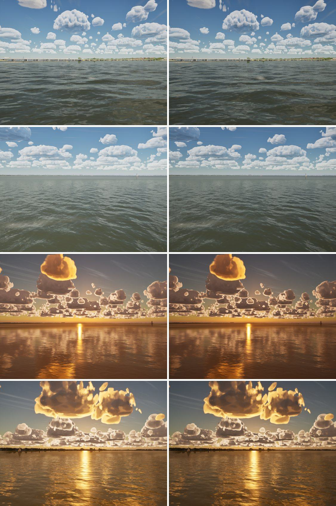

# Exposure choice: +0.5 EV in clear air, or none

For Bean to choose from pictures; nothing here changes the game.

Clear air carries a +0.5 EV lift (`ASailingEnvironment`, `AutoExposureBias = 0.5 x (1 - CloudDarkness)`), calibrated
in phase 8 against the reference video. A still camera's meter has no such lift. At bias 0 the clear sky's display
brightness matches the G5 photos (horizon sky 0.47 against 0.48 in linear light), and a bright sky sits lower on the
filmic tone curve's shoulder, which washes it less. Two checks found the same thing:
- the near-horizon sky (`docs/cumulus-rims/`): the atmosphere is as blue as the photos at 3–5 deg before the tone
  curve;
- the dusk glow toward the sun (`docs/realism-audit-1023/`, item 3): clear sky near the sun is within the photo's
  colour, but brighter.

Left: as now (+0.5 EV). Right: bias 0. From the top:
- the I-30 bridge (clear, 13:00);
- the open lake (clear, 13:00);
- the lake sunset (sun 2.6 deg up);
- dusk on Galveston Bay toward the sun (4.1 deg up).

All are on High in the capture mode.

