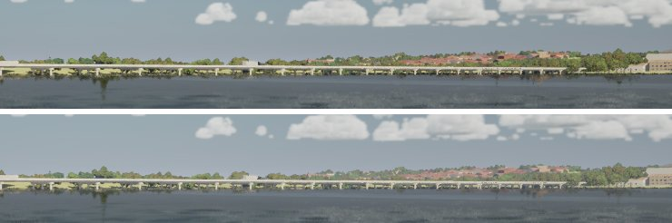
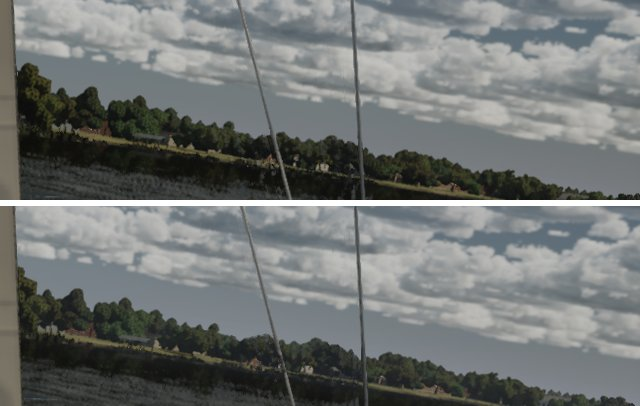
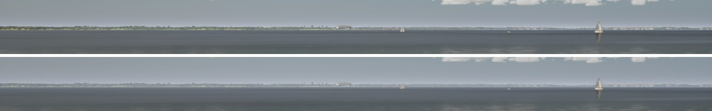

# Far-shore haze (Ultra audit item 8, Mac haze half)

The audit's "far shores are flat bands": every shore inside 3 km sat under the same thin veil, then the haze began at
full strength past 3 km. Two causes, both in how the engine's two fogs split the view.

1. **The near haze was five to eleven times too thin.** Inside its distance the volumetric fog replaces the analytic
   fog. The analytic fog integrates density / 1000 per cm in base 2 (`HeightFogCommon.ush`), so its extinction is
   100 ln 2 x density per km; the volumetric fog takes half the density in base e times its extinction scale
   (`VolumetricFog.usf`, `MatchHeightFogFactor`), 50 x scale x density per km. The scale was 0.12 to 0.3 by eye, so a
   25 km day showed a shore 3 km off at 94% of its contrast against Koschmieder's 63%. The scale is now 2 ln 2
   (`FHaze::VolumetricExtinctionScale`): the same extinction as the analytic fog, no step at the hand-off.
2. **The near haze had no skylight.** With Lumen, the volumetric fog's skylight comes from Lumen's translucency volume,
   which ends 80 m out (`r.Lumen.TranslucencyVolume.EndDistanceFromCamera`). From there to 3 km the fog had only the
   sun's lobe, darker than the sky-lit analytic fog: at the corrected extinction it laid a grey veil over the low sky
   (the horizon 15% darker in the bridge view). The volumetric fog now stops at Lumen's volume; the analytic fog takes
   the haze from 80 m. The shafts it was for are the boat's and sails' shadows, which are close.

Measured in linear luminance across the bridge view (rows down through the horizon and the shore behind the I-30
causeway), the change lands on the analytic fog alone (`r.VolumetricFog 0`) within 1 to 2%: the horizon goes
0.35 to 0.38, the far shore 0.29 to 0.34, the near causeway barely moves. Far shores now fade toward the horizon with
distance, and nearer ones stand out against them.

`-SailingClassicVolumetricHaze` restores the old scale and distance. Test: `SailingSim.World.Haze` (both fogs meet at
3 km, and a shore 1 and 3 km off keeps Koschmieder's contrast within 10% for 4 to 60 km).

Not done here: the houses' boxes (world kit), and the far shore's height variation (PC, world LOD). The lake's shores
are low and close, so the layering is gentle; it shows more on Marseille's ridges.

Stills (High, uncooked, before above, after below): the I-30 causeway, the helm eye looking west, the open lake.

