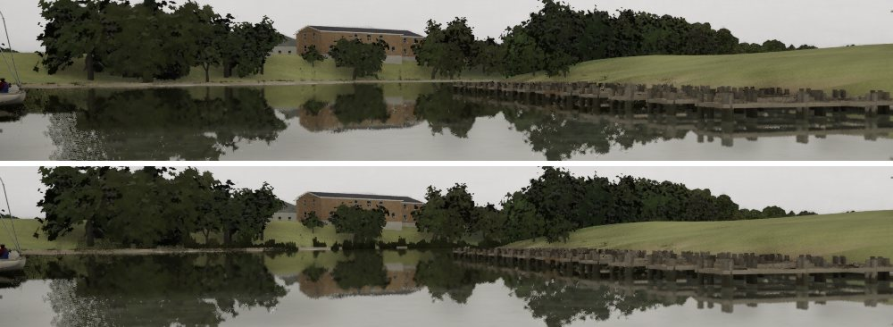
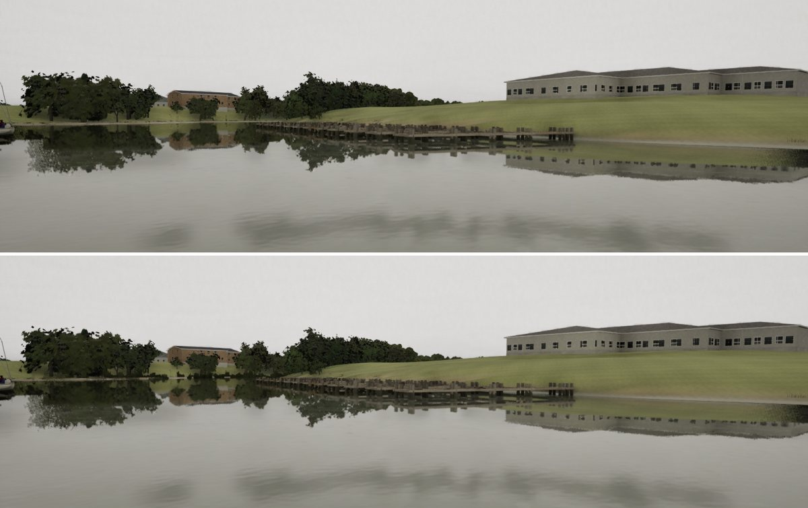
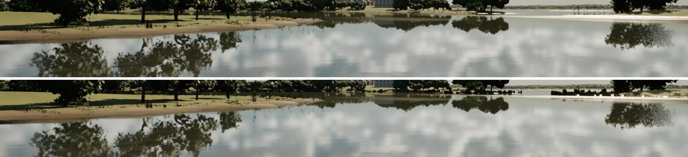

# Far shore relief (realism audit 1023, item 8, second pass)

#283's tint measured as nearly invisible on the far bank in g5-shore: a 1 m band is a few pixels out there. This pass
gives the margin relief, not colour.

## Change

- **`SM_Reeds_4`** (`Tools/blender/build_reeds.py` `far_margin`, 344 triangles): three crossed cards 4.5 m long with
  jagged tops (each peak its own height, 0.25 to 1.25 m), and two crossed pairs of taller shrub cards (1.2 to 1.8 m,
  buttonbush and water willow). One slot, `FarWeed`.
- **`M_FarWeed`** (`make_materials.py` `build_far_weed`): two-sided, matte (0.92), shaded at the foot and olive to straw at
  the tips in 3 m clumps. It dithers in from 120 to 170 m from the camera and is cut into clumps a metre or two long,
  with gaps between (about 30%).
- **Placement** (`LakeTerrainActor::PlaceReeds`):
  - a strip at about two waterline nodes in three on the lake's 5 m grid, and one in four, in patches, on the coasts'
    10 m grid, turned along the bank;
  - each strip slides down (or up) the slope to the waterline, because on a steep bank the 5 m grid has no node near the
    water itself;
  - drawn to 1.1 km, unshadowed, out of distance fields and ray tracing, on High and Ultra only;
  - counts per world: RayHubbard 77,968, Galveston 144,050, Gulf 10,016, TexasCoast 43,080;
  - `-SailingNoFarWeed` turns them off (the "before" stills).

The brief asked for the strips from 250 m out. A debug pass coloured the strips by distance, and the banks in g5-shore
turned out to be 150 to 250 m off, inside the near plants' band. The near bank grass is a pixel or two tall at that range
and left the line clean. So the strips come in at 120 to 170 m instead, where they no longer read as cards; nearer, the
real plants stand alone.

## Mac gate on #285

The first version put two strips per node on the coasts' 10 m grid: 901,942 over Galveston's marshes for a few
pixels. It read near-black at the foot and almost continuous, like a low hedge. This version:

- thins the strips as above;
- lights the foot a little (0.05, 0.064, 0.028 where it had been 0.035, 0.048, 0.018);
- breaks each run into clumps with gaps, so the water and the bank show between them.

## Cost

GPU total (1920x1080, the sum of the bench's GPU slices), before (`-SailingNoFarWeed`) and after:

| View | Tier | Before | After |
| --- | --- | --- | --- |
| g5-shore | Medium | 11.54 ms | 11.35 ms (not drawn on Medium) |
| g5-shore | High | 14.21 ms | 14.24 ms |
| g5-shore | Ultra | 19.40 ms | 18.63 ms |
| cove | Medium | 11.43 ms | 10.85 ms |
| cove | High | 13.60 ms | 13.66 ms |
| cove | Ultra | 17.31 ms | 17.01 ms |

The differences are within run-to-run noise.

## Stills (High, uncooked; before above, after below)

The g5-shore far bank, enlarged: the pale lawn-meets-water line is broken by clumps of weed with gaps between them.

Left as it was: the steep mown bank under the building in g5-shore is within 120 m of the camera. There, the near bank
grass's limits decide (a 0.6 slope); the strips don't reach it.
