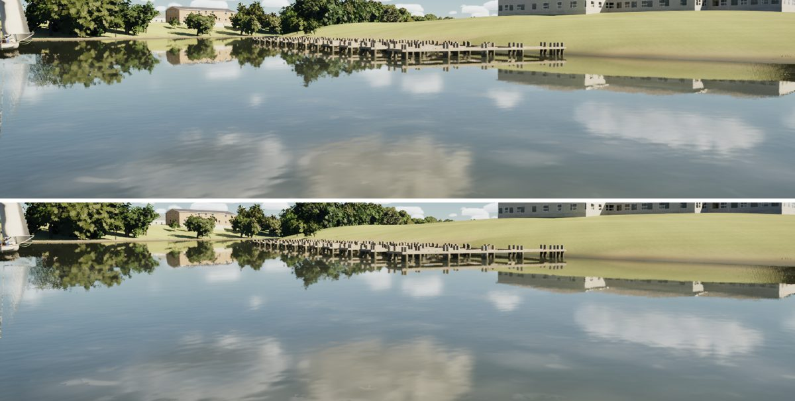
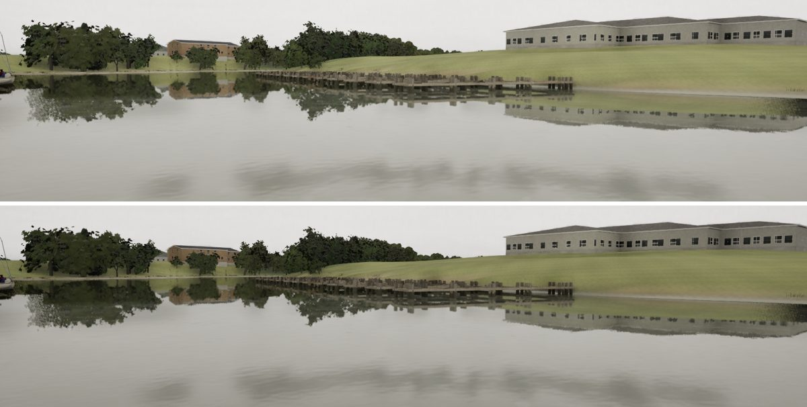
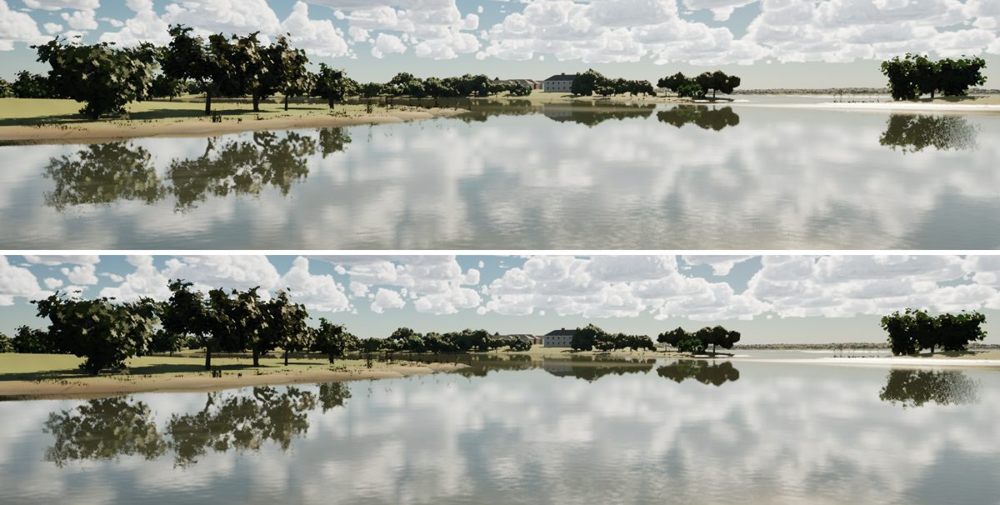

# Far shore (realism audit 1023, item 8)

#266 added bank grass and weed along the shore, but its instances stop drawing at 250 m. Past that, a grassy bank met
the water as a clean lawn.

## Change (`scripts/make_materials.py`, `build_terrain`)

This is a tint in `M_Terrain`, with no new geometry. On the shore cells (the vertex alpha CA, open water within 14 m),
the band from the waterline to about 1 m up (ragged) is painted as the rank grass, sedge and dead stems the near
plants stand for:

- darker and more olive than mown grass, in clumps a few metres across;
- matte (roughness 0.95);
- in long patches, so some stretches of bank stay bare;
- faded in from 180 to 260 m from the camera, across the plants' cull, so it never doubles up with the real plants up
  close.

Pale sand, limestone and riprap are left alone (a luminance test on the vertex colour).

A first version keyed on green vertex colours did nothing: the shore cells carry the mud and clay bank colour, not the
lawn's. A debug pass that painted the band's mask showed this, so the test is now on luminance.

The barge's paint is no longer metallic: `MI_World_Barge` metallic 0.3 → 0, the same fix as the ship's
(docs/ship-backlit).

## Cost

GPU total in the shore view (1920x1080, the sum of the bench's GPU slices):

| Tier | Before | After |
| --- | --- | --- |
| Medium | 12.04 ms | 11.72 ms |
| High | 14.40 ms | 14.16 ms |
| Ultra | 18.58 ms | 18.93 ms |

The differences are within run-to-run noise. The change is a few ALU instructions in the terrain's pixel shader.

## Stills (High, uncooked; before above, after below)

