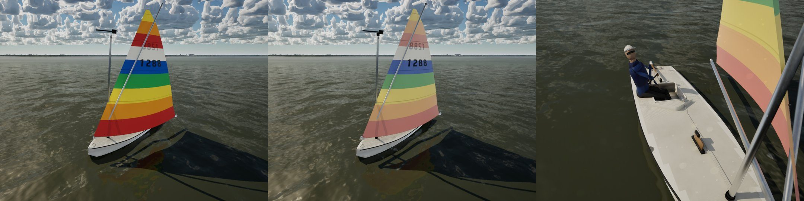
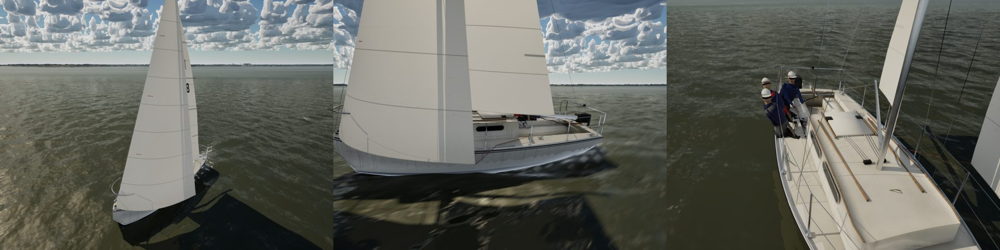
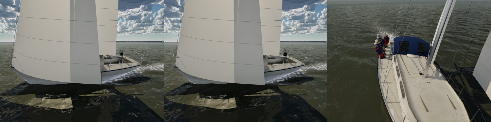
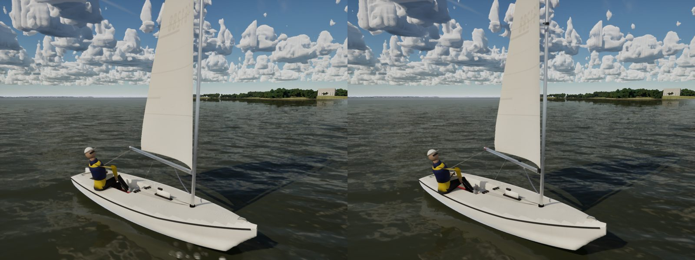
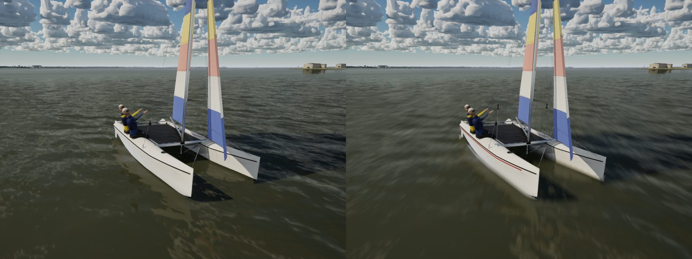
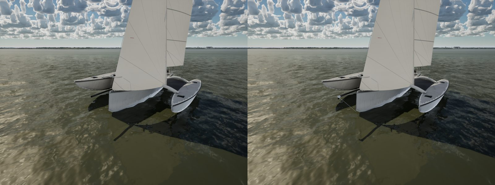
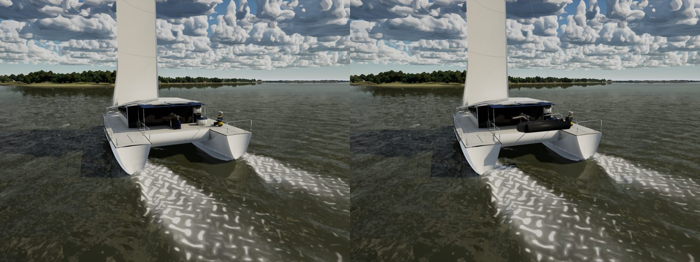

# Fleet hero pass

The fleet's boats, one at a time in career order (Sunfish, Catalina 22, Catalina 30, ILCA, Hobie 16, Corsair 880,
Lagoon 42), each brought up to hero detail in its own generator (`Tools/blender/build_fleet.py`, still exactly the
physics hull below the waterline: `SailingSim.Visual.FleetMesh`), rebuilt with
`scripts\windows\make-boat-models.ps1 -Parts fleet -Fleet <Tag>`.

## Sunfish

Its signatures: the lateen rig, the cockpit well and the dinghy-park sun fade.

- **Rig:** the masthead is the class's black halyard cap with its sheave and the halyard down the forward face (the
  generic wind indicator is gone); the yard ends at the sail's head with black end caps, carries its halyard eye a
  third of the way up, and meets the boom at a through-bolted stainless gooseneck jaw.
- **Well:** a moulded lip round its edge (the deck's gelcoat, rounded corners) and the hiking strap's webbing ends on
  the sole, beside the existing bailer, drain, splash guard and board.
- **Sun fade:** the catalogue's `sail_panel_fade` zones (kind `fade`) now reach the game: `make_liveries.py` writes
  `FLiveryWear::FadeRange` per profile, `SampleBoatLivery` draws `FBoatLivery::SailFade` from its own random stream (the
  sail numbers drawn after it are unchanged), and the pawn hands it to `M_SailCloth`'s new `Fade`. Dyed panels fade
  toward a chalky pastel, reds first and blues least, the head and leech (rolled outermost on the spars in a dinghy
  park) most; white cloth keeps the Dacron ageing it had. The Sunfish's club boats fade 0.4-0.8 (the player's 0.6).

## Catalina 22

- **Cabin trunk:** the class's two smoked windows a side with rounded ends in aluminium frames, in place of the generic
  window band; a teak eyebrow along both edges of the trunk top.
- **Companionway:** three teak drop boards, their edges proud, in place of the black stand-in.
- `import_boats.py fleet` imports only the seven fleet boats (it had re-imported the maxi whenever her FBX was in
  `Artifacts\models`).

## Catalina 30

- **Cabin trunk:** three smoked windows a side with rounded ends in aluminium frames (the shared Catalina hero cabin),
  the teak eyebrow and the companionway's teak drop boards; the wheel, binnacle, dodger and stern ladder stay.

## ILCA

- **Mast:** the two-piece spar, its collar over the joint 2.85 m up, the black gooseneck fitting the boom pins to, the
  rotating mast's step ring and the cunningham hook.
- **Boom:** the outhaul cleat and fairlead, the clew's tie-down strap round the boom end and the vang key.

## Hobie 16

- **Platform:** the cast aluminium beam ends at each hull, the righting line's bag on the front beam, the trapeze shock
  cords' deck eyes beside the tramp, and each hull's coloured stripe along the sheer.
- **Trapeze:** the wires from the hounds to their rings and handles at a crew member's reach, the shock cord down to the
  deck eye (baked on the mast mesh, which they hang from).

## Corsair 880

- **Bow:** the bowsprit's end fitting with the gennaker's tack block and its bobstay down to the stem.
- **Cabin top:** the self-tacking jib's track across the trunk, with its car, where the jib leads.

## Lagoon 42

- **Stern:** the charter cat's davits off the aft beam with the tender hung between them (a grey RIB, its outboard
  tilted up), and a swim ladder folded on each hull's sugar-scoop step.

