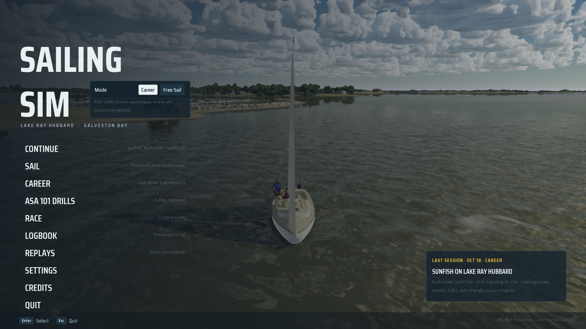
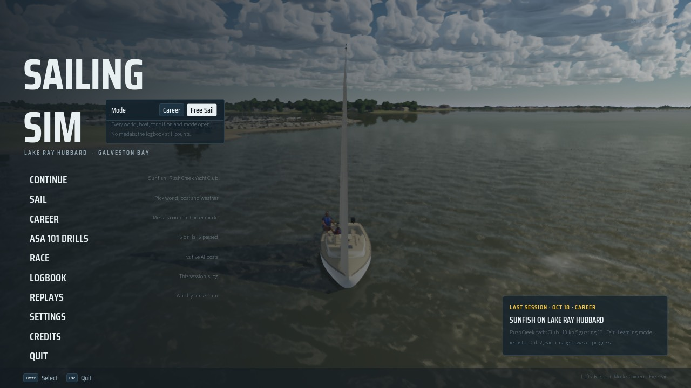
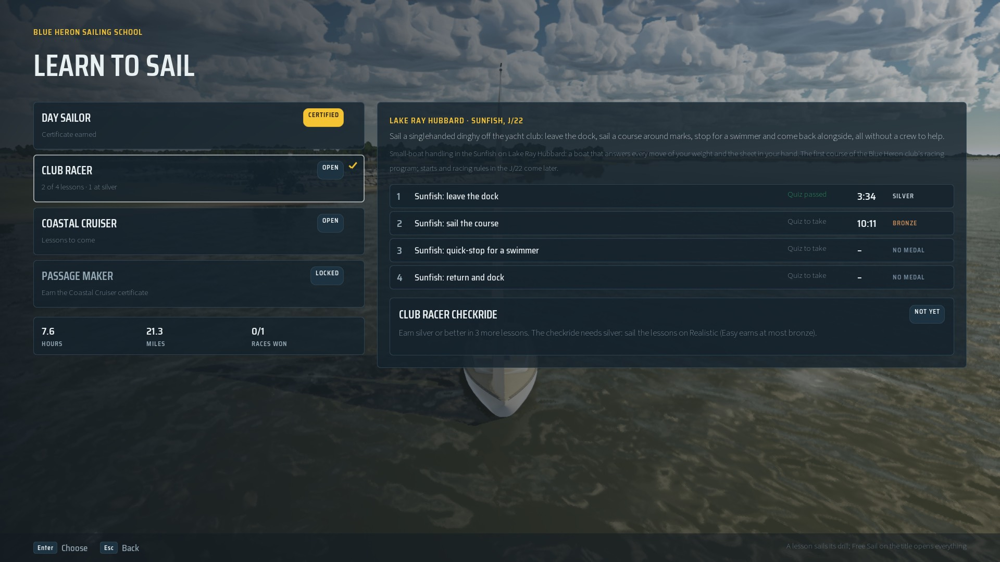
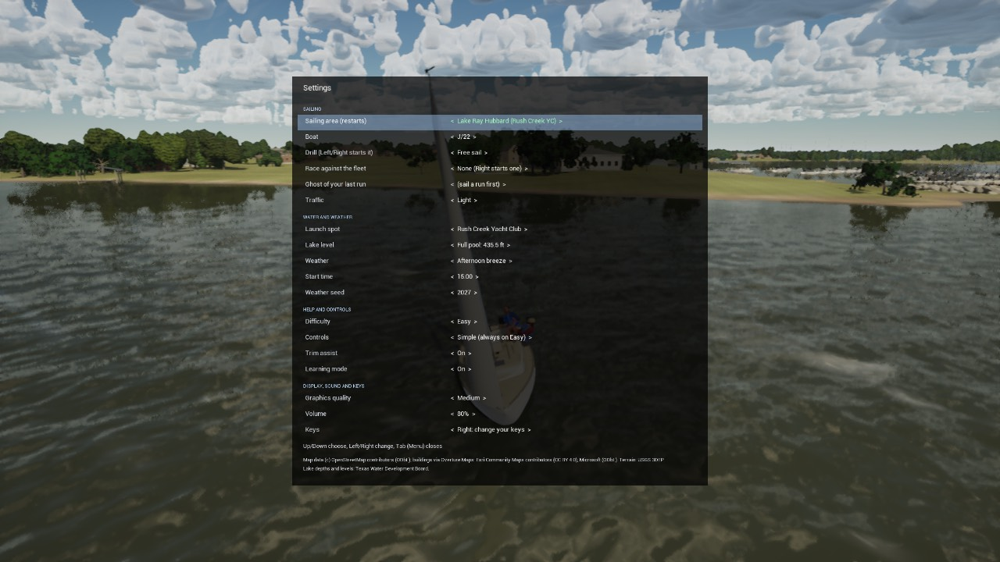

# Free Sail and the Sunfish

Bean's roadmap answers (Oct 18 2026): the title screen offers two modes, and the Sunfish is the Club Racer dinghy.

## Two modes

| | Career | Free Sail |
| --- | --- | --- |
| Worlds, spots, boats, conditions, modes | open as certificates are earned (`career.json`) | every one open from the start |
| Lessons, medals, quizzes, checkrides, certificates | graded and kept | sailed, but nothing is recorded |
| Logbook (hours, sessions, entries, miles), races sailed and won | counted | counted |

The **Mode** switch sits beside the logo on the title screen (Left / Right; it starts focused on Continue, Up reaches it).
The line under it says what the mode does, and the Career item reads "Medals count in Career mode" in Free Sail. Continue
keeps its own session's mode (the Last session card names it). Settings > Gameplay has the same switch under **Mode**.




The Career screen in Free Sail shows every tier open and says the checkride waits for Career mode; a drill finished in
Free Sail says "Free Sail: no medal" on its quiz page.




### Where it lives

- The rule is in the sim layer: `FCareerProgress(Content, Progress, bFreeSail)` opens every tier, world and boat and
  makes `RecordRun`, `RecordLessonQuiz` and `RecordCheckrideQuiz` record nothing; `AddSession` and `RecordRace` still count.
  `SailCareer::Progress()` builds it with `SailCareer::IsFreeSail()` (= `USailingSettings::IsFreeSail()`).
- The mode is `USailingSettings::bFreeSail` (the title's choice), carried over the map reload by `FSailSessionConfig::bFreeSail`
  (`ApplyToSettings`, `MakeDefault`) and kept for Continue in the last session.
- `-SailingFreeSail=0|1` overrides it for stills and scripts (`USailingSettings::FreeSailArg`, re-read when a bench list
  swaps the command line).
- Test: `SailingSim.Career.FreeSail` (everything open, no medal, quiz or certificate, the logbook counts, the save and the
  session carry it).

### What happened to "Open everything"

Career 1's Settings > Gameplay > **Open everything** (`bOpenEverything`, saved as `settings.career.openEverything`) is gone:
Free Sail replaces it. The difference: Open everything still let lessons, medals and certificates count; Free Sail does
not (Bean's rule: Free Sail runs earn no medals or unlocks). The save stays version 1 (`docs/save/README.md`):

- written: `settings.career.freeSail` and `lastSession.freeSail`; `openEverything` is dropped from the file on write;
- read: `freeSail` when present, else the old `openEverything` (a player who had everything open lands in Free Sail and
  can switch back to Career on the title screen; their progress is untouched).

## The Sunfish in Club Racer

`Content/Career/career.json`: Club Racer is now `ready`, boats `["Sunfish", "J22"]` (the Career screen sails a lesson in
the tier's first boat), four lessons and a checkride:

| Lesson | Drill | Silver | Gold |
| --- | --- | --- | --- |
| `club-racer.sunfish-leave-the-dock` | LeaveTheDock | clean, 5:00 | clean, 3:00, no collisions |
| `club-racer.sunfish-course` | SailATriangle | 9:00, no collisions | 6:00 |
| `club-racer.sunfish-quick-stop` | CrewOverboardQuickStop | proper, 3:00 | proper, 1:30 |
| `club-racer.sunfish-return-and-dock` | ReturnAndDock | gentle, 6:00 | gentle, 4:00, contact under 0.5 kn |

Checkride: all four at silver, then a 10-question written quiz (80%) over those drills. The Club Racer certificate
opens the **ILCA 7** (the step up from the Sunfish). The Sunfish itself opens with Club Racer, that is with the Day Sailor
certificate.

The times are first guesses checked against the scripted helmsmen: `SailingSim.Drills.SunfishLessons` sails the course
in 5:00 (gold under 6:00) and the quick-stop in 0:55 (gold under 1:30) in 10 kn. A Sunfish run counts for these lessons
and a J/22 run of the same drill still counts for Day Sailor's (Day Sailor's boats are the J/22 only;
`SailingSim.Career.Unlocks`). The lesson text uses the game's invented school (Blue Heron) and no outside course names.

Not yet: Club Racer's J/22 racing lessons (starts, mark roundings, the rules) need race drills first; the heave-to and the
figure-eight are left out of the dinghy's lessons (a Sunfish has no jib to back).

## Also in this change

- The in-game canvas Settings menu (Tab) keeps a 20 px margin under its last credit line, like its sides (at 1280x720 the
  Texas Water Development Board line sat on the panel's edge):

  

- The title's Last session card and the Career screen's certificate date printed `%b` as a letter ("B 18"): they now say
  "Oct 18".

## Stills

`Saved/SaveGames/free-sail-still.json` is a copy of `docs/free-sail/still-save.json` (Day Sailor certified, two Sunfish
lessons sailed). `-ForceRes` keeps a 1920x1080 window on this Mac's display:

```bash
RESX=1920 RESY=1080 scripts/run-game.sh 6 -ForceRes -SailingFrontEnd=Title -SailingSave=SaveGames/free-sail-still.json -SailingShot=title-career-1080
```

```bash
RESX=1280 RESY=720 scripts/run-game.sh 6 -ForceRes -SailingFrontEnd=Title -SailingFreeSail=1 -SailingSave=SaveGames/free-sail-still.json -SailingShot=title-freesail-720
```

```bash
RESX=1920 RESY=1080 scripts/run-game.sh 6 -ForceRes -SailingFrontEnd=Career -SailingSave=SaveGames/free-sail-still.json -SailingShot=career-club-racer
```

```bash
RESX=1280 RESY=720 scripts/run-game.sh 6 -ForceRes -SailingMenu -SailingShot=menu-720
```
