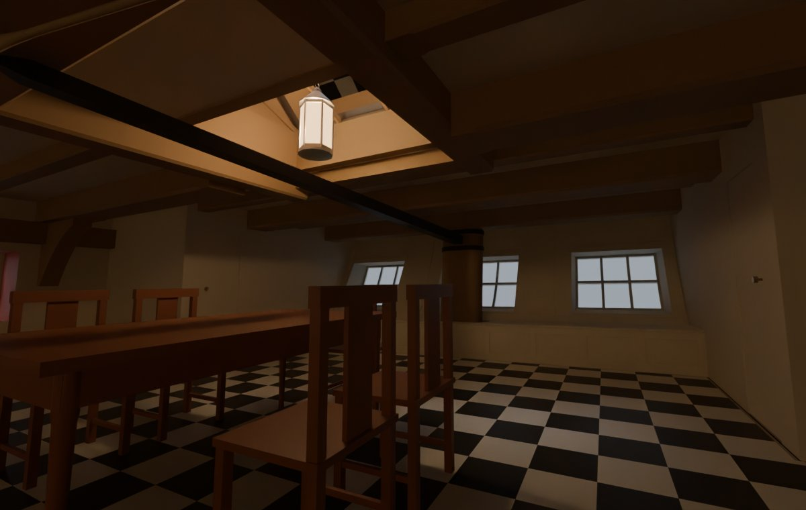
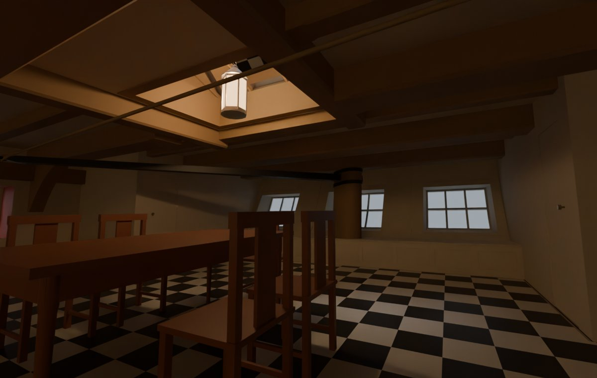
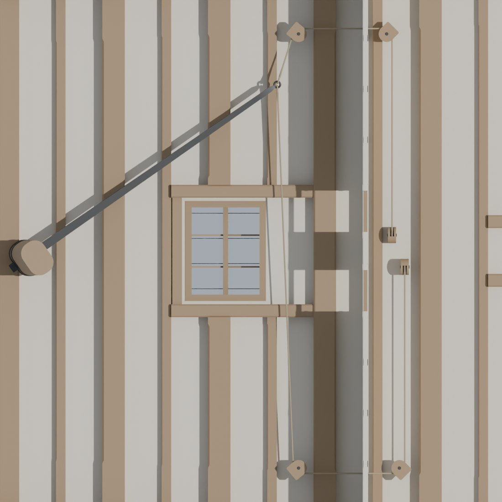
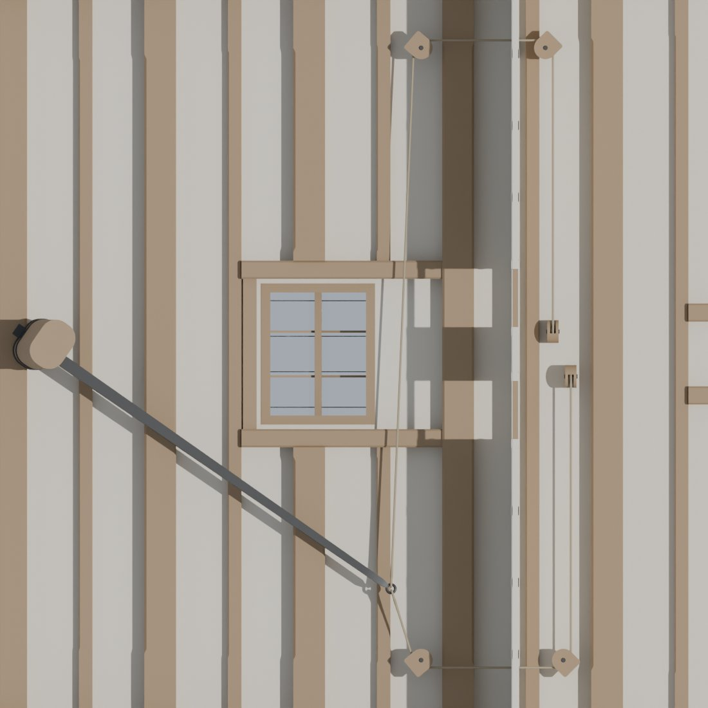
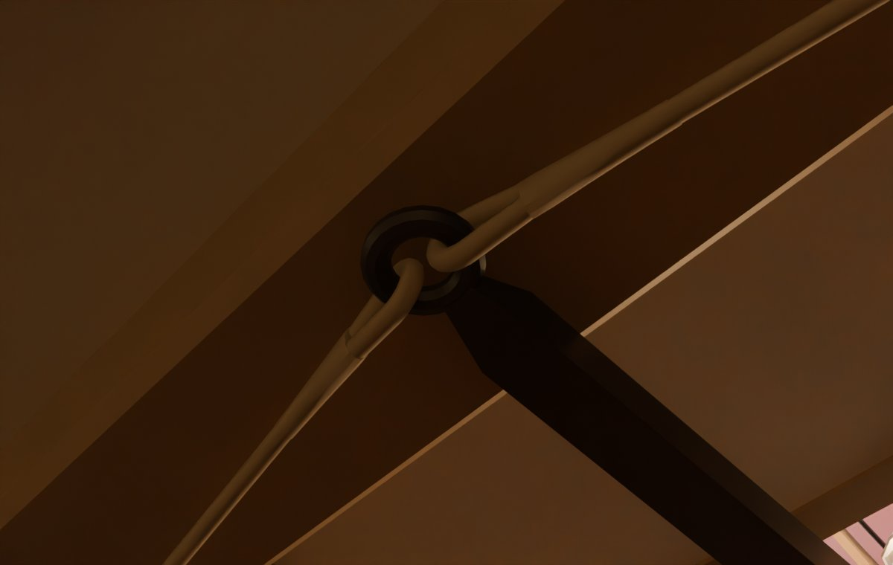
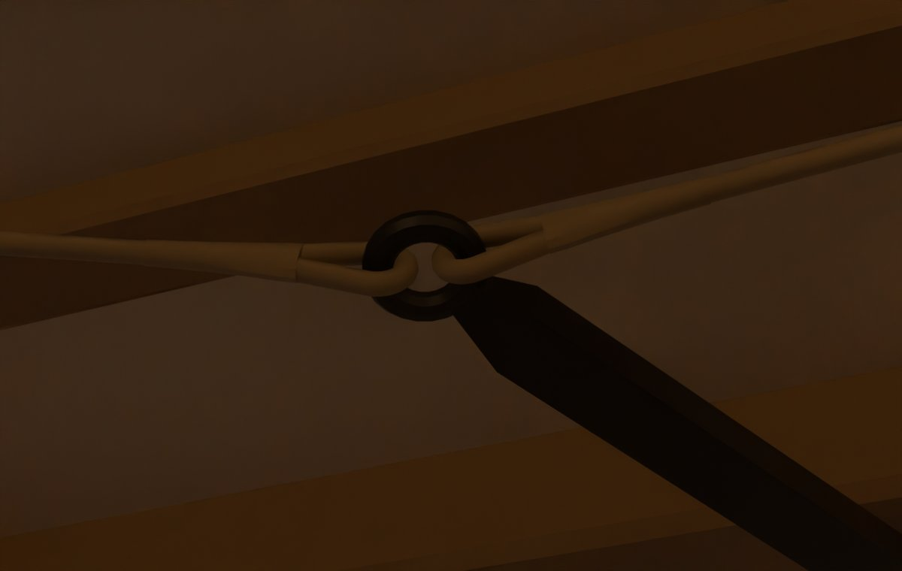
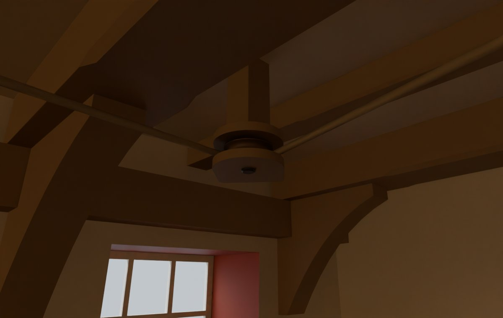

# The frigate's tiller: overhead in the great cabin

The frigate *Commonwealth* (plan: <https://claude.ai/artifact/8y6hW8vHjjUPJRovJEuxY7>) is steered from the
quarterdeck by her double wheel. Until now nothing turned her rudder: slice 13 found that her counter closes round the
rudder's head only at the gun deck's height, so the iron tiller cannot sit on the berth deck as it did in Constitution.
Bean chose (Nov 18) to hang it where the British frigates had theirs, under the quarterdeck's beams in the great cabin.
This page adds the rudder's head up through the window seat, the iron tiller overhead, and the tiller ropes from the
wheel round their sheaves to the tiller's end, with the parts that move with the helm each on a frame of its own and
posed for every degree of the helm in the game data. Nothing here is in the game yet: the frigate's export to Unreal
carries it over, and her wiring in the game turns it from the data below.

Every render on this page is flipped left to right, so it shows her as the game will (docs/shipkit-9 says why).

















The renders are lit by daylight through the stern windows and the skylight and by the cabin's lantern; the darker
views are brightened.

## What it builds

### The rudder's head

The rudder's main piece is carried on up from the blade's top as the head, squared 16 in fore and aft by 22 in
athwartships with its corners rounded to 7 in, along the line the rudder turns about: through its pintles, just abaft
the sternpost's aft face, which leans 7 degrees aft of upright there (`skin.py` `rudder_axis`). It goes an inch down into
the blade's top at that line, more aft since its foot is square to the raked line (one timber with the blade: the game
turns the head with the tiller, never the blade, whose lower pintles stand off the line where the drawn post bends). It
comes up through the window seat's fixed middle in front of the middle stern window, the seat cut round all it sweeps
1 in clear and its front 2 in before the sweep, to an inch under the quarterdeck's beams at every angle of the helm, its
top cut parallel to the tiller. An iron hoop goes round it either side of the tiller's mortise.

### The tiller

Iron (the 1812 description of Constitution's), forged square: 5 by 4 1/2 in at the head tapering to 3 by 2 3/4 in at
the end, through the head's mortise and keyed abaft it, then forward under the beams an inch clear of each at every
angle, 15 ft 1 in from the head's axis to the middle of its end ring (a 44's tiller was about 15 to 18 ft). Its end
necks down into a ring 5 in across of 1 1/4 in round bar, which the ropes are spliced round. The head, its hoops and
the tiller are one object, `Tiller`, on a frame of its own whose z is the head's axis: a positive turn about it takes
the tiller to starboard and her head to port, as the wheel's positive turn does, 35 degrees each way.

It hangs low, as it did: its underside is 4 ft 10 in (1.47 m) above the cabin's deck at the head and 5 ft 6 in
(1.67 m) at its end, so a tall man stoops under it aft.

### The tiller ropes

One 3 in rope, wound seven turns round the wheel's barrel, comes down from it as two legs through iron plates in the
quarterdeck (the starboard leg abaft the port one, both in the bay just forward of the cabin's bulkhead). Each leg:

* comes down through the planks between the cheeks of its **leading sheave**, a chock bolted up under the deck that
  turns it out athwartships under the beams;
* 3.5 m out from the middle line, a **side sheave** turns it aft, along under the beams and through a **lead bush** in
  the cabin's bulkhead;
* an **after sheave** abaft the tiller's end turns it in to the end ring, where it is **spliced round the ring's bar**,
  its eye bearing on the bar.

The sheaves are 7 in lignum vitae, 1 1/2 in thick, on 1 in iron pins between oak cheeks; the level ones (side and
after) hang under the planks on oak stools let into them, and the leading ones' cheeks run up into the planks. Each
sheave is scored for the rope with a round bottom a twentieth of an inch clear of it and sides flaring 20 degrees out to
the rim. Hauling in the starboard rope takes the tiller to starboard.

The rudder's axis leans aft, so the tiller's end drops 3.9 in hard over. The runs lie 2 in under the end ring at rest,
so the ropes leave their after sheaves within 3.6 degrees of level at every angle, which the grooves' flare takes. The
after sheaves stand abaft the tiller's end where the two ropes from them to it never ask for more rope than amidships:
hard over, the easing rope is 3.7 in slack at most. From amidships to hard over is 2.5 turns of the wheel each way (5.0
lock to lock).

### What moves with the helm

As the helm goes over, each rope's eye slides round the ring to face its sheave, its run from the sheave to the splice
swings and shortens or lengthens, and the point where it leaves the sheave moves round it. So the ropes are in parts:

| Object | What it is | How it moves |
| --- | --- | --- |
| `TillerRopeLeads` | both ropes from the deck to a degree short of where the runs leave the after sheaves | still |
| `TillerSheaves` | the six sheaves in their chocks, and the bulkhead's lead bushes | still |
| `TillerEye_S`, `TillerEye_P` | each eye round the ring's bar and its splice | set on its frame every degree |
| `TillerRun_S`, `TillerRun_P` | each run from its after sheave to its splice | set on its frame every degree, stretched along its own x |
| `TillerWrap_S`, `TillerWrap_P` | the rope round each after sheave from inside the lead's end to where the run leaves | turned about the sheave's pin every degree |

Each eye stays on the ring at every degree; the eyes never come within 58 degrees of the ring's neck, and keep at
least 160 degrees apart round it.

## Around it

* The wheel's two legs (`deck_1797.json` `wheel` `legs_x_m`) now stand in the bay between the gun deck's overhead
  ledge and beam just forward of the cabin's bulkhead, the turns on the barrel laid to that span; the legs end a hair
  into the quarterdeck, where the gun deck's leading sheaves take them on.
* The legs no longer go down through the gun deck, so the lead bushes there are gone, and a stanchion now stands on the
  middle line under the beam 1.0 m forward of the cabin's bulkhead (x -21.73 m), as under every whole beam clear of
  the fittings: the legs' holes kept it out before.
* The cabin's doors are 64 in high (they were 66), so they swing open clear under the tiller's end and its ropes:
  1.19 in at the closest, at every opening and every angle of the helm.
* The cabin's lantern hangs from a bar up in the skylight, 3/4 in under its ridge, 2.2 m abaft the bulkhead (it was
  1.5 m), so the tiller swings under it; its light in `gundeck.json` moved with it.
* The berth deck's card drops the sizes it kept for a tiller on that deck and its contact with the lead bushes that
  came down to it, and its wardroom lantern's bar keeps its own depth under the planks (`wardroom_bar_under_in`).

## Checks

```
python Tools/shipkit/frigate/build_frigate.py <out>
```

(Blender's Python, pip `bpy`; about an hour and over 11 GB of memory.) Besides every check before it, the build
fails if:

* the tiller and the six moving rope parts, turned together a degree at a time hard over each way, touch anything
  near their sweeps or each other, or come within half an inch of anything (`tiller_swing`, `build.json`
  `gundeck.tiller_swing`): the eyes on the ring, the runs and wraps in the sheaves' grooves are checked for a touch
  only, and a rope's parts are not checked against the rest of the same rope;
* on the way, a rope comes apart: each wrap from the fixed lead and from its run, or a run from its eye, by more than
  a twentieth of an inch at any degree (`tiller_swing` `joins_most_apart_in`);
* a cabin door, swung through its opening 5 degrees at a time, touches the tiller or its ropes at any whole degree of
  the helm or comes within half an inch of them (`door_helm`, `gundeck.door_helm`);
* at any angle of the helm the ropes would need more rope than amidships, or a rope would leave its after sheave
  before coming onto it, or round it the wrong way;
* a sheave's groove leaves less than a twentieth of an inch of rim, a stool or a leading sheave would come under a
  beam, or the wheel's legs stand out of order on the barrel or too close for its turns;
* any part of the tiller or its ropes meets anything else except by design (`gundeck_1797.json` `meets`), or deeper
  than allowed, or a designed contact no longer meets; or crosses itself.

The final build ran from scratch with every check and passed, in 60 minutes.

## Clearance

The designed contacts this change makes or moves, each measured in the final build (allowed: the depth when it was
set, plus a quarter inch, rounded up to 0.05 in):

| Parts | By design | Deepest (in) | Allowed (in) |
| --- | --- | --- | --- |
| Tiller / Rudder | the rudder's head stands on the blade's top, let down into it (tiller head_into_blade_in at the axis; its foot is square to the raked axis, so deeper aft; one timber: the game turns the head with the tiller, never the blade) | 2.85 | 3.1 |
| TillerEye_S / TillerRun_S | the starboard tiller rope's run ends half an inch inside its eye's splice (one rope) | 0.50 | 0.75 |
| TillerEye_P / TillerRun_P | the port tiller rope's run ends half an inch inside its eye's splice (one rope) | 0.06 | 0.75 |
| TillerRun_S / TillerWrap_S | the starboard run starts a fifth of an inch back round its after sheave, over the rope round it (one rope) | 0.20 | 0.45 |
| TillerRun_P / TillerWrap_P | the port run starts a fifth of an inch back round its after sheave, over the rope round it (one rope) | 0.20 | 0.45 |
| TillerRopeLeads / TillerWrap_S | the starboard rope round its after sheave runs on from the fixed lead, lying inside its end (one rope) | 0.14 | 0.4 |
| TillerRopeLeads / TillerWrap_P | the port rope round its after sheave runs on from the fixed lead, lying inside its end (one rope) | 0.14 | 0.4 |
| TillerRopeLeads / SparDeck | each tiller rope's leg starts half an inch inside the quarterdeck's planks, where the wheel's leg goes down into them (tiller_ropes leg_into_deck_in) | 0.51 | 0.8 |
| TillerSheaves / SparDeck | the level sheaves' stools and the leading sheaves' cheeks are let into the quarterdeck's planks | 0.17 | 0.45 |
| CabinBulkhead / TillerSheaves | the lead bushes' rims are let into the cabin's bulkhead's faces | 0.05 | 0.3 |
| AfterWall / WindowSeat | the window seat's top is let into the after wall | 0.25 | 0.5 |
| HornLanterns / Skylights | the cabin's lantern's screw eye is screwed up into its bar under the skylight's ridge | 0.75 | 1 |
| DeckBeams / Stanchions | each stanchion's head is under its beam | 0.08 | 0.35 |
| GunDeck / Stanchions | each stanchion's foot stands on the deck | 0.00 | 0.25 |
| SparDeck / TillerRope | the tiller rope's legs go down into the plates' holes, ending a hair into the deck (the gun deck's slice takes them on from its underside to the leading sheaves) | 0.11 | 0.4 |
| TillerRope / WheelStandards | the tiller rope's legs go down through the plates' holes (each drawn as a dark box the rope passes through) | 0.15 | 0.4 |

The two rope joins at the eyes are built alike, the run ending half an inch inside its eye's splice; the measure on the
port one stops at the splice's wall round the run, so both keep the starboard one's allowance. The spar deck's two
contacts with the rope's legs (`deck.py` `MEETS`) were set by the rule from this build's measurements: they were 0.35
and 0.5 in when it ran, and nothing else changed after it.

At every degree of the helm, the swing's least gap to anything near it is 0.625 in (the port eye to a beam over it,
amidships), a rope's parts come at most 0.042 in apart, and the doors keep 1.19 in clear (the port door wide open with
the tiller 11 degrees to port, from the port eye).

## Triangles

The tiller and its ropes come to 13,920 triangles. With the window seat cut round the head's sweep (+1,656), the
stanchion under the beam forward of the bulkhead (+256), the bulkhead bored for the ropes (+272) and the gun deck's lead
bushes gone (-512), with a few small changes elsewhere, the gun deck's parts loaded below come to 673,581 triangles, 56% of its 1.2M (slice 14: 658,097),
and the whole model to 5,587,186, 15,500 more than slice 14's.

| Part | Triangles |
| --- | --- |
| TillerSheaves (the six sheaves in their chocks, the lead bushes) | 8,568 |
| Tiller (the rudder's head, its hoops and the tiller) | 1,568 |
| TillerRopeLeads | 1,440 |
| TillerEye_S, TillerEye_P | 836 each |
| TillerWrap_S, TillerWrap_P | 288 each |
| TillerRun_S, TillerRun_P | 48 each |

## For the game

`gundeck.json` carries it:

* **`frames`**: `Tiller` (origin on the head's axis in the tiller's middle plane, z up the axis, x forward square to
  it) and the six moving rope parts, each as built with the helm amidships.
* **`tiller`**: the turn (`turns`), `hard_over_deg` 35, the length and the end ring's place.
* **`tiller_ropes`**: `poses`, one row for each whole degree from 35 to port to 35 to starboard, giving each moving
  part's frame for that degree (`o`, the origin, and `R`, its axes as columns; the runs also `scale_x`); `moves` says
  how to set them; `slack_in` and `wheel_turns` by degree, `wheel_turns_lock_to_lock`.

To show the helm at an angle: turn `Tiller` about its frame's z by the angle, and set the six rope parts from that
degree's row (between whole degrees, the nearer row or a blend of two). The rope's legs and the sheaves stay. The wheel
already turns on its own frame (`deck.json`); 2.5 turns of it take the helm hard over.

## Sources and estimates

* **The USS Constitution Museum's description of the ship in 1812**: an iron tiller, worked by tiller ropes from a
  double wheel. Constitution's was on the berth deck; this ship's counter does not reach that deck, so hers is
  overhead in the great cabin, as in the period's British frigates (Bean's choice).
* **Estimates** (period practice): the head's and tiller's sizes, the rope (3 in, as the wheel's), the sheaves (blocks
  for a 3 in rope were about 10 to 12 in long), the leads' places, the eyes, the doors' new height.

## Review

The tiller and its ropes were measured part by part with probes written for them, on the first build that passed
every check and again on the final one: each piece of the new parts closed and facing out; each moving part's frame in
`gundeck.json` against the part as built; and at every degree from 35 to port to 35 to starboard, each eye against the
ring's bar, each rope's joins, and each run and wrap against its sheave. No separate reviewer read this change. What
was found on the way, each fixed before the final build:

| Found | Fixed |
| --- | --- |
| The helm check skipped a rope's joined parts, so it would never see a run come away from its eye or its wrap | each join must keep meeting at every degree, within a twentieth of an inch (`joins_most_apart_in`) |
| A run leaving its after sheave a few degrees out of the sheave's plane touched the groove's lips | the grooves' sides flare 20 degrees out to the rim |
| An eye laid on the ring touched the bar's flat facets | each eye's bight stands 0.03 in off the bar (the facets' sag on a 24-sided ring), and the eyes are checked against the ring for a touch only |
| The port leading sheave's chock had its back built inside out: a shared helper turned a solid's faces by the way out from its outline's middle, which lies outside a concave outline | the helper turns them out by the solid's signed volume; no closed piece on the gun deck, berth deck, orlop or hold is inside out in the final build |
| The berth deck read the gun deck's lantern key that this change renamed, so the first full build stopped there | the berth deck reads its own key (`wardroom_bar_under_in`) |
| A deck part could not take the slab helper's material per face | `deck.py` `Part.add` takes one material per face |

In the final build every piece of the new parts is closed with its faces out, and every moving part's frame in
`gundeck.json` matches the part as built. At every degree each eye stays within 0.03 in of the ring's bar and never goes
into it, no run or wrap goes into its sheave, and each rope's parts stay within 0.042 in of each other. The final
build's numbers are the same as the first passing build's to the last digit.

## Known gaps

* **The rudder's blade doesn't turn with the helm in the game data**: the drawn sternpost bends below the counter, so
  the blade's pintles stand 3.1 to 4.7 in off the line the head turns about, and turning the blade about it would draw
  its lower straps off their gudgeons. The head and the tiller turn; the blade stays as built. Its top shows above the
  water from astern.
* **The easing rope's slack is not drawn**: its run stays straight (at most 3.7 in of slack, hard over).
* **The ropes don't render as running**: the rope's lay does not slide along the legs and leads as the wheel turns.
* **The berth deck's tiller room has no lodging knees yet** (its bays were kept for the tiller ropes' blocks): a knee
  at its first beam would reach forward past the wardroom's after bulkhead, so they wait for a later pass.
* **Estimates throughout** (Sources).

## Files

| File | What it does |
| --- | --- |
| `Tools/shipkit/frigate/gundeck.py` | the rudder's head and the tiller, the window seat and after wall cut round their sweep, the tiller ropes (leads, sheaves and chocks, bushes, eyes, runs and wraps) and their poses by degree; `swing_set` and `door_helm`, the helm's checks; `prism` faces a solid out by its signed volume |
| `Tools/shipkit/frigate/gundeck_1797.json` | `tiller` and `tiller_ropes`, the doors 64 in high, the cabin's lantern up in the skylight, the meets by design |
| `Tools/shipkit/frigate/skin.py` | `rudder_axis`: the line the head turns about |
| `Tools/shipkit/frigate/deck.py`, `deck_1797.json` | the wheel's legs where the card puts them (`legs_x_m`), ending a hair into the quarterdeck, and their contacts' allowances; a part takes a material per face |
| `Tools/shipkit/frigate/berthdeck.py`, `berthdeck_1797.json` | the berth deck's unbuilt tiller and its lead bush contact gone; its wardroom lantern's own bar depth; notes say where the tiller is |
| `Tools/shipkit/frigate/build_frigate.py` | the helm's parts and checks (`helm_bodies`, `tiller_swing`, `door_helm`), the cabin's objects, the game data's note |
| `docs/shipkit-12/README.md`, `docs/shipkit-13/README.md` | the great cabin's doors and the berth deck's tiller room, as they are now |
| `docs/frigate-tiller/baseline/` | `build.json`, `gundeck.json` and the renders |
