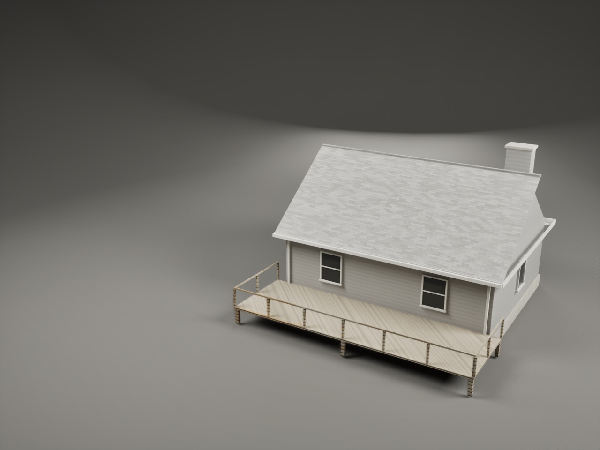
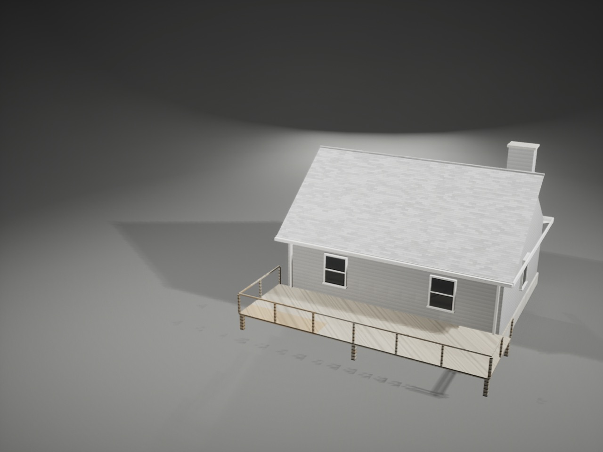
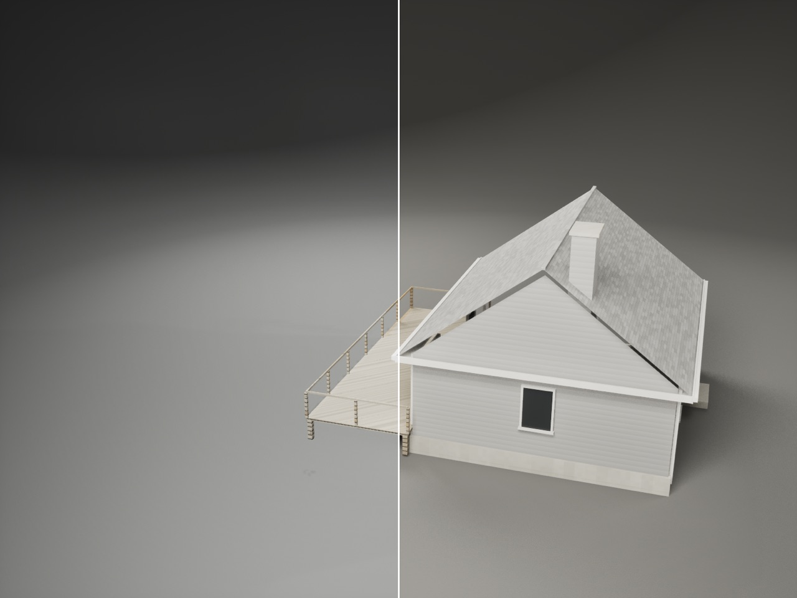
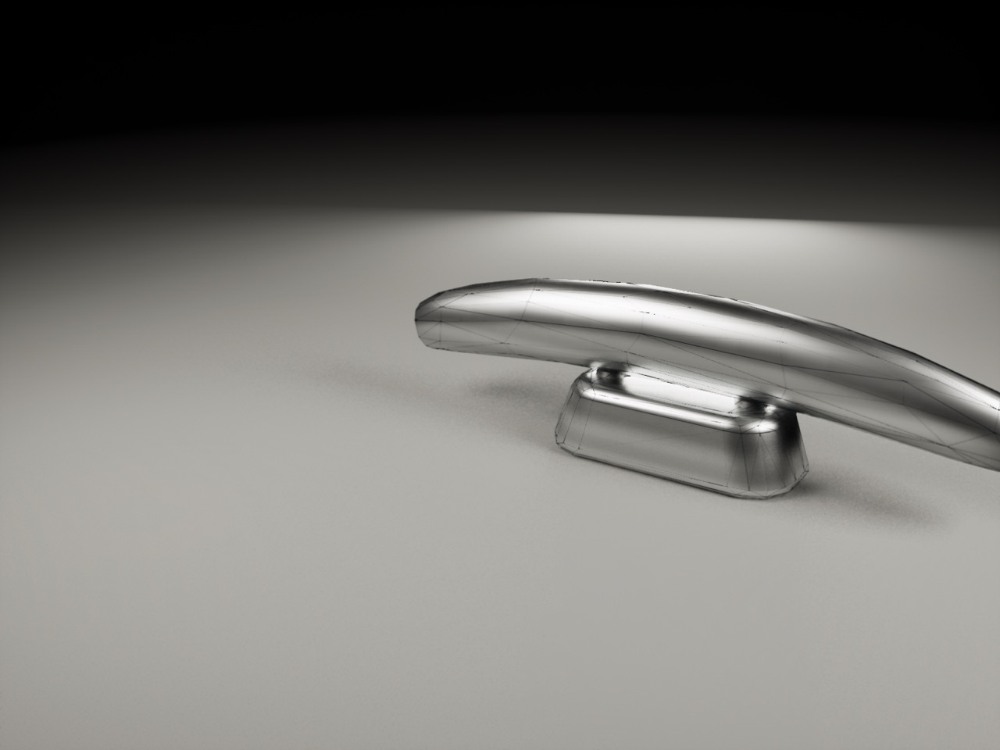
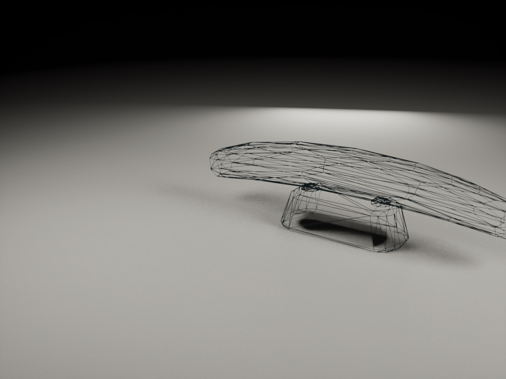
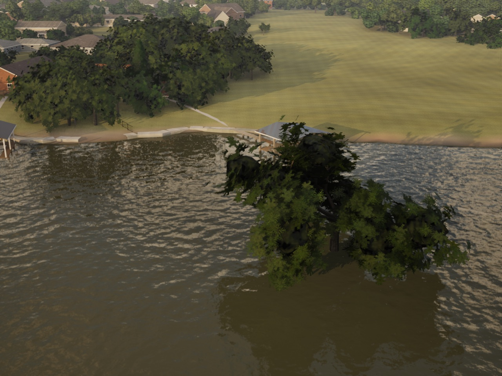
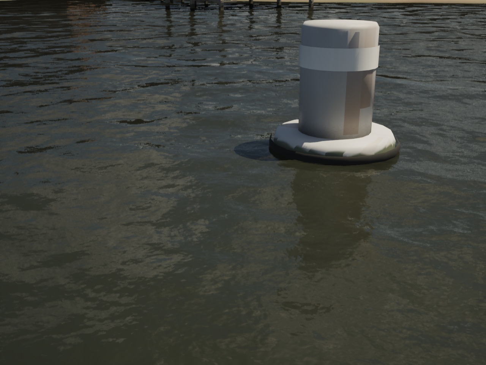

# Asset gallery G1: the Mac core (Oct 28 2026)

The brief is `Inputs/gallery/brief.md` (inputs branch, df60bd2); Bean approved the mockup. The gallery is for Bean and
internal developers only. G2, the screen, is the PC's. G3, whole boats on the stage, is the Mac's later.

## What G1 provides

- **The index** (`Gallery.h`, `SailGallery::ScanRegistry`) is read from the asset registry when the gallery opens; there
  is no hand-kept list.
  - It lists the static meshes under `/Game/Boats`, `/Game/World` and `/Game/Crew/Gear`. It leaves out the baked
    terrain and marina tiles (`World/Baked`, `World/Far`) and the boats' part folders.
  - One table maps folders to categories and default tags. A mesh in a folder the table doesn't name lands in **Other**.
  - `_Light` (the kit's AI-boat twins) and `_Far` (the trees' stand-ins) are grouped under their base mesh, with tags
    "Has light version" and "Has far version".
  - Houses are tagged "Near shore" or "Far shore", and the kit is tagged "Hero detail".
  - Names come from a small names table, or else the asset name split into words in sentence case. Numbered shapes
    count from 1, so `SM_LiveOak_0` is "Live oak 1".
  - The eight boats come from `SailCatalog`, the showroom's fleet.
  - The search matches every word, in any case, against the name, folder, category and tags. Category and tags filter
    too (`SailGallery::Matches`).
  - Today it logs: `Gallery index: 141 assets, 10 categories, 0 in Other (3905 meshes in the registry)`.
- **The stage** (`AGalleryStage`) shows one asset at a time.
  - The mesh loads asynchronously and the previous one is released. `Select` waits 200 ms (a list flick).
  - The framing comes from the mesh bounds: the bounding sphere fills 70% of the view's height. The camera is the
    showroom's `AFreeCamera` orbit: zoom 0.35x to 6x, pitch -10 to 80 deg, three-quarter view, a 6 deg/s spin after 4 s
    idle. The asset sits right of the left panel. The near clip comes in to 1 cm while the gallery is open.
  - `Orbit`, `Zoom`, `Pan` (limited to the bounds' radius) and `ResetView` are there for the screen to forward input to.
- **The studio** is a closed grey cyclorama 1 km over the water: floor, a cove up into the wall, and a dome. Three rect
  lights (key, fill, rim) sit on lighting channel 1, so they light only the studio.
  - The gallery camera meters its own frame there (histogram). The game's incident meter follows the outdoor light and
    burned the studio to white.
- **Lake presets**: Noon on the lake, Golden hour and Overcast.
  - They hide the studio and set the asset on open water near the boat, through the showroom's `PreviewConditions`
    (12:00 fair, 19:00 clear, 15:00 overcast). Closing the gallery, or going back to the studio, restores the conditions
    (`EndPreview(false)`).
  - Since this PR, the preview's restore works with no session too: it snapshots the weather's inputs, not a session's
    conditions.
  - Buoys and vessels float at their pivot. Shore things stand on the water for now, as in the oak still; a shore patch
    is later work.
- **Views**: Lit; Wireframe (`M_GalleryWire` on every slot); Lit + wire (the same as an overlay). This is a material,
  because the engine's wireframe view mode isn't in Shipping. Nanite meshes show their fallback in wire views.
- **Detail**: Auto, a forced LOD (non-Nanite meshes), Nanite's fallback mesh, and the light and far twins.
- **Stats** (`GetStats`): triangles of what is shown (Nanite's input triangles, or the LOD's), LODs, material slots,
  size in metres, path, screen percentage.
- **Graphics**: `FGraphicsSnapshot` takes Settings > Graphics on opening. `RestoreGraphics` puts it back and applies it
  live; `GraphicsChanged` drives the screen's "Keep these graphics settings?".
- **Compare tiers** (`StartCompare`): the camera stops, then tier A is set and settles for 1.5 s, and its frame is
  captured. Tier B is captured the same way, then the tier goes back.
  - The captures come through the engine's own screenshot, in memory; reading the viewport back gave black frames on
    Metal. They are available as `UTexture2D` for the screen's split, and a still saves them side by side.
- **Developer only**: `USailingSettings::bDeveloperTools` is on in development builds. In Shipping it is off unless the
  user's `GameUserSettings.ini` has:

      [/Script/SailingSim.SailingSettings]
      bDeveloperTools=True

  The screen (G2) shows the Title > Gallery entry only with it. The launch args below need it too.
- **Launch args for stills**:
  - `-SailingGallery=<path, key or name>`;
  - `-SailingGalleryLight=Studio|Noon|GoldenHour|Overcast`;
  - `-SailingGalleryView=Lit|Wireframe|LitWire`;
  - `-SailingGalleryDetail=Auto|Lod1|Fallback|Light|Far`;
  - `-SailingGalleryCompare=Low,Ultra`: 5 s in, it saves `Saved/Bench/<shot>-compare.png`, A on the left of the split.

## Not in G1

- The screen: list, search box, chips, thumbnails, cards, prompt bar, input forwarding, full screen, the leaving
  prompt. That is G2 (the PC's).
- Whole boats on the stage. That is G3; the index already lists the boats.
- Collision view, UV checker, texel density.
- "Used in" (world tags).

## Stills (1440x1080, Mac, uncooked)

- The cottage in the studio at Ultra, then at Low:
   
- Compare tiers, Low (left) against Ultra (right), from the compare capture:
  
- A horn cleat (15 cm, with the near clip in) with the wire over it, and its light twin (AI boats) in wireframe:
   
- A live oak at golden hour on the lake, and a can buoy at noon:
   

## Numbers

| | |
|---|---|
| Index | 141 entries from 3,905 registry meshes, 10 categories, 0 in Other |
| Async loads (uncooked) | 0 to 474 ms |
| Cottage | 734 Nanite triangles |
| Live oak | 9,512 Nanite triangles |
| Horn cleat | 580 triangles; its light twin 396 |

## Tests

- **`SailingSim.UI.Gallery.Index`** checks the folder table and the tags; that an unknown folder lands in Other; that
  twins group under their base and a twin without a base stands alone; that excluded folders are left out; the names
  (sentence case, compared case-sensitively); the boats; the order; and the search.
- **`SailingSim.UI.Gallery.Registry`**: every static mesh under the gallery's folders is listed, as an entry or a twin.
  The kit carries its light twins and the trees their far twins.
- **`SailingSim.Smoke.GalleryStage`**:
  - a mesh is shown, standing on the floor, with stats from its LOD 0;
  - forced LOD and Auto;
  - Wireframe on every slot, and Lit + wire as an overlay;
  - the graphics snapshot round trip;
  - the framing distance;
  - tier names;
  - the compare split.
