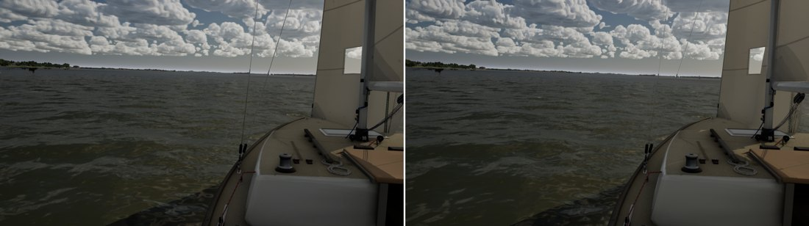
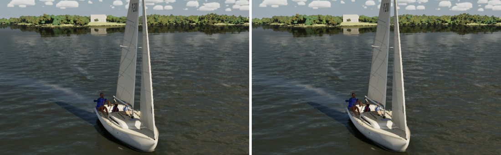
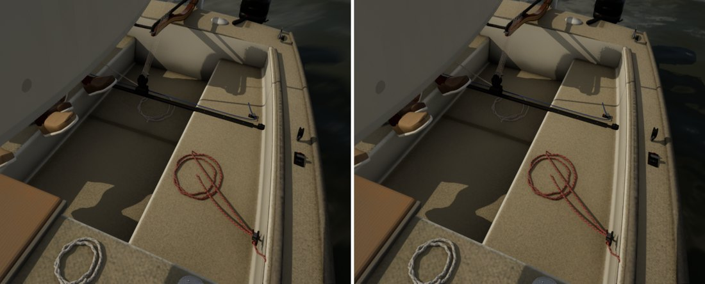
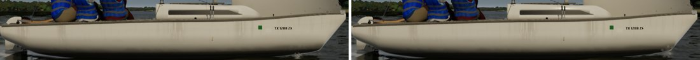

# Gelcoat cost (follow-up to docs/gelcoat)

`docs/gelcoat/` (#309) passed the Mac's boats gate on its look but cost on High close to the boat. Helm eye went from
57.3 to 54.6 fps (base pass +0.34 ms, Lumen +0.55 ms) and beam8 from 59.1 to 57.3. This pass trims the work that
doesn't change the picture.

## What changed

- **The hero is a simple slab again.** `M_J22HeroSurface` had become a Substrate slab with a hazy second lobe (the
  0.05 clear coat, weighted). That makes it a more complex Substrate material than the legacy single lobe it replaced.
  The coat is now folded into the one lobe's roughness, `Rough = lerp(Rough, 0.05, Coat)`: no haze pins, so the hero
  adds no feature over its pre-gelcoat slab. At the coat weight of 0.85 the lobe goes from a 15/85 blend of 0.22 and
  0.05 to a single 0.076, which the sheets below don't show. `M_BoatSurface` keeps the haze it has had since boat
  fidelity 1: it predates the gelcoat pass.
- **The corner grime samples only within reach.** The two global-distance-field samples move from graph nodes, which
  ran for every boat pixel at any range, into the custom code behind `[branch] if (Depth < 800)`. They call
  `GetDistanceToNearestSurfaceGlobal(GetTranslatedWorldPosition(Parameters) + n * d)`. One `DistanceToNearestSurface`
  node wired into an unused pin makes the material include the distance field. The grime now fades out from 4 m to 8 m
  (it was 3 to 15 m). Past 4 m it was a few percent on a few pixels. `M_BoatSurface` also skips metal and grained parts
  there.
- **Lumen's surface cache and the ray-traced hits take the cheap path.** The curvature (sheer highlight) and the grime
  are compiled out under `LUMEN_CARD_CAPTURE` (the card capture pass, re-run as the boat moves) and `RAYHITGROUPSHADER`.
  Neither shows in the surface cache's albedo at its resolution.

## Look (High, main on the left, this branch on the right)

| View | Sheet |
| --- | --- |
| Helm eye |  |
| beam8 |  |
| Cockpit close-up |  |
| Side, hull |  |

The same frames apart from the water, clouds and boom, which move between runs. The grime in the cockpit's corners,
the sheer line and the hull's gloss are unchanged.

## GPU ms (`gpu.total_ms`; base pass and Lumen slices), Bean's RTX 4090, 1920x1080

High is the mean of three 20 s runs; Medium and Ultra are one run each (helm eye Medium three: 3.82, 4.04, 3.78).
"Before gelcoat" is main with the boat materials from 58753358, before #309.

| View | Tier | Before gelcoat | Main (#309) | This branch |
| --- | --- | --- | --- | --- |
| Helm eye | Medium | 3.99 (1.67, 0.57) | 3.86 (1.61, 0.57) | 3.88 (1.61, 0.54) |
| | High | 5.48 (2.71, 0.69) | 5.61 (2.74, 0.73) | 5.59 (2.71, 0.72) |
| | Ultra | 7.36 (3.32, 0.87) | 7.75 (3.39, 0.94) | 7.86 (3.48, 0.95) |
| beam8 | Medium | 4.14 (1.71, 0.49) | 4.48 (1.86, 0.58) | 4.04 (1.67, 0.51) |
| | High | 5.08 (2.21, 0.57) | 5.10 (2.19, 0.59) | 5.10 (2.16, 0.57) |
| | Ultra | 7.03 (2.73, 0.56) | 7.03 (2.81, 0.59) | 7.00 (2.73, 0.57) |
| Cockpit close-up | Medium | 3.81 (1.57, 0.52) | 3.83 (1.58, 0.54) | 3.86 (1.59, 0.54) |
| | High | 5.39 (2.74, 0.67) | 5.60 (2.68, 0.70) | 5.56 (2.67, 0.68) |
| | Ultra | 6.88 (3.14, 0.78) | 7.06 (3.16, 0.82) | 7.25 (3.34, 0.83) |
| Side (hero fills a third) | Medium | 4.00 (1.70, 0.50) | 3.96 (1.68, 0.52) | 3.96 (1.68, 0.51) |
| | High | 5.22 (2.42, 0.62) | 5.27 (2.44, 0.63) | 5.28 (2.42, 0.62) |
| | Ultra | 7.28 (2.99, 0.66) | 7.43 (2.99, 0.65) | 7.26 (2.93, 0.64) |

**The 4090 can't resolve this.** The whole gelcoat pass costs it 0.1 to 0.2 ms on High, inside its run-to-run noise
(about 0.15 ms on High's three-run means, 0.3 ms on single runs). This branch reads the same as main there. The Mac's
High is where the 0.9 ms showed, so the Mac's boats gate is the measure. What this branch removes is structural: the
hero's haze feature, the distance-field samples past 8 m and in every surface-cache capture and RT hit, and the
derivatives in those passes.

Scratch scripts: `gcbench.ps1` (the views, three High runs, stills), `gcbase.ps1` (before gelcoat and main).

## Checks

Full suite 234/234 on the PC on main a72457cf plus this branch. `SailingSim.Visual.Whitecaps` (main #310) passes: at 10 kn the PC draws 0.05% caps against Monahan's 0.10%, a ratio of 2.0 (bound 3), as on the Mac.
