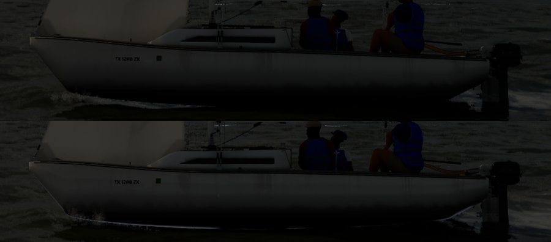
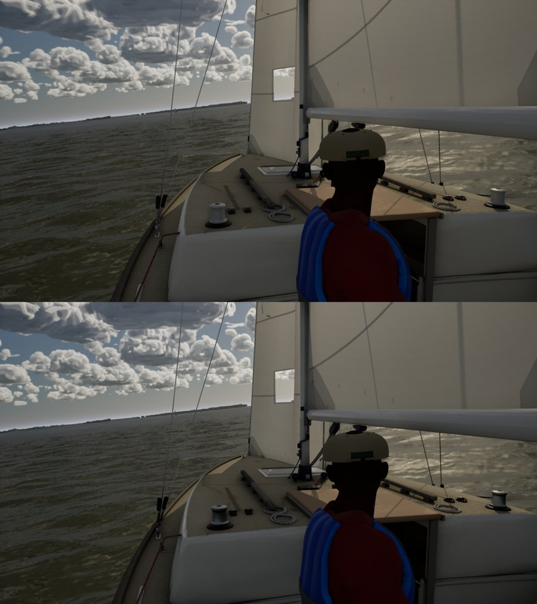
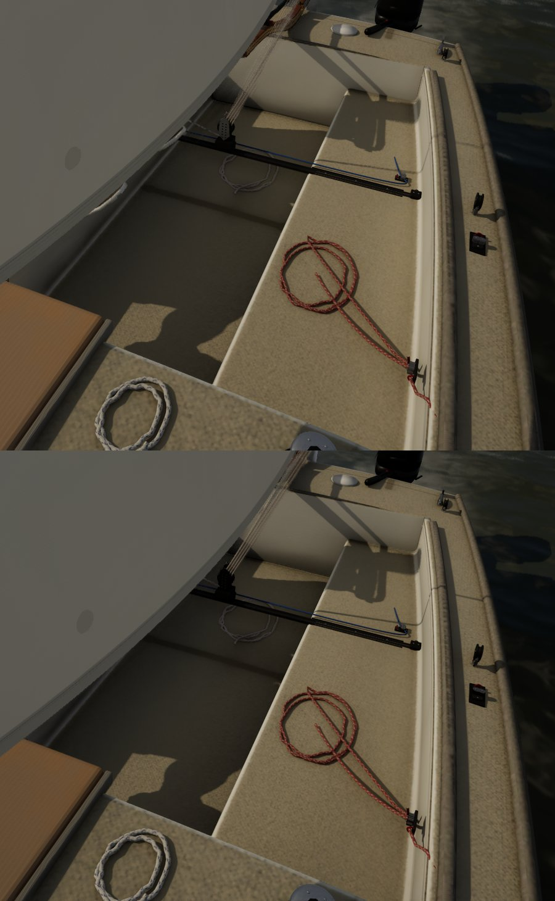
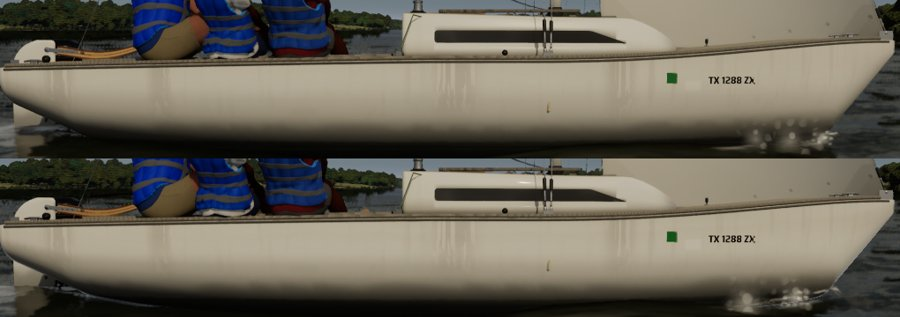

# Gelcoat (Ultra audit #4)

The Ultra audit (`docs/ultra-audit-1024/`) found the boats' gelcoat read matte next to recent AAA games: no sky or shore
in the hull, no crisp line along the sheer, and clean cockpit corners. Two things made it matte:

- **The clear coat was weak or missing.** `M_BoatSurface` capped the coat lobe at 0.6 of the slot's clear coat. The hero
  J/22's `M_J22HeroSurface` had no coat at all: legacy pins, a single GGX lobe at the bake's roughness (about 0.22).
- **The lee-topside guard was too wide.** `docs/lee-topside-patch/` roughens the gelcoat to 0.45 and drops the coat
  wherever the reflection points below the horizon, because Lumen's screen traces run before the Single Layer Water and
  find the hull under the sea. From any camera above the deck, that covers all the vertical topsides and the cockpit
  walls, so they all went to 0.45.

## What changed

Both `BOAT_CODE` (`scripts/make_materials.py`: `M_BoatSurface`, `M_BoatMast`, `M_BoatPacked` and the `MI_Boat_*`
library, updated in place) and the hero's `DETAIL_CODE` (`scripts/import_j22_hero.py`) do the same five things:

1. **Clear coat.** The coat lobe (Substrate slab second roughness 0.05) is now 0.85 of the slot's coat in
   `M_BoatSurface`. The hero is now a Substrate slab like `M_BoatSurface`, with the coat on its smooth gelcoat (the detail
   mask's blue, less chalking). The library's white gelcoat is smoother: Topsides 0.30 to 0.22, Deck 0.35 to 0.28.
2. **The guard starts 15 deg below the horizon** (`guard = saturate((-r.z - 0.25) * 4)`, full at about 40 deg). A heeled
   boat's lee topsides, where the dark dome was, still get the full guard. A chase or helm camera looking along the
   topsides does not.
3. **The water's own Fresnel in the hull.** Between the horizon and the guard, Lumen's trace finds no water (it isn't
   drawn yet) and returns the sky. The reflection is dimmed to what the water would show there: the slab's F0 and F90
   scale by `lerp(1, F_water(-r.z) + 0.04, saturate(-r.z * 8))`. So the hull shows the sky and shore near the horizon
   and darkens toward the waterline, the way a glossy hull does. The water's olive in the albedo now comes in only with
   the guard.
4. **Sheer highlight.** Convex edges under about 3 cm radius (the normal's screen derivatives over the position's:
   `fwidth(n) / fwidth(P)`, guarded out of ray-tracing hit shaders) get roughness 0.1 and the full coat, and skip the guard.
   That covers the hull-deck joint, the coaming tops and the seat edges. It fades between 1.5 and 9 m.
5. **Corner grime.** The global distance field is sampled 8 and 24 cm off the surface, toward the camera's side
   (`DistanceToNearestSurface`). `AO = sqrt(sat(d8 / 8) * sat(d24 / 24))`. Where a corner closes in, the albedo
   darkens by up to 45%, roughness rises to 0.55 and the coat goes. It applies within 15 m, not on metal, teak or
   grained parts. The distance field is coarse (Lumen's global SDF), so this is the soft dirt band along the
   sole-to-seat and sole-to-wall joints, not a crisp line. The bake's own corner dirt (`j22_materials.py`) stays.

## Stills (Ultra, 1920x1080)

`compare/` (git-ignored) has the full frames; the sheets here are crops, before above, after below.

| View | Sheet | What to look for |
| --- | --- | --- |
| Chase (backlit, 15:00) |  | The topsides darken toward the waterline (the water's Fresnel) instead of one flat grey; the sheer line is brighter |
| Helm eye |  | The cabin top's smooth margins and the coaming edges catch the sky |
| Cockpit close-up |  | Grime along the sole-to-seat and sole-to-wall joints; seat edges catch the light |
| Low side view (sun on the hull) |  | More contrast low on the hull; the upper topsides a touch lighter |

Face on, the change is small. White gelcoat reflects about 4% at normal incidence, so a lit white hull seen square-on
is mostly its diffuse colour, in life as here. The gloss shows at grazing angles, along edges and in the darker water
reflection low on the hull. This pass keeps the physics (F0 0.04) rather than exaggerating it.

## Frame cost

GPU time per frame (`gpu.total_ms`) on Bean's RTX 4090, before and after. **Corrected:** the first version of this table
summed every field of bench.json's `gpu` object, including `frames` (4) and `total_ms` itself, so it showed 4 plus
twice the real total and doubled every change. The numbers below are the same runs, corrected.

| View | Tier | Before ms | After ms | Change |
| --- | --- | --- | --- | --- |
| Side (hero J/22 fills a third of the frame) | Medium | 4.02 | 3.97 | -0.05 |
| | High | 5.19 | 5.37 | +0.18 |
| | Ultra | 7.31 | 7.54 | +0.23 |
| Cockpit close-up (the boat fills the frame) | Medium | 3.83 | 3.90 | +0.07 |
| | High | 5.57 | 5.74 | +0.17 |
| | Ultra | 7.39 | 7.26 | -0.13 |
| Marina (bench-visual's view: berthed fleet) | Medium | 3.62 | 3.65 | +0.03 |
| | High | 4.76 | 4.82 | +0.06 |
| | Ultra | 6.69 | 6.90 | +0.21 |

One run each, 20 s, 1920x1080. On the 4090 the pass costs about 0.2 ms at most. The Mac paid more on High close to the
boat (helm eye 57.3 to 54.6 fps); `docs/gelcoat-cost/` trims it. Scratch script: `gelbench.ps1` (the before set restores
HEAD's `Content/Boats` and puts the new assets back after).
## Checks

TESTS
