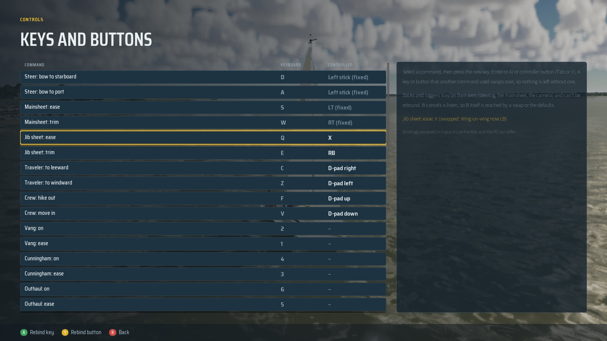

# Graphics G4: front end, HUD and level select

G4 replaces the canvas menus and instruments with a front end and an in-game HUD built from `Inputs/g4/ui-spec.md`
and its mockup. Choosing a world now starts a session: the game reloads the one map with that world, boat, launch spot
and conditions, and holds a loading screen until everything is really ready.

## The front end

`Title → World → Launch spot → Boat → Conditions → Mode → Cast off`. Each step keeps what you chose, Back walks the
flow in reverse, and Continue on the title starts the last session again.

| | |
|---|---|
|  |  |
|  |  |
|  |  |

- **Read from the game's data, not typed.**
  - Launch spots, navaid counts and map extents come from each world's bake (`Content/TerrainData/<World>.json`).
  - Boat lengths, beams, drafts, weights and close-hauled speeds come from the physics configs and reference polars
    (`UI/SailCatalog.h`). Only the descriptions and handling ratings are written by hand.
- **Maps** are chart-style images baked from the height grids (`Tools/ui/make_ui_art.py`): land in chart buff, water
  shaded by depth, bridges, place names and a magenta compass rose. Pins sit by the grid's extent.
- **Conditions**: six presets (ASA 101 lesson day, typical July afternoon, glassy morning, blue norther, bay sea
  breeze, live from today), or set wind, gusts, sky, time, date, air temperature and lake level by hand. The wind
  dial shows where it blows from. "What to expect" reads the wind against the boat's reef and comfort bands, and
  gives sunset for the date at that world's latitude.
- **Mode**: free sail, ASA 101 drills, a race against five AI boats with the five-minute sequence, or the Gulf
  passage (Galveston only). Learning or game mode, tips, difficulty and traffic.
- **Loading screen**: real readiness stages (terrain chunks, the weather map, the boat, shader compiles, traffic)
  with a progress bar and sailing tips. It waits for Enter, so the first frame you see is smooth. Settings can make it
  start on its own.
- **Images are the game's own**: the cards, title and loading art are capture-mode stills (no HUD), never photos.
  Galveston's are new (`captures/`).
- **Every screen works with the keyboard, a controller or the mouse.** Prompts follow whichever you used last.
  Hover moves focus only after the mouse actually moves, so a resting cursor can't steal it.

## Pause, settings and controls

| | |
|---|---|
|  |  |
|  |  |
|  |  |

- **Pause** (Tab or the controller's menu button) pauses the game. It has the session's distance and top speed, the
  coach's note, and opens the chart, logbook, photo mode, settings and controls. **Change conditions** changes the
  weather in place, with no reload.
- **Settings**, five tabs, all saved and applied at once:
  - Graphics: quality tier, resolution (Auto keeps the tier's own and High's governor), frame-rate cap.
  - Display: window mode, HUD (full, minimal, off), HUD size 85 to 130%.
  - Audio: master volume.
  - Gameplay: difficulty, learning mode, trim assist, control layout; speed in knots, mph or km/h; depth in feet,
    metres or fathoms; magnetic or true headings; start when loaded; pause when the window loses focus.
  - Accessibility: text size 100 to 150%.
  - Benchmarks and captures ignore the display rows (cap, resolution, focus pause), so their numbers stay comparable.
- **Controls**: every key, rebindable. A key another command used swaps over, so nothing is left without one.
  Gamepad rebinding (after the freeze): each row has a keyboard and a controller column. Enter (A) rebinds the key,
  Tab (Y) the button (face buttons, bumpers, the D-pad, stick presses, View, Menu); sticks and triggers stay on their
  axes and show as fixed. Esc or B cancels; the same swap rule holds in both columns (`SailingBindings::Assign`; a
  command with no button to give back leaves the other without one, and Menu never gives up the pad's pause). Menu
  navigation keeps the arrows and D-pad. "Restore the defaults" resets both columns; everything saves to Input.ini.
  The HUD tips, learning text and the controls card (`?`) name the live bindings, the controller's while the pad is in
  use. Tests: `SailingSim.UI.GamepadBindings`, `SailingSim.Smoke.KeyRebinding`.

  

## The HUD

- Top left: time, true wind (with the gust), sky and air temperature, and the tide on the coast. Under it, the
  learning tip card and, when another vessel matters, the rules of the road: who it is, whether you stand on or give
  way and under which rule, what to do, and the closest approach.
- Top centre: the compass tape (5° ticks, numbers every 30°, the true wind marked) with the heading under it, and
  toasts for the states that matter (aground, capsized, contact, shallow water).
- Top right: the drill's steps, the race (sequence, flags, line or next mark, results), or on the coast the
  navigation panel (GPS, tide and its next turn, current, the passage's next waypoint).
- Bottom: the minimap, speed with VMG and the polar's target, the apparent wind dial with the no-go zone, depth with
  the keel and the shallow alarm, and the sail trim panel with telltales and the heel band.
- `H` cycles full, minimal and off. Dials, tape and map are painted every frame; the text refreshes at 10 Hz (5 Hz on
  Low), like a real instrument's damping.

| | |
|---|---|
|  |  |

## How it's built, and where it differs from the spec

- **Slate in C++, not Common UI and UMG assets.** The spec assumed widget blueprints. Here every screen is Slate code
  (`Source/SailingSim/Private/UI/`). That keeps the UI reviewable in diffs and buildable headless from the scripts,
  which is how this project makes everything. The structure follows the spec: a screen stack with
  transitions, shared widgets (`SailWidgets.h`), style tokens and fonts (`SailUIStyle.h`), and a session subsystem.
- **Session and level select.** `USailSessionSubsystem` (`SailSession.h`) holds the choices across the map reload and
  saves the last one for Continue. The game mode applies them through the same paths the command-line overrides use,
  so a session started from the menus and a benchmark started from arguments go the same way.
- **Fonts**: Saira Condensed, Saira Semi Condensed and Source Sans 3 (OFL), loaded at runtime from
  `Content/UI/Fonts`.
- **Not done from the spec**:
  - per-row help in Settings, the 15-second "keep display" modal, HDR, brightness;
  - per-channel audio sliders (the synth has one master);
  - colour-blind side colours (the HUD already pairs side colours with P/S or a word);
  - controller glyph images (prompts show the button names);
  - a MoviePlayer screen during the blocking map load.

## Checks

- `SailingSim.UI.SessionFlow`: Lake to Galveston and back, each with a different boat, preset and mode, lands in the
  settings the game starts from. The catalog matches the world data, and every screen builds.
- Scripted end to end in the running game (`-SailingUIScript=<keys>`, which carries over the reload):
  - Title, then Galveston, launch spot 2, the Hobie 16, the bay sea breeze and a race in busy traffic. The race
    starts and the front end closes.
  - Then back: the lake, the J/22 and a drill.
  Both reach the loading screen, wait for Enter, and start sailing with the chosen world, boat and conditions.
- The screenshots on this page come from `-SailingFrontEnd=<screen>` (`scripts/run-game.sh`).

## Performance (packaged, fps)

| View | Medium G3 | Medium G4 | High G3 | High G4 |
|---|---|---|---|---|
| beam8 | 95.0 | 95.5 | 51.6 | 53.0 |
| beat15 | 90.1 | 92.5 | 49.2 | 51.8 |
| storm | 85.3 | 86.6 | 50.1 | 50.4 |
| marina | 87.7 | 89.2 | 46.9 | 47.0 |
| coast-day | 86.8 | 86.2 | 48.6 | 46.8 |
| coast-night | 113.5 | 115.2 | 56.5 | 56.2 |
| gulf-sea | 113.3 | 114.0 | 60.1 | 61.6 |
| helm-eye | 86.7 | 84.7 | 45.3 | 44.9 |
| slip | 76.4 | 77.9 | 47.4 | 47.3 |
| bridge | 94.3 | 95.4 | 51.9 | 52.1 |
| crew | 73.1 | 72.9 | 46.9 | 46.5 |
| marina-night | 91.9 | 91.5 | 57.5 | 57.4 |

- The views move by about ±2 fps against G3, which is run-to-run noise.
- Every view clears the gates (Medium 60, High 45) except helm-eye on High, which sits on the line: 44.9, and 45.1 on
  a rerun (45.3 in G3). Helm-eye is a capture view with no HUD drawn, so this isn't the UI.
- **The HUD's own cost**, High, with and without it (`-SailingNoHud`): beam8 52.8 against 52.6, marina 47.5 against
  47.4. That's within noise. The dials and tape are a few hundred line and box elements, and the text changes 10
  times a second, not every frame.
- Benchmarks run with the front end off (`-SailingBench`), so the numbers compare straight with G3. The screenshots
  are in `bench/`.

## Found and fixed on the way

- A static cached the shorts material. After a level reload it pointed at a freed object, and the game crashed on
  the second session. It is now loaded each time.
- The minimap's chart texture could be garbage-collected under the brush. UI textures are now held by an
  `FGCObject`.
- The old canvas traffic and race panels drew over the new instrument cluster. They are now part of the Slate HUD.
- The minimap cropped the launch screen's chart, place names and all, and the Gulf had none. Each world (Gulf
  included) now has a 4096 px label-free minimap.
- A benchmark of the pause screen never ended (the game mode doesn't tick while paused). During a benchmark it now
  does, keeping only the bench timing; the weather and tide stay paused.
