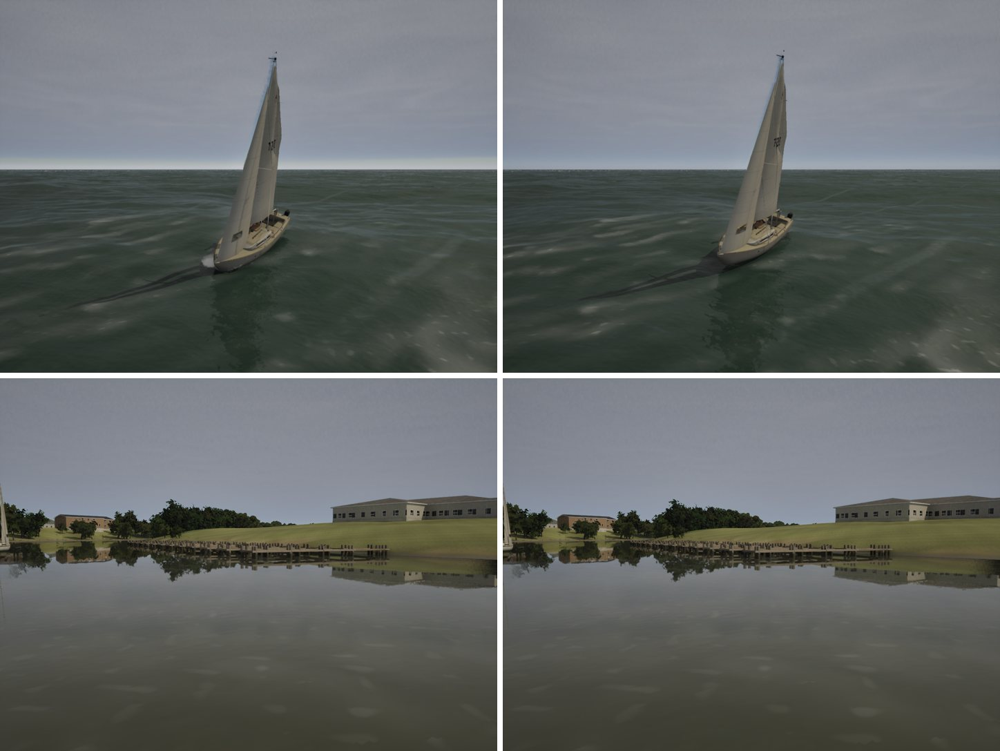

# The pale band on an overcast sea's horizon

The realism audit (`docs/realism-audit-1022/`, "also seen") found a pale haze band along the Gulf swell view's horizon.
Under the overcast it read a third brighter than the deck, with a greenish strip beneath it. A real overcast darkens
toward the horizon, if anything.

## Cause

The camera looks out to sea under a closed stratus deck (Overcast, 14:00). The sky above the horizon is about 140 grey
(sRGB, mean of a column), and the band reaches 178. Captures with the fog off and with the atmosphere off
(`-ExecCmds="showflag.fog 0"` / `"showflag.atmosphere 0"`) split it in two:

- **The haze** gave most of it. Under a deck its inscattering is `DeckGrey x HazeLight` (#263), at (0.58, 0.60, 0.63).
  At the horizon, where the fog reaches its 0.9 opacity, that came out brighter than the deck lighting it.
- **The deck stopped at the weather map's edge**, 32 km out (G2 fades every layer to nothing there, so the map's
  clamped edge texels don't smear into streaks). Its base then stood about 1.6 degrees over the horizon, with the
  clear sky's bright horizon under it.

## Fix

- `DeckGrey` is now (0.36, 0.37, 0.39), 0.62 of the old value: the sRGB gap between the band and the deck, in linear.
  Haze lit by a grey deck is no brighter than the deck.
- In `CLOUD_CODE`, a closed deck (stratus coverage over 0.8, full at 0.95) goes on past the map's edge at the layer's
  own coverage. The value is uniform, so it can't streak. Storms are untouched: their stratus never passes 0.5.

| row (px) | 300 | 440 | 460 | 470 | 480 | 490 |
|---|---|---|---|---|---|---|
| main | 143 | 150 | 168 | 176 | 182 | 178 |
| this branch | 142 | 149 | 158 | 164 | 165 | 157 |

These are green-channel means over the column in the swell view. The horizon is at row 495 and the deck is above row
440.

## Stills

Main left, this branch right. Top: the Gulf swell view (`bench-phase7.sh`'s `gulf-swell` on High, HUD off). Bottom:
the lake's overcast shore (G5 `g5-shore`), which shares the haze colour and barely changes.

