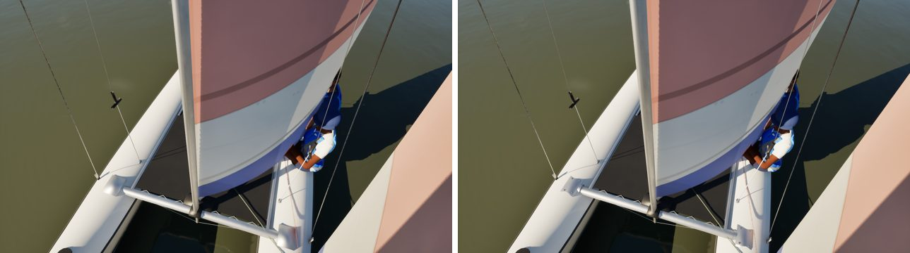
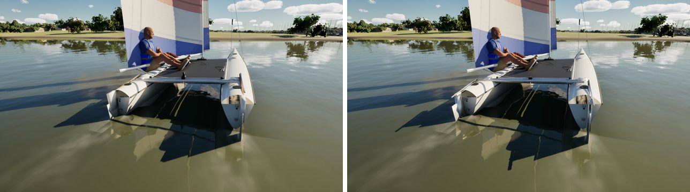
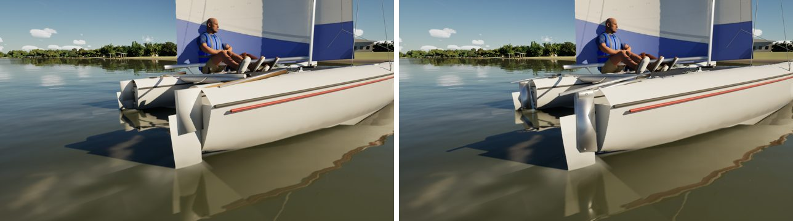

# Hobie 16, assembly by assembly (boat fidelity: pc/hobie-fidelity)

The fourth fleet boat in the boat-fidelity queue, done with the Sunfish's method.

- **References:** there are no Bean Hobie photos yet, so this pass works from the class layout and a Commons Hobie 16
  photo already on this machine.
- **Comparisons:** reference, before and after for each assembly, in `compare/`. That folder is git-ignored and never
  committed, because the photo shows sailors.

The renders are the game at Ultra.

## What changed (`Tools/blender/build_fleet.py`)

| Assembly | Before | Now |
| --- | --- | --- |
| Rudder heads | a white box each | the cast aluminium head (the Sunfish's, from #286): cheeks on a through-bolt, the pintle's barrels on the pivot axis |
| Tiller arms | wooden sticks reaching 45 cm past the crossbar | aluminium arms, 0.55 m forward to the crossbar, their black ends its connectors |
| Rudder blades | a centimetre inside the transom | hung aft of the pintle |
| Beam ends | aluminium boxes | the cast corner housings: rounded, a socket collar round each beam end, four bolt heads on top |
| Traveller | four boxes | the kit's track, car and end stops across the rear beam's top |

The rudders' branch is the Hobie's own in `build_rudder`, so it doesn't touch the lines pc/c22-fidelity changes. The kit
gudgeons on the transoms (`hobie_detail`) are unchanged. The tiller extension stays baked from the arms' ends, because
the game doesn't draw the crossbar's.

## Kept as they were

- **Sockets:** all unchanged, including both rudder pivots and the traveller, so there were no socket moves to report.
- **Measures:** FleetMesh's are unchanged.
- **Triangles:** hull 51,108 (Nanite), rudder 548.
- **Material slots:** unchanged.

## Renders (before | after)

