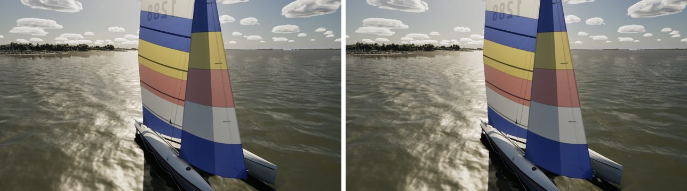
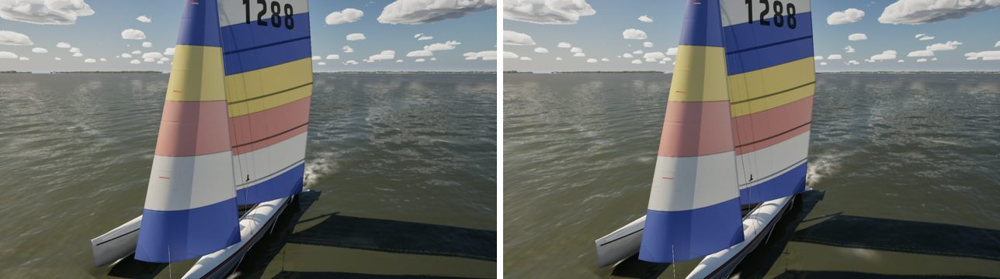
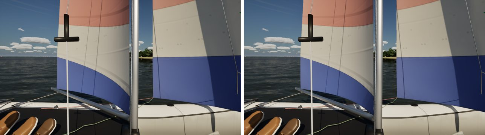
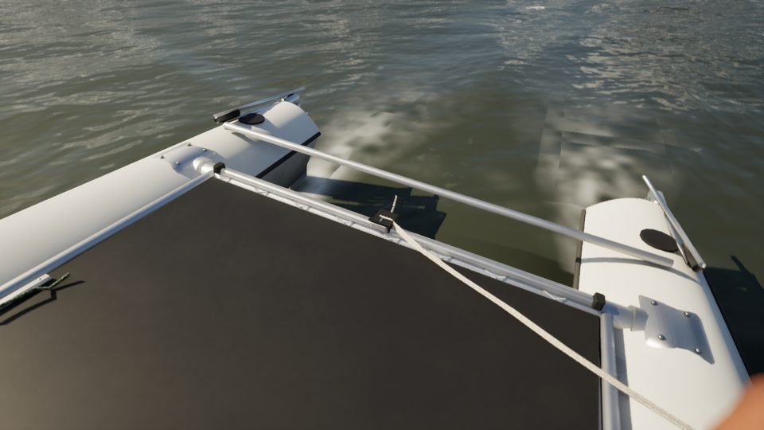

# Hobie 16: the jib through its shroud (pc/hobie-jib-shroud)

The Mac saw the Hobie 16's jib lying on, and through, its leeward shroud.

## Cause

`FSailCloth::KeepClear` keeps every sail clear of the rig's wires (the shrouds, spreaders and trapeze wires the pawn
passes it). It keeps the main inside them, and it keeps a jib outside them, the way an overlapping genoa passes outside
a keelboat's shrouds. When a jib's row meets a wire, the cloth turns that row outward, by up to 0.35 rad, to clear it.

The Hobie's jib is not a genoa. It sheets to cars on her trampoline, well inside the shrouds that run from her hounds to
her hulls' outer sheer. So the cloth turned it outward onto the wire it should have stayed inside.

## Fix (pawn side; FSailCloth and the physics untouched)

`UpdateModelRig` (`BoatModelVisuals.cpp`) gives the jib its own obstacle list where it sheets inside the shrouds, and
`UpdateSailCloths` (`SailVisuals.cpp`) hands it to the jib's cloth. That list is empty on the Hobie, which has no
spreaders, so her jib keeps its own shape, inside the shrouds. Her main still keeps clear of them.

This is set for the Hobie 16 only (`bJibInsideShrouds`). The J/22's jib also leads inside her shrouds, but changing it
is a separate call, so the J/22 and every other boat behave as before.

## Check

`SailingSim.Visual.RigClearance` sails every boat through eight cases with four samples each and lists every wire
through a sail:

| | Hobie 16 entries |
| --- | --- |
| Fix off (`bJibInsideShrouds` false) | shroud through the jib: 1 sample, close-hauled on port, fresh, at (71, 36, 421) cm, cloth row 137 |
| Fix on | none |

The other boats' entries are the same in both runs.

## Stills (Ultra; before | after)

The traveller close-up the Mac asked for (#290: the kit's track, car and stops across the rear beam):

