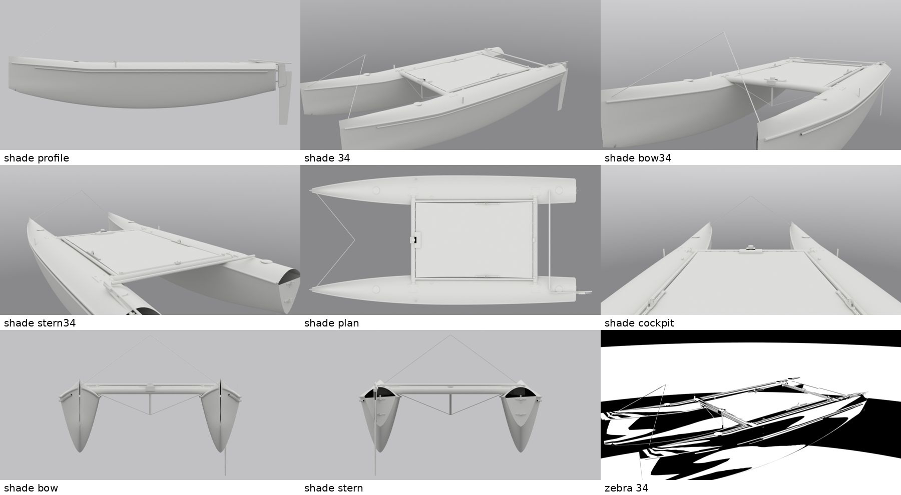
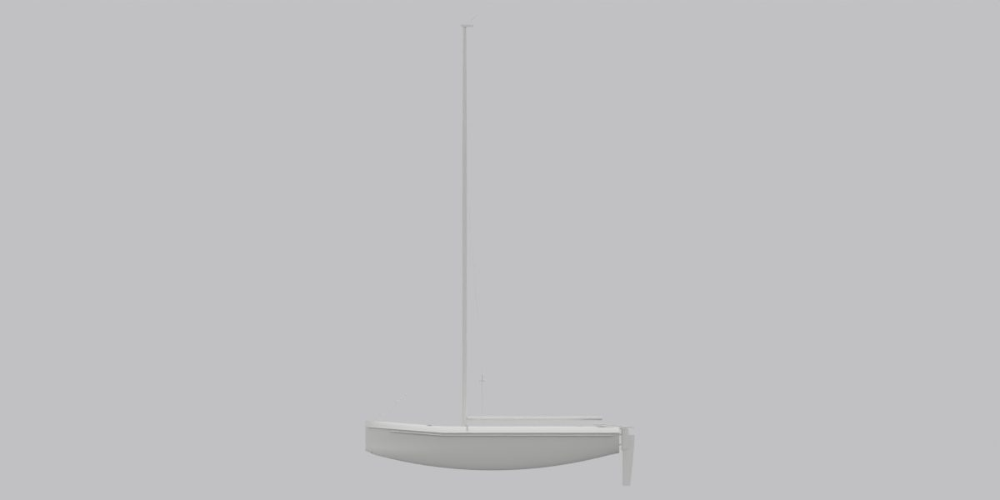

# Hobie 16 rebuild, slice 0: size card, size check, references and "before"

The Hobie 16 is in the game but has never had the rebuild
the J/22, Sunfish, Catalina 22, frigate and J-Class got. She is still drawn by the shared fleet template
(`Tools/blender/build_fleet.py`, `hobie_detail`), set to her sizes and dressed with kit hardware in the October
fidelity pass (`docs/hobie-detail`). Bean asked for the full rebuild on Nov 25 2026, by the same process. Plan:
<https://claude.ai/artifact/QKsLR7Kyeh9uk9AWraasNC>.

This is post-slice work: nothing here is imported into Unreal and nothing in the game changes. The new files are under
`Tools/`, so the pull request still needs Bean's `bean-approved` label (the Sensitive files check), and it stays a draft
until after the Dec 11 release.

## Words used here

- **Rocker:** how much the keel line curves up toward the bow and stern, seen from the side. A Hobie 16's hulls have a
  lot of it ("banana" hulls). **Sheer:** the deck edge's line from the side. **Freeboard:** the hull's height above the
  water.
- **Asymmetric hulls:** each hull's inner face is flatter than its outer one, so the hull itself resists sideways
  slip. That's why she has no daggerboards.
- **Crossbars (beams), sidebars, pylons, corner castings:** the platform. Two aluminium crossbars sit on cast corner
  housings bolted to pylons in the hulls; the trampoline is laced between them and two sidebars along the hulls.
- **Bridle, dolphin striker:** the forestay ends on two wires from the bows (the bridle); a post under the front
  crossbar with a rod (the dolphin striker) stiffens it against the mast's push.
- **Sockets:** named points on the model where the game hangs the rig's wires, the ropes and the crew.
- **Shape loop:** the J/22's way of reshaping a boat in rounds: fixed camera views, measurements by part, and blind
  reviewers. **Zebra stripes:** a mirror-like render that shows whether a surface is smooth ("fair").

## The size card

`Tools/shipkit/hobie16/specs_hobie16.json` holds her published sizes, the source of each, the game's current physics
numbers, how the check measures each target, the triangle and texture budgets per slice, and a `class_facts` list of
what she's built from. The tolerance is 3%, as for the C22.

| Measure | Published | Target |
| --- | --- | ---: |
| Length | 16 ft 7 in | 5.04 m |
| Waterline length | 15 ft 2 in | 4.64 m |
| Beam | 7 ft 11 in | 2.41 m |
| Draft, rudders up (the hulls) | 10 in | 0.254 m |
| Height from the floor to the bow / stern | 23.5 in / 24 in | 0.597 / 0.610 m |
| Weight, rigged | 320 lb | 145 kg |
| Mast length | 26 ft 6 in | 8.07 m |
| Main / jib area | 148.2 / 55.1 sq ft | 13.77 / 5.12 m² |

Length, beam, draft, weight, mast and the two heights were read on Hobie's own spec page. The waterline length comes
from a third-party data site only, so slice 1 rechecks it. The optional spinnaker is left out.

`class_facts` comes from the class's rule book (IHCA 2025-2028) and Hobie's parts guide for the 14 and 16. These are
lists of parts, counts and lengths only; no drawing is copied. They settle things the photos can't:

- The main has **eight full battens** (1.04 to 2.74 m) and the jib **four** (0.71 to 1.70 m).
- The **jib sheets lead to cars on the front crossbar's track**. Today's model leads them to sockets near the rear
  crossbar, which slice 6 fixes.
- The mainsheet is **6:1**, from the rear crossbar's traveller car to the boom's clew.
- A **dolphin striker** under the front crossbar is required by the class. Today's model has one.
- The bridle is at least 1.118 m pin to pin. There are two trapeze wires a side, shrouds with 7-hole adjusters,
  and one 2.13 m tiller extension on a straight tiller crossbar.
- The rudder blades are at most 25.8 mm thick, tapering to 12.7 mm near the tip. Each sits in an upper and a lower
  casting with a spring-loaded kick-up cam.

## The size check

`Tools/shipkit/hobie16/hobie16_check.py <stats.json> [<sockets.json>] [--slice N]` is the C22's check made for two
hulls. It reads the stats from `Tools/shapeloop/measure.py`. It measures the length, beam and waterline length; the
hulls' draft, less the crew's sink; the weight (her two canoe bodies' volume, less the 150 kg crew the game floats her
with); and the two heights from the floor (the deck at the bow and stern stations above the hulls' lowest point). The
mast length waits for slice 4's sockets, and the sail areas for slice 5's build report.

The crew's sink is 0.087 m, measured on today's hulls: 150 kg over a waterplane of 2.05 m² at the game's waterline
(1.76 m² 4 cm lower). The narrow hulls sink three times as far under their crew as the C22 does under hers (2.8 cm).

Today's model against the card:

| Measure | Target | Today | Off |
| --- | ---: | ---: | ---: |
| Length | 5.040 | 5.040 | 0.0% |
| Waterline length | 4.640 | 4.619 | -0.5% |
| Beam | 2.410 | 2.410 | 0.0% |
| Draft, rudders up | 0.254 | 0.216 | **-15.0%** |
| Weight (kg) | 145.0 | 145.2 | +0.1% |
| Height, floor to bow | 0.597 | 0.871 | **+45.9%** |
| Height, floor to stern | 0.610 | 0.753 | **+23.4%** |

**Her hulls are far too tall.** The plan-view sizes and the weight are right, but each hull is about 0.75 m from
keel to deck amidships, and the real boat's whole bow stands 0.60 m off the floor. She floats too high as a result.
The model's freeboard is 0.45 m with her crew aboard. In the CC0 broadside under sail (`Hobie 16 catamaran sailboat
1857.jpg`), it reads roughly 0.26 m amidships and 0.27 m at the bow. That's a rough read without a solved camera;
slice 1 measures it properly. Her draft is shallow too, because the formula hulls carry their volume in a deep, narrow
V. The real hulls are shallower, fuller and sit lower in the water.

Triangles as built: 84,690 in all. The two hull shells are 30,456, the platform and kit hardware 51,008, the
rudders 1,288, and the mast and boom 1,938.

`Tools/shapeloop/sections_hobie16.json` names today's parts for the loop. Today's model builds the platform and the
hardware into one object, so `fittings` holds both until slice 2's build names the platform.

## Before: today's model



Clay renders from the shape loop's fixed cameras (`Tools/shapeloop/render_set.py`), so every later slice renders the
same views for its before-and-after sheet. Each view is in `baseline/` at 1200 px. What they show against the real
boat, which the slices fix:

- **Hulls (slice 1):** tall, deep V sections, the same on both faces. The real hulls are asymmetric, much lower, and
  round-bilged with a crowned deck that rolls into the topsides. The rocker is a plain parabola, the same fore and aft,
  where the real hull lifts more at the bow. The transoms are tall flat shields. The sheer is dead flat aft of the
  front crossbar and only rises at the bow.
- **Platform (slice 2):** plain tubes for crossbars, a flat sheet trampoline with no lacing or sidebars, and the
  front crossbar's height is set from the too-tall sheer.
- **Rudders (slice 3):** blades in tall cast heads from the October pass, on tiller arms with no kick-up cam or lower
  casting.
- **Rig (slice 4):** the mast is a plain tube (the real one is a rotating wing section), and the shrouds and bridle are
  thin straight lines. Masthead is 8.5 m above the hull origin; slice 4 checks it against the 8.07 m mast.



## Reference photos

`Tools/shipkit/hobie16/refs.json` lists ten photos for looking and measuring: CC0, public domain or plain CC BY only
(no NC, ND or SA), never traced, never in the repo. The cloud's own requests to Wikimedia Commons got "too many
requests" again, so the 71 files in Category:Hobie 16 were read through the desktop app's browser, with each licence
and author taken from Commons' own data. The most useful:

- `Hobie 16 catamaran sailboat 1857.jpg` (CC0): a near-square broadside under sail, for the freeboard and sheer.
- `Hobie 16 catamaran on trailer.jpg` (CC BY 3.0): both bows from forward, out of the water, for the sections.
- `A Hobie Cat rest a day after ... .jpg` (CC0): bow-on on a mooring lift, for the hulls' spacing and the beam height.
- `Hobie 16 catamaran sailboat 2660.jpg` (CC0): a quarter view under sail, for the rudders and tiller crossbar.

The CC BY-SA photos (the Glénans raids and others) are left out, as are Hobie's own manual drawings. Bean's photos of
Hobie 16s at Rush Creek, on a beach or on a trailer will be the best reference; the plan lists the shots.

## Reproduce

```
SRC=Source/SailingPhysics
clang++ -std=c++17 -O2 -I$SRC/Public $(ls $SRC/Private/*.cpp | grep -v SailingPhysicsModule.cpp) \
    Tools/BoatExport/main.cpp -o <work>/boat-export
<work>/boat-export hobie16 <work>/hobie16.json
FLEET_SHAPE_BLEND=1 blender -b --factory-startup -P Tools/blender/build_fleet.py -- <work>/hobie16.json Hobie16 <work>
blender -b -P Tools/shapeloop/measure.py -- <work>/Hobie16_shape.blend Tools/shapeloop/sections_hobie16.json <work>/before
blender -b -P Tools/shapeloop/render_set.py -- <work>/Hobie16_shape.blend Tools/shapeloop/sections_hobie16.json <work>/hull --res 1200
blender -b -P Tools/shapeloop/render_set.py -- <work>/Hobie16_shape.blend Tools/shapeloop/sections_hobie16.json <work>/rig --res 1200 --with-other
python3 -I Tools/shipkit/hobie16/docs_hobie16.py <work>/hull <work>/rig docs/hobie16-1/baseline
python3 -I Tools/shipkit/hobie16/hobie16_check.py <work>/before/stats.json <work>/Hobie16_sockets.json
```

In the cloud, `blender -b -P <script> --` was a Python 3.13 venv with `pip install bpy numpy pillow`, through a
wrapper that imports `bpy` first and sets `sys.argv`, as for the C22. The check exits non-zero on today's model
(draft and heights): that is the "before", and slice 1's hulls must pass it.

## Next: slice 1, the hulls

Her own asymmetric hulls from sections, in a new build in `Tools/shipkit/hobie16/`, lower and fuller so the heights,
draft and freeboard come right at the same weight. Slice 1 solves the camera of the broadside and the bow photos,
checks fairness, volume and trim against the card, and puts three blind reviewers on it against today's model. Below
the waterline the new hulls are the design for slice 9's physics; until then the game keeps today's physics hulls.
