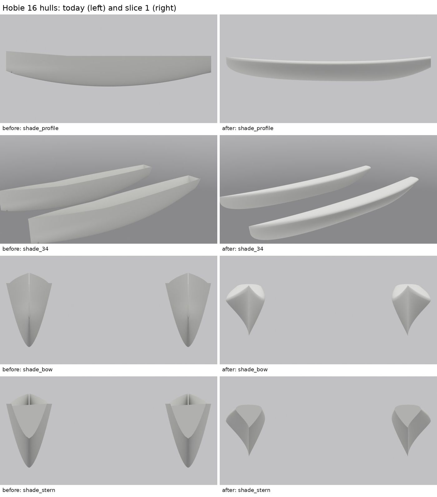
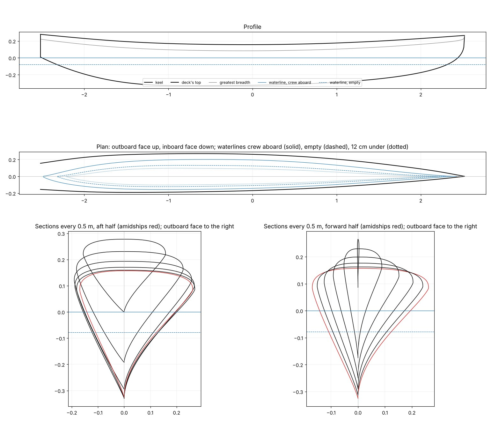
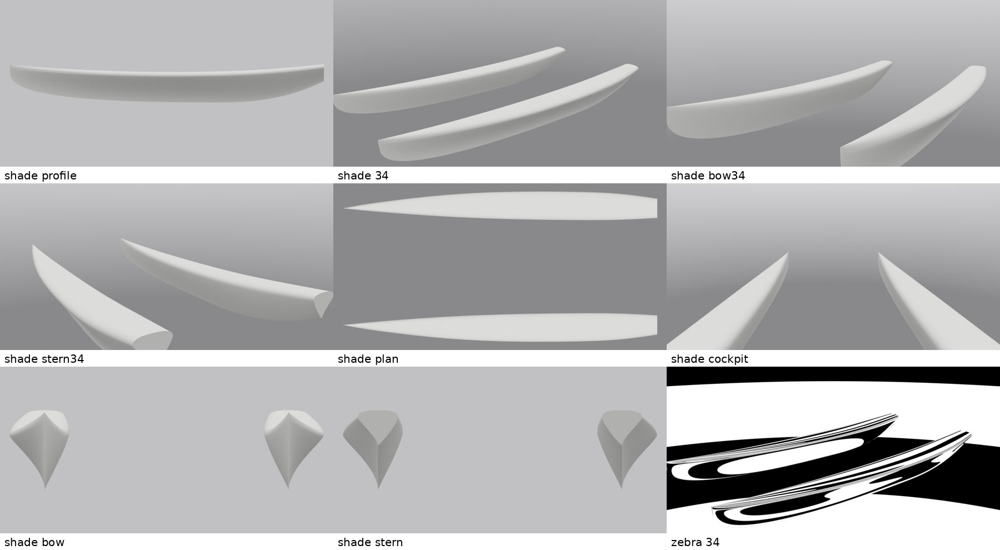

# Hobie 16 rebuild, slice 1: the twin hulls

Slice 1 draws the Hobie 16 hulls of her own. They replace the shared fleet template's hulls, which slice 0 showed were the
right length, beam and weight but far too tall (`docs/hobie16-1`). Plan: <https://claude.ai/artifact/QKsLR7Kyeh9uk9AWraasNC>.

Nothing is imported into Unreal and nothing in the game changes. The game keeps today's model and physics hulls until
slices 9 and 10. The new files are under `Tools/`, so the pull request needs Bean's `bean-approved` label, and it stays a
draft until after the Dec 11 release.



## Words used here

- **Rocker:** how much the keel curves up toward the bow and stern, seen from the side. A Hobie's is a "banana".
- **Deck line:** the top of the hull seen from the side. On a Hobie the deck is rounded over (crowned) and rolls into the
  sides, so there is no sharp deck edge.
- **Sections:** cross-cuts of the hull, seen from ahead. **V:** a section that narrows to the keel. **Flare:** sides that
  lean outward as they rise.
- **Asymmetric hulls:** each hull's inboard face (toward the other hull) is flatter and straighter than its outboard one,
  so the hull itself resists sideways slip. That's why a Hobie 16 has no daggerboards.
- **Transom:** the flat face at the stern, where the rudders hang.
- **Centre of buoyancy (CB):** the centre of the underwater volume. She floats level when it sits under the centre of
  weight of boat and crew.
- **Fair:** smooth, with no bumps or creases. **Zebra stripes:** a mirror-like render whose stripes bend smoothly on a
  fair surface. **Inflection:** a line bending one way, then the other. **Kink:** a sharp peak in a line's curvature.

## What the photo showed

Slice 0 read the card's 10 in draft as the empty boat's, and guessed that the real hulls were shallower and fuller than
today's. Slice 1 tested that, and the photo says the opposite about fullness.

- **Round-bilged hulls can't do it.** Full, round sections that meet the card's heights (0.597 m from the floor to the
  deck at the bow, 0.610 m at the stern) and her 145 kg float 0.25 m deep with her two crew and only 0.18 m empty.
- **The broadside photo was measured on its pixels.** That is the CC0 photo under sail, `Hobie 16 catamaran sailboat
  1857.jpg`, read through the desktop app's browser, since the cloud can't reach Commons. Its hull is 888 px long, so
  176 px to the metre. What it shows:
  - Only 0.19 m of hull stands over the water amidships, with one sailor aboard.
  - The deck rises about 0.19 m to the bow and 0.03 m to the stern. She is trimmed by the stern; with that taken out,
    it rises about 0.11 m to each end.
  - The stem is nearly upright, with only about 0.1 m of overhang.
- **So she floats deep, in a narrow V that flares out above the water.** That is how Hobie draws a hull that goes
  upwind without boards, and it is what floats 145 kg at 10 in. The deck curves too: a banana deck over a banana keel.

The check therefore keeps the 10 in as the empty boat's draft. It takes off the crew's sink measured on the new hulls
(7.8 cm) and compares the waterline length at that same empty waterline. The broadside photo is a rough read without a
solved camera, so Bean's photos of a Hobie on a trailer or the sand remain the real check, above all for the sections
under the water.

## How she's drawn

`Tools/shipkit/hobie16/lines_hobie16.json` holds a few curves, and `hull_hobie16.py` turns them into one hull's surface:

- **The keel line,** a banana rocker. Its lowest point is 0.8 m aft of amidships. Forward, it curves up continuously
  and turns tightly at the forefoot into a nearly upright stem. Aft, it rises to the transom's foot, which sits at the
  water with the crew aboard.
- **The deck's top,** measured from the keel's lowest point: 0.49 m amidships, rising to the card's 0.597 m at the bow
  and 0.610 m at the stern.
- **The greatest half-breadth along her length.** She is 0.54 m across at her widest, 0.6 m aft of amidships, as
  today's hull, and her outsides come to the card's 2.41 m beam. She has a fine entry and a transom about 0.28 m across.
- **The sections.** Each face is two curves:
  - Above the greatest breadth, a crowned deck rolls into the topsides.
  - Below it is a deep V. It narrows to the keel and flares out above the water, finer toward the bow and fuller toward
    the stern.
- **The asymmetry.** The inboard face is drawn narrower and straighter in plan, pulled halfway toward a straight line
  from the stem to the transom's inboard corner. It is also fuller below the greatest breadth, so it stands flatter and
  more upright than the outboard face.

The keel's depth isn't drawn; it is solved. `solve_depth` finds the depth at which the two hulls float boat and crew
(295 kg) at the game's waterline: 0.330 m. The keel's lowest point and the fuller stern put her centre of buoyancy at
x -0.369 m. The game's boat and crew have their centre of gravity at -0.356, so she floats level within about 1 cm.

`build_hobie16.py` meshes both hulls in Blender as one object, `H16_Hull`, so the loop measures her overall beam. It
uses 200 stations by 112 points round, with the deck as its own material slot (slice 7's non-skid) and a flat transom.
The two hulls are 89,146 triangles, against slice 1's budget of 200,000. They carry box-projected UVs for the Unreal
import's tangent frame.



`lines_plot_hobie16.py` draws the lines from the same code. The sections are drawn whole, because the two faces differ.

## Checks

| Measure | Target | New hulls | Today's | Off (new) |
| --- | ---: | ---: | ---: | ---: |
| Length | 5.040 m | 5.040 m | 5.040 m | 0.0% |
| Waterline length, empty | 4.640 m | 4.644 m | (4.619 crewed) | +0.1% |
| Beam | 2.410 m | 2.410 m | 2.410 m | 0.0% |
| Draft, empty | 0.254 m | 0.253 m | 0.216 m | -0.4% |
| Weight | 145 kg | 145.1 kg | 145.2 kg | +0.1% |
| Height, floor to bow | 0.597 m | 0.595 m | 0.871 m | -0.3% |
| Height, floor to stern | 0.610 m | 0.608 m | 0.753 m | -0.4% |

The size check (`hobie16_check.py --slice 1`) passes everything it can measure so far. The weight is the mesh's own
volume under the waterline. With her crew aboard the new hulls are 4.94 m long at the waterline and 0.165 m of deck
stands over the water amidships.

**Fairness** (`Tools/shapeloop/fairness.py`, 10 waterlines and 10 stations a face). `one_hull.py` cuts one hull out and
centres it, since the tool reads a single hull's port face. It's run once for each face.

- **The inboard face:** no inflections or kinks. It's a plain convex V.
- **The outboard face:**
  - **Inflections:** one per station, where the V's flank turns out into the flare. That's the shape asked for.
  - **Kinks:** five on the aft half's stations, all at the deck's edge, a 7 cm radius. The roll from the topsides into
    the deck is tight, and two reviewers noticed it (below).
  - **The waterlines:** none.
- **Today's hulls:** two inflections and one kink. They're faceted and creased in the zebra render.



## Reviews

**Blind reviewers.** Each reviewer saw the new hulls and today's side by side in six views: profile, three-quarter,
bow, stern, plan and zebra. They didn't know which was which, and the sides were shuffled for each view. Both were
shown as hulls only.

- **Round 1** (the first draw): all three reviewers chose the new hulls overall. **Their shared notes:**
  - the asymmetry couldn't be seen;
  - the bow overhung like a spoon, and the stem should stand more upright;
  - the rocker should be a continuous banana, not flat amidships;
  - the transom should be smaller.
- **Round 2:** I made those changes:
  - the inboard face is narrower, straighter and fuller;
  - the keel line is one continuous curve turning up tightly at the forefoot;
  - the transom is 0.28 m across instead of 0.38;
  - the deck rolls in more softly.
- **Final round** (round 2, three new reviewers): all three chose the new hulls overall, in 17 of 18 views. The one view
  that went to today's hulls was a profile, for its deeper banana keel.

What the final reviewers still see wrong, for the rounds with Bean's photos:

- **The asymmetry** is still hard to see from ahead or astern (all three). The plan view shows it.
- **The transom:** all three want a small, near-vertical flat face, about 0.3 m deep, rather than a V coming to a
  point at the transom's foot.
- **The deck line:** two want it nearly level end to end, from the card's heights alone. The broadside photo shows it
  rising about 0.11 m to each end, so it stays until Bean's photos say otherwise.
- **The bow:** two want the deck a little fuller in its forward metre. They're split on the stem: one wants it more
  raked and rounded, another a defined, slightly raked edge.
- **The rocker:** two want more banana, with the ends lifted further. The card's heights and draft limit how much.
- **The deck's edge:** two see the zebra stripes bunch at the 7 cm roll, and want an even, slightly larger radius.

## Reproduce

```
blender -b -P Tools/shipkit/hobie16/build_hobie16.py -- <work>/s1
blender -b -P Tools/shapeloop/measure.py -- <work>/s1/hobie16.blend Tools/shapeloop/sections_hobie16_rebuild.json <work>/s1/m
python3 -I Tools/shipkit/hobie16/hobie16_check.py <work>/s1/m/stats.json --slice 1
python3 -I Tools/shipkit/hobie16/hull_hobie16.py
blender -b -P Tools/shipkit/hobie16/one_hull.py -- <work>/s1/hobie16.blend H16_Hull <work>/out.blend [--inboard]
blender -b -P Tools/shapeloop/fairness.py -- <work>/out.blend <work>/fair --object OneHull
blender -b -P Tools/shapeloop/render_set.py -- <work>/s1/hobie16.blend Tools/shapeloop/sections_hobie16_rebuild.json <work>/s1/hull --res 1200
python3 -I Tools/shipkit/hobie16/lines_plot_hobie16.py docs/hobie16-2/lines.jpg
python3 -I Tools/shipkit/hobie16/docs_hobie16.py <work>/s1/hull <work>/s1/hull <work>/s1/docs
python3 Tools/shapeloop/make_sheet.py <today's hulls> <work>/s1/hull <out.jpg> shade_profile shade_34 shade_bow shade_stern
```

`<today's hulls>` is `render_set.py` on docs/hobie16-1's `Hobie16_shape.blend` with a sections file holding only its
hull section, so the platform and hardware aren't drawn. In the cloud, `blender -b -P <script> --` was a Python 3.13
venv with `pip install bpy numpy scipy pillow matplotlib`, through a wrapper that imports `bpy` first and sets
`sys.argv`.

## Next: slice 2, the platform

The crossbars on their cast corner housings, the pylons, the sidebars and the laced trampoline, the bridle and the
dolphin striker. They sit on these hulls' decks, so the front crossbar's height comes from the new deck line rather
than today's too-tall sheer. The beams' positions and their height over the water need a photo from above or Bean's own
photos.
