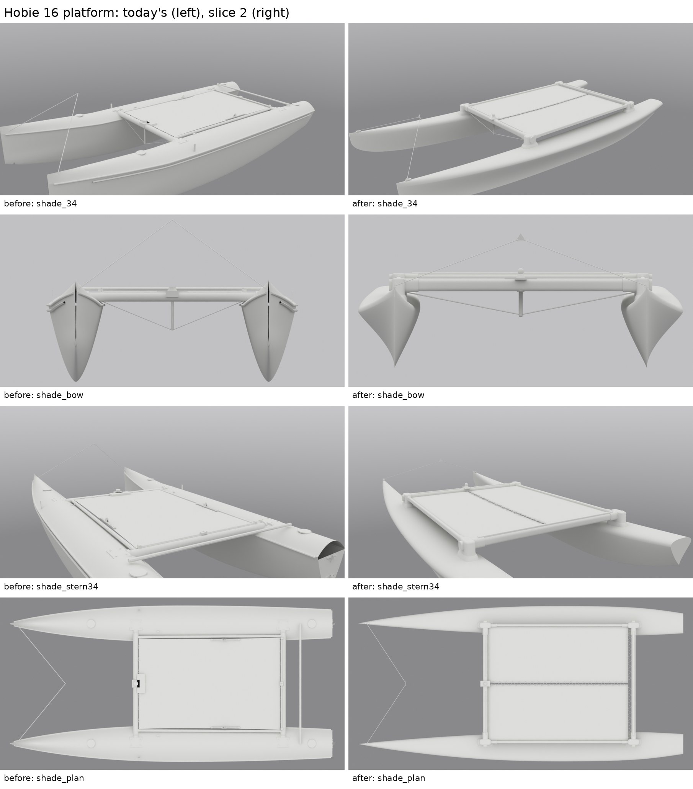
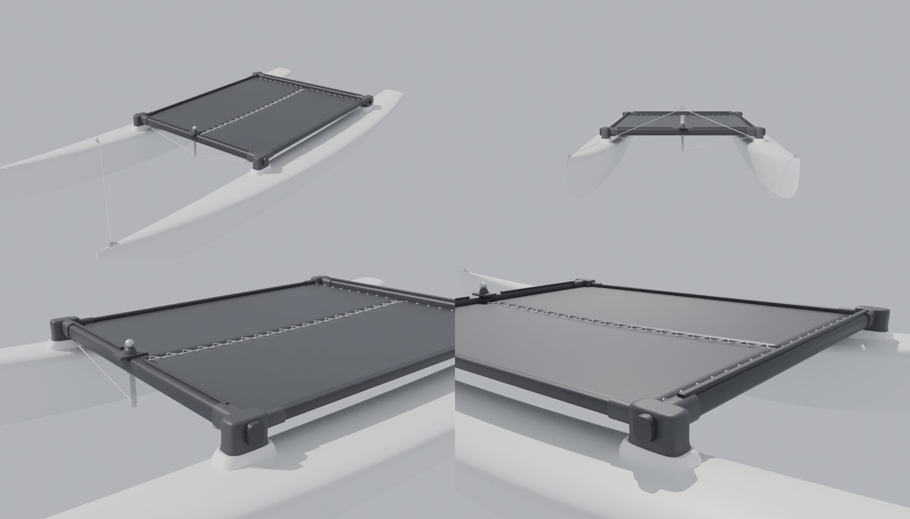
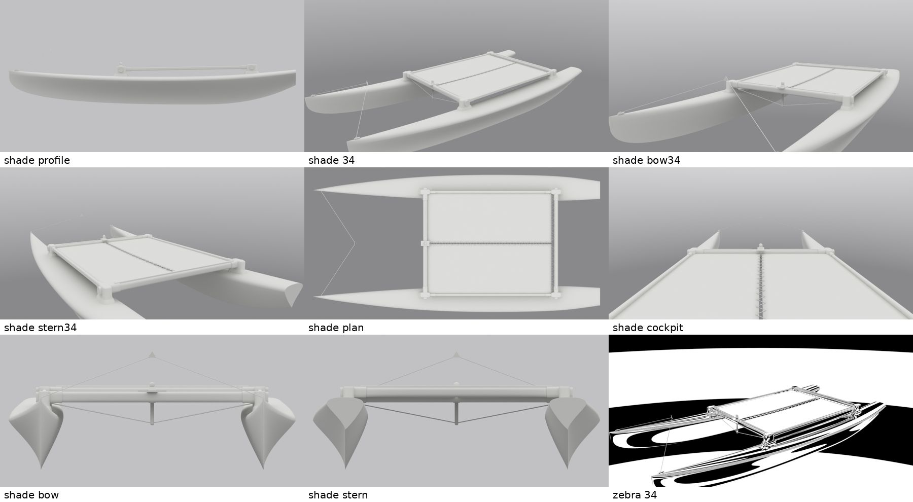

# Hobie 16 rebuild, slice 2: the platform

Slice 2 builds the Hobie 16's platform on slice 1's hulls (`docs/hobie16-2`). That is the frame of two crossbars and two
sidebars on four corner castings, the trampoline laced inside it, the dolphin striker, the mast step, and the bow tangs
with the forestay's bridle. Plan: <https://claude.ai/artifact/QKsLR7Kyeh9uk9AWraasNC>.

Nothing is imported into Unreal and nothing in the game changes. The new files are under `Tools/`, so the pull request
needs Bean's `bean-approved` label, and it stays a draft until after the Dec 11 release.



## Words used here

- **Crossbars:** the two aluminium beams across the boat. The front one carries the mast step and the jib track; the
  rear one carries the main traveller's track.
- **Sidebars:** the two extrusions along the hulls between the crossbars. The trampoline's edge slides into a groove in
  each.
- **Corner castings:** the cast fittings at the frame's four corners. Each takes a crossbar's end and a sidebar's end,
  and stands on a **pylon**, a raised pad moulded in the hull's deck.
- **Trampoline:** the fabric deck between the hulls, where the crew sit.
- **Dolphin striker:** a short post under the front crossbar's middle, with a rod from its foot to each end of the
  crossbar. It stiffens the crossbar against the mast's and forestay's pull.
- **Bridle:** two wires from the bows that meet at a plate, where the forestay ties on.

## What the photos showed

Two photos were read by eye in the desktop app's browser. Both are listed in `refs.json`, and neither is in the repo.

- **The Hobie on a mooring lift (CC0).** The frame is a raised rectangle on four castings, not bars lying on the decks.
  The crossbars run a hand's width outboard of their castings, and the dolphin striker hangs under the front one.
- **A current Hobie 16 on a Dutch beach, nearly broadside (public domain).** It shows broad white pylons about 5 cm tall
  with chunky black castings on them, and the sidebars' tops about 0.14 m over the deck. The mast's foot is about 62% of
  her length from the transom (the game's is 61%). The rear casting looks about 1.0 m from the transom; the game has
  0.77 m. That is a rough read, since the tiller crossbar overlaps it.

## How it's built

`Tools/shipkit/hobie16/platform_hobie16.json` holds the sizes, each with a note saying where it comes from.
`platform_hobie16.py` turns them into meshes with plain numpy, and `build_hobie16.py` adds them to the .blend as four
objects:

- **`H16Platform_Frame`:**
  - the crossbars, rounded extrusions 72 × 88 mm (front) and 66 × 78 mm (rear), with the jib track and the traveller
    track on top;
  - the grooved sidebars;
  - the four corner castings, each with a sleeve for each tube;
  - the dolphin striker, 0.18 m deep, with its two rods;
  - the mast step: a plate, a raised pedestal and the ball.
- **`H16Platform_Boss`:** the four pylons moulded in the decks. Each is a rounded pad 0.26 × 0.13 m and 4.5 cm tall.
  Its foot follows the crowned deck 4 mm under it, so it meets the hull all round. The seam check confirms it: the join
  `H16Platform_Boss|H16_Hull` has no open bins.
- **`H16Platform_Tramp`:** the trampoline's two halves, laced together on the centreline. Its sides run in the
  sidebars' grooves and its front edge in the front crossbar. Its rear edge is laced to the rear crossbar by two lacing
  lines. It sags 18 mm in the middle.
- **`H16Platform_Bridle`:** a tang on each bow, the two wires and the bridle plate. The plate's position is solved
  from the wire length (1.16 m) and its height (0.3 m over the front crossbar).

The crossbars stay where the game has them: x 0.55 (the mast) and x −1.75. The physics' mast, traveller and crew
positions don't move until slice 9. The frame's corners are 3 cm inboard of each hull's centreline. The tubes'
undersides are 7.5 cm over the deck.

The platform is 10,626 triangles, against its budget of 150,000. The castings and the tramp get their detail and
textures in slices 6 and 7.



## Checks

The size check (`hobie16_check.py --slice 2`) passes. The hulls are unchanged from slice 1, and both sections are
under budget. From this slice on, the check also reads the build report's platform numbers against two class rules:

| Class rule | Model | Needs |
| --- | ---: | ---: |
| Bridle wire, pin to pin (5.1) | 1.147 m | at least 1.118 m |
| Dolphin striker under the front crossbar (6.4) | 0.180 m deep | present |

Where the platform stands, in metres over the game's waterline with the two crew aboard (`hobie16_report.json`,
`platform`):

| | Height |
| --- | ---: |
| Front crossbar's underside | 0.238 |
| Rear crossbar's underside | 0.285 |
| Trampoline, lowest point (crew aboard) | 0.278 |
| Trampoline, lowest point (empty boat) | 0.355 |
| Dolphin striker's foot | 0.058 |
| Bridle plate | 0.626 |
| Top of the mast step's ball | 0.409 |

The trampoline inside the frame is 2.19 m long and 1.78 m wide.



## Reviews

**Blind reviewers.** Each reviewer saw today's platform and the new one side by side in six views:

- three-quarter;
- bow-on;
- stern three-quarter;
- plan;
- a low view along the trampoline;
- bow three-quarter.

They didn't know which was which, and the sides were shuffled for each view. Each model was shown on its own hulls,
and reviewers were told to judge only the platform.

- **Round 1** (the first draw): two of three reviewers preferred today's platform. Their shared notes:
  - the castings read as tall, thin stalks that made the frame float;
  - the rear crossbar looked too far forward.
- **Round 2:** I made these changes:
  - each casting now stands on a broad pylon pad moulded in the deck, with a chunky body round the corner;
  - the frame came down from 12 cm to 9 cm over the deck;
  - the mast step got a raised pedestal.
- **Final round** (round 2, three new reviewers, asked to describe both pictures in each row so their reading could be
  checked): all three chose the new platform overall, in 17 of 18 views. The one view that went to today's was a
  bow-on, for its lower bridle and its bar lying closer to the decks. One reviewer swapped the letters in a row while
  describing the right model; that row was counted by the description.

After the final round, the frame came down another 1.5 cm to match the beach photo's sidebar height, because all three
reviewers still saw the castings as a little tall. The dolphin striker was shortened from 0.22 m to 0.18 m so its foot
stays 6 cm over the water with the crew aboard. Both are small steps in the direction the reviewers asked for, so there
was no further round.

What the final reviewers still see wrong, for the rounds with Bean's photos:

- **The rear crossbar's position:** two of three want it 0.2–0.3 m further aft, about 0.45–0.6 m from the transoms.
  The beach photo puts it about 1.0 m from them, and the game has 0.77 m. It stays at the game's position until a
  photo from above or Bean's tape measure decides. Moving it would also move the traveller and the crew in the physics
  (slice 9).
- **The centre lacing:** one reviewer (about 70% sure) thinks the trampoline is one piece, laced only at the rear.
  Another says it is two halves laced down the middle. Hobie's parts list for the 14 and 16 has a 20 ft centre lacing
  line (32 ft on double-grommeted trampolines), so the two halves stay.
- **The castings:** all three still see them as a little tall and round. They want low, blocky castings with flared
  feet. Slice 6 shapes the castings in detail.
- **The bridle plate's height:** the reviewers are split. Two want it lower (0.3–0.5 m over the tramp), one says it's
  fine. It stays at 0.3 m over the front crossbar until slice 4 hangs the forestay from it.
- **The mast step:** one wants a longer raised casting, about 15 cm, on the front crossbar. The plate is now 15 cm
  long; slice 4 adds the mast's own base casting on the ball.
- **The front crossbar:** one wants it a little deeper, about 10 cm with a flatter top, against today's 8.8 cm.
- **A tiller crossbar** aft of the rear crossbar was missed by two reviewers. It belongs to the rudders and comes in
  slice 3.

## Reproduce

```
blender -b -P Tools/shipkit/hobie16/build_hobie16.py -- <work>/s2
blender -b -P Tools/shapeloop/measure.py -- <work>/s2/hobie16.blend Tools/shapeloop/sections_hobie16_rebuild.json <work>/s2/m
python3 -I Tools/shipkit/hobie16/hobie16_check.py <work>/s2/m/stats.json --slice 2
python3 -I Tools/shipkit/hobie16/platform_hobie16.py
blender -b -P Tools/shapeloop/seams.py -- <work>/s2/hobie16.blend Tools/shapeloop/sections_hobie16_rebuild.json <work>/s2/seams
blender -b -P Tools/shapeloop/render_set.py -- <work>/s2/hobie16.blend Tools/shapeloop/sections_hobie16_rebuild.json <work>/s2/r --res 1200
python3 -I Tools/shipkit/hobie16/docs_hobie16.py <work>/s2/r <work>/s2/r <work>/s2/docs
python3 Tools/shapeloop/make_sheet.py <today's platform> <work>/s2/r <out.jpg> shade_34 shade_bow shade_stern34 shade_plan
```

`<today's platform>` is `render_set.py` on docs/hobie16-1's `Hobie16_shape.blend`. Its sections file holds only the
hull and fittings sections (`Hobie16_Fittings` holds today's beams, trampoline and bridle with its hardware). The
colour picture is a Cycles render that uses each material slot's colour. In the cloud, `blender -b -P <script> --` was a
Python 3.13 venv with `pip install bpy numpy scipy pillow matplotlib`, through a wrapper that imports `bpy` first and
sets `sys.argv`.

## Next: slice 3, the rudders

The two kick-up rudders on their cast heads on the transoms, the tiller arms, the tiller crossbar and the tiller
extension. The blade's length and rake, and the draft with the rudders down, need a photo of a Hobie on the beach or a
trailer.
