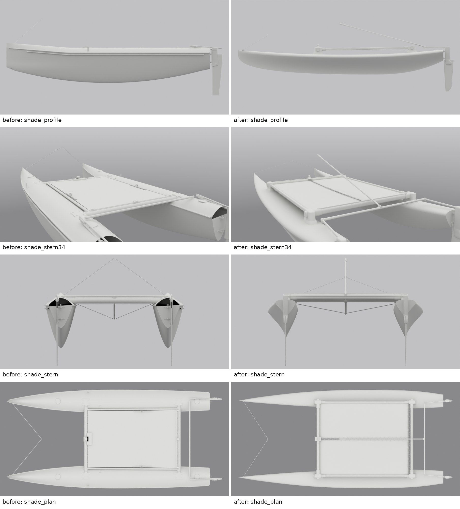
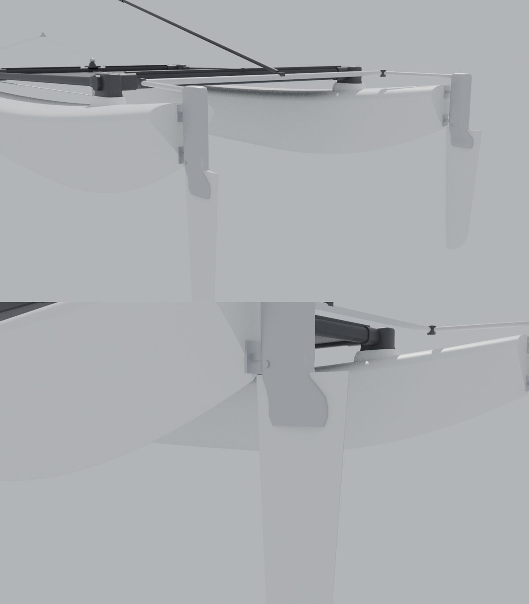
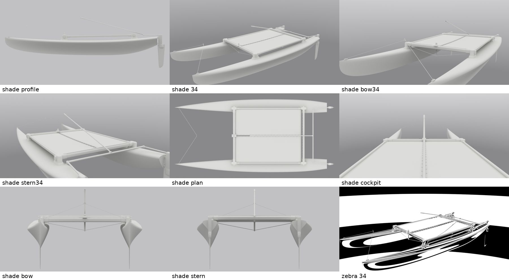

# Hobie 16 rebuild, slice 3: the rudders

Slice 3 hangs the Hobie 16's two kick-up rudders on slice 1's transoms (`docs/hobie16-2`) and joins them with the tiller
arms, the tiller crossbar and the tiller extension. Plan: <https://claude.ai/artifact/QKsLR7Kyeh9uk9AWraasNC>.

Nothing is imported into Unreal and nothing in the game changes. The new files are under `Tools/`, so the pull request
needs Bean's `bean-approved` label, and it stays a draft until after the Dec 11 release.



## Words used here

- **Gudgeons:** the two cast eyes on each transom that the rudder hangs on, one under the deck and one near the
  transom's foot.
- **Upper casting:** the cast head the rudder turns in. Its pintles drop into the gudgeons, the tiller arm bolts to its
  top, and the lower casting pivots on a pin at its foot.
- **Lower casting:** the casting that holds the blade's head between its cheeks. It kicks up about that pin when the
  blade hits the beach; a cam holds it down while sailing.
- **Tiller arms:** the aluminium tubes from each upper casting forward to the tiller crossbar.
- **Tiller crossbar:** the bar joining the two arms just aft of the rear crossbar, so both rudders turn together. It
  slides across the boat as she steers.
- **Tiller extension:** the long stick on a universal joint at the crossbar's middle that the helm holds from the
  trampoline or out on the wire.

## Where the sizes come from

`Tools/shipkit/hobie16/rudder_hobie16.json` holds every size with a note naming its source.

- **The blade's thickness and taper** are the class rule's: at most 25.8 mm thick, tapering over 610 mm to 12.7 mm
  thick 51 mm from the tip. The taper starts where the blade leaves the lower casting, which puts the tip 0.661 m below
  the casting's foot.
- **The blade's chord,** about 9 3/4 in (0.248 m) at its head, is an owner's figure on Hobie's forum. The model's is
  0.24 m at the head, narrowing to 0.14 m before the tip rounds off.
- **The tiller crossbar:** the usual adjustable H16 bar is 76 in (1.93 m), on a boat an owner measured at 83 1/2 in
  (2.12 m) between the rudders (Hobie's forum). So the arms angle inboard to it.
- **The tiller extension** is 84 in (2.13 m) in Hobie's parts guide.
- **The draft with the rudders down** is not published. Hobie gives only the 10 in with them up, and boat-specs.com
  gives 0.6 m (2 ft). The class rule's taper gives 0.672 m below the empty boat's waterline, and that is the model's.

## How it's built

`rudder_hobie16.py` turns the json into meshes with plain numpy, and `build_hobie16.py` adds them to the .blend as four
objects:

- **`H16Rudder_P` and `H16Rudder_S`:** each rudder, with its origin on its pivot line (x -2.57, 5 cm aft of the
  transom, the game's `RudderPivot` sockets), so it can turn about it:
  - the upper casting, 12 × 7 cm, standing 7 cm over the deck, with its tiller arm's socket;
  - the lower casting, lofted down from the upper casting's foot round the blade's head, so the two read as one cast
    head;
  - the blade, a symmetric NACA four-digit section at the class thickness. Its leading edge runs straight down, 2° aft
    of plumb. The trailing edge sweeps forward into a long elliptical tip. 16% of the chord is forward of the pivot.
- **`H16Rudder_Gudgeons`:** the four gudgeons, each a plate on the transom with an eye. Their backs follow the transom,
  and the seam check confirms they meet it: the join `H16Rudder_Gudgeons|H16_Hull` has no open bins.
- **`H16Tiller_Crossbar`:** the two tiller arms, the crossbar (1.76 m, 0.1 m over the decks at x -2.06) and the
  extension, drawn pointing forward and up over the rear crossbar at 15°.

Each rudder hangs on the middle of its transom (y ±0.935), where the transom is 0.27 m tall and takes both gudgeons.
The game's physics and sockets have the rudders at y ±1.0, 6.5 cm further out, where slice 1's transom is only 0.16 m
tall. Slice 9 moves the physics' rudders to the drawing.

The rudders and tiller are 5,264 triangles, against their budget of 80,000. The castings get their cam, pins and
detail in slice 6, and their textures in slice 7.



## Checks

The size check (`hobie16_check.py --slice 3`) passes. The hulls and platform are unchanged from slice 2. From this
slice on, the size card has one more target, the draft with the rudders down:

| | Model | Target |
| --- | ---: | ---: |
| Draft, rudders down, empty boat | 0.671 m | 0.672 m (class rule's taper) |
| Draft, rudders down, crew aboard | 0.749 m | |

From the build report (`hobie16_report.json`, `rudders`):

| | Value |
| --- | ---: |
| Wet blade area each, crew aboard | 0.137 m² |
| Wet blade area each, empty boat | 0.119 m² |
| Gudgeons, height over the waterline | 0.059 and 0.234 m |
| Tiller crossbar's height over the waterline | 0.336 m |



## Reviews

**Blind reviewers.** Each reviewer saw today's rudders and the new ones side by side in six views:

- profile;
- stern three-quarter;
- stern-on;
- three-quarter;
- plan;
- the profile silhouette.

They didn't know which was which, and the sides were shuffled for each view. They were asked to describe both pictures
in each row, so their reading could be checked against the key.

- **Round 1:** all three chose the new rudders, in 15 of 18 views, with 2 ties. Their shared notes:
  - the upper and lower castings read as two boxes with a gap;
  - the blade looked like a parallel paddle, where a Hobie's tapers to a long rounded tip;
  - the tiller arms should angle inboard to the crossbar.
- **Round 2:** I made these changes:
  - the lower casting is lofted from the upper casting's foot, so the head reads as one casting;
  - the blade's chord narrows from 0.24 to 0.14 m, and the trailing edge sweeps into an elliptical tip;
  - the crossbar was shortened so the arms angle inboard.

  Today's model has only one rudder mesh, so for round 2 it was drawn with both rudders, a fairer comparison. All three
  new reviewers chose the new rudders, in 16 of 18 views, with 2 even.

After round 2, I made the small changes the reviewers asked for, with no further round:

- The blade's rake came down from 5° to 2°: the reviewers saw 5° as too much.
- The upper casting is chunkier, 12 × 7 cm standing 7 cm over the deck: they saw it as a thin post.
- The tiller arms are straight tubes.
- The crossbar went from 1.68 m to 1.76 m: they thought 0.19 m of angle in all was too much.

What the reviewers still see differently, for the rounds with Bean's photos:

- **The tiller extension's length:** all six reviewers thought it long. They remembered 1.2–1.8 m; Hobie's parts guide
  says 84 in (2.13 m). The parts guide's length stands until a photo or Bean's tape measure decides.
- **The blade's depth:** round 1's reviewers remembered about 2.5 ft (0.76 m) under the water, and boat-specs.com says
  0.6 m. The class rule's taper gives 0.672 m, between them.
- **Where the rudders hang:** the drawing has them 1.87 m apart, on the transoms' middles. The physics has 2.0 m, and an
  owner measured 2.12 m on a 1983 boat. Where the transoms and rudders really sit needs a photo from astern.
- **The castings:** the reviewers want more of a real casting's detail, such as the cam and the kick-up pin. Slice 6
  adds them.
- **The gudgeons:** they are small cast plates on the transom, and hard to see in some views. They get their
  detail in slice 6.
- **The tip's shape:** the reviewers' sketches differ. The elliptical tip follows the class rule's taper to a point
  51 mm from the tip.

## Reproduce

```
blender -b -P Tools/shipkit/hobie16/build_hobie16.py -- <work>/s3
blender -b -P Tools/shapeloop/measure.py -- <work>/s3/hobie16.blend Tools/shapeloop/sections_hobie16_rebuild.json <work>/s3/m
python3 -I Tools/shipkit/hobie16/hobie16_check.py <work>/s3/m/stats.json --slice 3
python3 -I Tools/shipkit/hobie16/rudder_hobie16.py
blender -b -P Tools/shapeloop/seams.py -- <work>/s3/hobie16.blend Tools/shapeloop/sections_hobie16_rebuild.json <work>/s3/seams
blender -b -P Tools/shapeloop/render_set.py -- <work>/s3/hobie16.blend Tools/shapeloop/sections_hobie16_rebuild.json <work>/s3/r --res 1200
python3 -I Tools/shipkit/hobie16/docs_hobie16.py <work>/s3/r <work>/s3/r <work>/s3/docs
python3 Tools/shapeloop/make_sheet.py <today's rudders> <work>/s3/r <out.jpg> shade_profile shade_stern34 shade_stern shade_plan
```

`<today's rudders>` is `render_set.py` on docs/hobie16-1's `Hobie16_shape.blend` with its rudder mesh mirrored to the
starboard side. The colour picture is a Cycles render that uses each material slot's colour. In the cloud,
`blender -b -P <script> --` was a Python 3.13 venv with `pip install bpy numpy scipy pillow matplotlib`, through a
wrapper that imports `bpy` first and sets `sys.argv`.

## Next: slice 4, the mast and standing rig

The rotating mast (8.07 m) on the step's ball, the shrouds, the forestay to the bridle plate, and the trapeze wires.
The Hobie 16 has no spreaders. The mast's rake and section need a photo of a rigged boat.
