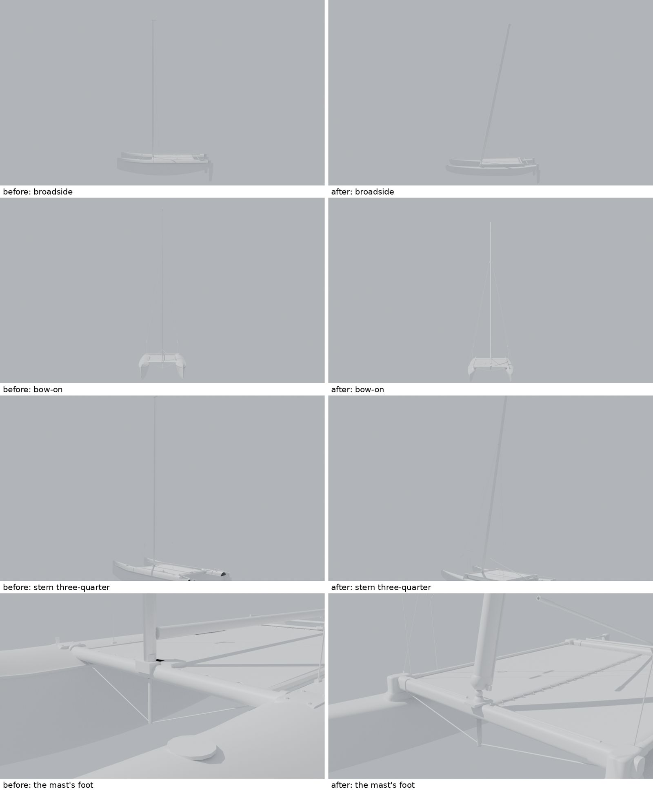
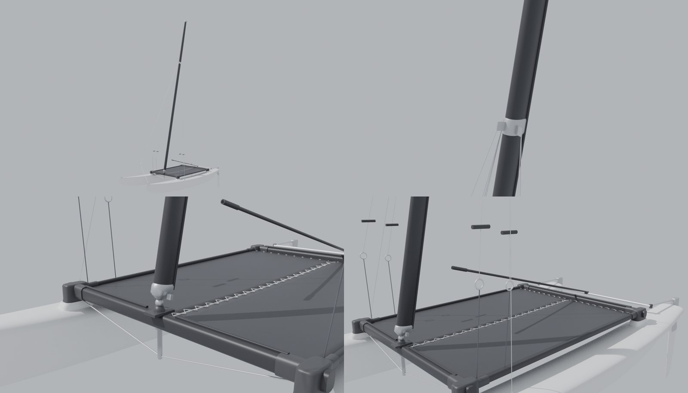
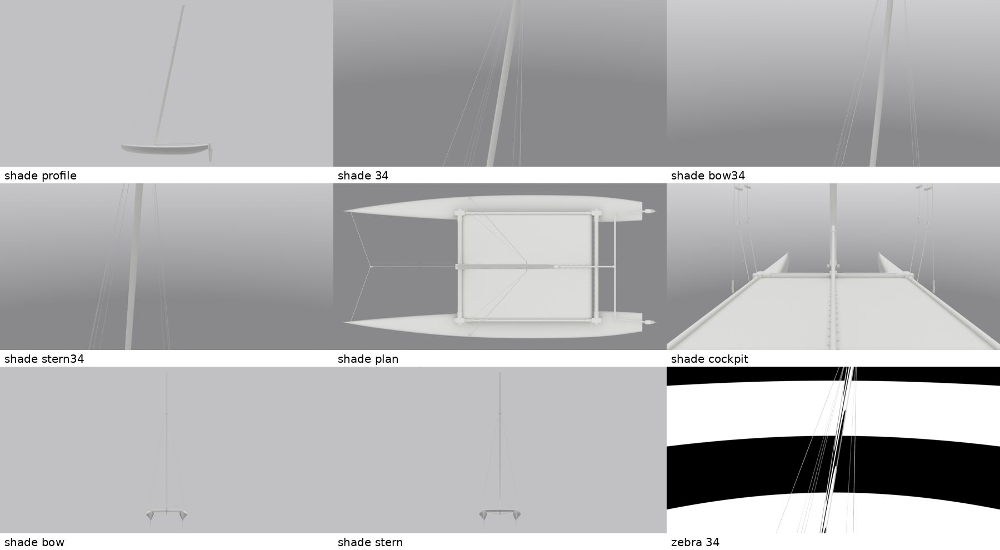

# Hobie 16 rebuild, slice 4: the mast and standing rig

Slice 4 stands the Hobie 16's rotating mast on slice 2's mast step (`docs/hobie16-3`). It also adds:

- the forestay to the bridle;
- the two shrouds;
- the four trapeze wires.

Plan: <https://claude.ai/artifact/QKsLR7Kyeh9uk9AWraasNC>.

Nothing is imported into Unreal and nothing in the game changes. The new files are under `Tools/`, so the pull request
needs Bean's `bean-approved` label, and it stays a draft until after the Dec 11 release.



## Words used here

- **Rotating mast:** the mast stands on a ball on the front crossbar and turns with the sail, so its wing section
  lines up with the mainsail.
- **Rake:** how far the mast leans aft. Hobie 16s are sailed with a lot of it.
- **Hounds:** the fitting about 70% up the mast. The forestay, both shrouds and all four trapeze wires pin on there.
  The Hobie 16 has one set of hounds, and no spreaders or diamond wires.
- **Forestay:** the wire from the hounds forward to the bridle plate.
- **Shrouds:** the two wires from the hounds down to each side.
- **Chainplates:** the fittings the shrouds pin to.
- **Stay adjusters:** the plates with a row of holes at the foot of the forestay and shrouds, for setting the rake.
- **Trapeze wires:** the wires the crew hang from, out over the side, in a harness hooked to a ring. There are two a
  side, one for each crew. Each has a handle above its ring. A shock cord holds the ring down when nobody is on it.

## How the rake is found

The mast's length is on Hobie's spec sheet: 26 ft 6 in (8.07 m). Its rake and the height of the hounds are not
published. They follow from the wires, so `rig_hobie16.py` solves them from the wire lengths that owners quote from
Hobie's wire guide, pin to pin:

| Wire | Length | With |
| --- | ---: | --- |
| Forestay | 17 ft 6 in (5.334 m) | the current "Aussie" pigtail, 9 3/4 in, and the stay adjuster's middle hole |
| Shrouds | 18 ft 10 1/4 in (5.747 m) | the shroud's stay adjuster, 0.14 m |
| Trapeze wires | 16 ft 7 1/4 in (5.061 m) | finished, with stops and handle |

The forestay holds the hounds forward, and the shrouds hold them down and aft. Both must just reach. The bridle plate
rides where a stay from the hounds pulls it. That is the point its two 1.144 m wires allow that lies nearest the
hounds, so the bridle lines up with the forestay.

Owners check their rake with the main halyard (Hobie's forum). They pull it from the masthead to the top of a bow
tang's bolt, then swing it to the transom. The mark lands 6 to 16 in below the transom's bottom edge; about 16 in is
the usual start. The build report works out the same mark on the model (`halyard_rake_in`).

That measure decided where the shrouds land:

- **Chainplates on the sidebars** (round 1, from my reading of the parts guide) give a 7.7° rake. The halyard mark
  is then 0 in, outside owners' range.
- **Chainplates at the hulls' outer deck edge,** where today's model has them and where all three round 1 reviewers
  put them, bring the mark into the range.

The shroud adjuster's setting then picks a rake inside owners' range. Round 2's reviewers asked for less than 12.9°,
so it is set to land mid-range. That gives:

- **Rake:** 11.6° aft. The masthead is 1.62 m aft of the mast's foot.
- **Halyard mark:** 12.7 in below the transom's bottom edge.
- **Hounds:** 5.60 m up the mast (69%), 5.90 m over the water.
- **Masthead:** 8.39 m over the empty boat's waterline. The game's physics has 8.5 m.
- **Bridle plate:** 0.88 m over the water, 1.51 m ahead of the mast. Slice 2 had it 0.3 m over the front crossbar,
  which only holds with no stay on it.

## How it's built

`Tools/shipkit/hobie16/rig_hobie16.json` holds the sizes and wire lengths, each with a note naming its source.
`rig_hobie16.py` turns them into meshes with plain numpy. `build_hobie16.py` adds them to the .blend as three objects:

- **`H16Mast`:** its origin is on the step's ball, so it can turn about its own axis. It has:
  - the extrusion, a wing section 0.14 × 0.075 m with the luff track along its back. It narrows over its top metre
    into the current mast's composite tip (the parts guide's "comptip");
  - the base casting, a cup over the ball, with its rotation stops;
  - the hounds band with its tangs;
  - the masthead casting with its sheave box.
- **`H16Rig_Stays`:** the forestay with its stay adjuster, and the shrouds with theirs. The chainplates are straps on
  the hulls' outboard sides at the deck edge, 0.17 m aft of the mast, each pin 8 cm over the deck.
- **`H16Rig_Trapeze`:** the four trapeze wires from the hounds. Each has its ring, a handle 0.32 m above it, and a
  shock cord to the hull's deck edge. The rings hang forward beside the shrouds, 0.72 m over the trampoline.

The build also writes `hobie16_sockets.json`: the mast's heel and head, the hounds, the forestay's tack and the
chainplates, in the game's frame. The check reads the mast's length from it. Slice 8 writes the full set of sockets the
game draws from.

The rig is 2,628 triangles, against its budget of 120,000. The halyards, cleats and the mast's base fittings come with
the running rigging in slice 6.



## Checks

The size check (`hobie16_check.py --slice 4`, given the build's sockets file) passes. It measures the mast for the
first time: 8.070 m from heel to head, against 8.07 m. The hulls, platform and rudders are unchanged from slice 3,
except the bridle plate, which has moved. Its wires are still 1.144 m pin to pin, against the class's 1.118 m minimum.

From the build report (`hobie16_report.json`, `rig`):

| | Model | Target |
| --- | ---: | ---: |
| Forestay, pin to pin with pigtail and adjuster | 5.662 m | 5.662 m |
| Shroud, pin to pin with adjuster | 5.887 m | 5.887 m |
| Halyard rake mark below the transom | 12.7 in | 6 to 16 in |
| Rake | 11.6° | (solved) |
| Hounds, share of the mast | 69% | (solved) |
| Trapeze rings over the trampoline | 0.72 m | |



## Reviews

**Blind reviewers.** Each reviewer saw today's rig and the new one side by side, both in plain clay, in six views:

- broadside;
- bow three-quarter;
- bow-on;
- stern three-quarter;
- a close-up of the hounds;
- a close-up of the mast's foot.

They didn't know which was which, and the sides were shuffled for each view. They were told to judge only the mast and
rig, and to describe both pictures in each row so their reading could be checked against the key. Every description in
both rounds matched the key.

- **Round 1** (rake 7.7°, chainplates on the sidebars): all three chose the new rig, in all 18 views. They all named
  the rake, the hounds fitting and the ball step as what made it a Hobie 16. Today's mast is plumb, with no hounds
  fitting, in a box on the crossbar. Their shared notes:
  - the mast's section read as a round tube; they asked for a teardrop 15–16.5 cm long by 7–8 cm wide;
  - the shrouds should land on the hulls' outer sheer (all three);
  - the wires are hard to see from a distance.
- **Round 2:** I made these changes:
  - the section's chord went from 0.115 m to 0.14 m (the width keeps one owner's figure of 3 in);
  - the chainplates moved to the hulls' deck edge, which, with Hobie's wire lengths, raked the mast 12.9°, the
    halyard mark at 16.7 in.

  Three new reviewers all chose the new rig, again in all 18 views.

After round 2, two of three reviewers wanted less rake (7–8° and 10°; the third said 11–13°). All three wanted the
trapeze rings higher. So I made two small changes, with no further round:

- the shroud adjuster now lands the halyard mark mid-range: 11.6°, 12.7 in;
- the rings hang forward beside the shrouds, 0.72 m over the trampoline, up from 0.6 m.

What the reviewers still see differently, for the rounds with Bean's photos:

- **The rake:** the reviewers ranged from 7° to 13°. Owners' halyard measure on this model's hulls allows about 9.5°
  to 12.6°. A broadside photo of a rigged boat decides.
- **The trapeze rings:** the reviewers want them 0.9–1.0 m over the trampoline. Hobie's wire length allows about
  0.7 m where they hang.
- **The mast's section** still reads round to all three. The only published figure is one owner's rough 4 1/2 × 3 in;
  a tape on a real mast decides.
- **The wires are hard to see** in the far views. They are drawn close to their real sizes (forestay 4.8 mm, shrouds
  4 mm, trapeze wires 3.2 mm). The game's live rig lines keep at least 0.8 pixels on screen (boat fidelity 4); slice 8
  decides which of these wires the game draws as live lines.
- **The mast's length:** all three round 2 reviewers read it as 4–8% short. It measures 8.070 m in the check; the
  rake makes it look shorter.
- **A rotation arm** at the mast's foot: one reviewer in each round wanted one. Hobie's parts guide lists only the base
  casting's rotation stops.
- **The hounds' tangs** read as boxy blocks to one reviewer. Slice 6 shapes the fittings.

## Reproduce

```
blender -b -P Tools/shipkit/hobie16/build_hobie16.py -- <work>/s4
blender -b -P Tools/shapeloop/measure.py -- <work>/s4/hobie16.blend Tools/shapeloop/sections_hobie16_rebuild.json <work>/s4/m
python3 -I Tools/shipkit/hobie16/hobie16_check.py <work>/s4/m/stats.json <work>/s4/hobie16_sockets.json --slice 4
python3 -I Tools/shipkit/hobie16/rig_hobie16.py
blender -b -P Tools/shapeloop/seams.py -- <work>/s4/hobie16.blend Tools/shapeloop/sections_hobie16_rebuild.json <work>/s4/seams
blender -b -P Tools/shapeloop/render_set.py -- <work>/s4/hobie16.blend Tools/shapeloop/sections_hobie16_rebuild.json <work>/s4/r --res 1200
python3 -I Tools/shipkit/hobie16/docs_hobie16.py <work>/s4/r <work>/s4/r <work>/s4/docs
```

The before-and-after and colour pictures are Cycles renders from fixed cameras of each whole .blend: today's from
docs/hobie16-1's `Hobie16_shape.blend` with both rudders drawn, the new one in clay and in each material slot's colour.
In the cloud, `blender -b -P <script> --` was a Python 3.13 venv with `pip install bpy numpy scipy pillow matplotlib`,
through a wrapper that imports `bpy` first and sets `sys.argv`.

## Next: slice 5, the sails

The fully battened main (8 battens) and jib (4), at Hobie's 13.77 m² and 5.12 m², in the rainbow livery the game
already wears; the boom on its gooseneck; and the mainsheet and jib sheets' blocks.
