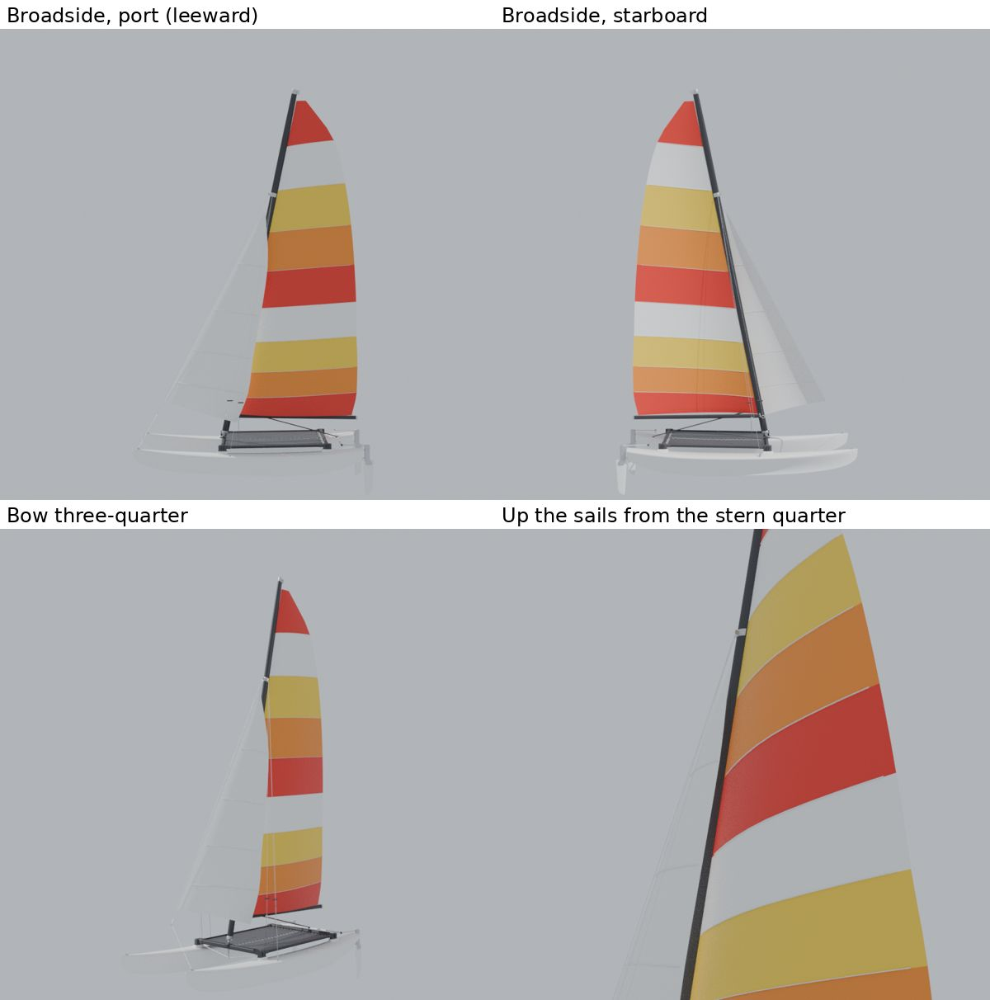
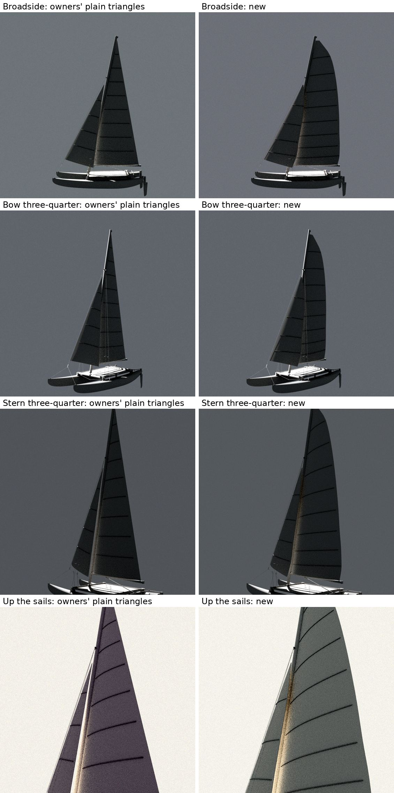
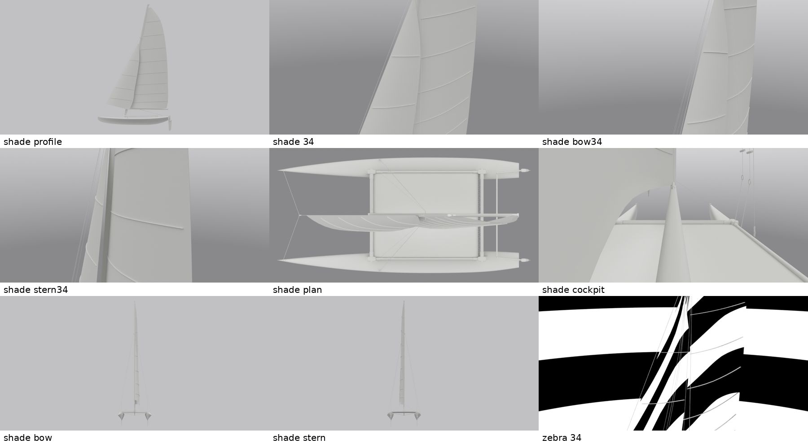

# Hobie 16 rebuild, slice 5: the sails and boom

Slice 5 hangs the Hobie 16's sails on slice 4's mast and forestay (`docs/hobie16-5`):

- the fully battened mainsail, 8 battens, on the mast's luff track;
- the battened jib, 4 battens, on the forestay;
- the boom, from the gooseneck to its end cap past the main's clew.

Both sails are sheeted for sailing upwind on starboard tack, so they sit to port.

Plan: <https://claude.ai/artifact/QKsLR7Kyeh9uk9AWraasNC>.

Nothing is imported into Unreal and nothing in the game changes. The new files are under `Tools/`, so the pull request
needs Bean's `bean-approved` label, and it stays a draft until after the Dec 11 release.



## Words used here

- **Luff, leech, foot:** a sail's front edge (on the mast or forestay), back edge and bottom edge.
- **Tack, clew, head:** the sail's front-bottom, back-bottom and top corners.
- **Battens:** stiff strips in pockets across the sail. On a Hobie 16 they run the whole way from the luff to the
  leech ("fully battened").
- **Roach:** the cloth that bulges out past a straight line from the head to the clew. The long battens hold it out.
  It is most of what makes a Hobie 16 main look like one.
- **Camber:** how deep the sail's curve is, as a share of its width.
- **Twist:** how much the top of a sail opens away from the wind compared with its bottom.
- **Gooseneck:** the joint where the boom meets the mast.
- **Loose-footed:** the main's foot is held only at the tack and clew, not along the boom.

## Where the shapes come from

Hobie's spec sheet gives the areas: main 13.77 m² and jib 5.12 m². Hobie's parts guide gives every batten's length.
Owners give the edges (Good Old Boat's sail data, matched on Hobie's forum and Sailboat Owners):

| | Luff | Foot | Leech | Battens, bottom to top |
| --- | ---: | ---: | ---: | --- |
| Main | 24 ft (7.32 m) | 9 ft (2.74 m) | 25 ft 2 in (7.67 m) | 107 7/8, 103 7/8, 97 3/8, 90 3/4, 82 3/8, 72 1/8, 59 1/8, 41 in |
| Jib | 16 ft (4.88 m) | 5 ft 9 in (1.75 m) | 15 ft 9 in (4.80 m) | 67, 56, 43 3/4, 28 in |

The plain triangles of those edges are only 9.9 m² and 4.2 m². The rest of Hobie's area is roach, so the model draws
the roach from the battens: each batten is as long as the sail's width at its height, plus 4 cm (3 cm on the jib) for
its pocket's ends. The leech is a fair curve through the battens' ends and the head.

The battens' heights up the luff are not published. `sails_hobie16.py` solves them from the areas. They follow one
curve, `(k / 9) ** p` up the luff for batten k, and `p` is found so the sail comes out at exactly Hobie's area:

- **Main:** p is 1.35. The battens sit 0.38, 0.97, 1.67, 2.46, 3.32, 4.24, 5.22 and 6.25 m up the luff, so they
  are closer together near the boom (0.6 m apart) than near the head (1.0 m).
- **Jib:** p is 1.41. The battens sit 0.50, 1.34, 2.37 and 3.56 m up the luff.

Round 1's reviewers expected the main's battens evenly spaced. With these batten lengths, even spacing would make the
main about 15 m², 9% over Hobie's figure. A photo of a real main decides.

**The corners.**

- **Main:**
  - The tack is 0.5 m up the mast, just over the class's black band, so the gooseneck is 0.60 m over the trampoline.
  - The boom is held by the mainsheet. Its end is 0.48 m over the rear crossbar's top, which leaves room for the 6:1
    mainsheet's blocks. The boom then droops 0.75° aft.
  - The head is 0.25 m under the masthead.
- **Jib:**
  - The tack is tied 0.32 m up the forestay from the bridle plate.
  - The clew stands 0.32 m to port, 0.30 m aft of the front crossbar and 0.40 m over it.
  - The clew's height is solved from the jib's three edges. Sheeted in, the leech is the edge that goes tight, so the
    clew comes down until the straight leech is owners' 15 ft 9 in.

**The main's leech is reported, not used.** Solved the same way, the main's 25 ft 2 in leech would drop the boom 10°,
its end 5 cm over the rear crossbar, with no room for the mainsheet's blocks. The real main's luff is cut with a curve
to fit the mast's bend: the composite tip bends aft when the sail is sheeted in. That brings the head aft and lets the
boom stand higher. This model's mast is straight, so its leech measures 7.28 m against owners' 7.67 m. Slice 9 or
Bean's photos decide.

**Shape when sheeted in.**

| | Main | Jib |
| --- | --- | --- |
| Camber, low to head | 10% to 6% | 10% to 8% |
| Deepest point, low to head | 42% to 48% of the width | 38% to 42% |
| Twist at the head | 10° | 8° |
| Battens' rise toward the leech, low to top | 3° to 8° | 7° to 8° |

The battens rise toward the leech so they stand about square to it, not parallel to the foot.

## How it's built

`Tools/shipkit/hobie16/sails_hobie16.json` holds the sizes, each with a note naming its source. `sails_hobie16.py`
turns them into meshes with plain numpy. `build_hobie16.py` adds three objects to the .blend:

- **`H16Sail_Main`:** both faces of the cambered sail. The panels between the battens take the four livery slots
  SailA to SailD in turn, so the game's striped schemes (`Inputs/g3/boat-catalogue.json`) can colour them. Its
  battens are strips on the sail's port face.
- **`H16Sail_Jib`:** both faces of the jib, in one slot, SailJib, and its battens.
- **`H16Boom`:** its origin is at the gooseneck. It has the black extrusion, the gooseneck casting and the end cap.

The pictures use a preview colouring: the catalogue's sunrise stripes (#E6332A, #F28C28, #F7D23A) and white. In the
game the livery's material colours the slots. The sail number, window and insignia come with the textures in slice 7.
Any insignia will be a made-up emblem, never Hobie's.

The sails and boom are 6,076 triangles, against their budget of 120,000. The mainsheet, jib sheets, traveller,
blocks and halyards come with the hardware and lines in slice 6.



## Checks

The size check (`hobie16_check.py --slice 5`) passes. It weighs the sails' areas for the first time:

| | Model | Target |
| --- | ---: | ---: |
| Main | 13.770 m² | 13.77 m² |
| Jib | 5.120 m² | 5.12 m² |

Each area is the sail's planform in its own plane: the luff and the faired leech as one polygon. The hulls, platform,
rudders and rig are unchanged from slice 4. The mast still measures 8.070 m, and the seams are closed.

From the build report (`hobie16_report.json`, `sails`):

| | Model |
| --- | ---: |
| Main's centre of effort, x and height | -1.31 m, 3.74 m |
| Jib's centre of effort, x and height | 0.46 m, 2.60 m |
| Whole sail plan's centre of effort, x and height | -0.84 m, 3.44 m |
| Boom's end aft of the rear crossbar | 0.74 m |
| Jib's nearest cloth to the mast's axis (at its head, ahead of the mast) | 0.07 m |

The boom's end lands 0.74 m aft of the rear crossbar. A 9 ft foot on a gooseneck at the mast puts it there, so the
crossbar may need to sit further aft. Slice 2's reviewers asked for that too. It is left for Bean's photos, because
moving the crossbar moves the platform.



## Reviews

**Blind reviewers.** Each reviewer saw two versions side by side, in plain clay, in seven views:

- broadside;
- bow three-quarter;
- bow-on;
- stern three-quarter;
- a close-up of the boom and the main's foot;
- a close-up of the jib;
- a view up the sails from the stern quarter.

They didn't know which was which, and the sides were shuffled for each view. They judged only the sails and boom, and
described both pictures in each row so their reading could be checked against the key. The game has no sail model to
compare with (its sails are cloth built from the physics at run time), so:

- **Round 1** compared the new sails with the owners' plain triangles. The reviewers chose the battened, roached sails
  in 16 of 21 views. Three were ties, and in two close-ups one reviewer slightly preferred the triangles. One reviewer
  swapped the letters in two rows, but the descriptions matched the key. Their shared notes:
  - the leech ran almost straight, then turned in at a hard shoulder at the top batten, like a modern square-top;
  - the sails were flat and untwisted;
  - they expected the battens evenly spaced.
- **Round 2:** I made these changes:
  - the leech became a fair curve through the battens' ends and the head;
  - the upper battens rise toward the leech;
  - camber went from 8% to 10% low (7% at the head), and the head twists off 10°.

  Three new reviewers compared round 2 with round 1. In the broadside, bow three-quarter and stern three-quarter views
  they chose round 2 every time: 8 of 8 (one reviewer left out one row). One reviewer swapped the letters in one row,
  but the description was of round 2. The bow-on view was a tie. The close-ups split, and one reviewer preferred round 1
  in three of them. Their notes:
  - the bottom batten made a small hook out past the clew;
  - the jib had a crease near its luff, and a leech hooked to windward;
  - the jib's battens drooped aft, not square to its leech.

After round 2 I made these changes, with no further round:

- the pockets' allowance went from 8 cm to 4 cm, which takes the hook out of the bottom batten and spreads the battens
  a little more evenly;
- the chord points were packed toward the luff, which removes the jib's crease;
- the camber line now leaves the leech flatter than a parabola;
- the jib's battens rise 7–8° from its foot, about square to its leech;
- the main's camber eases to 6% at the head, its deepest point moving aft.

What the reviewers still see differently, for the rounds with Bean's photos:

- **The battens' spacing.** Reviewers expect it even, about 0.8 m. Hobie's area with these batten lengths puts them
  closer together near the boom.
- **The battens' angle.** Two reviewers want the top battens to rise toward the leech, square to it. One wants them
  level or dropping aft, square to the luff.
- **Twist.** One reviewer thought 10° too much, one too little; the third wanted 5–8°.
- **The head under the masthead.** It is 0.25 m. One reviewer said the head locks at the masthead, about 5 cm under
  it. Owners' 24 ft luff and the class's black band at the gooseneck leave 0.25 m; a photo decides.
- **The boom.** It is 0.60 m over the trampoline at the gooseneck. Two reviewers were content with its height. One
  wanted its end 0.1–0.2 m higher.
- **The mast's rotation.** Sheeted in, the rotating mast turns to line up with the main's luff. It stands straight
  fore and aft here. The mast's object turns about its own axis, and slice 8 decides how the game turns it.

## Reproduce

```
blender -b -P Tools/shipkit/hobie16/build_hobie16.py -- <work>/s5
blender -b -P Tools/shapeloop/measure.py -- <work>/s5/hobie16.blend Tools/shapeloop/sections_hobie16_rebuild.json <work>/s5/m
python3 -I Tools/shipkit/hobie16/hobie16_check.py <work>/s5/m/stats.json <work>/s5/hobie16_sockets.json --slice 5
python3 -I Tools/shipkit/hobie16/sails_hobie16.py
blender -b -P Tools/shapeloop/seams.py -- <work>/s5/hobie16.blend Tools/shapeloop/sections_hobie16_rebuild.json <work>/s5/seams
blender -b -P Tools/shapeloop/render_set.py -- <work>/s5/hobie16.blend Tools/shapeloop/sections_hobie16_rebuild.json <work>/s5/r --res 1200
python3 -I Tools/shipkit/hobie16/docs_hobie16.py <work>/s5/r <work>/s5/r <work>/s5/docs
```

`sails_hobie16.py` needs numpy; the others run as in slice 4. The before-and-after and colour pictures are Cycles
renders from fixed cameras of the whole .blend: the new one in clay and in each material slot's colour, and the owners'
triangles as the same .blend with each sail redrawn as the plain triangle of its luff and foot.

## Next: Milestone A, then slice 6

Milestone A looks at the whole boat so far (hulls, platform, rudders, rig, sails) against the reference photos. Then
slice 6 adds the hardware and lines: the mainsheet and its traveller, the jib sheets and their cars, the halyards, the
blocks and cleats, and the trampoline's lacing.
