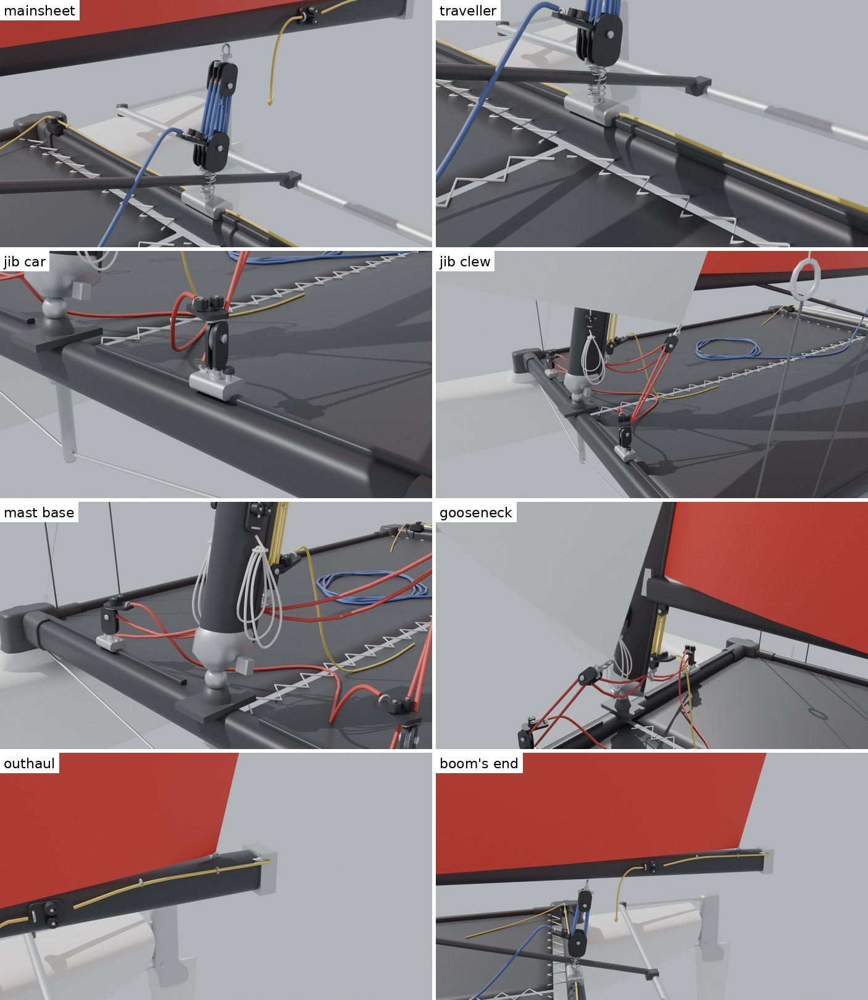
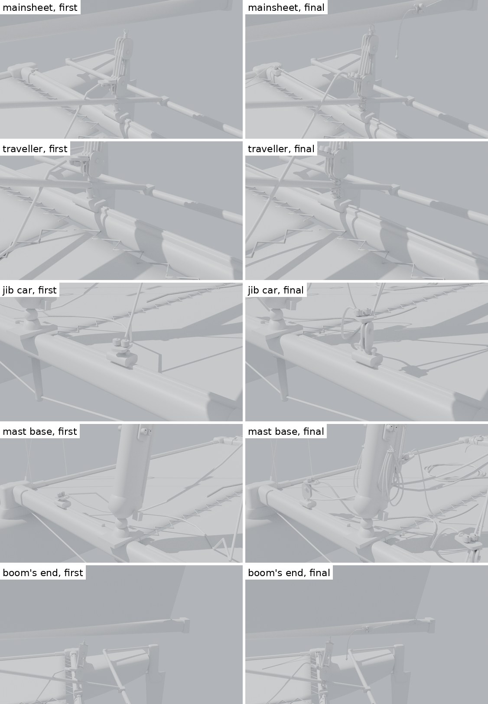
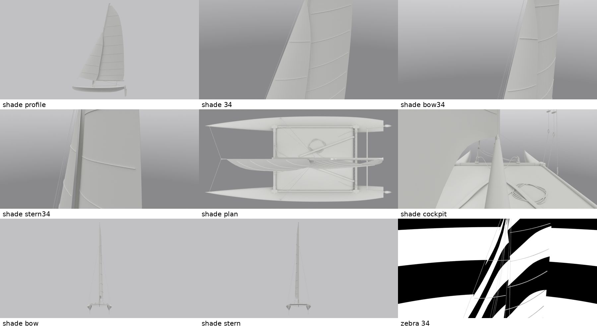

# Hobie 16 rebuild, slice 6: the hardware and lines

Slice 6 adds the Hobie 16's running rigging and deck hardware to the boat from slices 1 to 5 (`docs/hobie16-6`,
Milestone A in `docs/hobie16-milestone-a`):

- the mainsheet's 6:1 between the traveller car on the rear crossbar and the boom;
- the traveller car, its line, stops and cleats;
- the jib cars on the front crossbar and the 2:1 jib sheet;
- the jib's and main's downhauls, the outhaul, and the halyards' tails on the mast's foot;
- the hiking straps.

Bean asked for the detail to be modelled well, so every block, cleat, shackle and car is a real shape (sheaves, cheek
plates, teeth, pins), checked in close-ups by two rounds of blind reviewers. Everything is sheeted for sailing upwind
on starboard tack, as slice 5's sails are.

Plan: <https://claude.ai/artifact/QKsLR7Kyeh9uk9AWraasNC>.

Nothing is imported into Unreal and nothing in the game changes. The new files are under `Tools/`, so the pull request
needs Bean's `bean-approved` label, and it stays a draft until after the Dec 11 release.



## Words used here

- **Block:** a pulley. Its wheels are **sheaves**; a triple block has three side by side.
- **Purchase (6:1, 2:1):** how many parts of rope run between two blocks. A 6:1 pulls six times as hard as the rope
  in your hand, and you pull six times as much rope.
- **Two-blocked:** the two blocks pulled together until they touch. Hobie 16 crews sheet the main this hard upwind.
- **Traveller:** the car that slides across the rear crossbar, with the mainsheet's lower block on it. Its line moves
  it to either side.
- **Cam cleat:** two toothed cams that grip a rope pulled between them. A **fairlead** is the loop the rope leaves
  through.
- **Becket:** an eye on a block where a rope's end is tied.
- **Bail:** a strap riveted under the boom for a block to hook on.
- **Shackle:** a U of metal closed by a pin.
- **Downhaul (cunningham):** pulls a sail's front corner down. **Outhaul:** pulls the main's back corner out along the
  boom. **Halyard:** hoists a sail.

## Where it comes from

`Tools/shipkit/hobie16/hardware_hobie16.json` holds the sizes, each with a note naming its source.

**Counts and arrangements.**

- The class rules (`specs_hobie16.json` `class_facts`) give the mainsheet's 6:1 on a 35 ft line, the jib cars in the
  front crossbar's track locked by a plunger, up to 6:1 on the main's downhaul, and the outhaul cleated on the boom.
- The Hobie class association's page on the H16 mainsheet gives the standard blocks: a 57 mm triple with a ratchet
  and cam below, a 40 mm triple with a becket above. Since 2022 a block made for the boat replaces them. The model's
  blocks are generic shapes of those sizes, not any maker's design.
- The jib sheet is one 2:1 line, as an owner on Hobie's forum gives its path: from the becket on the jib car up to
  the block on the clew, back to the car and through its swivel cleat, and the same on the other side. So the clew has
  a double block, each car a becket and a ratchet block with a cam over it, and the tail runs across the trampoline
  between the cars. Owners give the sheet as about 32 ft.
- The traveller line runs from each end of the car to a cam cleat near each corner of the rear crossbar, with a
  stopper knot so the car can't slam into the casting. Owners on the forum describe this arrangement, which varies by
  year.

**Where the boom's block hangs is solved, not set.** The mainsheet leans 10° aft of upright from the traveller car to
the boom. That puts the boom's block 0.58 m forward of the main's clew, on a bail under the boom:

- Sheeted hard, the 6:1 is two-blocked, which can only happen with the boom's block nearly over the car.
- Hung at the clew, the sheet would lean 71° off upright, and the blocks could never meet.
- So the outhaul runs on from the clew to a sheave in the boom's end cap.

**Rope sizes.**

| | Rope | Colour in the pictures |
| --- | ---: | --- |
| Mainsheet | 10 mm | blue |
| Jib sheet | 8 mm | red |
| Traveller line | 7 mm | gold |
| Downhauls, outhaul | 6 mm | gold |
| Halyards' tails | 5 mm | white |

The colours are a preview, so the lines can be told apart in the pictures. In the game a rope colourway will colour
them (`Inputs/rope/colourways.json`).

**What the model draws.**

- **Mainsheet:**
  - The lower block sits on the traveller car's swivel post, through an eye, held upright by a stand-up spring. Its
    cam cleat is on an arm forward, tilted 15° up toward the crew.
  - The upper block's shackle hooks through the bail.
  - The six parts leave each sheave fore and aft.
  - The tail runs from the cam forward along the trampoline toward the helm's hand. The spare is flaked in a loose
    pile.
- **Traveller:** the car rides the crossbar's track, centred under the boom. End stops sit 0.82 m out each side, and
  the cleats stand on risers at 0.75 m. Each line has a figure-eight stopper, and the tails lie forward on the
  trampoline.
- **Jib sheet:**
  - The cars sit 0.42 m out each side, a little outboard of the clew, so the sheet pulls down and out.
  - The working (port) side is tight. It leads 51° up from the car to the clew.
  - The lazy (starboard) side hangs slack, round the mast's aft face, clear of the base casting.
- **Downhauls:**
  - The jib's tack downhaul is two parts to the bridle plate.
  - The main's is 4:1 between two 24 mm doubles, hooked to a ring under the gooseneck and an eye on the mast's foot.
    It stands 22 mm aft of the mast on tangs, and its tail falls to the trampoline.
- **Outhaul:** from a ring at the clew aft round a sheave on an upright pin in the end cap, then forward along the
  boom's port side through two fairleads to a cam cleat 0.45 m from the end. Its tail hangs free with a stopper.
  Owners also run it inside the boom; that is not settled.
- **Hiking straps:** one padded strap a side, 50 mm wide, lying slack on the trampoline from beside the centre
  lacing back toward each aft corner. Each front end is lashed through two grommets, and each back end tucks under
  three turns of line round the rear crossbar, inboard of the traveller's cleats. Owners on the beach-cat forums
  describe them sewn or tied this way; Hobie's parts list gives no sizes, so a photo from above decides.
- **Halyards:** both sails hang on hooks, so the halyards are slack once hooked. Each tail runs down the mast's side to
  its cam cleat on the mast's foot, where it is coiled and hung. The jib's head ties to a short wire from the hounds.

## How it's built

`hardware_hobie16.py` draws the parts on slices 2 to 5's platform, rig and sails, in plain Python.
`build_hobie16.py` adds three objects to the .blend:

- **`H16Hw_Mainsheet`:** the traveller car and line, and the 6:1's blocks and parts.
- **`H16Hw_JibSheet`:** the jib cars, their cleats and the sheet.
- **`H16Hw_Lines`:** the downhauls, outhaul, halyards' tails and the mast base's cleats.
- **`H16Hw_Straps`:** the hiking straps and their lashings.

The parts take the material slots Block, Sheave, Cast, SheetMain, SheetJib, Control, Line and Strap, so slice 7's textures
and the game's rope colourways can colour each kind of part.

The hardware is 51,392 triangles, against its budget of 200,000. The whole boat is now 165,132.



## Checks

The size check (`hobie16_check.py --slice 6`) passes. The hulls, platform, rudders, rig and sails are unchanged from
slice 5: the main still measures 13.770 m², the jib 5.120 m², and the seams are closed.

From the build report (`hobie16_report.json`, `hardware`):

| | Model |
| --- | ---: |
| Mainsheet's lean aft of upright | 10.0° |
| Gap between the mainsheet's blocks | 0.10 m |
| Mainsheet between the blocks, six parts | 0.58 m of 10.67 m |
| Boom's block forward of the main's clew | 0.58 m |
| Jib car (x, out, height) | 0.54, 0.42, 0.34 m |
| Jib sheet, car to clew | 0.49 m, 51° up |



## Reviews

**Blind reviewers.** Each reviewer saw two versions side by side, in plain clay, in six close-ups:

- the mainsheet and traveller;
- the traveller's end;
- the jib car;
- the mast base;
- the boom's end;
- the whole deck from the stern quarter.

They didn't know which was which, and the sides were shuffled for each view. They described both pictures in each
row, so their reading could be checked against the key.

- **Round 1** compared the first build with a second one. The reviewers chose the second in 12 of 18 views. One
  preferred the first in one view, and five were ties. All three tied the deck view: it was too far away to judge
  hardware. Their shared notes:
  - no traveller line could be seen;
  - the jib's cam stood on a raised arm, and the sheet made a U-loop to reach it;
  - the mainsheet's cam was on a side plate;
  - the outhaul could not be seen, and the downhaul had no tackle;
  - the boom's block hung from an open hook;
  - the tails were stiff, and every line was the same white tube;
  - the lower block stood on a tall bare post.

  I made these changes:
  - closed shackles round the boom's bail and the traveller's eye;
  - a stand-up spring under the lower block;
  - cam cleats with fairleads facing the crew, the jib car's over its block;
  - the traveller line with stopper knots and end stops;
  - the main's 4:1 downhaul tackle;
  - the outhaul round a sheave in the boom's end;
  - coiled halyard tails;
  - the mainsheet's spare flaked on the trampoline;
  - the lines in preview colours.
- **Round 2:** three new reviewers compared round 2 with round 1. They chose round 2 in 16 of 18 views. One preferred
  round 1 in one view (the traveller's end: they disliked the spring), and one view was a tie. Their shared notes:
  - the halyards' coils were rigid rings (3 of 3);
  - the lazy jib sheet wrapped the mast base (3 of 3);
  - the outhaul lay flat on the boom like a decal (3 of 3);
  - the traveller line lay flat on the crossbar like a stripe (3 of 3);
  - the downhaul's tackle could not be seen (2 of 3);
  - the tails turned in sharp corners (2 of 3);
  - the cams' teeth looked like gears (2 of 3).

After round 2 I made these changes, with no further round:

- the halyards' tails hang as loose coils of uneven loops from their cleats;
- the lazy jib sheet passes round the mast's aft face, above the base casting;
- the outhaul and the main's downhaul stand off their spars, through fairleads and on tangs;
- the traveller line is its own colour, and runs through the air from the car to its cleats;
- every tail is smoothed, with no sharp corners;
- the cams have finer teeth.

What the reviewers still see differently, for the rounds with Bean's photos:

- **The stand-up spring.** Two reviewers liked it, and one thought it looked odd. Real boats have one.
- **The boom's block.** One reviewer, not sure, thought it sat too far forward. The 10° lean puts it there; a photo
  of a sheeted boat decides.
- **The traveller and outhaul.** Both vary by year. A photo of one boat's rear crossbar and boom end decides.
- **The hiking straps** were added after round 2, when I checked the plan's list for slice 6. No reviewer has
  seen them yet.

## What owners' figures say about the platform

Owners on Hobie's forum gave these. They are noted here and checked against the platform in a later round, since
moving the hulls moves the platform:

| | Owners | Model |
| --- | ---: | ---: |
| Trampoline, between the crossbars' insides | 89.5 in | 87.8 in |
| Pylons, centre to centre, front | 78.5 in | |
| Pylons, centre to centre, rear | 77.25–77.5 in | |
| Bow tangs apart | 79 in | |
| Rudder pins apart | 84 in | 73.6 in |

The rudder pins are 10 in closer together here than the owners measure, so the rudders' place across the transoms is
on the list for Bean's photos (Milestone A, item 3).

## Reproduce

```
blender -b -P Tools/shipkit/hobie16/build_hobie16.py -- <work>/s6
blender -b -P Tools/shapeloop/measure.py -- <work>/s6/hobie16.blend Tools/shapeloop/sections_hobie16_rebuild.json <work>/s6/m
python3 -I Tools/shipkit/hobie16/hobie16_check.py <work>/s6/m/stats.json <work>/s6/hobie16_sockets.json --slice 6
blender -b -P Tools/shapeloop/seams.py -- <work>/s6/hobie16.blend Tools/shapeloop/sections_hobie16_rebuild.json <work>/s6/seams
blender -b -P Tools/shapeloop/render_set.py -- <work>/s6/hobie16.blend Tools/shapeloop/sections_hobie16_rebuild.json <work>/s6/r --res 1200
python3 -I Tools/shipkit/hobie16/docs_hobie16.py <work>/s6/r <work>/s6/r <work>/s6/docs
```

`build_hobie16.py` needs numpy, as in slice 5. The close-ups are Cycles renders from fixed cameras of the whole .blend,
in clay and in each material slot's colour.

## Next: Milestone B, then slice 7

Milestone B looks at the whole boat with her hardware against the reference photos. Then slice 7 adds the textures:
the hulls' gelcoat and non-skid, the trampoline's weave, the sails' cloth, number and a made-up insignia, and the
ropes' colourways.
