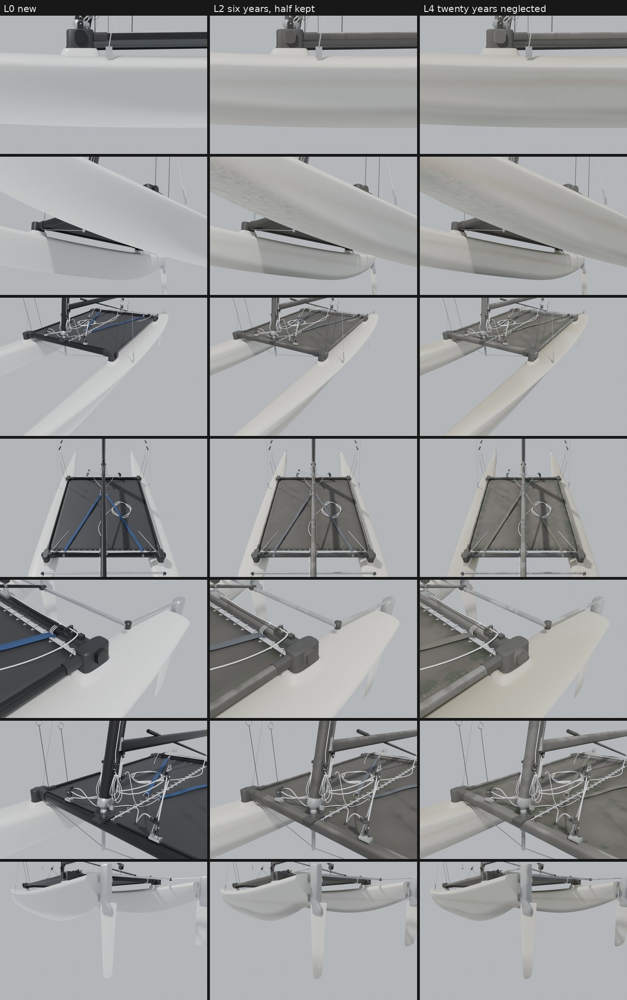
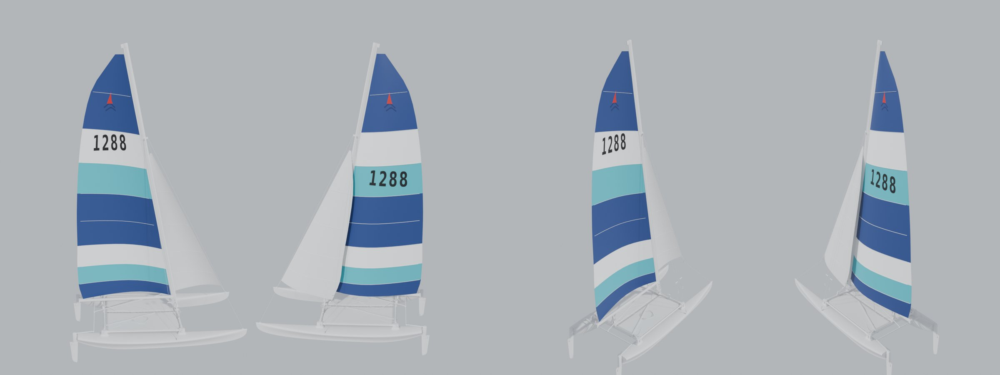
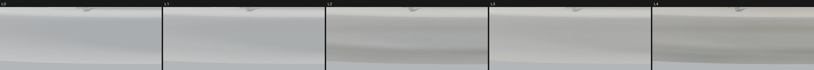
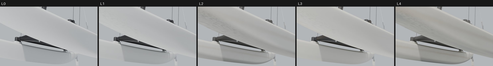
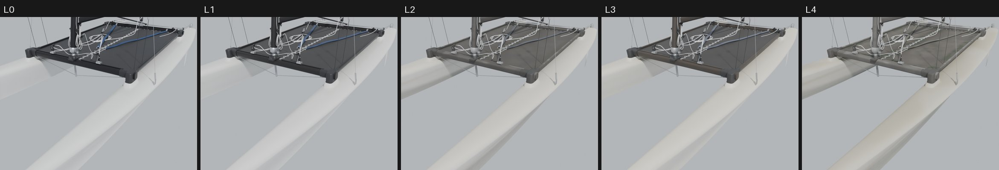
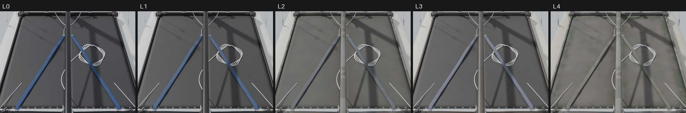
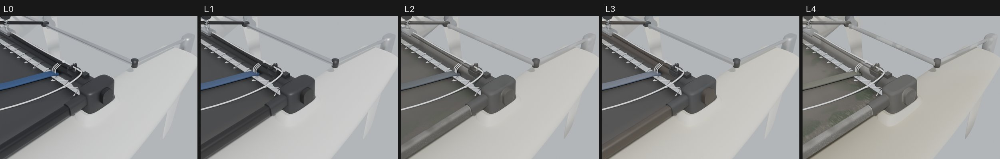
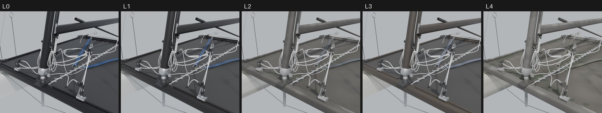
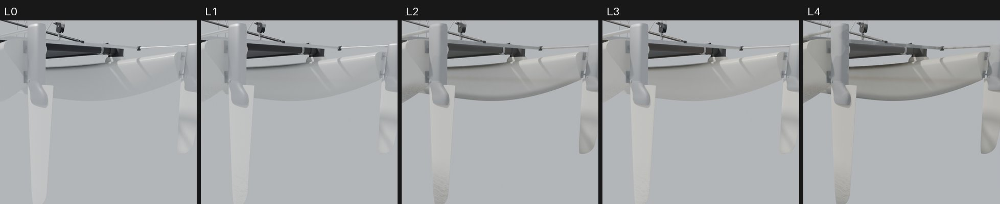

# Hobie 16 rebuild, slice 7: her textures and wear

Slice 7 of the Hobie 16 rebuild (plan: <https://claude.ai/artifact/QKsLR7Kyeh9uk9AWraasNC>) gives every surface of the
boat a look and the texture loop's five wear levels ([docs/texture-loop](../texture-loop/README.md)), from launched
new to twenty years left on the club's beach: the hulls' and blades' white gelcoat with the beach's scrapes, the
trampoline's black woven mesh, the black anodised spars and crossbars, the cast aluminium fittings, the stainless
wires, the blocks' black plastic and the navy hiking straps. It also gives the sails the cloth maps the game's sail
material reads, with a preview of her sail number and the game's made-up insignia, and picks the ropes' colourways.
It follows the Catalina 22's texture slice ([docs/c22-9](../c22-9/README.md)) and reuses its wear rules.

The page is `docs/hobie16-8` because each slice's page is numbered one past the slice (slice 6 is `docs/hobie16-7`).
Like the other slices it is tools and docs only: nothing is imported into Unreal and nothing in the game changes. The
new files are under `Tools/` and `Inputs/`, so the pull request needs Bean's `bean-approved` label, and it stays a
draft until after the Dec 11 release.



## Words used here

- **Gelcoat**: the hard, glossy outer skin of a fibreglass hull. In the sun it goes chalky (a white powder that rubs
  off), then yellow, and fine **crazing** (spider cracks) opens where the moulding flexes.
- **Dry-sailed**: kept out of the water between sails, on a dolly or trailer on the beach, and launched each time.
  She never sits on a mooring, so there is no bottom paint, no slime and no lake mustache; the wear comes from the sun,
  the sand and being dragged up the beach.
- **Trampoline**: the woven deck stretched between the hulls and crossbars, laced along its edges.
- **Anodised**: aluminium with a hard, dyed surface layer. Black anodising fades toward bronze in the sun, and where it
  is scratched through, the bare metal shows and then grows a white oxide powder.
- **Castings**: the corner castings, gudgeons and rudder heads, cast in aluminium and left bare.

## The five levels

The loop's levels (`Tools/texloop/levels.json`), as they read on her. She sails from the beach at Rush Creek on Lake Ray
Hubbard: fresh water, so rust and stainless tea staining come at a third of the salt-water rate.

| Level | Age, care | On the Hobie 16 |
| --- | --- | --- |
| L0 | new | launched new: glossy white hulls, a deep black trampoline, black anodised spars and crossbars, bright castings and stainless, crisp blocks |
| L1 | 0.3 years, 0.9 | her first season on the beach: the gelcoat's gloss a touch softer, sand scratches along the keels, a faint tan line where she floats, dust on the trampoline |
| L2 | 6 years, 0.5 | six years a club boat, half kept: chalky hulls and decks, the keels scraped grey, the trampoline faded grey and dirty along the walks, the spars' anodising dull with white oxide at the scratches |
| L3 | 30 years, 0.9 | thirty years old and well kept: polished but faintly yellow gelcoat, spider cracks round the pylons, old scrapes polished out, a newer trampoline, the spars' black faded toward bronze and scratched |
| L4 | 20 years, 0.1 | twenty years left on the beach: heavy chalk and a grubby film, the keels worn through to the grey laminate, a trampoline bleached grey-brown with green mildew and frayed lacing edges, the anodising gone to grey with white powder, the castings grimy with oxide |

## What slice 7 builds

### The cards

One card per surface (`Tools/shipkit/hobie16/textures/textures_hobie16.json`). Each says which of the build's material
slots it covers (by kind), how close a camera comes, the pattern's real size, the detail maps it draws, and what she
looks like at each level. Every slot the build makes is in a card or in `unweathered` with its reason (the sails, which
age in `M_SailCloth`; the battens, which go with the sails; the ropes, which have the rope materials' own wear);
`dress()` stops otherwise.

| Surface | Her slots (by kind) | Closest camera | Detail maps |
| --- | --- | --- | --- |
| Gelcoat | topsides: Hull; deck: Deck; blade: Blade | 0.6 m | Gelcoat (shared) |
| Trampoline | tramp: Tramp | 0.4 m | Tramp (hers) |
| Anodised | black: Bar, Mast, Extension | 0.4 m | Metal (shared) |
| Metal | stainless: Wire; aluminium: Cast, Arm | 0.4 m | Metal (shared) |
| Plastic | black: Block, Corner, Handle, Cord; grey: Sheave | 0.3 m | none |
| Canvas | strap: Strap | 0.4 m | Canvas (shared) |

There are no colour targets: no CC0 scan is her white gelcoat, black trampoline mesh or anodising, so the blind ladder
judges them. Each card also gives every slot its new finish (colour, roughness, metal and clear coat), from the game's
`BOAT_LIBRARY` where the slot exists there; three are new (below, "The game's side").

The plan's list for this slice named non-skid. Her decks are treated as smooth gelcoat here, since the crew walks and
sits on the trampoline; whether her decks carry a moulded non-skid pattern joins the list for Bean's photos, and the
shared NonSkid map is ready if they do.

### The wear

`Tools/shipkit/hobie16/textures/weathering_hobie16.py` turns a level into wear terms and puts them on her, with the
Catalina's rules (`weathering_c22.amounts`, from the loop's own time and dirt numbers in `Tools/texloop/wear.py`):
neglect's own terms start past a threshold of dirt a kept boat never reaches, a first season's marks grow as the square
root of dirt so L1 is not new, and a kept boat's routine renews what owners renew (a new trampoline every eight years
or so, new hiking straps every five). It reuses the Catalina's gelcoat, stainless and plastic dressers and Bluebonnet's
node helpers, and adds her own:

- **Gelcoat.** The Catalina's: chalk, yellowing, crazing at the fittings, black streaks and the corners' patina. Then
  the beach: sand scratches running fore and aft along the keels and the bows' forefoot within a season, scraped grey
  over the years whatever the care, worn through to the grey laminate when neglected; the rudder blades' tips the same.
  A faint ragged tan line where she floats, higher at the bow, washed off a kept boat. Neglected, a grubby film of
  sand, sunscreen and dust settles over the chalk, heaviest low down.
- **Trampoline.** Her own woven map up close. The black fades to a dusty grey-brown in the sun and chalks; the walks
  across the middle and along each hull darken with feet and sand; neglect bleaches it further, grows green-grey mildew
  in patches where water lies in the sag, and frays the edges at the lacing (threads only up close; past a couple of
  metres only their mean, so they don't read as noise).
- **Anodised.** The dye fades, more on what faces the sky: toward bronze on a kept, polished boat and toward a flat
  grey on a half-kept or neglected one; the surface dulls and blooms chalky;
  edges and the places lines rub scratch through to bright metal (fine marks only within arm's length, their mean past
  it); the bare metal blooms white oxide at the scratches, joints and ends, with grime in the corners.
- **Cast aluminium.** Dulls to a matt grey. Neglected, grime darkens it and white powder blooms in its crevices and pits
  in broad soft patches (the Catalina's aluminium put oxide over the whole face, and round 4's centimetre mottle,
  both read as granite).
- **Stainless, plastic, canvas.** The Catalina's: stainless dulls and, neglected, tea-stains slowly in fresh water, and
  on a neglected beach boat the wires and tangs go dull grey under grime. Black plastic blooms a chalky grey. The navy
  straps fade, dirty where feet go, and mildew when neglected.

Each term is a value node named `wear:<surface>.<term>` in the material; `apply_level()` sets them for a level (or any
age and care), so one build renders every level.

### Her own detail map

`Tools/shipkit/hobie16/textures/textures_hobie16.py` makes the trampoline's woven mesh with numpy (no photos), using
Bluebonnet's noise, normal-map and measuring helpers, written to `Inputs/hobie16-detail` as plain PNGs (the folder's
`.gitattributes` keeps them out of Git LFS, which the cloud cannot push): a normal map and a mask map, tileable.

| Map | Tile | Pixels | Pixels a mm | Mask channels | Pattern (measured on the map, against the card) |
| --- | --- | --- | --- | --- | --- |
| Tramp | 30 x 30 mm | 512 x 512 | 17.1 | cavity, roughness, height | weave 1.2 mm (card 0.8 to 1.6) |

The flat coated yarns of a basket weave about 1.2 mm apart, the PVC coating filling the gaps. The shared library's maps
(`Inputs/boat-detail`: Gelcoat, Metal, Canvas) are already resident for the J/22, so they cost her nothing.

### The budget

Her own map only, block compressed with mips (BC5 normal, BC1 mask):

| Tier | Budget (set here) | Her maps |
| --- | --- | --- |
| High and Ultra | 1 MB | 0.5 MB: Tramp |
| Medium | 0 MB | none: Medium draws no detail maps, only the colour and roughness math |

### The sails' cloth, number and insignia

The game draws every sail with `M_SailCloth` (seams, battens, wear by its own Age and Care, the class insignia and the
sail number), reading three UV maps that the game's own sails get from `FSailCloth`. The rebuild's sails now carry the
same three (`sails_hobie16.cloth_uvs`): UV0 in metres along each row from the luff and up from the foot, UV1 each row's
share from luff to leech and the height's share of the head's (FSailCloth's `UVNormal`, which places the marks), UV2
metres to the leech. The cloth's tangent frame comes from UV0, as on the Catalina's sails.

`render_marks_hobie16.py` previews the marks the way the game will draw them: a copy of `M_SailCloth`'s marks block
(the insignia's box near the head, the number's box below it, each side's set reading right from its own side with
starboard's uppermost, as the class rule asks) over the main's panels in the catalogue's most common scheme, with the
atlas drawn by `scripts/make_sail_marks.py` itself. The insignia is the game's made-up emblem (a red sail over two navy
swells), never the maker's logo; the number is the player's 1288 (`BoatLivery.cpp`).



What the preview measures on her main (`marks.json`):

| Mark | On her main |
| --- | --- |
| Number's box | 0.86 m tall at 62 to 74% of the head's height (starboard) and 48 to 60% (port), 0.96 m wide at its rows |
| Digits | 0.46 m tall; the class catalogue's figure is 254 mm |
| Insignia | 0.58 x 0.65 m, wholly on the cloth, below the head |

The digits come out taller than the class's figure because `M_SailCloth`'s boxes are a share of the sail's height and
are the same for every class: on a 7.2 m main they make 0.46 m. That is a game-side note for the import slice (a
per-class number height), not something this slice changes. The preview draws the digits in DejaVu Sans Bold: the
repo's sail-number font is an LFS file the cloud cannot fetch, so the shapes are a stand-in; the sizes and places are
the material's.

### The ropes' colourways

Each line slot gets a colourway from `Inputs/rope/colourways.json` for the import slice (the cards' `ropes`): the
mainsheet `blue_white_mix`, the jib sheets `red_white_fleck`, the control lines (downhauls, outhaul, traveller)
`black_white_fleck`, and the halyards' tails and the lacing `white_blue_fleck`. They are a typical beach cat's set,
not copied from a photo of one boat; the rope materials carry their own wear.

## Checks

`wear_check_hobie16.py` measures the renders (77 of them: seven views at five levels, lit and as albedo, plus an id shot
each), as the Catalina's checks do, and writes `wear_check.json`:

| Check | Result |
| --- | --- |
| Coverage: every built slot in a card or listed unweathered | pass (none left over) |
| Ladder: all nine weathered surfaces, rule as below | pass |
| Her map: Tramp tiles (seam 0.41 / 0.39 of the field's spread), repeats 0.000 / 0.001, 17.1 px a mm, weave 1.2 mm in 0.8 to 1.6 | pass |
| Budget: 0.5 of 1.0 MB on High | pass |
| Blind round 5: three fresh reviewers, each sheet all five right or one neighbouring swap | pass, 21 of 21 all five |

The ladder, as each level's colour distance from new (and the kept L3's from the neglected L4):

| Surface | L1 | L2 | L3 | L4 | L3 to L4 | Result |
| --- | --- | --- | --- | --- | --- | --- |
| Gelcoat, topsides (Hull) | 1.4 | 11.3 | 5.7 | 16.3 | 12.6 | pass |
| Gelcoat, deck (Deck) | 0.9 | 7.2 | 8.3 | 17.2 | 12.7 | pass |
| Gelcoat, blades (Blade) | 0.9 | 9.1 | 5.6 | 14.4 | 10.8 | pass |
| Trampoline (Tramp) | 3.4 | 13.1 | 7.8 | 17.7 | 9.9 | pass |
| Anodised black (Bar, Mast, Extension) | 3.3 | 21.8 | 16.5 | 28.0 | 12.5 | pass |
| Stainless (Wire) | 0.0 | 1.3 | 0.4 | 6.7 | 6.4 | pass |
| Cast aluminium (Cast, Arm) | 1.2 | 12.1 | 6.4 | 17.8 | 11.3 | pass |
| Black plastic (Block, Corner, Cord) | 1.6 | 12.7 | 8.3 | 17.5 | 9.3 | pass |
| Grey plastic (Sheave) | | | | | | listed: the sheaves sit inside the blocks' cheeks, where no view sees them |
| Straps (Strap) | 7.4 | 26.6 | 24.8 | 36.9 | 14.5 | pass |

Distances are CIE76 colour differences of each material's mean albedo (what the checks measure, before light), the
loop's rule: L4 at least 8 from new, L2 at least 4, L1 no further than L2, L2 no further than L4, and the kept thirty-year
boat at least 6 from the neglected one. Stainless only just clears it (6.7 and 6.4): fresh water keeps its wires and
tangs nearly bright, and the neglected boat's grime on them is what separates the two. The black plastic's L1 to L4 are
the Catalina's rule unchanged. `Handle` (the tiller extension's grip) and `Sheave` are in no view; both are listed.

The ladder sheets, each surface's crop from the view that shows it best, new (L0) to twenty years neglected (L4) left
to right; the blind sheets the reviewers saw are the same crops shuffled under A to E (`blind/`, key in
`blind/key.json`):









## Review

Five rounds, three fresh reviewers each (`reviews_hobie16.json`; round 5 is current, rounds 1 to 4 under `earlier`).
Each reviewer described every panel before putting the seven blind sheets in level order and named the least
convincing thing on each. Every round placed every sheet: 21 of 21 each time, and only two answers in fifteen
reviewers' 105 were a neighbouring swap (the deck's L0 and L1, which look alike at that distance).

From round 2 the reviewers also compared each round's six-year and twenty-year renders with round 1's, without being
told which was which. Rounds 2 and 3 showed a pull toward the right-hand picture, so from round 4 each reviewer got their
own left and right order. Votes for the new renders against round 1 (new, round 1, same):

| Sheet | Round 2 | Round 3 | Round 4 | Round 5 |
| --- | --- | --- | --- | --- |
| Topsides | 1, 2, 0 | 3, 0, 0 | 3, 0, 0 | 2, 1, 0 |
| Keel | 2, 1, 0 | 2, 1, 0 | 2, 1, 0 | 1, 2, 0 |
| Deck | 0, 2, 1 | 0, 3, 0 | 1, 0, 2 | 1, 1, 1 |
| Trampoline | 1, 2, 0 | 0, 3, 0 | 3, 0, 0 | 3, 0, 0 |
| Corner | 1, 2, 0 | 0, 3, 0 | 1, 2, 0 | 2, 1, 0 |
| Mast | 3, 0, 0 | 2, 0, 1 | 3, 0, 0 | 3, 0, 0 |
| Rudder | 3, 0, 0 | 0, 3, 0 | 0, 3, 0 | 1, 2, 0 |

What each round fixed, from the reviewers' notes:

- Round 1 to 2: the topsides' round grey streak blobs (the hull view reframed closer; round 2's reviewers no longer
  named them), the keel's cloudy scrape (now sand scratches along it, a grey band, worn through at the very keel), the
  trampoline's middle-of-the-sheet mildew (now at the laced edges and the sag) and fraying (added), the spars' marble
  mottle (fine marks where lines and hands rub), the rudder tips' ripples.
- Round 2 to 3: the waterline's tiled band and pinstripe tan line (one soft ragged line), the neglected hulls' even
  beige (patchy chalk), the trampoline's hard-edged mildew, a stamped white fray, spars like grey paint (white powder
  and pits), castings that never changed (grime and oxide).
- Round 3 to 4: the half-kept boat's spars faded to bronze, which read as the thirty-year boat (a kept boat fades to
  bronze, a half-kept or neglected one to grey: the `bronze` term is care squared), mildew that had become an even wash
  (distinct soft patches again), the crossbars' even grain (marks and oxide gathered in patches where things rub), the
  rudder tips' scrape too low to see (the lower third of the blade), castings like plastic (mottled grime and oxide).
- Round 4 to 5: the castings' centimetre mottle and white specks, which read as granite (broad, soft grime and oxide).

Round 5's least-real notes are the known gaps below.

## Known gaps

From round 5's notes, for a later pass or for Bean's photos:

- The neglected hulls' wear is soft tone, bands and film, with no crazing, chalk grain or scratches visible at the
  views' distance; up close the Catalina's crazing is there round the pylons. Real chalk from photos of a neglected
  beach cat would show how coarse it should be.
- The keel band seems to start at a hard vertical line partway along the far hull: that is the trampoline's shadow on
  the hull in that view (it is in every round's renders, round 1's too), not the wear. A view without it would help.
- The near hull's underside sand scratches read as noise to some reviewers at the keel view's distance.
- The neglected trampoline's mildew is still a little evenly spread for some, and its green beside the rear crossbar
  reads as grass in the corner view; the frayed edges don't read at sheet size.
- The thirty-year boat's newer trampoline faded nearly as much as the six-year one for one reviewer.
- The control lines and lacing stay white at every level: the ropes' wear is the rope materials' own (slice 10), and
  these renders use plain white for them.
- The rudder tips' scrape reads as a fine regular noise to some.

## The game's side

The game draws her through the shared `M_BoatSurface` and `BOAT_LIBRARY` in `scripts/make_materials.py`. Most of her
slots map to entries that exist (Topsides, Deck, Stainless, BlackPlastic, Rubber, Webbing, SailCover). Three are new and
come with her import (slice 10), since `make_materials.py` is shared by every material and needs the Mac's rebuilt
assets committed with it:

| New entry | Surface kind | From her slots |
| --- | --- | --- |
| Trampoline | 14 webbing (woven), with her Tramp map as its own detail pair | Tramp |
| AnodisedBlack | 4 aluminium, dyed black | Bar, Mast, Extension |
| CastAluminium | 4 aluminium, matt | Cast, Arm |

The sails need no new entry: `M_SailCloth`'s Layout 2 is already the Hobie's coloured panels, and the rebuild's cloth
now carries the maps it reads.

## How to run

The same venv as slices 1 to 6 (Python with pip `bpy`, numpy, scipy, pillow). From the repo root:

```
python3 -I Tools/shipkit/hobie16/textures/textures_hobie16.py               # her map into Inputs/hobie16-detail
blender -b -P Tools/shipkit/hobie16/build_hobie16.py -- <work>/s7            # the boat (slices 1 to 6)
blender -b -P Tools/shipkit/hobie16/textures/render_wear_hobie16.py -- <work>/s7/hobie16.blend <work>/s7/wear
python3 -I Tools/shipkit/hobie16/textures/wear_check_hobie16.py <work>/s7/wear --sheets docs/hobie16-8 \
    --blind-key docs/hobie16-8/blind/key.json
blender -b -P Tools/shipkit/hobie16/textures/render_marks_hobie16.py -- <work>/s7/hobie16.blend <work>/s7/marks
```

With the pip `bpy` module, `<venv>/bin/python <script> <args>` runs the same. The wear render is seven views at five
levels, lit and as albedo, plus an id shot each: 77 renders, about 22 minutes at 900 pixels on the cloud's CPU. The
size check (`hobie16_check.py --slice 6`) still passes on the rebuilt boat: the sails' maps add no triangles.

## Files

| File | What it is |
| --- | --- |
| `Tools/shipkit/hobie16/textures/textures_hobie16.json` | new: the six cards, the unweathered slots and why, each slot's finish and its game entry, her map's card, the budget, the sails' marks and the ropes' colourways |
| `Tools/shipkit/hobie16/textures/weathering_hobie16.py` | new: the wear terms by level (`amounts`), the dressers (gelcoat, trampoline, anodised, cast aluminium; the Catalina's for the rest), `dress()`, `apply_level()`, the id and albedo modes, the texture report |
| `Tools/shipkit/hobie16/textures/textures_hobie16.py` | new: her trampoline map and its measures |
| `Tools/shipkit/hobie16/textures/render_wear_hobie16.py` | new: the seven wear views at five levels, lit, as albedo and as ids |
| `Tools/shipkit/hobie16/textures/wear_check_hobie16.py` | new: the ladder, maps, budget and blind checks, and the ladder and blind sheets |
| `Tools/shipkit/hobie16/textures/render_marks_hobie16.py` | new: the sail marks preview from the cloth's UVs |
| `Tools/shipkit/hobie16/textures/reviews_hobie16.json` | new: the blind reviewers' answers and least-real notes |
| `Tools/shipkit/hobie16/sails_hobie16.py` | the cloth's three UV maps (`cloth_uvs`) |
| `Tools/shipkit/hobie16/platform_hobie16.py`, `build_hobie16.py` | a part can carry per-vertex UVs; the sails' objects get UV0, UV1 and UV2 |
| `Inputs/hobie16-detail/` | new: the trampoline map (normal and mask PNGs, plain git) and `hobie16_detail.json` |
| `docs/licences/assets.csv` | a row for `Inputs/hobie16-detail` (generated, our own) |
| `docs/hobie16-8/` | this page, the contact sheet, the ladder and blind sheets and their key, the marks preview, `wear_check.json` |

## Next: slice 8, the light copy and sockets

A decimated light copy of the whole boat for AI boats and distance, and the sockets the game hangs her rig, crew and
lines on, as the Catalina's slice 9 did.
