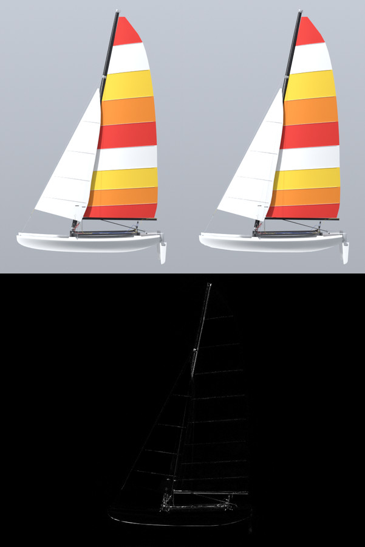
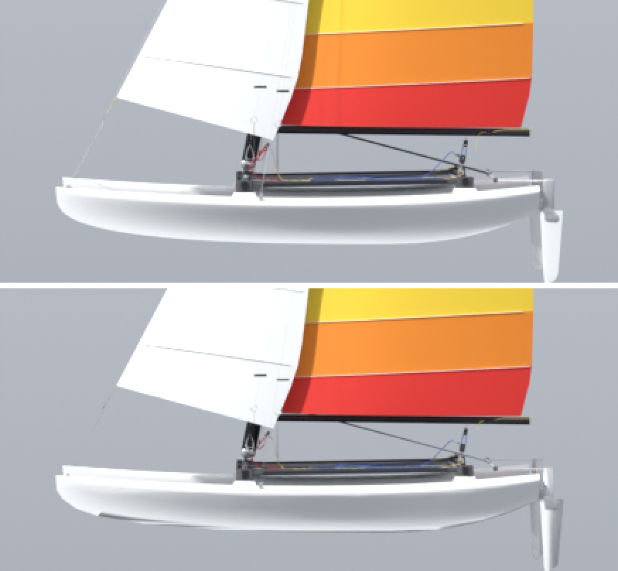
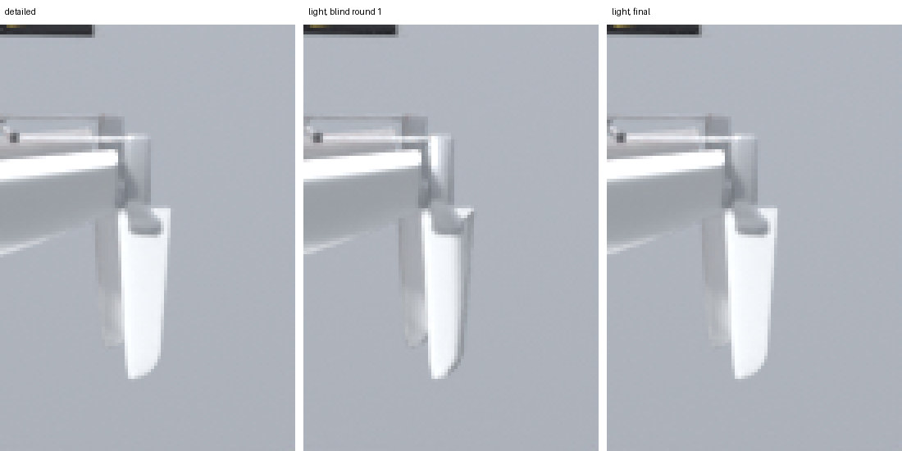
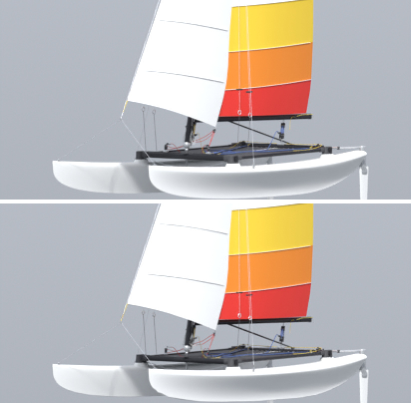
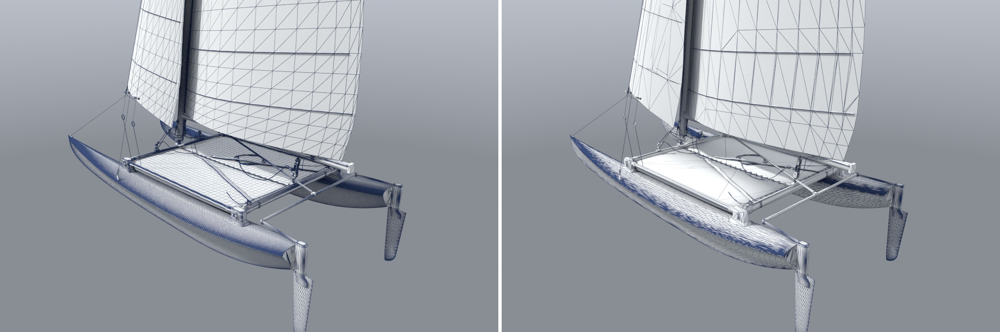
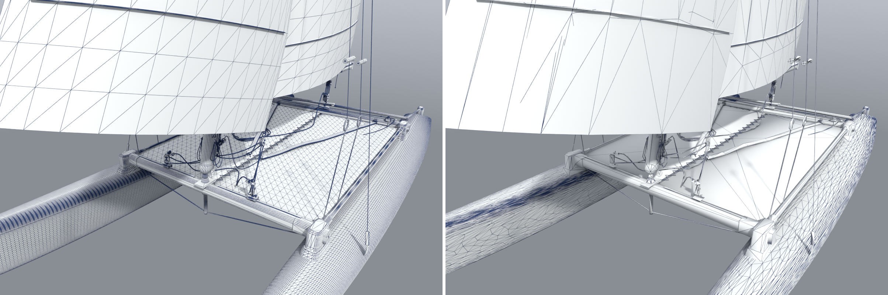

# Hobie 16 rebuild, slice 8: the light copy and the game's sockets

Slice 8 of the Hobie 16 rebuild (plan: <https://claude.ai/artifact/QKsLR7Kyeh9uk9AWraasNC>) gets the rebuilt boat
ready for the game's import (slice 10):

- a **light copy**: a lighter twin of every part, for boats 50 m off or further (AI boats in a race, boats on the
  club's beach, distant boats);
- the **sockets** the game reads to hang her rig, sheets and rudders on, written by the build and checked against her
  parts.

It follows the Catalina 22's slice 9 ([docs/c22-10](../c22-10/README.md)) and uses the same tool. The page is
`docs/hobie16-9` because each slice's page is numbered one past the slice. Nothing is imported into Unreal and nothing
in the game changes. The files are under `Tools/`, so the pull request needs Bean's `bean-approved` label, and it stays
a draft until after the Dec 11 release.



## Words used here

- **Light copy (LOD):** a simpler version of a model that the game draws when it is far enough away that nobody can
  see the difference. Here it is held to one pixel: no point of it is further than one pixel's width from the
  detailed boat, on a 4K screen at the game's narrowest field of view (60 degrees), 50 m away. That pixel is 15 mm.
- **Triangles:** the flat pieces every 3D model is made of. Fewer triangles draw faster.
- **Socket:** a named point on the model where the game attaches something: a wire's end, a rope's lead, a rudder's
  hinge.
- **Tube:** a rope, wire or round rod. The tool rebuilds each one round its own centre line with a few sides, so it
  stays as thick as the real one from every side.

## The light copy

`light_hobie16.py` runs the J-Class's light copy tool (`Tools/shipkit/jclass/light.py`, `docs/jclass-12`) on the built
`hobie16.blend` with her settings (`light_hobie16.json`). Every mesh gets a twin named `<part>_Light`, hidden, in the
collection `Light`, with `light_of` naming its part. She has one state for it, the sails up as the build sheets them.

| | detailed | light copy | share |
| --- | ---: | ---: | ---: |
| Hulls | 89,146 | 11,546 | 13.0% |
| Platform (frame, trampoline, castings, bridle) | 10,714 | 1,386 | 12.9% |
| Rudders, gudgeons, tiller crossbar | 5,292 | 4,910 | 92.8% |
| Mast, boom, stays, trapeze | 2,808 | 570 | 20.3% |
| Sails | 6,024 | 2,389 | 39.7% |
| Hardware, lines, straps | 51,956 | 3,992 | 7.7% |
| **The whole boat** | **165,940** | **24,793** | **14.9%** |

The plan allowed a quarter. All 19 twins are within the pixel; the worst is 14.57 mm, the tiller crossbar's. The tool
rebuilt 93 tubes (ropes, wires, the trapeze rings' wires, the frame's rods) and dropped 4 specks under a pixel across.
`baseline/light.json` lists each part's triangles, error and `ue_screen_size`: the screen size below which the game
may switch to the twin, which holds the pixel even at the widest field of view.

It took five passes to get there, each found in the renders or the blind check below:

1. **At one pixel everywhere** the whole boat came to 5% of the triangles, every part within the pixel. But the hulls
   came down to 1,530 triangles, and their long flat facets showed: bands of shading along the topsides and a kinked
   keel line from 50 m. The light copy is now held tighter where shading shows: the hulls to a third of a pixel
   (5 mm) and the jib to half a pixel (`part_pixels` in `light_hobie16.json`).
2. **The sails** were first held to their cloth maps (the maps the game's sail material reads), and could not be
   simplified at all. The game never draws these sail meshes: it draws her sails as cloth from the physics
   (`FSailCloth`, with its own maps), as it does for every boat. So their twins serve the renders only, and the maps
   are no longer held.
3. **Ropes and wires** ended in one flat polygon, so the tool did not know them as tubes and collapsed them as solids
   into flat ribbons. Seen edge on, from the bow, the forestay nearly disappeared. Every swept part now ends in a fan
   of triangles from its centre (`platform_hobie16.sweep`), which looks the same, and the tool rebuilds them round.
   This adds 808 triangles to the detailed boat.
4. **The rudder blades** looked stepped along their trailing edge to two of the three blind reviewers (below). It was
   their shading, not their outline: held to half a pixel, then a fifth, the twins' normals stayed several degrees off
   and the sharp trailing edge drew a dark rim. Each blade is only 2,320 triangles, so the twins now keep every one
   (`whole` in `light_hobie16.json`). That is most of the rise from 12.4% to 14.9%.
5. **The bridle wires** from the bows to the forestay drew darker on the light copy than on the detailed boat, and
   all four of the second blind round's picks named them. The detailed wires have six sides; the tool had built them
   again with four, standing a little further out. The bridle is only 104 triangles, so it is kept whole too, its
   wires as they are.



### Against the detailed boat

`render_light_hobie16.py` renders both from 50 and 100 m, abeam and 40 degrees off the bow, at a 4K screen's own pixels
with the game's narrowest field of view, and the J-Class's `light_compare.py` measures the difference over the boat's
pixels (each pixel's largest channel, out of 255):

| view | mean | 99th percentile | pixels differing visibly (over 16) |
| --- | ---: | ---: | ---: |
| 50 m abeam | 1.04 | 19 | 1.3% |
| 50 m off the bow | 1.49 | 25 | 2.0% |
| 100 m abeam | 0.94 | 14 | 0.6% |
| 100 m off the bow | 1.32 | 18 | 1.3% |
| the renderer's own noise (two seeds) | 1.42 | 13 | 0.5% |

The means are at the renderer's own noise, and below the Catalina 22's (1.4 to 1.8). The first pass had been 2.2 and
3.3 from 50 m. What still differs is under a pixel wide: the trapeze wires and shrouds (a four-sided wire covers a
slightly different share of its pixels), and the hulls' sheer highlight.









### Blind check

Three rounds, each with three fresh reviewers and four pairs (50 m and 100 m, abeam and off the bow) at the screen's
own pixels shown twice size, the detailed boat left or right at random (method, answers and keys in
[`blind/`](blind/reviews_hobie16_light.json)).

| round | light copy | can't tell | picks | right | what they named |
| --- | --- | ---: | ---: | ---: | --- |
| 1 | pass 3 | 10 of 12 | 2 | 2 | the rudder blade's trailing edge, stepped and darker |
| 2 | pass 4 (rudders whole) | 8 of 12 | 4 | 1 | the bridle wires, darker (all four picks) |
| 3 | pass 5 (bridle whole too) | 10 of 12 | 2 | 2 | a crisper line where the near hull's bow crosses the far hull, off the bow only, confidence 2 |

Rounds 1 and 2 each found one real tell, and each was fixed (the rudders and then the bridle are kept as built). In
round 3 the only cue left is the near hull's bow edge over the far hull. It is not a steady tell: one reviewer read it
as the detailed boat and was right twice, another saw the same crisper edge on the light copy, and in round 1 a third
had named it on the light copy too. No reviewer in any round found anything from abeam at 100 m. All nine said a
player would not notice the switch at 50 or 100 m.

## The sockets

`sockets_hobie16.py` writes every point the game's boat code reads (`BoatModelVisuals.cpp`) from the rebuild's own
geometry, and `build_hobie16.py` adds them to slice 4's rig sockets in `hobie16_sockets.json`. Each socket has its part
(`owner`: the hull, the mast, the boom or a rudder, by the fleet's mesh names), the build object it sits on and how
close (`near`), and where it comes from (`from`). The names are the fleet Hobie 16's (`Tools/blender/build_fleet.py`),
so the rebuild draws every line today's model does.

| socket | part | where |
| --- | --- | --- |
| `MastStep` | hull | the mast's heel on the step's ball: the mast part stands here |
| `ForestayTack` | hull | the bridle plate, where the forestay and both bridle wires meet |
| `ChainplateUpper_S`, `_P` | hull | the shroud's pin at each hull's deck edge |
| `RudderPivot`, `RudderPivot_1` | hull | each rudder's hinge line at the waterline (port first, as on the fleet's model) |
| `JibLead_S`, `_P` | hull | the jib car's block on the front crossbar, where the sheet comes down from the clew |
| `JibWinch_S`, `_P` | hull | the fairlead of the cam over that block, where the tail leaves (she has no winches) |
| `LazySheetVia` | hull | where the lazy jib sheet bears on the mast's aft face |
| `Traveler_C`, `Traveler_S` | hull | the traveller car's eye, centred and run out to starboard against its stop |
| `Gooseneck` | hull | the boom's pivot at the main's tack |
| `FootBrace_S`, `_P` | hull | the middle of each hiking strap, where a crew member sitting out hooks a foot |
| `Hounds` | mast | the hounds on the mast's axis, where the forestay, shrouds and trapeze wires meet |
| `Masthead`, `MastheadAft`, `MastBase` | mast | the mast's top, its aft face there, and its heel |
| `Boom_Mainsheet`, `Boom_Clew` | boom | the mainsheet's upper block under the boom, and the main's clew |
| `RudderStock`, `RudderBolt` | rudder | the rudder head's top, and the kick-up pin the blade swings on |

She has no lowers, spreaders, backstay or vang, so the game draws one shroud a side and nothing from `MastheadAft`.
The hounds point is the one slice 4 solved the wires' lengths to, on the mast's axis: the game's wires run their last
few centimetres inside the mast, where they don't show.

Not written: `TillerEnd`. The game hangs a tiller extension from the rudder's `TillerEnd`, but hers is hinged on the
middle of the tiller crossbar, which joins both rudders. The fleet's model bakes it on the hull, and the rebuild does
too (`H16Tiller_Crossbar`). Slice 10 decides how the game draws it.

`sockets_check_hobie16.py` holds each socket to its part: all 24 lie within their distance of the object they name
(`baseline/sockets_check.json`), and every socket the game reads is there.

## Fixed on the way

The starboard hiking strap's rise up the rear crossbar's face was 128 broken vertices (not numbers), so part of it
never drew. Where the strap turns straight up, the sweep's frame had no sideways direction. The frame now leans a little
forward (`hardware_hobie16.hiking_straps`). The light tool found it: it cannot simplify a mesh with broken vertices.

## Checks

- **Size check** (`hobie16_check.py --slice 8`): passes, every size as in slice 7. The detailed boat is 165,940
  triangles (808 more for the tubes' end fans).
- **Light copy:** `light.json` passes (19 of 19 twins within the pixel, 14.9% of the triangles).
- **Sockets:** `sockets_check_hobie16.py` passes (24 of 24).
- **Slice 7's wear:** the geometry changes are the tubes' end caps and the strap's rise, too small to change the wear
  renders, which were not run again.

## For slice 10 (import)

- The twins are the same parts as the detailed boat's, so the export can write `SM_Hobie16Hero_*_Light` from them.
- The export leaves out what the game draws live: the stays, the trapeze wires, the sheets and the sails.
- `TillerEnd` and the tiller extension (above).

## Reproduce

```
blender -b --factory-startup -P Tools/shipkit/hobie16/build_hobie16.py -- <work>/s8
blender -b -P Tools/shipkit/hobie16/sockets_check_hobie16.py -- <work>/s8 --json <work>/s8/sockets_check.json
blender -b -P Tools/shapeloop/measure.py -- <work>/s8/hobie16.blend Tools/shapeloop/sections_hobie16_rebuild.json <work>/s8/m
python3 -I Tools/shipkit/hobie16/hobie16_check.py <work>/s8/m/stats.json <work>/s8/hobie16_sockets.json --slice 8
blender -b -P Tools/shipkit/hobie16/light_hobie16.py -- <work>/s8          # about 25 min on the cloud's CPU
blender -b -P Tools/shipkit/hobie16/render_light_hobie16.py -- <work>/s8/hobie16.blend <work>/s8/lr   # 2 min
python3 -I Tools/shipkit/jclass/light_compare.py <work>/s8/lr docs/hobie16-9
```

## Files

| file | what |
| --- | --- |
| `Tools/shipkit/hobie16/light_hobie16.py`, `light_hobie16.json` | new: the light copy's settings and her parts |
| `Tools/shipkit/hobie16/render_light_hobie16.py` | new: the renders against the detailed boat |
| `Tools/shipkit/hobie16/sockets_hobie16.py` | new: the game's sockets from her geometry |
| `Tools/shipkit/hobie16/sockets_check_hobie16.py` | new: holds each socket to its part |
| `Tools/shipkit/hobie16/build_hobie16.py` | writes the game's sockets |
| `Tools/shipkit/hobie16/hardware_hobie16.py` | the strap's frame; the jib cars' points for the sockets |
| `Tools/shipkit/hobie16/platform_hobie16.py` | swept parts end in a fan from their centre |
| `docs/hobie16-9/` | this page, its images and `baseline/` (light.json, the sockets, their check, the comparison) |
