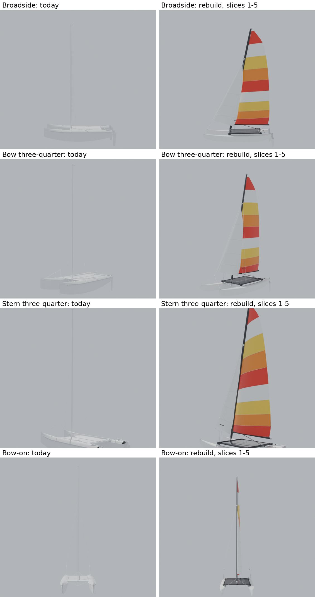

# Hobie 16 rebuild, Milestone A: the boat so far

Milestone A is the plan's first stop for Bean. It shows the whole boat after slices 1 to 5 beside today's model, in the
same Cycles light and from the same cameras. Plan: <https://claude.ai/artifact/QKsLR7Kyeh9uk9AWraasNC>.

The rebuild so far:

- the hulls (`docs/hobie16-2`);
- the platform (`docs/hobie16-3`);
- the rudders (`docs/hobie16-4`);
- the mast and standing rig (`docs/hobie16-5`);
- the sails and boom (`docs/hobie16-6`).

Today's model has no sail mesh: in the game its sails are cloth built from the physics at run time. The rebuild's sails
wear a preview colouring. In the game the livery colours them.

## Where it stands

| | Model | Target | Source |
| --- | ---: | ---: | --- |
| Length | 5.040 m | 5.04 m | Hobie |
| Beam | 2.410 m | 2.41 m | Hobie |
| Waterline length, empty | 4.644 m | 4.64 m | Hobie |
| Draft, hulls, empty | 0.253 m | 0.254 m | Hobie |
| Draft, rudders down, empty | 0.671 m | 0.672 m | class rule's taper |
| Weight | 145.1 kg | 145 kg | Hobie |
| Mast | 8.070 m | 8.07 m | Hobie |
| Main | 13.770 m² | 13.77 m² | Hobie |
| Jib | 5.120 m² | 5.12 m² | Hobie |
| Floor to bow, floor to stern | 0.595 m, 0.608 m | 0.597 m, 0.610 m | Hobie |
| Triangles, whole outside | 114,268 | 870,000 budget | |

Every slice's final blind round chose the rebuild over today's model (or, for the sails, over plain triangles). Each
slice's README has its rounds.

## What photos of a real Hobie 16 would settle

The reviewers' memories and the published figures disagree on these. One rigged boat on a beach answers most of them.

1. **A broadside of the rigged boat, level:**
   - the mast's rake (the reviewers said 7–13°; the model has 11.6°);
   - the boom's height and angle;
   - the main's head under the masthead (0.25 m here);
   - where the main's battens sit (the model packs them a little toward the boom).
2. **The rear crossbar against the transoms and the boom's end.** The boom's end overhangs the crossbar by 0.74 m.
   Slice 2's reviewers wanted the crossbar 0.2–0.3 m further aft, but a beach photo suggested further forward.
3. **The rudders from astern:**
   - where they hang across the transoms;
   - the tiller extension's length (the parts guide says 2.13 m; reviewers remember 1.2–1.8 m).
4. **The mast's foot and hounds, close up:**
   - the section's size;
   - the base casting;
   - the trapeze rings' height when nobody is on them.
5. **The transoms and decks:**
   - the transom's shape;
   - the deck-edge radius;
   - whether the trampoline is one piece or two.

The plan is to keep going without the photos: slice 6 (hardware and lines) and slice 7 (textures) don't depend on
them. Any of these can be moved in a later round, since every size comes from one json file.

## Next: slice 6, the hardware and lines

The mainsheet and its traveller, the jib sheets and their cars, the halyards, the blocks and cleats, the castings'
detail and the trampoline's lacing.
