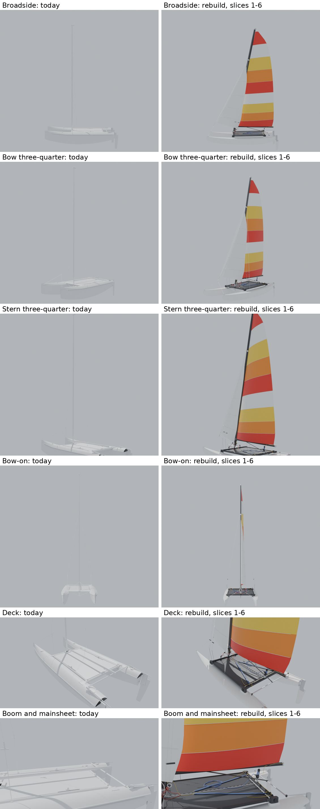

# Hobie 16 rebuild, Milestone B: the boat with her hardware

Milestone B is the plan's second stop for Bean. It shows the whole boat after slices 1 to 6 beside today's model, in
the same Cycles light and from the same cameras as Milestone A (`docs/hobie16-milestone-a`). Plan:
<https://claude.ai/artifact/QKsLR7Kyeh9uk9AWraasNC>.

Since Milestone A, slice 6 (`docs/hobie16-7`) added the hardware and lines:

- the mainsheet's 6:1 and the traveller;
- the jib cars and the 2:1 jib sheet;
- the downhauls, the outhaul, the halyards' tails and the hiking straps.

The sails and lines wear a preview colouring. In the game the livery and the rope colourways colour them.

## Where it stands

| | Model | Target | Source |
| --- | ---: | ---: | --- |
| Length | 5.040 m | 5.04 m | Hobie |
| Beam | 2.410 m | 2.41 m | Hobie |
| Waterline length, empty | 4.644 m | 4.64 m | Hobie |
| Draft, hulls, empty | 0.253 m | 0.254 m | Hobie |
| Draft, rudders down, empty | 0.671 m | 0.672 m | class rule's taper |
| Weight | 145.1 kg | 145 kg | Hobie |
| Mast | 8.070 m | 8.07 m | Hobie |
| Main | 13.770 m² | 13.77 m² | Hobie |
| Jib | 5.120 m² | 5.12 m² | Hobie |
| Floor to bow, floor to stern | 0.595 m, 0.608 m | 0.597 m, 0.610 m | Hobie |
| Triangles, whole boat | 165,132 | 870,000 budget | |

The hardware is 51,392 of those triangles. Every slice's final blind round chose the rebuild; slice 6's chose the
final hardware in 16 of 18 close-ups.

## What photos of a real Hobie 16 would settle

Milestone A's list still stands (the rake, the rear crossbar, the rudders from astern, the mast's foot, the
transoms). Slice 6 adds:

1. **The boom and mainsheet from the side, sheeted in:** where the boom's block hangs (the model solves it 0.58 m
   forward of the clew), and whether the mainsheet's lower block has a stand-up spring.
2. **The rear crossbar from above:** the traveller line's path and its cleats. It varies by year.
3. **The boom's end:** whether the outhaul runs outside the boom to a cleat, as drawn, or inside it.
4. **The trampoline from above:** where the hiking straps run and how they are tied.
5. **A tape on the platform:** owners give the trampoline as 89.5 in between the crossbars (the model has 87.8 in)
   and the rudder pins 84 in apart (73.6 in here).

As with Milestone A, the plan is to keep going without the photos: slice 7 (textures) doesn't depend on them.

## Next: slice 7, the textures

The hulls' gelcoat and non-skid, the trampoline's weave, the sails' cloth, number and a made-up insignia, and the
ropes' colourways.
