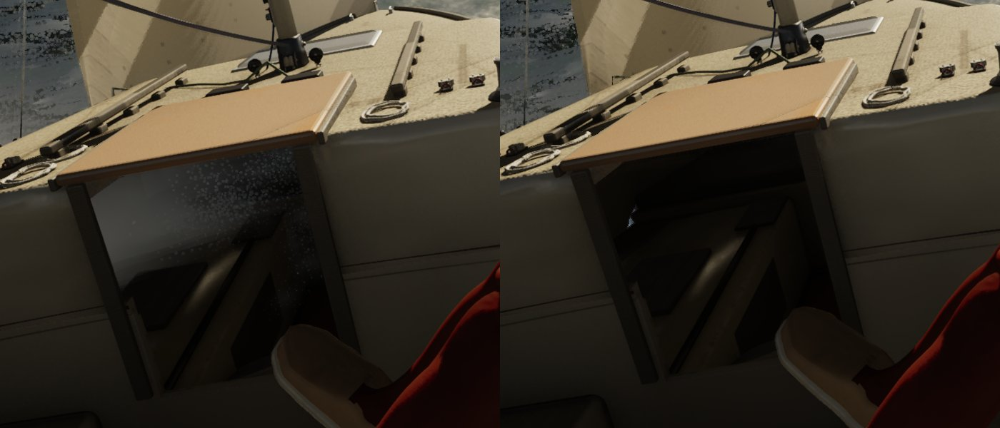

# Water inside the boat in rough seas (playtest, Oct 27)

**What Bean saw:** water showing through the bottom and cabin of the boat at times, most of all in rough seas.

**Reproduced:** the J/22 in a 3 m Gulf swell at 25 kn, from the cockpit (`-SailingCockpit -SailingWorld=Gulf -SailingSwell=3
-SailingWind=25 -SailingTWA=50 -SailingHoldTWA=50 -SailingQuality=High`), stills every second from 9 to 16 s. At some
moments the cabin, seen through the companionway, filled with a milky haze speckled with drops.

**What it was:** not the sea. The hull clip (`docs/boat-water-clip/`) holds: the haze is the same with the clip on,
with V7's clip and with it off. With the instanced meshes hidden (`ShowFlag.InstancedStaticMeshes 0`) it went at the
same moment. That is the spray. Above 6.5 m/s of wind, `AWaterSurface::UpdateSpray` tears drops and mist off the
breaking crests within 60 m of the camera. Mist barely falls and rides the wind, so the mist off the crests to windward
drifted straight through the hull and hung in the cabin. The bow's slam mist, blowing aft, did the same. Nothing stopped
a droplet at a boat.

**Fix:** a droplet that flies into a boat (any boat within 80 m of the camera) is gone. "Into" is `CrewInsideBoat`, the crew's own
test of the solid boat: under the deck, inside the topsides, in a cabin trunk. Spray over the deck and into the cockpit
well stays. The first 0.15 s of a droplet's life is exempt, because the bow wave's sheets start at the skin.

Left: before, at 9 s. Right: after, the same moment.

