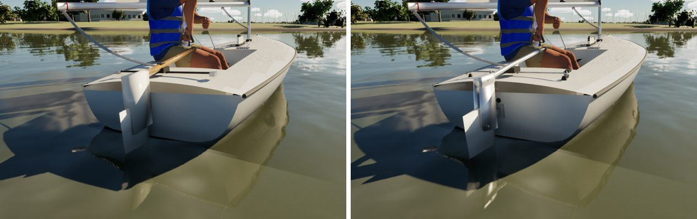
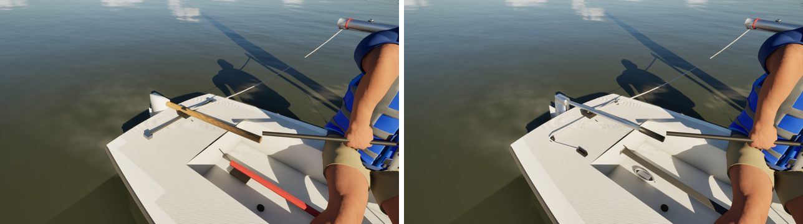
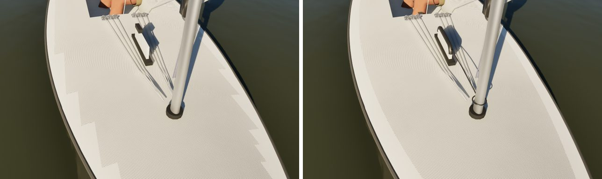
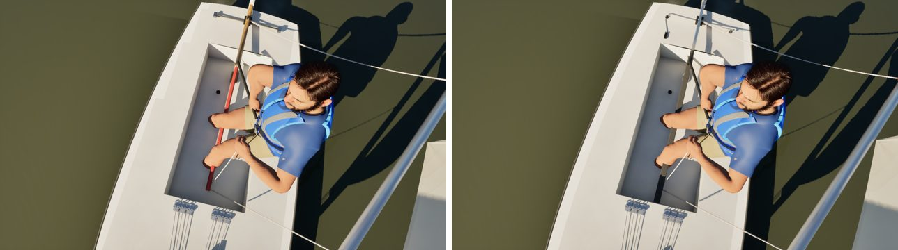
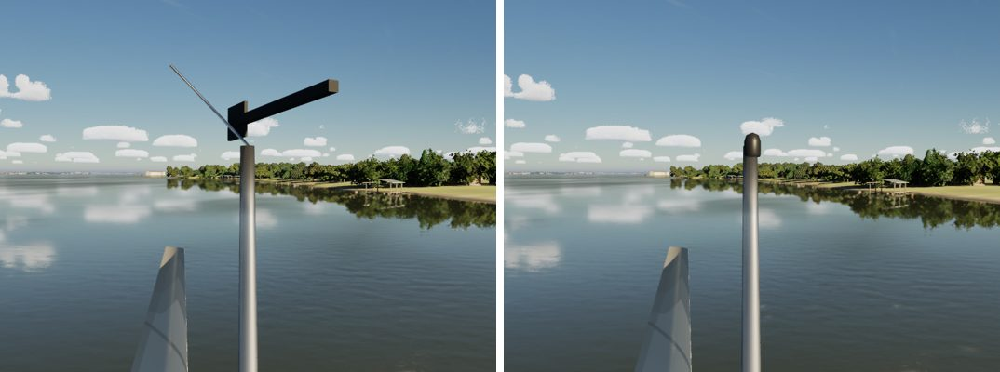

# ILCA 7, assembly by assembly (boat fidelity: pc/ilca-fidelity)

The second fleet boat in the boat-fidelity queue, done with the Sunfish's method (docs/sunfish-detail).

- **References:** Bean's ILCA photos aren't in yet (`Data/Reference/raw/boats/ILCA7` is empty), so this pass works from
  the class layout and a Commons ILCA photo already on this machine.
- **Comparisons:** reference, before and after for each assembly, in `compare/`. That folder is git-ignored and never
  committed, because the photo shows a sailor.

Where the ILCA shares the Sunfish's parts, the Sunfish's builders now take a variant. Everything is in
`Tools/blender/build_fleet.py`, and the Sunfish builds identically (31,558 hull triangles, as before). The renders are
the game at Ultra.

## What changed

| Assembly | Before | Now |
| --- | --- | --- |
| Rudder head | a white box | the cast aluminium head (the Sunfish's): cheeks on a through-bolt, the pintle's barrels on the pivot axis |
| Gudgeon | none | a stainless plate on the transom, its arm out to the barrel (the ILCA's pivot stands 6 cm off the transom) |
| Rudder blade | ahead of its pintle | hung aft of it |
| Tiller | a varnished wooden stick | a round aluminium tube, 28 mm, its last 15 cm under a black grip |
| Traveller | a black rope and two boxes | a rope through a moulded fairlead at each quarter, knotted at one end and led forward to a clam cleat at the other; the mainsheet's lower block runs on it |
| Daggerboard | a white plank and a black box | white moulded, 22 mm, top corners rounded, a black handle moulding along its top; the rubber gasket round the slot; the shock cord to the mast |
| Hiking strap | a red tube 36 mm round, 6 cm off the sole | the Sunfish's flat black webbing, 50 mm, 12 cm over the sole at the ends and 10 in the middle; its shock cord from the transom now meets it |
| Bailer | a black box | the oval cast rim and its flap |
| Deck | the non-skid border stepped cell by cell | the border follows the sheer 8 cm in |
| Masthead | a wind-indicator stick and the game's stand-in fly | the top section's moulded cap; no fly (the sail's sleeve goes over the masthead: `SailboatPawn`) |

## Kept as they were

- **Sockets:** all nine are unchanged, so there were no socket moves to report.
- **Measures:** FleetMesh's are unchanged (LOA 4.230 m, beam 1.370 m, canoe volume 0.162 m³, centre of buoyancy).
- **Triangles:** hull 61,348 (was 58,530; Nanite, so the 40,000 non-Nanite limit doesn't apply), mast 723 (673), boom 330,
  rudder 538 (340).
- **Material slots:** unchanged.

Strap for the crew lane (boat frame, metres, z up from the design waterline; the well's sole is at z 0.12):

- ends at x -1.616 and -0.224, its top at z 0.24 (12 cm over the sole);
- middle at x -0.92, its top at z 0.22;
- y -0.025 to 0.025, the webbing 3 mm thick.

## Renders (before | after)

