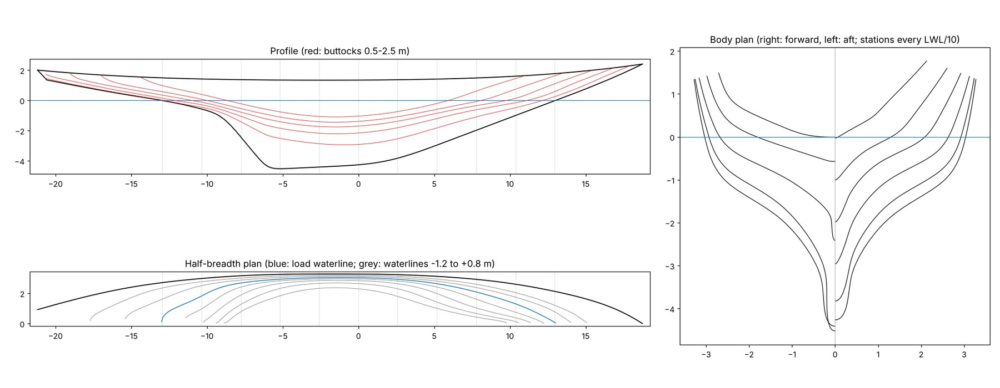
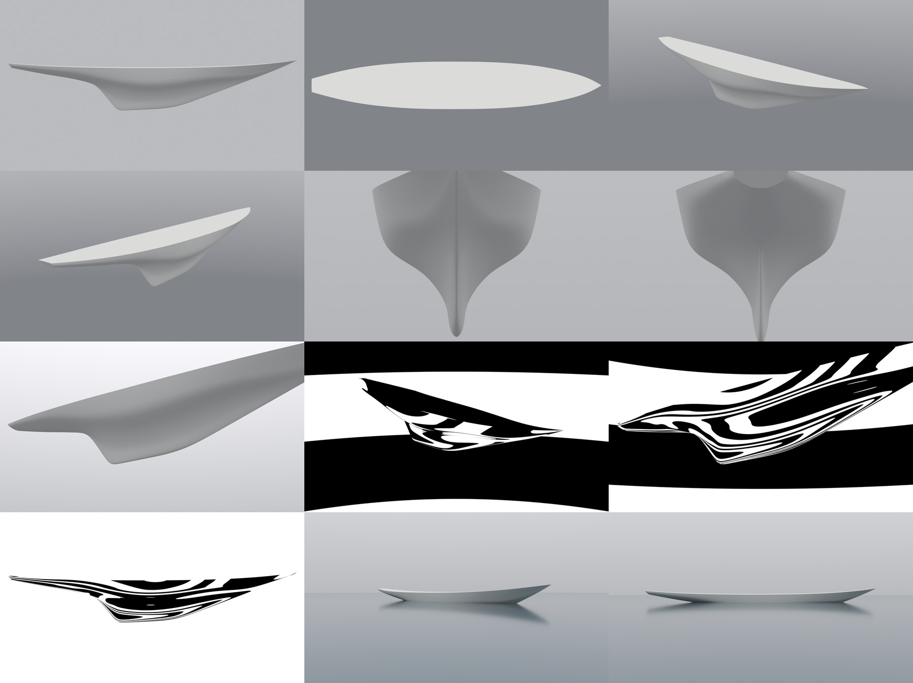

# J-Class 1: Bluebonnet's size card and hull lines

*Bluebonnet* is our own J-Class racing sloop of 1937, built for the invented Bolivar Roads Yacht Club of Galveston.
She is drawn to the 1930s Universal Rule and sized between *Endeavour* (1934) and *Ranger* (1937), with the 1934-37
look: steel hull, laid teak deck, winches on deck, full accommodation below. Plan and Bean's decisions (Nov 13 2026):
<https://claude.ai/artifact/WdUKp8somgyNJZDyESCgyU>. This page covers slice 0 (references, size card and rule check)
and slice 1 (hull lines). It is post-slice art: nothing here is imported into Unreal or wired into the game yet.

Unlike the frigate, whose hull is read off a 1927 lines plan, *Bluebonnet*'s lines are our own design. Nothing is
traced from a real J's drawing or photo. The real Js only set the targets (their published sizes) and the look we
check her against.

## What slice 1 builds

The moulded hull (the outside of the frames, inside the plating) as one surface: canoe body and keel together, the
wineglass section of the 1930s Js. Plus the transom, and a flat cambered placeholder deck so renders read as a yacht.
The mesh is 182,682 triangles (hull 172,422, transom 216, deck 10,044), under the plan's 200k for this slice. The
plating, the lead keel's casting line and the rudder are slice 2, the deck and deckhouses slice 3.



The lines drawing: the profile (side view) with the buttocks in red, the half-breadth plan (from above, one side) with
the waterlines, and the body plan (the sections seen end-on, bow half on the right, stern half on the left).



The renders, left to right in rows of three: clay from the side, from above and the bow quarter; the stern quarter,
bow end-on and stern end-on; from below, zebra bow quarter and zebra from below; zebra from the side, and afloat from
a dinghy's eye and from the side. Each is in `baseline/` at full size.

## The size card and the rule

`Tools/shipkit/jclass/specs_bluebonnet.json` holds the targets, the rule and the published sizes of three real Js.
Every later slice is checked against it by `rule_check.py`: each size within 5% of its target, the rating at 76 ft or
less, the draft at 15 ft or less.

| Measure | Bluebonnet (model) | Target | *Endeavour* 1934 | *Ranger* 1937 |
| --- | --- | --- | --- | --- |
| Length overall | 131.0 ft (39.93 m) | 131 ft | 129.5 ft | 135.2 ft |
| Load waterline | 85.4 ft (26.03 m) | 85 ft | sources differ | 87 ft |
| Beam | 21.5 ft (6.56 m) | 21.5 ft | 22 ft | 21 ft |
| Beam at the waterline | 20.0 ft (6.09 m) | | | |
| Draft | 14.8 ft (4.52 m) | 15 ft | 15 ft | 15 ft |
| Displacement | 154.9 long tons | 155 | 143 | 166 |
| Bow overhang | 18.8 ft | 19 ft | | |
| Stern overhang | 26.8 ft | 27 ft | | |
| Least freeboard | 4.4 ft (1.34 m) | 4.2 ft | | |
| Sail area (rated) | 7,500 sq ft (target until slice 6) | 7,500 | 7,651 | 7,546 |
| Rating | 75.8 ft | 76 or less | | 76 (official) |

The displacement is the moulded hull's 153.5 m³ (154.9 long tons of sea water). The rudder is already in it: on the
Js the rudder is the after part of the keel, so it is inside the hull surface here, and slice 2 cuts it out along its
stock line.

**The rule.** R = 0.18 L √S / ∛D, with L and R in feet, S in square feet and D in cubic feet (35 cu ft of sea water
to the long ton). A J must rate 76 ft or less.

* **L is taken as the load waterline length.** The rule's own length measurement changed over the years and added
  something for the overhangs. With L as the waterline, *Ranger*'s published figures (87 ft, 7,546 sq ft, 166 tons)
  rate 75.7 ft against her official 76, so the simplification is close.
* **S is the size card's target** until slice 6 measures the sails.
* **The 15 ft draft** is what the 1934-37 Js drew (*Ranger*'s and *Endeavour*'s published draft). A copy of the
  rule's text with the class's draft limit could not be read from the cloud (Wikipedia and the archive sites are
  blocked), so slice 0 holds her to 15 ft as a design limit.
* **From 1934 the class put the winches on deck and required full accommodation below.** Slices 3, 7, 9 and 10 build
  to that.

## Sources and licence

* **Published sizes** (museum and class pages, read Nov 2026) are facts: free to use. They are in the size card's
  `published` block and only check our sizes.
* **Photos:** `Tools/shipkit/jclass/refs.json` lists eight photos of real Js on Wikimedia Commons, each public domain or
  plain CC BY, with what each is for: *Endeavour*'s launch in 1934 and her departure in 1937 (Agence Rol and Agence
  Meurisse, public domain via the Bibliothèque nationale de France), *Yankee* in 1935 (public domain), and modern
  photos of *Velsheda* and *Ranger* (CC BY: Phil Whiston, Chris Parfitt, Don Ramey Logan, David Blaikie).
  `Tools/shipkit/fetch_refs.py` downloads them into the git-ignored `Data/Reference/raw/ships/Bluebonnet/`, reading
  each file's licence on Commons first and refusing anything that isn't public domain, CC0 or plain CC BY. They are
  for looking only: nothing is traced or measured off them into the model. If one is ever shown in the docs, its
  photographer gets a credit.
* **Left out:** most of the Commons photos of the modern Js are CC BY-SA, which the shipkit doesn't take. The 1930
  *Enterprise* lines scan on archive.org, and the class and museum sites, are blocked from the cloud; *Bluebonnet*'s
  lines are our own design anyway, so nothing waits on them.

## How the hull is made

`Tools/shipkit/jclass/lines_bluebonnet.json` is the design: a handful of curves along the length, in metres, in the
game's frame (X forward, Y starboard, Z up, origin on the centreline at the middle of the load waterline).

* **The canoe body's centreline:** the counter's underside, the run, the bottom, the forefoot and the spoon bow.
* **The keel's outline below it:** a straight raked leading edge, a straight bottom 8 m long with 37 cm of drag (deeper
  aft), and the raked aft edge, about 51 degrees from the horizontal, with rounded corners. The aft edge (`post` in the
  json) is the rudder's trailing edge: on the Js the rudder is the keel's after part, turning on a stock inside it, so
  here it is the keel aft of a stock line 1.7 m forward of that edge (`rudder_chord`), and slice 2 cuts it out there.
  The leading edge is drawn tangent to the forefoot, so the keel and the stem are one convex line crossing the
  waterline at about 20 degrees, with no knee between them. `loft.leading_edge_tangent` finds the point, and the loft
  refuses to run if an edit to the canoe line leaves the json's point off the forefoot (it would bring the knee back).
  Under the counter the aft edge meets the canoe body with a hollow (the fillet); at the forefoot there is none.
* **The sheer, the deck edge's half-breadth, and the "knuckle":** each section's shoulder, on the waterline amidships
  and rising up the section in the overhangs.
* **A few shape factors along the length:** the floor's width and deadrise, the bilge's place, the topsides' flare.

`loft.py` (plain numpy and scipy, no Blender) turns them into a surface:

* **Each curve is faired like a batten.** It may miss its key points by a set tolerance (1-2 cm for heights and
  breadths, half a degree for the deadrise; listed in the json), with its ends held, and it bends with the least
  change of curvature that allows. A spline forced exactly through hand-placed points bends to meet each one. On a
  hull that shows as a ripple in the reflections every few metres, and the faired curves have none. The canoe line
  does bend both ways in two places, on purpose: where the run sweeps up into the counter (x -14.3 to -9.1 m) and
  where the forefoot lifts toward the stem (x +4.4 to +9.2 m).
* **Each station's section is a control polygon** built from those curves: the keel's bottom, two points up each side
  of the keel and its root, then the floor, bilge, knuckle, topside and sheer. Forward of the keel the keel's points
  sit together a stem bar's width out, so the bow has a crisp stem bar. Under the counter they spread across the floor
  in four steps whose slopes grow evenly, the floor point sunk to meet them, so the counter's underside curves from
  flat at the centreline into the bilge with no crease along it.
* **The hull is the bicubic B-spline surface on those polygons** (72 rows along the length). A B-spline surface is
  smooth to the second derivative everywhere, so a fair net gives a fair hull. The keel's points run down its sides,
  and the surface turns them into the garboard's hollow on its own.
* **The keel's thickness** is a foil section between its leading edge and the aft edge at each height. The control
  polygon is 0.54 m thick at the bottom (the lead), 0.96 m at the root and 14 cm at the aft edge, and the stem bar is
  7 cm forward of the keel. Along the bottom 0.6 m the lead's casting stays blunt out to the toe and the heel
  (`bottom_blunt`), so the keel ends in a rounded bottom, not a knife edge. Where the keel is shallow it eases to what
  the section is without one: at the leading edge's top, the bow's own V, so the forefoot opens into the bow with no
  thin blade under it; at the aft edge's top, the bar's width, so the rudder's edge stays thin up to the counter.
* **The keel as built is thinner than its control polygon,** because a B-spline surface rounds its polygon off rather
  than passing through it. Measured on the surface between x -5 and +1 m: 0.13-0.17 m thick 2 cm above the bottom (the
  edge of the rounded bottom), 0.34-0.45 m 20 cm up, 0.4-0.65 m 30% of the way up and 0.45-0.8 m halfway, thickest
  forward; above that the garboard's hollow opens out into the canoe body. The draft is likewise 14.83 ft for the
  design's 15.
* **The aft rows lean to the transom's rake,** so the surface's aft edge lies in the transom's plane, and the transom
  closes it there. The forward row is the stem head itself.

`build_jclass.py` makes the Blender objects (`Hull`, `Transom`, `DeckPlaceholder`) and writes `jclass.blend`,
`jclass.obj` and `build.json`. The hull, transom and deck together close into one watertight shell with outward
normals: `build.json`'s `shell` entry counts open, shared-by-three and flipped edges and degenerate faces (all 0) and
the enclosed volume, and the build fails if they don't close.

## Hydrostatics, weights and balance

`loft.py` integrates the hull from 400 station cuts (`baseline/hydrostatics.json`):

| | |
| --- | --- |
| Centre of buoyancy | 0.68 m aft of mid-waterline (52.6% of the waterline from the bow), 1.03 m below it |
| Prismatic coefficient | 0.49 with the keel in the midship section; 0.48 for the canoe body alone |
| Waterplane coefficient | 0.75 |
| Block coefficient | 0.21 on the full 4.52 m draft, keel included; 0.35 for the canoe body on its own 2.28 m depth |
| Canoe body and keel | 128.0 m³ above the canoe body's centreline, 25.5 m³ of keel below it |
| Wetted area | 193.8 m² (2,086 sq ft) |
| Displacement-length ratio | 249 (*Ranger*: 252 by her published figures) |
| Waterplane | 119.4 m², its centre 0.65 m aft of mid-waterline |

**Are these normal for a J?** Guides to yacht design put a sailing yacht's prismatic coefficient between about 0.50
and 0.56, some between 0.45 and 0.60 ([sailboat-cruising.com](https://www.sailboat-cruising.com/prismatic-coefficient.html)).
*Bluebonnet*'s 0.48-0.49 is at the fine-ended end, which is what the long overhangs of a 1930s racer give. We found no
published prismatic coefficient or GM for a real J to hold her against. A 2008 paper by the Wolfson Unit re-analyses
the 1936 tank tests of J models ([HISWA 2008](https://www.wumtia.soton.ac.uk/sites/default/files/uploads/pages/HISWA2008JR.pdf))
and may give some; it has not been read for this slice.

**Weights.** The size card's weight split for a riveted steel J (long tons): lead keel 92, hull steel and frames 30,
deck and deckhouses 7, mast, boom and rigging 8.5, sails 3, winches and hardware 3.5, accommodation 6, crew and stores
5: 155 in all. The lead's place comes from the hull, the other parts' centres are estimates (in the size card).

* **The lead fits in the keel:** 93.5 tonnes (92 long tons) is 8.24 m³ of lead. It stops at the rudder's stock line
  and fills the keel forward of it below 2.72 m under the waterline, the bottom 1.80 m of the keel. Its centre is
  0.90 m aft of mid-waterline and 3.32 m down. Slice 2 casts it there.
* **Fore and aft:** the centre of gravity is 0.07 m aft of the centre of buoyancy. With her fore-and-aft GM of 30.3 m
  that trims her about 6 cm by the stern over the waterline's length. Slice 2 levels her when it sets the casting.
* **Stability:** the centre of gravity is 1.10 m below the waterline and the metacentre 0.79 m above it, so GM is
  1.89 m. That is upright stiffness only; slice 13 works out her stability at heel for the physics.

`baseline/sections.json` has the hull's half sections at 31 stations from the transom's foot to the stem, each 24
points evenly along the girth from the centreline (keel or counter) to the sheer, with the sheer height and the load
waterline's half-breadth, and the hull's volume and centre of buoyancy at the top. Each station's record has the same
keys as the maxi's `Tools/boats/maxi/sections.json`, which slice 13 turns into her physics hull, but the top level
differs: these sections include the keel and rudder (a J's are part of her hull surface, so there are no appendages
to add), and `volume_m3` is that whole hull's, where the maxi's `canoe_volume_m3` is her canoe body alone. Slice 13
adapts `make_maxi_hull.py` to it rather than running it as is.

## Checks

Run from the repo root. `rule_check.py` and `fetch_refs.py` are plain Python 3. The rest need a Python with numpy
and scipy: `loft.py`'s lines drawing also needs matplotlib, `docs_jclass.py` Pillow, and the build, the renders and the
fairness check Blender's Python module. One venv holds them all (this slice used Python 3.13 with pip `bpy` 5.3:
`python3.13 -m venv <venv> && <venv>/bin/pip install bpy numpy scipy matplotlib pillow`); `<venv>/bin/python` below:

```
python3 -I Tools/shipkit/fetch_refs.py Tools/shipkit/jclass/refs.json Data/Reference/raw/ships/Bluebonnet
<venv>/bin/python Tools/shipkit/jclass/loft.py <out>            # hydrostatics.json, sections.json, lines.png
<venv>/bin/python Tools/shipkit/jclass/build_jclass.py <out>    # jclass.blend, jclass.obj, build.json
python3 -I Tools/shipkit/jclass/rule_check.py <out>/build.json
<venv>/bin/python Tools/shapeloop/fairness.py <out>/jclass.blend <out> --object Hull
<venv>/bin/python Tools/shipkit/jclass/render_jclass.py <out>/jclass.blend <out>/renders --res 1200
<venv>/bin/python Tools/shipkit/jclass/docs_jclass.py <out> docs/jclass-1/baseline
```

The build stops before writing anything if the hull, transom and deck don't close into one shell, and `rule_check.py`
fails a `build.json` whose shell is open. It prints the rating and every size against its target, and exits 1 if any
fails. Slice 1's run:

```
Rating 75.76 ft (L 85.38 ft, S 7500.0 sq ft, D 5421.0 cu ft = 154.9 long tons)
  ok   rating               75.76 ft        (limit 76.0)
  ok   draft limit          14.83 ft        (limit 15.0)
  ok   length overall      131.00 ft        (target 131.0)
  ok   load waterline       85.38 ft        (target 85.0)
  ok   beam                 21.51 ft        (target 21.5)
  ok   draft                14.83 ft        (target 15.0)
  ok   displacement        154.89 long tons (target 155.0)
  ok   bow overhang         18.78 ft        (target 19.0)
  ok   stern overhang       26.84 ft        (target 27.0)
  ok   least freeboard       4.38 ft        (target 4.2)
PASS
```

`render_jclass.py` frames the yacht from her own size (the shape loop's `render_set.py` frames J/22-sized boats):
clay views from the side, above, the quarters, end-on and below; zebra views (stripes in a mirror hull: a fair
surface shows smooth bands); and two views afloat on a flat sea, the first from a dinghy's eye height. They are in
`baseline/` as JPEGs, with the lines drawing (`lines.jpg`) and the contact sheet (`sheet.jpg`): `docs_jclass.py`
copies the build's json files there and writes the images under 300 KB each (docs images are plain git, not LFS).

**Fairness** (`Tools/shapeloop/fairness.py`, 10 waterlines and 10 stations): 17 inflections and 23 kinks, 17 of them
firm (the hull the QA review checked: 18, 20 and 17; round 1's: 18, 19 and 16). The check now writes where each one is
(`inflections_at`, `kinks_at` in `baseline/fairness.json`), and each is accounted for below. Most are turns the design
makes on purpose; the counter's flats are noted as such.

* **The stations through the keel** (x -7.1 to +4.6 m): 2 inflections and 2 firm kinks each. The wineglass section
  turns hollow into the garboard low on the keel (its tightest at 0.14-0.41 m out) and convex at the bilge (2.5-2.6 m
  out), and changes over between them.
* **The station at x +8.5 m:** 2 inflections and 2 firm kinks: convex where the shallow keel turns into the bow's V,
  0.3 m out, and hollow where the forward sections flare just above the waterline, 1.9 m out.
* **The station at x +12.4 m,** just inside the waterline's forward end: hollow low by the stem bar, turning convex at
  the knuckle 0.4 m above the waterline (the firm kink, 1.0 m out), with 1 inflection between them.
* **The station at x +16.3 m,** in the bow overhang: 1 inflection and 2 soft kinks where the narrow V flares out
  toward the sheer, 0.3-0.4 m out.
* **The counter's stations** (x -18.8, -14.9, -11.0 m): no inflections; one kink each at the knuckle or bilge turn
  (soft at -18.8 m), and one each where the floor runs nearly straight between its rounded centreline and the bilge
  (1.0-1.6 m out; firm at -11.0 m). The straight floor was there before, but the centreline was a crease inside the
  15 cm the check leaves off each line's end; now that the centreline is rounded, the check sees the straight run
  between two bends as a flat.
* **The waterline 0.55 m above the keel's bottom** (z -4.0 m): 1 firm kink at x -4.5 m, the straight run along the
  lead's side between its turns at the toe and the heel.
* **The waterlines through the keel** (z -2.7 to -1.4 m): 1 or 2 inflections and at most 1 kink each, all at the
  keel's aft end (x -8.0 to -6.2 m), where the waterline runs from the keel's side onto its thin aft edge.
* **The waterline just below the load waterline** (z -0.1 m): 1 soft kink at x -10.5 m, where it runs past the top of
  the keel's aft edge into the counter.
* **The waterline 1.8 m up** is measured only on its longest piece, the bow end (4 m of line): 1 inflection at x 17.4,
  by the stem bar.

## Blind review

A round passes when two of three fresh reviewers prefer the new hull. Each reviewer sees matched views of two hulls,
labelled X and Y at random in each view, with period photos for the look, and is not told which is the newer.

**Round 1: failed, one of three.** It compared round 1's hull with the same design before the batten fairing and
the floor fix, in eight views (three zebra, four clay, the lines drawing) beside the 1934 launch photo. Two reviewers
preferred the older hull, one of them for a pinch at the stem head; all three were unsure. The separate QA review
found the pinch's cause: near the stem head the floor's control point came from a division by a near-zero width, and
one control row dropped 12 cm. The floor now starts at the stem bar's face, and the loft refuses any section polygon
that folds back. All three reviewers agreed on what a J of 1934-37 looks like, and round 2 drew to it: a keel
tapering from about a metre thick at the root, with drag; one convex line from the keel to the stem, with no hollow
in the forefoot; the bow crossing the waterline at about 20 degrees; more spring in the sheer at both ends; the
counter's underside higher and rounder; near-upright topsides with a rounder bilge.

**Round 2: passed, three of three.** Round 2's hull against round 1's lines lofted with the fixed code, in eleven
views (six clay, three zebra, afloat, the lines drawing) beside *Endeavour*'s launch in 1934 and a photo of her in
1937. View by view the reviewers preferred the new hull 7 to 4, 8 to 2 (one view even) and 8 to 3. All three named
round 1's knee in the forefoot, where the bow overhang met the keel's leading edge, as the worst fault in either hull.
To balance the new keel's lead, round 2 also moved the keel forward (its bottom now runs from 1.9 m forward of
mid-waterline to 6.0 m aft) and the canoe body's deepest point aft.

What all three still saw in round 2's hull, and what this PR did about it after the round (checked by the build, the
rule check, the fairness check and the renders; the QA review below looks at the final hull):

* **The keel's bottom closed to a knife edge at the heel.** The lead now stays blunt along the bottom 0.6 m, out to
  the toe and the heel, so the keel ends in a rounded bottom like *Endeavour*'s on her cradle (its thickness as built
  is above).
* **A spindle-shaped swelling on the stem near the waterline,** where the thin stem bar met the keel's thicker
  leading edge. The keel's thickness first eased to the bar's where the keel is shallow; the QA review found that this
  left a thin blade under the bow's V, so it now eases into the V itself (below).
* **A hard bilge shoulder about 40% of the way down** (two of three). The bilge is back halfway toward round 1's
  slacker turn.
* **The keel's aft edge meets the counter in a tight hollow.** The hollow is smaller (`fillet` 1.0 m, from 1.4 m).
  Slice 2 cuts the rudder out of the keel along its stock line, as on the Js.
* **The bow is one straight line from the keel to the stem head, with no spoon.** Kept, see the known gaps.
* **Small isolated lenses and slivers in the zebra on the topsides** (both hulls). The near-upright topsides reflect
  the stripes edge-on, where the smallest change of slope moves a band; the fairness check finds no ripple there.

## QA review

A separate critical review after round 1 checked the code, the numbers and the renders. Besides the stem head's
pinch it found that the closed-shell claim left out the deck (the build now checks hull, transom and deck together
and fails if they don't close, and `jclass.obj` includes the deck), that the docs called her about 1% deep when she
floats light, and that the block coefficient needed its draft named. All fixed here.

A second critical review checked the final hull: it rebuilt everything from the code and matched every number and
image here byte for byte, checked the shell, the trim and the photo licences, and measured the surface itself. What it
found and what this PR did:

* **The rudder was counted twice.** The rudder is the keel's after part, inside the hull surface, yet the rule check
  added 35 cu ft for it. The allowance is gone; the rating is 75.76 ft and the displacement 154.9 long tons.
* **A thin blade and a waist in the forefoot,** about 0.6 m below the waterline (5 cm half-breadth 25 cm behind the
  waterline's forward end, wider above and below), and slivers in the zebra there. Round 2's fix for the stem's
  swelling eased the shallow keel to the 3.5 cm stem bar. The shallow keel now eases into the bow's own V instead: the
  same widths from z -1.4 m to the waterline are now 12.5-19 cm, growing upward but for a 1 cm dip at z -0.8 m, and
  the waterline at z -0.7 m lost its inflection and kink.
* **A crease along the counter's centreline,** where the section turned through its 16-19 degree deadrise within 2 mm,
  and a dark line under the counter in `clay_stern`. The fairness check couldn't see it (it leaves off 15 cm at each
  end of a line). The counter's floor is now rounded across the centreline (radius about 1 to 3.5 m measured on the
  surface from x -20 to -12 m, tightening to 0.3 m where it meets the top of the keel's aft edge), and the line is
  gone from the stern renders. The bilge point near the transom is lower (`bilge_height` 0.5 there,
  from 0.8), so the counter's sections turn evenly into the knuckle instead of reversing.
* **The fairness notes put several kinks in the wrong place.** The check now records where each one is, and the notes
  above are rewritten from those locations.
* **The README gave the keel's input thickness, not what was built.** Both are given now (above).
* **The leading edge's tangent point was hand-copied into the json and never checked,** so editing the canoe line
  could silently bring back round 1's knee. The loft now refuses a json whose leading edge no longer touches the
  forefoot.
* **`sections.json` is not quite the maxi's format,** and the README said it was; the difference is described now.
* **This page was hard to read without help:** it now shows the lines drawing and the renders and explains its terms.
* Smaller things: the canoe body's block coefficient is now computed (0.35, not "near 0.4"); tonnes and long tons are
  told apart; the build stops before writing if the shell is open, and the rule check fails an open shell; the checks
  raise errors instead of `assert` (which `python -O` skips); `loft.py` says when it can't draw `lines.png`; the plan
  view's waterlines sit at each row's own x; a vertical or level keel line is refused with a message; the needed
  packages are listed.
* **Left for Bean** (the reviewer's "design call"): a firm shoulder line on the bow's topsides, where each section's
  knuckle turns 0.4 m above the waterline from about x +10 to +16 m, which shows as a step in the zebra stripes on
  the forward topsides; and the transom's corners. Lowering the counter's bilge point eased the knuckle by the
  transom (the fairness check now calls it soft), but the bow's shoulder is unchanged.

## Known gaps

* **No rudder yet** (slice 2): it is part of the keel's surface, and slice 2 cuts it out along its stock line.
* **The bow is straight, with no spoon.** With the waterline's forward end, the 19 ft bow overhang, the stem
  head's 2.4 m and the keel's toe (where the lead balances) all set, the line between them can only bend a little. A
  spoon needs a higher stem head, or the toe further aft, which puts the lead aft or the waterline and the rating up.
  *Ranger*'s bow of 1937 was straight like this; *Endeavour*'s had more spoon. Bean can choose.
* **She floats about 1.5 tons light for her estimated weight.** The moulded hull displaces 154.9 long tons and the
  weights add to 155.0, but the plating (about 8 mm over 194 m², 1.6 tons) adds buoyancy, so she would float about
  1 cm high. Slice 2 sets the plating, re-weighs her and trims the lead.
* **The bow's topsides have a firm shoulder** where the knuckle turns, 0.4 m above the waterline from about x +10 to
  +16 m (see the QA review). Bean can say whether he wants it softened.
* **The keel is thinner than its control polygon** (0.13-0.17 m 2 cm above its bottom, 0.34-0.45 m 20 cm up). If the
  lead's bottom should read broader, slice 2 can raise the polygon's thickness.
* **Two small leftovers at the forefoot:** the widths behind each waterline's forward end dip by about 1 cm at
  z -0.8 m, and where the leading edge's line meets the forefoot the profile switches lines with a 2.3 degree change
  of slope (the keel outline's rounding lifts it 5 cm there). The surface smooths both; neither shows in the renders.
* **The rule's own length measurement** (with the overhangs) isn't modelled: L is the waterline. Bean can open the
  rule text on a machine that reaches the archive sites if he wants it checked.
* **The weights' centres are estimates** until each slice builds its part.
* **The deck is a placeholder** (slice 3).

## Words used here

* **Moulded hull:** the shape of the frames, inside the plating; the plating adds about 8 mm outside it.
* **Canoe body:** the hull without its keel. On a J the keel hangs below a canoe-shaped body and they meet in a smooth
  hollow, the **garboard**, so a section through the middle looks like a wineglass.
* **Sections, waterlines, buttocks:** slices through the hull, upright across it, level, and upright along it.
* **Deadrise:** how steeply the bottom rises from the centreline toward the side.
* **Knuckle:** here, each section's shoulder, where the bottom turns up into the topsides.
* **Counter:** the long overhang aft, above the water, ending at the small **transom**.
* **Control polygon, B-spline:** the hull is a smooth surface pulled toward a net of points; it follows the net
  closely but rounds it off, so it does not pass through the points.
* **Inflection:** where a line changes from bending one way to bending the other.
* **Kink:** a spot where the line bends noticeably harder or softer than just beside it (a bump, a flat or a
  crease). **Firm** ones stand out more than **soft** ones.
* **Prismatic coefficient:** how full the ends are: the underwater volume divided by the volume of a prism with the
  biggest section's area and the waterline's length. Lower means finer ends.
* **Waterplane and block coefficients:** how much of the rectangle around the waterline, and of the box around the
  underwater hull, the hull fills.
* **Centre of buoyancy (B) and of gravity (G):** where the water pushes up and the weight pulls down. If G is aft of
  B she sits stern down until they line up.
* **Metacentre, GM:** how stiff she is upright. Heel her a little and B moves sideways; the metacentre is where the
  push then acts, and GM is how far it is above G. The bigger GM, the harder she resists heeling at first.
* **Long ton:** 2,240 lb (1.016 tonnes); the rule measures volume in cubic feet, 35 of sea water to the long ton.

## Files

| File | What it is |
| --- | --- |
| `Tools/shipkit/jclass/specs_bluebonnet.json` | the size card: targets, rule, published sizes, weights |
| `Tools/shipkit/jclass/rule_check.py` | the rule and size check every slice runs (plain Python) |
| `Tools/shipkit/jclass/refs.json` | the reference photos and what each is for (licence-checked by `fetch_refs.py`) |
| `Tools/shipkit/jclass/lines_bluebonnet.json` | the hull's design curves and their fairing tolerances |
| `Tools/shipkit/jclass/loft.py` | the hull surface, hydrostatics, weights, sections and lines drawing |
| `Tools/shipkit/jclass/build_jclass.py` | the Blender build: `jclass.blend`, `jclass.obj`, `build.json` |
| `Tools/shipkit/jclass/render_jclass.py` | clay, zebra and afloat renders framed for a 40 m yacht |
| `Tools/shipkit/jclass/docs_jclass.py` | copies a build's checks and renders into `baseline/` as small JPEGs |
| `Tools/shapeloop/fairness.py` | the shape loop's fairness check; this PR adds where each kink and inflection is |
| `Tools/shipkit/jclass/sections_jclass.json` | her parts for the shape-loop tools |
| `docs/jclass-1/baseline/` | this hull's build stats, hydrostatics, fairness, sections, lines drawing and renders |
