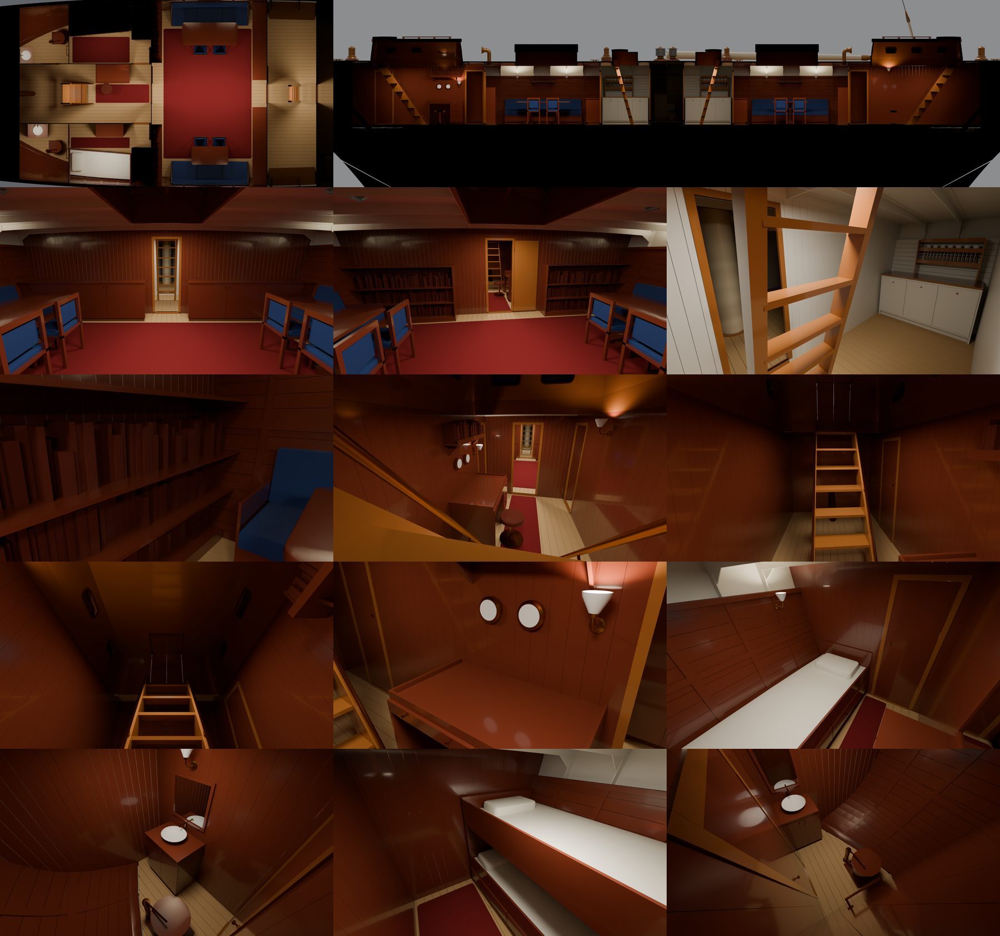
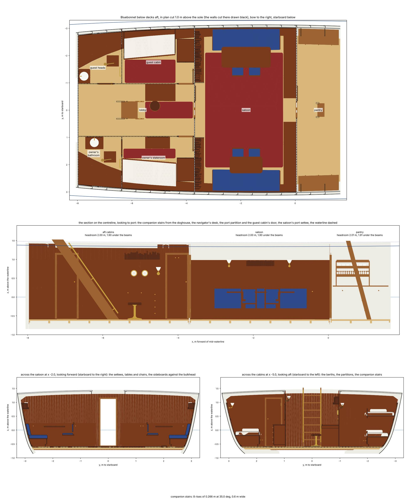

# J-Class 10: Bluebonnet below decks, aft

Slice 10 of *Bluebonnet*, our own J-Class sloop of 1937 (plan and Bean's decisions:
<https://claude.ai/artifact/WdUKp8somgyNJZDyESCgyU>; the hull is slice 1, [docs/jclass-1](../jclass-1/README.md), its
plating, keel and rudder slice 2, [docs/jclass-2](../jclass-2/README.md), its deck slice 3,
[docs/jclass-3](../jclass-3/README.md), her spars slice 4, [docs/jclass-4](../jclass-4/README.md), her standing
rigging slice 5, [docs/jclass-5](../jclass-5/README.md), her sails slice 6, [docs/jclass-6](../jclass-6/README.md),
her winches and running rigging slice 7, [docs/jclass-7](../jclass-7/README.md), the rest of her deck hardware slice 8,
[docs/jclass-8](../jclass-8/README.md), and the crew's end below slice 9, [docs/jclass-9](../jclass-9/README.md)). This
slice finishes the inside: the owner's end, from the galley's after bulkhead to the bulkhead forward of the lazarette.
It carries slice 9's steel aft, and builds the steward's pantry under the crew's companionway, the panelled saloon under
the saloon skylight, and under the doghouse the owner's stateroom and bathroom, the guest cabin and heads, and the lobby
between them with the navigator's desk and the companion stairs down from the doghouse's doors. Ten lamps light it. On
deck it opens the saloon skylight, the companionway and the doghouse over the rooms, and bores the third pair of deck
prisms and the after cowls through. All of it is streamed in only when you go below. Like slices 1 to 9 it is
post-slice art: tools and docs only, nothing imported into Unreal or wired into the game yet.



The renders, left to right in rows of three: the rooms aft from above, cut 0.5 m over the waterline, the bow to the
right; the port half from the centreline, and the starboard half (both orthographic, the camera cutting the yacht at
the centreline); the saloon looking forward to the pantry's door, the settees and tables each side; the saloon looking
aft to the owner's end, the bookcases each side of its door; the pantry to port under the companionway, the crew's
ladder down from it; a bookcase and the starboard settee's end; the lobby from aft, the navigator's desk to port and
the cabins' doors open; the companion stairs from forward; the doghouse from the foot of the stairs, its doors, windows
and slide overhead; the navigator's desk; the owner's stateroom; the owner's bathroom; the guest cabin; the guest heads.
Each is in `baseline/` at 1200 pixels wide. The views are lit by the cabins' own ten lamps (each bulb glowing, a warm
point light over it), by work lights under the deckhead like slice 9's (the renders', not the model's: the pantry has
no lamp, and dark mahogany by its lamps alone is hard to read) and by the daylight through the skylights, ports and
prisms, and use Blender's AgX colour.



## What slice 10 builds

### The rooms

From forward to aft, each between two bulkheads standing on frames. Headroom is measured as in slice 9, from the sole
to the underside of the lowest deck beam over the room ("under the beams") and to the deckhead between the beams, on
the centreline and across a walkway 0.6 m wide; the table gives the least of the two.

| Room | From, to (x) | Sole | Headroom between the beams, under them | What is in it |
| --- | --- | --- | --- | --- |
| Pantry | 0.035 to the galley's bulkhead at 1.64 | -0.60 m | 2.01 m, 1.91 | the steward's pantry: a counter of lockers each side with a dresser over it, and the crew's ladder down from the companionway on the centreline |
| Saloon | -3.71 to 0.035 | -0.60 m | 2.00 m, 1.90 | the panelled saloon under the saloon skylight: a settee each side with a table before it and two chairs, sideboards against the forward bulkhead, bookcases against the after one, a shelf of books over each settee, four lamps, the carpet |
| Owner's end | -7.99 to -3.71 | -0.60 m | 2.00 m, 1.90 | under the doghouse: the lobby on the centreline with the companion stairs and the navigator's desk; to starboard the owner's stateroom and, aft of it, his bathroom; to port the guest cabin and the guest heads |

The soles aft are 0.1 m lower than the galley's, so a six-foot man stands under the beams everywhere aft; the step down
at the galley's door is under the 0.2 m that needs a step, so the sill takes it. The bulkheads at 0.035 and -3.71 have
doors 0.56 m wide on the centreline like slice 9's, their leaves hooked back to port; the galley's door at 1.64,
drawn shut in slice 9, is now hooked open the same way. The after bulkhead at -7.99, forward of the lazarette and the
steering gear, is blank: the lazarette is reached from its deck hatch.

The owner's end is split by partitions of tongue-and-groove mahogany 22 mm thick: two fore and aft, 1.91 m apart (their
lobby faces under the doghouse sill's inside face, 0.955 m each side of the centreline), from the after bulkhead to the
saloon's, and one across each side on frame -6.385, from the fore-and-aft partition out to the hull, between the cabins
and the bathrooms. Each is scribed up under whatever is over it: the deckhead, the uncut beams, the doghouse's forward
header and its sill's lining. Their four doors open 0.53 by 1.695 m over a 25 mm sill: the stateroom's and the guest
cabin's at the lobby's forward end, hooked open flat against the saloon's bulkhead, the guest heads' from the lobby and
the owner's bathroom's from his stateroom, both drawn shut.

| Place in the owner's end | From, to (x) | Across (y, to starboard) |
| --- | --- | --- |
| Lobby | -7.99 to -3.71 | -0.955 to 0.955 |
| Owner's stateroom | -6.385 to -3.71 | 0.977 to the hull |
| Owner's bathroom | -7.99 to -6.385 | 0.977 to the hull |
| Guest cabin | -6.385 to -3.71 | the hull to -0.977 |
| Guest heads | -7.99 to -6.385 | the hull to -0.977 |

### The pieces

| Piece | Where | What it is |
| --- | --- | --- |
| Frames, beams, knees and the plating's inside face | carried aft from slice 9's 1.64 to -7.99: 18 more frames at the same 0.535 m | as slice 9's, painted white; behind the panelling they no longer show |
| Carlins and headers | under the companionway (0.04 to 1.64), the saloon skylight (-3.17 to -0.50) and the doghouse (-7.45 to -4.25) | the beams under each opening are cut and landed on carlins along its sides, with a header across each end; at the doghouse's after end the uncut beam at -7.455 is the header. The bulkheads and partitions are scribed up under the carlins |
| Panelling | the saloon and the owner's end, from 2 mm over the sole to 0.32 m under the deckhead at the side (where the frames and their knees show above it) | varnished mahogany boards 0.11 m wide over the frames, laid by their length round the hull's turn (so each row tapers toward the ends, where the girth is less, and no gap opens at the bilge), their edges bevelled where two meet at an angle; rails 60 by 12 mm at 0.002 (the skirting), 0.42 and 0.95 m over the sole, a stile 60 mm wide over each frame, a cornice 50 by 30 mm along the top. The owner's end's runs break at the partitions on frame -6.385 |
| Pantry lining | the pantry | painted tongue-and-groove, like the galley's |
| Bulkheads | 0.035 and -3.71 (with doors), -7.99 (blank) | tongue-and-groove pine 22 mm thick, as slice 9's; each face toward the saloon or the owner's end is varnished mahogany, the pantry's and the galley's faces white |
| Partitions and their doors | the owner's end (above) | tongue-and-groove mahogany, each door with its frame, sill, leaf and two hinges |
| Soles | each room | pine planks on bearers, as slice 9's |
| Pantry | 0.12 to 1.60, each side | a counter of lockers 0.9 m high and 0.55 deep with a teak top and three doors, a dresser over it (0.2 to 1.1) with three shelves, a plate rack, fifteen plates and seven mugs; the crew's teak ladder under the companionway, 8 rises of 0.262 m from the sole to its sill |
| Settees | -3.05 to -0.55, each side | mahogany settees against the panelling, the seat 0.42 m over the sole with its cushion and 0.62 deep, blue velvet seat and back cushions |
| Tables and chairs | x -1.8 | a table before each settee, its top 0.74 m up and 0.1 m out over the seat's front: to port 1.8 by 0.75 m on two pedestals, to starboard 1.2 by 0.6 on one; two chairs at each on its inboard side |
| Sideboards | against the forward bulkhead (-0.41 to 0.04), from 0.45 m out to the side | 0.85 m high, three doors, facing aft |
| Bookcases | against the after bulkhead (-3.68 to -3.35), from 1.0 m out to the side | 1.2 m high with three shelves, facing forward, full of books |
| Book shelves and lamps | over each settee | a shelf (-2.2 to -1.4) 1.38 m up, over a sitter's head, and 0.2 deep on brackets on the stiles, with a fiddle and its books (no taller than the panelling); a lamp 1.42 m up on the stiles at frames -2.64 and -1.035 each side |
| Carpet | the saloon | a red pile carpet 12.0 m^2 between the settees' kicks, from the bookcases to the sideboards |
| Companion stairs | from the doghouse's doors (their sill 1.53 m over the waterline at x -7.36) down to the lobby's sole | two teak strings leaning 35 degrees from upright, teak treads at 8 even rises of 0.266 m, 0.6 m wide, a brass handrail on posts along each string |
| Navigator's desk | against the port partition, -5.5 to -4.4 | a mahogany desk 0.6 m deep, its top 0.78 m up with fiddles, a pedestal of four drawers forward, the chart drawer under the top, a shelf of pilot books over it on brackets, the barometer and the clock on the partition, a lamp; a brass stool with a leather seat 0.45 m up, standing in the desk's knee space (0.22 m under the chart drawer for the knees) |
| Runner | the lobby, -5.5 to -3.76 | a carpet runner 0.6 m wide |
| Owner's stateroom | to starboard | the berth against the hull (-6.36 to -4.36, its mattress 0.55 m over the sole, 0.85 wide, a lee rail and two drawers under it), a chest of four drawers against the partition with a mirror over it, the wardrobe (two doors, 1.75 m high) in the forward outboard corner, a carpet, a reading lamp on the side's stile over the berth, 1.4 m up |
| Owner's bathroom | aft of the stateroom | a pump WC, the basin's vanity against the partition (-7.7 to -7.05, 0.8 m high) with its mirror and lamp, a towel rail |
| Guest cabin | to port | two berths one over the other against the hull (-6.3 to -4.4, the mattresses 0.5 and 1.25 m over the sole), a hanging locker like the wardrobe, a carpet, a lamp |
| Guest heads | aft of the guest cabin | a pump WC, the basin's cabinet against the after bulkhead with its mirror and lamp, a towel rail |
| Lamps | ten in all (four in the saloon, two in the lobby, one in each cabin, bathroom and heads) | brass wall lamps, each a backplate and arm holding an open porcelain shade over a frosted bulb |

The deck is now opened under the saloon skylight, the crew's companionway and the doghouse (slice 3 left it closed under
them): the skylight's coaming is carried down through the deck as a lining like slice 9's, and each house stands on a
sill that lines its opening below, its doors' opening cut through and its top open under the slide. The third pair of
deck prisms, moved to x -1.87 between two beams, and the after cowls are bored through the deck and the deckhead.

### The objects and triangles

| Object | What it is | Triangles |
| --- | --- | ---: |
| `Aft.Structure` | the plating's inside face, frames, beams, knees, carlins and headers aft of the galley's bulkhead, and the deckhead over them | 134,356 |
| `Aft.Panelling` | the panelling's boards, rails, stiles and cornice, and the pantry's lining | 11,312 |
| `Aft.Joinery` | the bulkheads, partitions (with the fillers at the doghouse lining's corners), doors with their hinges and knobs, soles and bearers, the coamings' and sills' linings under the deck, the pantry's counters and dressers, the crew's ladder, the settees, tables, chairs, sideboards, bookcases and shelves, the stairs, the desk, the berths, chests, wardrobe, locker and cabinets with their knobs, the WCs' seats | 69,146 |
| `Aft.Fittings` | the lamps, the stairs' handrails, the WCs' pans and pumps and the basins, mirrors, towel rails, books, plates and mugs, the barometer and clock, the stool's pedestal | 24,640 |
| `Aft.Upholstery` | the settees' and chairs' cushions, the mattresses and pillows, the carpets and the runner, the stool's seat | 4,990 |

Below decks aft comes to 244,444 triangles, against slice 10's 900,000; it is streamed in with slice 9's objects only
when you go below (`build.json` lists all ten under `streamed_below`, each with its slice). Slice 9's forward objects now
come to 386,808 (386,976 before): `Below.Structure` 242,696 (242,896) where the deckhead now ends at the galley's
bulkhead, and `Below.Joinery` 52,996 (52,964) with the galley's door hooked open. The whole model shown under main and
genoa is now 830,308 triangles, from 823,796: the doghouse gains 4,748 (7,964: its walls on their sill, the ports and
windows cut through with rims each side, the doors and the slide's notch), the companionway 940 (1,684), the skylights
168 (3,816) and the deck hardware 1,280 (34,030: the after cowls and the third prisms bored through), and the deck
loses 624 (17,574) where it is opened.

## Checks

The build stops before writing anything if any of these fail; `rule_check.py` prints the slice 10 ones and fails a
`build.json` that lacks them.

* **Every object is closed:** each of the five objects aft is a closed solid, and the shell, transom and deck still
  close with the deck's new openings capped (the caps only for the check).
* **Nothing crosses anything but by design:** slice 9's overlap check now takes the whole interior: 98 groups of
  furniture (135 meshes), each shrunk 1 mm along its faces' normals, against the structure, the panelling and ceiling,
  the bulkheads, partitions and soles, the shell, the deck, the linings, the deck hardware carried down through the
  deck, every other group and its own meshes in the other objects; the 210 fixed groups against each other, both shrunk.
  Aft, the only contacts allowed by design are the deckhead's holes ending inside the saloon skylight's lining, the
  companionway's and the doghouse's sills and the after cowls and third prisms carried down through it, the last three
  only round their own plans (3 cm out). Nothing else crosses.
* **Everything rests on something:** every one of the 3,962 pieces below (forward and aft) touches another within 0.5
  mm, and each set of pieces touching each other reaches the hull or the deck. None is loose and no set floats. It is a
  check of contact, not of strength.
* **Headroom:** standing room (6 ft, 1.83 m) between the beams in the pantry (2.006 m), the saloon (2.000) and the
  owner's end (2.002), each the least over the centreline and a walkway 0.6 m wide; under the beams it is 1.906, 1.900
  and 1.902 m, over six feet too.
* **The stairs and doors:** the companion stairs' rises are no more than 0.27 m (8 of 0.266 m; `rule_check.py` holds
  the 0.27 itself, so the json can only lower it); every door aft opens at least 1.6 m high: the four in the partitions
  (0.53 by 1.695 m) and the three in the bulkheads at 1.64, 0.035 and -3.71 (0.56 by 1.68).
* **The pieces fit the hull:** the build raises an error if the panelling's rows cannot reach from its foot to its top
  at a station, a panelled room gets no row, the saloon's carpet runs under the settees' kicks, the guest heads' basin
  cabinet stands outside the panelling, or the navigator's stool leaves less than 0.15 m under the chart drawer.
* **The weights:** the accommodation forward and aft, both weighed from the model, must come to no more than the card's
  6.0 long tons (5.90), and the trimming ballast must take up what they leave (below).
* **Slice 10's triangles** stay within its budget (244,444 of 900,000; the check holds the 900,000 itself).
* **Every earlier slice's checks** still pass, and the moulded hull and the finished shell are as fair as before.

## Her weight and balance

| Part | Weight | Centre (x, y, z; y to starboard) |
| --- | ---: | --- |
| Bulkheads 0.035, -3.71 and -7.99 (pine, faced with mahogany toward the panelled rooms) | 440 kg | -3.62, -0.04, 0.37 m |
| Partitions and their doors (mahogany) | 336 kg | -5.94, 0.01, 0.39 |
| Soles and bearers (pine) | 857 kg | -2.90, 0.00, -0.62 |
| Panelling (mahogany) and the pantry's lining | 397 kg | -3.50, -0.08, 0.18 |
| Saloon: settees, tables, chairs, sideboards, bookcases and shelves with their books, lamps, carpet | 882 kg | -2.17, -0.05, -0.07 |
| Pantry: counters, dressers, the crew's ladder | 155 kg | 0.78, 0.00, 0.28 |
| Lobby: stairs, desk, stool, runner, lamps | 184 kg | -5.51, -0.40, 0.33 |
| Owner's stateroom and bathroom | 300 kg | -5.44, 1.79, 0.00 |
| Guest cabin and heads | 299 kg | -5.47, -2.04, 0.12 |
| The coamings' and sills' linings under the deck (teak) | 78 kg | -3.56, 0.00, 1.38 |
| **The accommodation aft** | **3,928 kg (3.87 long tons)** | -3.52, -0.06, 0.01 |
| The accommodation forward (slice 9's) | 2,068 kg (2.04 long tons) | 6.60, -0.28, 0.23 |
| **All the accommodation** | **5,996 kg (5.90 long tons)** | -0.03, -0.14, 0.08 |

The joinery, panelling and soles are weighed from their geometry at mahogany's (590 kg/m^3), pine's or teak's density,
the cushions and mattresses at 120 and 90 kg/m^3, the carpets at 2.8 kg/m^2, the brass and mirror glass at theirs, and
the books at 650 kg/m^3 (the bookcases' 292 books and the shelves' 42 are most of the saloon's weight); the WCs and the
basins' works are estimated (40 kg each WC with its pump), and so is the stool's hollow brass pedestal (7 kg). The
forward end weighs 2.036 long tons, from slice 9's 2.030: the galley's bulkhead, its door now hooked open, weighs 154.5
kg (148.3).

The size card allowed 6.0 long tons for all the accommodation, centred at x -1.0, z -0.5 m, and until now that estimate
stood in her weight. Slice 10 replaces it with the measured 5.90 long tons: aft and forward together centre at x -0.03,
z 0.08 m, about a metre further forward and 0.58 m higher than the card's (slice 9 set slice 10 a target of 3.97 long
tons at x -4.89, z -0.87 to keep the card's centre; the cabins as drawn weigh 3.87 and sit 1.4 m further forward and
0.9 m higher than that, so the card's centre is not kept: the measured one stands in her weight and balance instead).
The trimming ballast in the bilge takes up the 0.10 long tons the accommodation leaves and the 0.015 the deck gives up
(below): 3.475 long tons (3.363 before), so the lead is 96.90 long tons and she floats on her lines at 156.2. The accommodation's centre moving forward brings
her LCG onto her LCB: she now floats level (she trimmed 3.1 cm by the stern before). Its centre moving up raises G to
1.367 m below the waterline (1.388), so GM is 2.155 m (2.176); her righting moment heeled 30 degrees is 1,678 kNm
(1,694), and the windward shrouds' breaking moment is 3.26 times it (3.23).

## Changes to earlier slices

Slice 10 changes some earlier slices' pieces. Their reports and weights in `build.json` change with them; their own
docs pages and renders are not redone.

* **Slice 3's deck** is opened under the saloon skylight (its coaming carried down as a lining, `Skylights` 3,816
  triangles), the companionway and the doghouse. Each house now stands on a teak sill over the deck (40 mm at the
  companionway, 60 mm at the doghouse: the doors' threshold) that lines its opening below; the companionway's walls
  stand just inside its sill, its top forward of the slide is a board between them and its two doors (0.33 m each)
  close the opening up to the slide (`Companionway` 1,684 triangles, 744 before); the doghouse's walls, leaning in as
  before, stand on its sill with their ports and the forward windows cut through, rimmed each side, its doors (0.3 m
  each) fill the opening from the sill to the slide, and the slide runs over a notch in the roof (`Doghouse` 7,964,
  3,216 before). The deck weighs 15 kg less: the planking taken out under the three openings (242 kg) was nearly all
  planking already deducted under the coamings and houses (240 kg less is deducted now); the companionway is 2.7 kg
  lighter, the doghouse 10.9 kg (its walls cut for the ports, the roof notched; the sill, the ports' inside rims and
  the larger doors add back).
* **Slice 8's hardware:** the third pair of deck prisms moved aft from x -1.70 to -1.87, between two beams, and with
  the after cowls is bored through the deck to the deckhead.
* **Slice 9's interior:** its steel and the deckhead run on aft (the deckhead now in two slabs, either side of the
  galley's bulkhead); the galley's door is hooked open; the ladders and dressers (furniture.py) put the crew's ladder
  under the companionway and the pantry's dressers into the aft objects; the overlap and support checks take the whole
  interior.
* **Slice 2's ballast:** the trimming ballast takes the accommodation's measured weight in place of the card's (above).

## Sources and licence

* **Our own layout and pieces,** in the manner of the owners' ends of the 1930s Js and big cruising yachts as their
  restorations show them: a panelled saloon with settees and tables each side under a skylight, a steward's pantry
  between it and the galley, the owner's stateroom and bathroom on one side and a guest cabin and heads on the other
  under the doghouse, and a navigator's desk at the foot of the companion. None is copied from a particular yacht's
  plans, a maker's catalogue or a photograph; the sizes are ours, checked by the build (rooms, headroom, stairs, doors,
  weights).
* **No outside assets:** every mesh is generated by the build from `interior_bluebonnet.json` (and the openings from
  `deck_bluebonnet.json` and `hardware_bluebonnet.json`). The materials are flat colours and the renders' own shaders:
  no image textures, nothing that needs a licence row until she goes into the game.

## Review

An independent review read the slice's code, json, drawing and renders before this pull request, as for slices 1 to 9.
What it found and what changed:

| Finding | What changed |
| --- | --- |
| The navigator could not sit at the desk: the stool's seat was 0.61 m over the sole, 6 cm under the chart drawer | the stool is lower (its seat 0.45 m up, leaving 0.21 m under the drawer for the knees) and stands in the desk's knee space (x -5.15); its seat height is in the json, and the build stops if it leaves less than 0.15 m |
| Some walls stopped short of the deckhead: the partitions across read their neighbours' pieces at their edges, so the board under the doghouse carlin's flange and the first one outboard stood 9 to 10 cm short; the saloon's forward bulkhead cut its boards under the companionway's carlin down whole; where the doghouse lining's corners curve away, the fore-and-aft partitions left a gap over their cabin faces | each board across is read inside its own width, and split where the lining ends; the bulkhead's boards under the carlin are cut in pieces where its web and flange begin and end, each 0.5 mm under what is over it; a mahogany filler on each of the four corners closes the partition up to the deckhead |
| The saloon's book shelves and lamps hung at a sitter's head (1.25 m over the sole) | the shelves are 1.38 m up, their books no taller than the panelling and standing off the cornice where they reach into it; the lamps are 1.42 m up |
| The owner's reading lamp was on the partition 1.0 m over the sole, where he sits up in his berth | it is on the side's stile over frame -5.85, 1.4 m up (0.85 m over the mattress), facing inboard |
| The owner's vanity's forward door swung into the WC's pump | the pump stands outboard of the pan |
| The stool was weighed as solid brass, 38 kg | its pedestal is hollow: an estimated 7 kg |
| The checks could be loosened by the files they read | `rule_check.py` holds the stairs' 0.27 m and the 900,000 budget itself, checks every door aft (the three in the bulkheads too) and that the trimming ballast takes what the accommodation leaves; the deckhead's allowed crossings with the after cowls, the companionway and the doghouse count only round each one's own plan |
| Smaller things | the panelling's skirting starts 2 mm over the sole (it left a 1 cm slit); the navigator's lamp clears the shelf's bracket; the lobby's lamp is 1.65 m up; the stairs' strings are teak; the lamps' places and the stool are in the json; the panelling's break at the partitions takes the partitions' thickness; the plan drawing no longer shows the mattresses' triangles, and the bathroom's name is off its WC; this page's numbers corrected (below) |

## Known gaps

* **From on deck you can see into cabins that are not loaded:** the doghouse's ports, windows and doors, the
  companionway's doors and slide, the saloon skylight's glass and the deck prisms all now look down into rooms streamed
  in only when you go below. When she goes into the game, it should load the aft objects whenever the camera is near
  those openings (or draw a stand-in behind each: a dark box or a baked card of the room).
* **The lamps are lit only in the renders:** the bulbs' glow and a warm point light over each are the render script's.
  How many of the ten cast light and shadows in the game is the game's light budget to set when she is imported. The
  daylight through the skylights, ports and prisms is the renders' sun, not baked.
* **Berths for thirteen:** the ten cots forward, the owner's berth and the guest cabin's two; the saloon's settees could
  take two more. A J raced with a much larger crew than that; the rest are taken to have lived ashore or in her tender.
  The guest cabin's upper berth has about 0.65 m over its mattress to the beams: room to sleep, not to sit up.
* **The owner's berth is a single** (its mattress 0.85 m wide at the front's line, widening to 0.99 m at the top as the
  side flares out); a double would need the chest of drawers moved. Bean may want either.
* **The doors are drawn in one state each:** the cabins' open, the heads' and the bathroom's shut, the bulkheads' hooked
  back. The game may want them to swing (each leaf turns on its hinges' line).
* **The WCs' and basins' works are estimated:** their pipes, seacocks and tanks are not drawn, only weighed.
* **No small things:** no crockery or glasses in the pantry's lockers, no linen in the drawers, no charts on the desk; the
  books are plain blocks in the leather colour, and the dressers carry only their plates and seven mugs each.
* **Flat colours:** the mahogany, velvet, carpet and brass are flat colours with the renders' own shaders; the grain,
  the panels' figure and the carpets' pattern come with the textures when she goes into the game.
* **The lazarette is not drawn:** the after bulkhead is blank, and the steering gear stays slice 3's estimate inside the
  wheel box.
* **The companion stairs are steep:** 55 degrees to the sole (35 from upright), as yachts' companions are, with a
  handrail each side. A gentler stair would need a longer lobby.
* **Room names are plain strings** shared by the json, the build and the checks (`Pantry`, `Saloon`, `Aft cabins`), and
  slice 10 also routes pieces into the aft objects by them: renaming one means renaming it everywhere.
* **Tight spots the review found and left:** the doors in the partitions open 1.695 m high, so a six-foot man ducks
  through them (and the bulkheads' 1.68 m doors); going up the stairs there is 1.61 m from a tread to the doghouse's
  slide over it, so you stoop as you climb; the stairs' handrails end 0.44 m short of the sill at the top; there is 0.22
  m in front of the owner's WC to the partition and 0.12 m in front of the guest's (a real heads might turn the pan
  athwartships); the crew's ladder in the pantry lands 0.49 m from the galley's door; the guest berths are 1.86 m long,
  where the cabin has room for about 2.0.
* **Small gaps left:** the pantry's counters and dressers stand 3 to 14 mm off its lining in places (the lining follows
  the hull's curve, their backs are straight); at the doghouse's after end a 5 cm pocket between its sill's lining (x
  -7.40) and the beam at -7.45 is left open over the partitions.
* **The checks look for crossings and contact, not swing or strength:** no check swings a door through its arc (the
  vanity's door against the WC's pump was found by eye), and the support check asks only that every piece touch
  something that reaches the hull, not that it is fixed strongly enough.

## Words used here

* **Owner's end:** the after part of a big yacht's accommodation, the owner's and guests' cabins, as against the crew's
  end forward. **Saloon:** the main cabin, where the owner and guests sit and eat. **Pantry:** the steward's room
  between the galley and the saloon, where the food is dished up and the china kept.
* **Panelling:** here varnished mahogany boards over the frames, in place of the crew's end's pine battens, with
  **rails** (horizontal strips) along them, **stiles** (upright strips) over each frame and a **cornice** (a moulding)
  along their top under the deckhead.
* **Partition:** a wall dividing a room that stands on the sole and is not on a frame like a bulkhead; here
  tongue-and-groove mahogany. **Scribed:** cut to fit what it meets, here the deckhead and the beams over it.
* **Companionway:** a stair or ladder down from the deck, and the hatch over it; the crew's is the box abaft the mast,
  the owner's is the **doghouse**, the low deckhouse aft with windows, whose doors and **slide** (sliding hatch) open
  onto the companion **stairs**. **Strings:** a stair's two sides; **treads:** its steps; **rise:** the height of each
  step.
* **Heads:** a yacht's lavatory. **Pump WC:** a marine toilet flushed and emptied by a hand pump. **Vanity:** a basin
  set in a cabinet.
* **Settee:** a fixed sofa along the side. **Sideboard:** a low cupboard with a top to serve from. **Fiddle:** the
  raised rail round a table, desk or shelf that stops things sliding off. **Lee board (lee rail):** the raised front of
  a berth that keeps the sleeper in when she heels.
* **Sconce:** a lamp on a wall bracket. **Deck prism:** a glass prism let into the deck that lights the cabin below.
  **Cowl:** a ventilator on deck, its mouth turned to the wind.
* **Headroom:** the height to stand, from the sole up to the deck beams' undersides (under the beams) or to the
  deckhead (between them).
* **Long ton:** 2,240 lb, 1,016 kg, the size card's unit.

## How to run

The same venv as slices 1 to 9 (Python 3.13 with pip `bpy` 5.3, numpy, scipy, matplotlib, pillow); `<venv>/bin/python`
below. Run from the repo root:

```
<venv>/bin/python Tools/shipkit/jclass/build_jclass.py <out>    # jclass.blend, jclass.obj, build.json and twelve drawings
python3 -I Tools/shipkit/jclass/rule_check.py <out>/build.json
<venv>/bin/python Tools/shapeloop/fairness.py <out>/jclass.blend <out> --object Hull
<venv>/bin/python Tools/shapeloop/fairness.py <out>/jclass.blend <out>/shell --object Shell
<venv>/bin/python Tools/shipkit/jclass/render_jclass.py <out>/jclass.blend <out>/renders --res 1600 --only below_aft_plan,below_aft_half_port,below_aft_half_starboard,below_aft_saloon_forward,below_aft_saloon_aft,below_aft_pantry,below_aft_bookcase,below_aft_lobby,below_aft_stairs,below_aft_doghouse_up,below_aft_desk,below_aft_stateroom,below_aft_bathroom,below_aft_guest,below_aft_heads
<venv>/bin/python Tools/shipkit/jclass/docs_jclass.py <out> docs/jclass-10/baseline --slice 10
```

The build takes about ten minutes on the cloud's CPU, and the fifteen renders at full size about an hour more.

## Files

| File | What it is |
| --- | --- |
| `Tools/shipkit/jclass/saloon.py` | new: builds the rooms aft (the partitions with their doors, the pantry, the saloon, the lobby with the stairs and the desk, the stateroom, the bathroom, the guest cabin and heads) and their lamps; its docstring says how pieces stand against the panelling |
| `Tools/shipkit/jclass/interior_bluebonnet.json` | the aft rooms (`rooms`), the panelling (`ceiling` `panel`, `breaks`), the aft bulkheads' faces, the openings aft, the new materials and densities, and `aft`: the partitions, doors and each room's pieces, each with its note |
| `Tools/shipkit/jclass/interior.py` | carries the steel aft (with the carlins under the companionway and the doghouse, the bulkheads' boards cut in pieces under them where a web and a flange begin and end), lays the panelling by arc length with its rails, stiles and cornice, bevels its boards' edges, and routes the pieces into the five `Aft.` objects (by place, or by an aft room's name so a room's piece at its forward bulkhead goes with it); calls `saloon.build` |
| `Tools/shipkit/jclass/furniture.py` | the ladders and dressers take the aft objects (the crew's ladder under the companionway, the pantry's dressers) |
| `Tools/shipkit/jclass/deck.py`, `deck_bluebonnet.json` | opens the deck under the saloon skylight, the companionway and the doghouse; the houses stand on sills that line their openings, with their doors and ports cut through |
| `Tools/shipkit/jclass/hardware_bluebonnet.json` | moves the third pair of deck prisms to x -1.87, between two beams |
| `Tools/shipkit/jclass/build_jclass.py` | checks the aft objects (closure, crossings, support; an allowed crossing can be held to a plan box, and the deckhead's with the after cowls, companionway and doghouse are), weighs the accommodation forward and aft against the card and lets the trimming ballast take the difference, counts slice 10's triangles against its budget and lists the aft objects as streamed below |
| `Tools/shipkit/jclass/rule_check.py` | the slice 10 checks in a slice 10 build: headroom aft, the stairs' rise (its 0.27 m held in the check), every door aft's height, the accommodation's weight and the trimming ballast taking what it leaves, the 900,000 budget (held in the check) |
| `Tools/shipkit/jclass/drawings_jclass.py` | adds the cabins aft in plan and three sections (`interior_aft_plan.png`), the walls cut drawn in black, each face's edge in its own colour wide enough to hide a curved face's triangles in the plan |
| `Tools/shipkit/jclass/render_jclass.py` | adds the views aft, lit by the cabins' lamps (each bulb lit, a warm point light over it) |
| `Tools/shipkit/jclass/docs_jclass.py` | takes `--slice 10` |
| `Tools/shipkit/jclass/sections_jclass.json` | the rooms aft are a section of their own (`interior_aft`); the note says what each of the five objects holds |
| `docs/jclass-10/baseline/` | this build's stats, fairness checks, drawing and renders |
