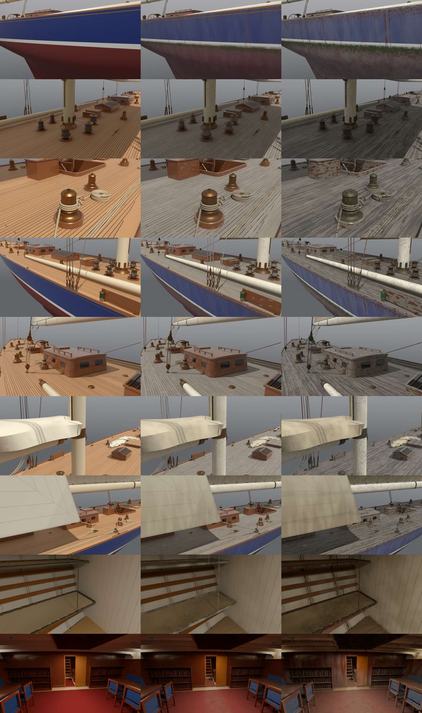
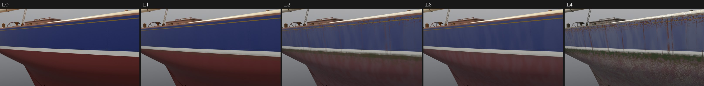
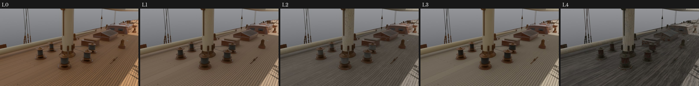
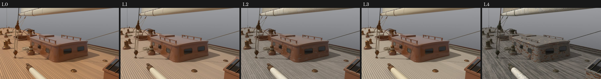
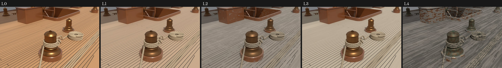
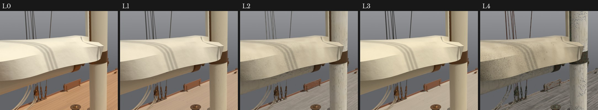
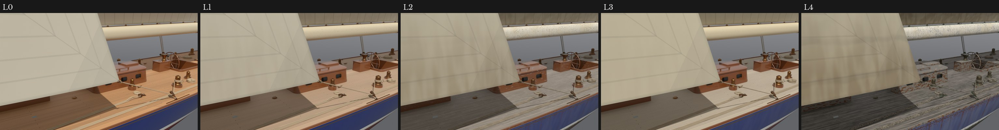
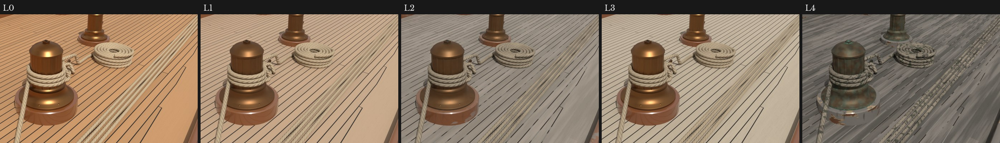
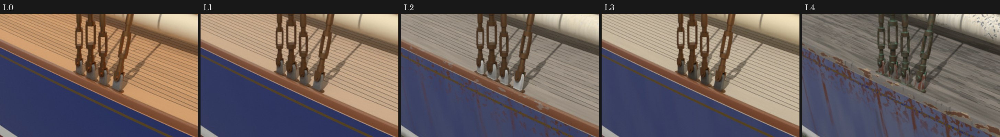
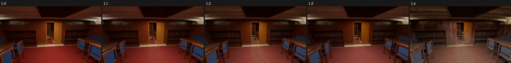

# J-Class 11: Bluebonnet's textures and wear

Slice 11 of *Bluebonnet*, our own J-Class sloop of 1937 (plan and Bean's decisions:
<https://claude.ai/artifact/WdUKp8somgyNJZDyESCgyU>; the hull is slice 1, [docs/jclass-1](../jclass-1/README.md), its
plating, keel and rudder slice 2, [docs/jclass-2](../jclass-2/README.md), its deck slice 3,
[docs/jclass-3](../jclass-3/README.md), her spars slice 4, [docs/jclass-4](../jclass-4/README.md), her standing
rigging slice 5, [docs/jclass-5](../jclass-5/README.md), her sails slice 6, [docs/jclass-6](../jclass-6/README.md),
her winches and running rigging slice 7, [docs/jclass-7](../jclass-7/README.md), the rest of her deck hardware slice 8,
[docs/jclass-8](../jclass-8/README.md), and below decks slices 9 and 10, [docs/jclass-9](../jclass-9/README.md) and
[docs/jclass-10](../jclass-10/README.md)). Until now every one of her materials was a flat colour. This slice dresses
them all in the texture loop's five wear levels ([docs/texture-loop](../texture-loop/README.md)), from new in the
spring of 1937 to twenty years neglected: the steel topsides' enamel chalking, rust weeping from the rivets, weed and
barnacles at the waterline; the teak deck silvering, scrubbed blond or blackened with its seams failing; the varnish
ambering and peeling; the bronze browning, polished bright or green; the duralumin spars' paint chalking and flaking;
the cotton sails dingy and mildewed; the manila greying and hairy; the galvanised wire dulling, oiled or rusting; and
the saloon's velvet, carpet, leather, linen and porcelain fading and wearing. Three close-up maps of her own (cast
bronze, cotton duck, manila) join the boats' shared library. Like slices 1 to 10 it is post-slice art: tools and docs
only, nothing imported into Unreal or wired into the game yet.



The sheet shows nine views, each in a row of three: new (L0), six years half kept (L2) and twenty years neglected
(L4). The views are the hull's topsides and boot top from a dinghy alongside, the deck by the mast, a primary winch
with its tail, the chainplates, the doghouse, the gooseneck, the genoa's foot, a cot below and the saloon. All five
levels of each surface are in its ladder below.

## The five levels

The loop's levels (`Tools/texloop/levels.json`), as they read on her. She lives in salt water at Galveston, so rust,
verdigris and the waterline's growth come at the salt-water rate, not the lake's third.

| Level | Age, care | On Bluebonnet |
| --- | --- | --- |
| L0 | new | launched, spring 1937: wet-look enamel, golden new teak, deep glossy varnish, new cast bronze, cream cotton, straw-gold manila, bright galvanised wire |
| L1 | 0.3 years, 0.9 | her first season: the enamel's gloss a touch softer and a tan scum line on the boot top, the deck paling, the varnish hazed on its tops, rope and sails a shade greyer, bronze dulling to brown |
| L2 | 6 years, 0.5 | six years a working yacht, half kept: enamel dull and chalky with rust weeps at the rivet lines, a silver-grey deck, varnish thin and grey at the edges, brown bronze polished where hands and rope touch, dingy sails, grey-brown rope, white zinc bloom on the wire |
| L3 | 30 years, 0.9 | a kept classic thirty years on: everything renewed and polished, but the enamel faded, the deck scrubbed pale with its grain standing proud, the varnish deepened to dark amber, bronze bright with dark patina in the recesses, cotton yellowed a little, the wire oiled dark |
| L4 | 20 years, 0.1 | twenty years laid up and neglected: chalked enamel with rust bleeding from every seam and chips at the sheer, weed and barnacles at the boot top, a black and green deck, varnish peeled to grey wood, verdigris on the bronze, paint flaking off the mast, mildewed sails, grey rope and rusting wire |

## What slice 11 builds

### The cards

One card per surface the plan names, plus the saloon's furnishings (`Tools/shipkit/jclass/textures_bluebonnet.json`).
Each says which of her materials it covers, how close a camera comes, the pattern's real size, the detail maps it
draws, and what each level looks like on her. Every material the build makes is in a card or in `unweathered` with its
reason (her glass, lenses, mirrors, a lamp's bulb, and the flags, renewed every season); the build stops otherwise.

| Surface | Her materials (by kind) | Closest camera | Detail maps | Colour targets (CC0 scans) |
| --- | --- | --- | --- | --- |
| Steel paint | enamel: Topsides, Bootstripe, CowlRed, Black, Iron; antifouling: Antifouling, Keel; gilt: CoveStripe, Gilt; interior: WhitePaint | 0.6 m | Gelcoat (shared) | rust: Poly Haven rusty_painted_metal, rust_coarse_01; ambientCG Rust009 |
| Teak deck | deck: Teak; sole: Pine | 1.0 m | TeakWeathered (shared) | Poly Haven teak_veneer (L0), wood_planks_grey (L2), weathered_planks (L4) |
| Varnish | exterior: Wood; interior: Varnish, Mahogany | 0.5 m | WoodVarnish (shared) | Poly Haven weathered_peeling_timber (L4) |
| Bronze | bronze: Bronze; brass: Brass | 0.4 m | CastBronze (hers) | ambientCG Metal013, Metal015, Metal017 (L4) |
| Duralumin spars | spar: Spar | 0.8 m | Gelcoat, Metal (shared) | none: no scan of the period's buff mast paint |
| Cotton sails | sail: the five sails' cloth; stowed: SailHeap, SailBag, SailLine; canvas: Canvas | 1.0 m | Cotton (hers) | none: every CC0 cotton is dyed or bleached |
| Manila rope | rope: Rope | 0.4 m | Manila (hers) | ambientCG Rope001 (L0), Rope003 (L2) |
| Wire rope | wire: Wire, WireRope; galvanised: Galvanised; zinc: Zinc | 0.5 m | Metal (shared) | ambientCG Rope002 (L1) |
| Furnishings below | velvet: Upholstery; carpet: Carpet; leather: Leather; linen: Linen; porcelain: Porcelain | 0.5 m | none | none: the CC0 velvets and carpets are other colours |

The scans are measured only (their mean albedo, in `wear_check.py`), never shipped, and kept in the git-ignored
`Data/Reference/raw/textures/Bluebonnet`. A surface with no scan that is really that surface has no colour target and
says so; the blind ladder judges it.

### The wear

`Tools/shipkit/jclass/weathering.py` turns a level into wear terms and puts them on her. `amounts()` gives each
surface's terms from the loop's own time and dirt numbers (`Tools/texloop/wear.py`: time_k and dirt_k from age and
care). Three ideas shape them:

- **What neglect alone does** (rust, flaking paint, failed varnish, verdigris, mildew, barnacles) starts past a
  threshold of dirt that a kept yacht never reaches, so the kept L3 has none of it.
- **A first season's marks** (the gloss going, the boot top's scum line, a spar's slap marks, smudges on the sails, a
  flattened pile) grow as the square root of dirt, which is near its first year's value by then; so L1 is not new.
- **What a kept yacht's routine undoes** (scrubbing the boot top and spars at each haul-out, washing the sails,
  revarnishing each spring, polishing the bronze, renewing the rope every few seasons and the saloon's fabrics) takes
  the first-season marks away again, by care squared once she is two years old.

The dressers then put each term where it belongs, in Blender's nodes over each material's colour, roughness, metal,
coat and bump:

- **Steel paint.** The gloss and the clear coat go. Chalk greys and lifts the colour nearly evenly, most high up and
  on what faces the sky, washed down the topsides in long soft streaks; a white chalks white and is never darkened. On
  the plating, rust runs down from the frames' rivet rows (a rivet somewhere in the strake, running on into the next),
  from the seams' rivets 7.5 cm apart and, longest and widest, from the scuppers and fittings at the sheer, each
  strake's sources drawn afresh; dark grime runs come down from the sheer; nothing runs below the waterline. Chips at
  the sheer show rust. The transom, with no plating UV, gets streaks and chips without the rows. A tan scum line forms
  at the boot top in her first season, then slime and weed in a band about the waterline, with barnacles in colonies
  below it.
- **Teak.** It silvers within a season; a kept deck is scrubbed blond. Grime, algae and mildew darken it plank by
  plank (each its own tone), in streaks along the grain and most in the soft early wood, green where water lies;
  checks open where a slow pattern lets them (the map's own checks repeat with its tile); the seams' glue fails pale
  and proud.
- **Varnish.** The wood ambers under it with the years. The film dulls and hazes first on the tops and where hands go;
  neglected, the cooked old film goes dark brown and lifts in flakes along the grain, first on the tops and edges, to
  grey wood with black water stains. Below, a milky bloom where damp got under it (low down and in condensation
  streaks), with water rings and mildew specks.
- **Bronze.** Open faces brown, then darken; polished bright where hands and rope work it; the recesses keep their
  patina whatever, going almost black with the years; neglected, verdigris in the recesses and dripping from them, a
  thin bloom of it on the open faces.
- **Duralumin.** The buff paint's gloss goes; grey slap marks gather on one side of the spar; the paint chalks to a
  flat pale buff; grime runs from the fittings; neglected, the paint flakes to grey metal with white oxide round each
  flake, most round the fittings (where bronze and steel meet the alloy) and in clusters.
- **Cotton.** Dingy, then grimy along the foot and in rain streaks; yellowing with age; black mildew specks along the
  folds it was stowed in; rust running aft from the hanks and slides at the luff.
- **Manila.** Greyer and hairier (the broken fibres soften the lay and pale it from afar), darker where it is handled,
  mildewed when left; rope is renewed as it wears, on a kept yacht every three seasons or so, on a neglected one
  hardly ever.
- **Wire.** The zinc dulls, then blooms white in the grooves and as a thin film over the rest; a kept yacht's wire is
  oiled dark; neglected, it rusts in the grooves. The galley's zinc has its own kind: it dulls and oxidises white, but
  has no iron in it to rust.
- **Furnishings.** Colours fade toward the skylights' light; the velvet's pile wears shiny at the seat fronts and the
  carpet along the gangway; linen greys; stains, mildew, and the porcelain crazing.

Each term is a value node named `wear:<term>` in the material, which `apply_level()` sets for a level (or any age and
care), so one build renders every level. The game's twin of this (the same terms in the boat materials' HLSL, by E1's
Age and Care) is slice 14's, with the import.

### Her own detail maps

`Tools/shipkit/jclass/textures.py` makes three close-up maps with numpy (no photos), written to `Inputs/jclass-detail`
as plain PNGs (the folder's `.gitattributes` keeps them out of Git LFS, which the cloud cannot push): a normal map and
a mask map each, tileable, sized from the card's real pattern.

| Map | Tile | Pixels | Pixels a mm | Mask channels | Pattern (measured on the map, against the card) |
| --- | --- | --- | --- | --- | --- |
| CastBronze | 100 x 100 mm | 1024 x 1024 | 10.2 | cavity, roughness, height | sand grain 0.35 mm (card 0.2 to 0.6) |
| Cotton | 40 x 40 mm | 1024 x 1024 | 25.6 | weave gaps, tone, height | warp 0.385 mm, weft 0.5 mm (card the same), slubs 10 mm (5 to 20) |
| Manila | 60 x 30 mm | 1024 x 512 | 17.1 | strand lum, hairs, height | fibres 0.32 mm (0.1 to 0.4) |

The shared library's maps (`Inputs/boat-detail`: Gelcoat for the enamels' and the spars' paint, TeakWeathered,
WoodVarnish, Metal) are already in the game's memory for the J/22, so they cost her nothing more. Every map is
sampled at its real size in each part's own frame, projected three ways and blended by the face's direction, with a
map's grain running fore and aft on the deck and along the horizontal on walls (Cycles' own box projection would turn
the deck's grain across its planks); the sails and the ropes use their own UVs (the sails' cloth in metres, the ropes'
strands along their lay). Fine detail fades out with the camera's distance as the game fades it.

### The budget

The plan left texture memory to this slice. Her own maps only (the shared library is already resident), block
compressed with mips (BC5 normals, BC1 masks):

| Tier | Budget (set here) | Her maps |
| --- | --- | --- |
| High and Ultra | 6 MB | 5.0 MB: CastBronze 2.0, Cotton 2.0, Manila 1.0 |
| Medium | 0 MB | none: Medium draws no detail maps on her, only the colour and roughness math, as the boats' Medium material does |

## Checks

`rule_check.py` holds the slice 11 checks in a slice 11 build: every material covered and dressed, the five levels
there with L0 all zero, each of her maps tiling, without a big repeat, at 4 pixels a millimetre or more and its pattern
the card's size, and the budget (its 6 and 0 MB held in the check). `wear_check.py` measures the renders:

| Check | What passes | Result |
| --- | --- | --- |
| The ladder, 23 kinds | each level's mean colour (CIELAB, measured per material in the albedo shots and averaged by pixels) at least 8 from new at L4 and 4 at L2, L1 no further than L2 and L2 no further than L4, and the kept L3 at least 6 from the neglected L4 | all pass |
| Colour targets, 9 | each within 6 in colour (a, b) of the CC0 scans' mean albedo | all pass |
| Her maps | tiling, no big repeat, 4 px a mm or more, the pattern the card's size | all pass |
| Budget | High 6 MB, Medium 0 MB | 5.0 MB and 0 MB: pass |
| Blind ladder | three or more reviewers, each putting all five levels right or swapping only two neighbours, on every surface | all nine pass: all three reviewers put every surface's five levels right |

The ladder, as each level's colour distance from new (and the kept L3's from the neglected L4):

| Kind | L1 | L2 | L3 | L4 | L3 to L4 |
| --- | --- | --- | --- | --- | --- |
| paint.enamel | 3.9 | 20.2 | 14.2 | 31.0 | 17.1 |
| paint.antifouling | 5.7 | 26.8 | 22.5 | 38.4 | 18.4 |
| paint.gilt | 1.5 | 14.7 | 1.2 | 36.4 | 35.6 |
| paint.interior | 0.9 | 4.6 | 3.3 | 9.8 | 7.2 |
| teak.deck | 13.6 | 25.2 | 21.5 | 33.2 | 27.0 |
| teak.sole | 4.1 | 12.5 | 9.8 | 18.8 | 13.4 |
| varnish.exterior | 1.6 | 8.5 | 3.9 | 29.8 | 29.3 |
| varnish.interior | 1.2 | 4.1 | 5.9 | 18.4 | 19.7 |
| bronze.bronze | 10.2 | 13.9 | 5.6 | 28.4 | 23.5 |
| bronze.brass | 17.3 | 22.3 | 9.5 | 43.4 | 34.4 |
| duralumin.spar | 0.5 | 5.6 | 1.3 | 8.2 | 9.5 |
| cotton.sail | 4.8 | 12.4 | 5.3 | 19.1 | 15.0 |
| cotton.stowed | 4.4 | 12.3 | 5.1 | 19.8 | 16.0 |
| cotton.canvas | 4.2 | 11.9 | 4.7 | 19.1 | 15.7 |
| manila.rope | 4.0 | 15.8 | 8.7 | 26.8 | 18.1 |
| wire.wire | 3.0 | 9.8 | 12.3 | 19.2 | 12.7 |
| wire.galvanised | 3.2 | 6.5 | 13.5 | 18.9 | 9.1 |
| wire.zinc | 0.1 | 6.6 | 0.7 | 12.2 | 12.9 |
| furnishings.velvet | 2.3 | 8.4 | 9.2 | 22.2 | 13.0 |
| furnishings.carpet | 3.8 | 12.4 | 12.3 | 25.2 | 13.3 |
| furnishings.leather | 2.8 | 10.0 | 10.8 | 21.4 | 11.2 |
| furnishings.linen | 1.8 | 5.0 | 1.8 | 12.9 | 11.3 |
| furnishings.porcelain | 0.5 | 8.8 | 2.7 | 17.8 | 15.1 |

The colour targets (distance in a and b; the lightness, d_L, is reported, not held: a scan's lighting is not hers):

| Target | Scans | d_ab | d_L |
| --- | --- | --- | --- |
| the rust colour | rusty_painted_metal, rust_coarse_01, Rust009 | 3.6 | 0.3 |
| teak.deck at L0 | teak_veneer | 0.5 | 0.8 |
| teak.deck at L2 | wood_planks_grey | 5.0 | 23.3 |
| teak.deck at L4 | weathered_planks | 3.8 | 9.5 |
| varnish.exterior at L4 | weathered_peeling_timber | 2.9 | -4.6 |
| bronze.bronze at L4 | Metal013, Metal015, Metal017 | 4.7 | -15.8 |
| manila.rope at L0 | Rope001 | 2.9 | 23.1 |
| manila.rope at L2 | Rope003 | 4.1 | 36.1 |
| wire.wire at L1 | Rope002 | 0.8 | 12.4 |

The ladder sheets, each surface's crop from the view that shows it best, new (L0) to twenty years neglected (L4)
left to right; the blind sheets the reviewers saw are the same crops shuffled under A to E (`blind/`, key in
`blind/key.json`):











## Review

An independent review read the slice's code, cards, maps and first renders before this pull request, as for slices 1
to 10. It found fifteen things; all are fixed:

| Finding | What changed |
| --- | --- |
| The deck's teak grain ran across the planks: Cycles' box projection maps a top face as (y, x) | the maps are projected three ways by `weathering.py` itself, each with its own (u, v): the grain runs fore and aft on the deck and along the horizontal on walls |
| The numpy maps' stretched features were shortened instead of lengthened, and came out about three times finer than asked | `spectral_noise` stretches the right way and puts its band where it is asked; `textures.py` measures each pattern's size on the map against the card, and `rule_check.py` and `wear_check.py` hold it |
| The rust weeps repeated in every 1.05 m strake, each cut off at the next seam | each strake's sources are drawn afresh, and a frame's runs carry on into the strake below |
| The ladder averaged a kind's materials into one colour (the blue topsides and the white boot top) | each material's distances are measured on its own and averaged by pixels |
| The spars' paint barely changed (chalk and grime cancelled; flakes covered 2 to 5 per cent) | chalk lifts toward a flat pale buff, slap marks and grime runs are drawn, the paint flakes in proportion to its term |
| The kept L3 contradicted its card where a refit renews a finish (the varnish dull, the gilt dull, the spars as glossy as L2, the rope 4 years old) | first-season marks go as the square root of dirt and a kept yacht's routine takes them off again; neglect's own terms start past a threshold L3 never reaches; rope is on average half its life old |
| The blind rule could not work as written (five levels matched to five descriptions cannot be 4 right), its key came from the reviews file, and unreviewed surfaces passed | the answers must use each level once; all five right or one swap of neighbouring levels passes; the key is the sheets' own `blind/key.json`; every surface must be reviewed |
| L0 and L1 were nearly the same on six surfaces | L1 has first-season cues of its own: the boot top's scum line, the varnish's haze, the spars' slap marks, smudges on the sails, greyer and hairier rope, a flattened pile |
| Noise masks were nearly flat (Blender's noise varies by a tenth) and `patches()` gave less than its share | `blot()` spreads the noise over 0 to 1, and `patches()` takes its threshold from the noise's measured spread (an inverse normal) |
| The galley's zinc rusted and was oiled | zinc is its own kind: it dulls and oxidises white |
| An id seen through glass or in a mirror could read as another material | glass, lenses and mirrors hold out in the id and albedo shots, and a pixel more than 0.1 off a level is not counted |
| The paint's grime term did nothing | dark grime runs come down from the scuppers and fittings at the sheer |
| Bolt ropes on the sails and the headboards have no Spar UV, so their fibre was one texel | where a part has no Spar UV the rope's map is projected instead |
| The cotton map's R was the yarn, not the gaps it is documented as | R is the weave's gaps |
| The checks trusted the generator's json and passed on missing data | `wear_check.py` regenerates the maps and measures the PNGs; a colour target not fetched, a kind in no view or a surface not reviewed fails |
| Smaller things | the seams' rivets are 7.5 cm apart on the frames' lines; the detail maps fade as the shared library's card says; sail rust runs from the hanks at the luff; nothing runs below the waterline; the transom gets its rust without the plating's rows; chalk never darkens a white; the bronze's recesses go dark at L3; the build packs the detail maps into the .blend; the Medium budget is measured, not written |

The second round's renders then showed the varnish's peeling and the bronze's verdigris reading as camouflage and
speckle, and the sails' mildew specks aliasing into grain at a few metres; they were retuned (fewer, larger failed
patches at first; the verdigris in the recesses and a thin crust on the tops; the specks fading into their own grey
mottle past four metres, as the game's fine detail fades). Its checks failed the wire's L4, the white paint and varnish
below, the leather's kept against neglected, and four colour targets (new teak, new manila, neglected bronze and
varnish). A third round fixed those: the wire rusts in runs along its lay under a brown stain; the white paint and the
varnish below darken with age and hands' dirt, and a kept yacht repaints and renews them; the fabrics fade less on a kept
yacht; new teak's and manila's colours are held to their scans; the bronze has less verdigris and the varnish peels to
grey wood when long neglected. It also added three views, measured only, for the galley's zinc, the owner's linen and the
bathroom's porcelain, which no view showed. Its checks passed every colour target and failed five ladders (the
galvanised fittings, whose dulling and white bloom cancelled in their mean colour; the zinc; the linen; the porcelain;
the varnish below at L2), which a fourth round fixed.

The fourth round passed every check, and its three blind reviewers put all nine surfaces in the right order. But
each, asked for the least convincing thing on every sheet, named the same ones: the saloon's panelling at L4 a
brown and white cow-print over every wall and the ceiling ("it looks like a texture error"); the deckhouse's peeled
varnish, the old deck and the bronze's verdigris as camouflage blotches or confetti; the mast's flaking as polka dots;
the sail's mildew as clouds with no rust from the hanks; the rope hardly changing; the wire too thin to read. A fifth
round answered them, and its results are the ones above, with three new reviewers (their answers and the fourth
round's are in `reviews_bluebonnet.json`):

| Fourth round's least real | Fifth round |
| --- | --- |
| The saloon's varnish bloom: hard-edged white blotches over half of every surface | a milky haze the wood shows through (at most a fifth of the way to white), thickest low down over the sole and in soft streaks where condensation ran down |
| The white paint below rusting in blotches | rust at the fastenings and joints, weeping down from them |
| The deckhouses' peel: round blobs | flakes drawn out along the grain (level on her deckhouses), ragged at the ends, with a pale rim of lifted film; the old film a dark brown, not orange |
| The old deck: an even dark mottle | darker plank by plank (each its own tone, by the planking's own rows and lengths) and in streaks along the grain, green where water lies |
| Verdigris sprinkled over the domes | in the recesses and the casting's pits and dripping from them, only a thin soft bloom on the open faces |
| The mast's flaking evenly spread | most round the fittings and in clusters, with more white powder round each flake |
| The hull's rust as specks | longer, wider runs from the frames, the seams and the sheer; the chalk nearly even, heaviest high up and washed down in streaks |
| The sail's mildew in clouds, no rust from the hanks | the mildew gathers along the folds it was stowed in; rust runs aft from each hank; the grime along the foot and in rain streaks, not clouds |
| Old rope just darker | a neglected yacht's rope is old (it is renewed as it wears: on a kept yacht every three seasons or so, on a neglected one hardly ever), and broken fibres soften its lay and pale it from afar |
| The galvanised fittings' white bloom in black and white blotches | a thin uneven film, thickest in the crevices |
| The wire too thin | its ladder is cropped on the shrouds' feet and their rigging screws |

## Known gaps

- **The game's twin.** The wear is in Blender's nodes here; the boat materials' HLSL twin (by E1's Age and Care, as
  the J/22's) and the PC import are slice 14's.
- **No blind A/B this time.** The loop's A/B holds a round against the last; this is her first wear round, so there is
  none to hold it against (`wear_check.json` says so). The next round on any surface will have one.
- **No colour target for cotton, the spars' paint or the furnishings.** No CC0 scan is really that surface (undyed
  sail cotton, a 1930s buff mast paint, her blue velvet and red carpet); the blind ladder judges them.
- **Gloss is judged by eye.** The colour checks read the albedo (each material's colour alone, without the light), which
  has no shine; the lit ladders and the blind reviewers judge the gloss.
- **Medium draws none of this detail.** As the boats' Medium material, it keeps the colour and roughness math only.
- **What the fifth round's reviewers still found least real**, for the next wear round: the neglected hull's rust runs
  evenly spaced, like a barcode, and the barnacles a flat grey speckle; the deckhouses' peel still reads as a blocky
  patchwork; the mast's flaking still an even dark speckle; the kept deck at L3 beige rather than white-blond, and the
  kept bronze's dark recesses hard to see; the mildew on the genoa not visibly along its folds, and the hank rust too
  faint to read; the rope barely changing until L4; the wire still too thin to judge; and the saloon's first four
  levels nearly the same, with the old deckhead a coarse mottle. All three put every level right regardless.

## How to run

The same venv as slices 1 to 10 (Python 3.13 with pip `bpy` 5.3, numpy, scipy, matplotlib, pillow); `<venv>/bin/python`
below. Run from the repo root:

```
python3 -I Tools/shipkit/jclass/textures.py                    # her three maps into Inputs/jclass-detail
<venv>/bin/python Tools/shipkit/jclass/build_jclass.py <out>   # dresses every material at L0
python3 -I Tools/shipkit/jclass/rule_check.py <out>/build.json
<venv>/bin/python Tools/shipkit/jclass/render_jclass.py <out>/jclass.blend <out>/renders --res 960 --only <the wear shots>
python3 -I Tools/shipkit/jclass/wear_check.py <out>/renders --fetch --sheets docs/jclass-11
<venv>/bin/python Tools/shipkit/jclass/docs_jclass.py <out> docs/jclass-11/baseline --slice 11
```

The wear shots are `wear_<view>_id`, and `wear_<view>_<level>` and `wear_<view>_<level>_albedo` for each level L0 to
L4, for the views hull, deck, winch, chainplates, doghouse, gooseneck, sail, cot and saloon, and only the id and albedo
shots for galley, stateroom and bathroom (measured, not looked at: the zinc, the linen and the porcelain): 117 renders,
about 70 minutes at 960 pixels on the cloud's CPU after the ten-minute build. `--fetch` downloads the CC0 colour
targets once.

## Files

| File | What it is |
| --- | --- |
| `Tools/shipkit/jclass/textures_bluebonnet.json` | new: the nine cards (materials by kind, closest camera, pattern sizes, maps, colour targets, the five levels on her), the unweathered materials and why, her own maps' cards, the budget |
| `Tools/shipkit/jclass/weathering.py` | new: the wear terms by level (`amounts`), the Blender dressers per surface, `dress()`, `apply_level()`, the id and albedo modes, the build's texture report |
| `Tools/shipkit/jclass/textures.py` | new: her three detail maps (cast bronze, cotton duck, manila), their tiling, repeat and pattern-size measures |
| `Tools/shipkit/jclass/wear_check.py` | new: the colour, ladder, maps, budget and blind checks on the wear renders, and the ladder and blind sheets |
| `Inputs/jclass-detail/` | new: the three maps (normal and mask PNGs, plain git by the folder's `.gitattributes`) and `jclass_detail.json` |
| `Tools/shipkit/jclass/build_jclass.py` | dresses every material at L0, stops if a material has no card, packs the detail maps into the .blend, writes `textures` into build.json |
| `Tools/shipkit/jclass/render_jclass.py` | the wear views: nine at five levels, lit and as albedo, and as ids; three more as albedo and ids only |
| `Tools/shipkit/jclass/rule_check.py` | the slice 11 checks: coverage, the levels, each map's tiling, repeat, sharpness and size, the budget (its 6 and 0 MB held in the check) |
| `Tools/shipkit/jclass/docs_jclass.py` | takes `--slice 11` (its nine-row contact sheet is saved narrower to stay under 300 KB) |
| `Tools/shipkit/jclass/reviews_bluebonnet.json` | new: the blind reviewers' answers and least-real notes (the fifth round's, which the check reads, and the fourth's) |
| `docs/licences/assets.csv` | a row for `Inputs/jclass-detail` (generated, our own) |
| `docs/jclass-11/` | this page, the ladder sheets, the blind sheets and their key, and `baseline/` (build.json, wear_check.json, the contact sheet) |
