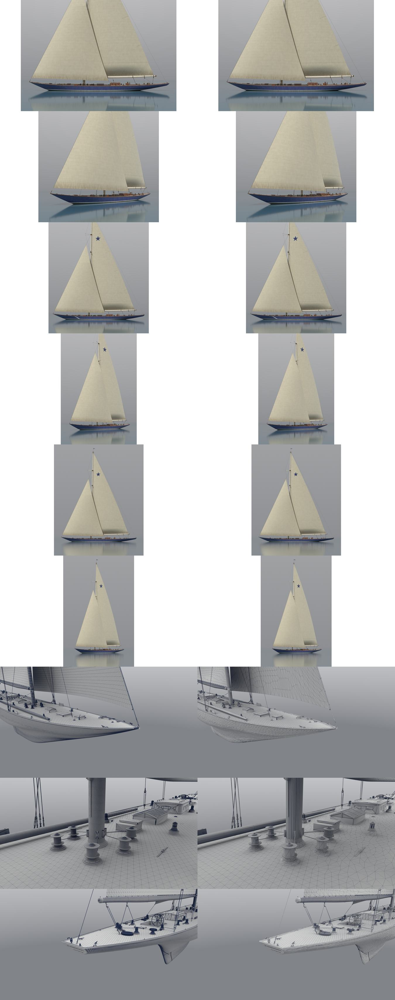

# J-Class 12: Bluebonnet's light copy

Slice 12 of *Bluebonnet*, our own J-Class sloop of 1937 (plan and Bean's decisions:
<https://claude.ai/artifact/WdUKp8somgyNJZDyESCgyU>; the hull is slice 1, [docs/jclass-1](../jclass-1/README.md), its
plating, keel and rudder slice 2, [docs/jclass-2](../jclass-2/README.md), its deck slice 3,
[docs/jclass-3](../jclass-3/README.md), her spars slice 4, [docs/jclass-4](../jclass-4/README.md), her standing rigging
slice 5, [docs/jclass-5](../jclass-5/README.md), her sails slice 6, [docs/jclass-6](../jclass-6/README.md), her winches
and running rigging slice 7, [docs/jclass-7](../jclass-7/README.md), the rest of her deck hardware slice 8,
[docs/jclass-8](../jclass-8/README.md), below decks slices 9 and 10, [docs/jclass-9](../jclass-9/README.md) and
[docs/jclass-10](../jclass-10/README.md), and her wear slice 11, [docs/jclass-11](../jclass-11/README.md)). Until now
she had one model: the detailed one, 830,308 triangles under main and genoa. This slice gives every part seen from
outside a light twin, for the game to draw when she is far off and for AI boats: 126,236 triangles under main and genoa,
15% of the detailed boat. Seen from 50 m on a 4K screen, its surface is nowhere further than a pixel from the detailed
one's, and its drawn paint (the plating's seams, a sail's cloths) is within a pixel over 99% of its area. It also writes
the plan's six frame-rate gate views. Like slices 1 to 11 it is tools and docs only: nothing is imported into Unreal
yet, and the Mac's and PC's frame-rate gates run on these views once she is in the game (slice 14, before the vertical
slice's Nov 27 feature freeze: `docs/slice/README.md`).



The sheet's first six rows are the detailed boat (left) and the light copy (right) from 50, 100 and 300 m, abeam and
40 degrees off the bow, each at a 4K screen's own pixels at the game's narrowest field of view; the last three are
their triangles close to (the bow, the mast's foot with its winches, the counter).

## How light, and why

**The tolerance is a pixel at 50 m.** A light copy is right when nobody can tell it from the detailed one where it is
drawn. The narrowest view the game has is 60 degrees across (Settings > Field of view runs 60 to 120); on a 4K screen
(3840 pixels across) a pixel at 50 m is then 2 x 50 x tan 30 / 3840 = **15 mm**. Every twin is held to that: its
surface and its paint lines within 15 mm of the detailed part's everywhere, its drawn paint within 15 mm over 99% of
its area (the rest is listed below). The game switches each part to its twin by its own screen size (Unreal's LOD
screen size, written for every part in `light.json`), at the size where the twin's error is one pixel. Unreal measures
a part's size from the middle of its bounding sphere, so for a big part (the mast, a sail) the switch is set for the
sphere's nearest point in the game's widest view (120 degrees), and it is then safe in every view. With the chase
camera's 90 degrees the worst part's error is a pixel from 28.7 m on 4K and 14.4 m at 1080p; most parts' errors
are far smaller and switch nearer still.

**Why 50 m and not the plan's 300 m.** The plan's budget gave the light copy about 650,000 triangles and drew it beyond
about 300 m. Held to a pixel at 50 m it comes out at about a fifth of that (126,236 under main and genoa), because most
of her detailed triangles are on things far smaller than 15 mm across or far flatter than that (the plating's rivet
rows, the winches' teeth, the shackle pins, round rope with 12 sides). So one copy serves both a boat racing 50 m off
and a boat on the horizon, the plan's quarter of the detailed boat is held in every suit with room to spare, and there
is no need for a second, coarser level for 300 m.

## How a twin is made

`Tools/shipkit/jclass/light.py` makes one twin per part, `<part>_Light`, in the collection Light, hidden, with the
part's frame, parent, material slots, UV maps and custom properties (so it shows in the same suits and states), plus
`light_of` naming the part. Every outside part has one (67): not slice 1's moulded hull (the fairness check's
reference, never shown) and not below decks (slices 9 and 10), which is only drawn from inside, close to. Five steps:

1. **Specks.** A separate piece whose bounding box is under 15 mm across (a split pin, a rivet head) would be left out,
   being under a pixel from 50 m. *Bluebonnet* has none: her smallest separate pieces are bigger than that.
2. **Tubes.** A rope, a wire or a round rod is built again round its own centreline with the fewest sides that keep it
   within half the tolerance and 30% of its radius of the round one, its corners standing a little outside the round
   rope and its flats a little inside (for four sides, 17% of the radius each way, so its width seen from any side is
   within 17% of the rope's). A 12-sided rope or wire becomes 4 to 6 sides, a winch's barrel or a spar's fitting up
   to 9. Its rings are thinned to those its bends need, and its paint is carried from the detailed rope's as in step
   4. A tube that would then stray further than the tolerance, or whose paint would slide further (a winch drum,
   round which the paint jumps back within one face), is simplified with the solids instead.
3. **Solids.** Everything else is collapsed with Blender's quadric decimation to the smallest share of its triangles
   (from 0.4% to 100% in 24 steps, found by halving) that keeps it within the tolerance. Where two materials meet (a
   paint line, a sail's patches) or a UV map jumps (a seam in the drawn paint: the plating's, a sail's cloths) the
   faces are cut apart first and collapsed apart, so each line stays exactly where it was; then the cut is sewn shut
   again, every vertex on one side put into the other side's edge, so no crack opens. Only the cuts are sewn, never an
   edge the part itself leaves open (the transom's, a sail's leech). A jump of a whole turn (a spar's wrap round seam,
   where the paint's share round it runs from 1 back to 0) is no seam and stays whole.
4. **Paint.** Every corner takes the detailed part's UVs at the nearest point of its own piece facing its way, looked
   for a little inside its face: so the plating's seams and rivet rows, a sail's cloths and tablings and a spar's bands
   (all drawn by the materials from the UVs, not modelled) stay where the detailed part draws them, though the
   triangles under them have gone. Next to a seam a corner keeps its own side.
5. **Normals.** Every corner takes the detailed part's shading normal at the nearest point of its faces facing the same
   way (within 72 degrees): a four-sided rope shades round, a hard edge stays hard, and the two sides of a thin piece
   (a skylight's glass, a hatch's lid) keep their own.

The share each solid part is collapsed to is the smallest that passes all of these together: the surface within the
tolerance both ways, the paint lines within it, every cut sewn shut, the drawn paint's slide within it (the 99th
percentile by area, below), and no face turned over wider than the tolerance. A part made of many small pieces may not
collapse at all (the transom's 264 triangles stay 264): `light.json` gives each part's share asked for and reached.

## What is measured

Each twin against its part, in `light.json`:

- **Surface**: the furthest any point of the part (less its specks) lies from the twin, and any point of the twin
  from the part, measured at every corner and on a grid inside every triangle at most 60 mm apart (exact distances
  to the triangles, with Blender's tree checked where it can miss a long sliver).
- **Paint lines**: the furthest a face of one material lies from that material on the part.
- **Drawn paint**: how far each UV number's lines slide. At seven points inside each of the twin's triangles, each
  standing for a seventh of its area, the twin's value against the part's at the same place, over how fast that
  number changes along the part there, is how far its lines have moved (the corners take the part's UVs exactly, so
  they are not counted). Only the maps a face's material reads are measured, and only where the number
  draws lines: where it hardly changes (a band of flat colour) there is nothing to move, and where it changes many
  times faster than usual it is a flag or a pole (the plating's mark for "not plated", the centre of a spar's end cap,
  where the share round it is undefined), not a line. Four numbers draw no lines of their own and are measured as what
  they are (`uv_numbers` in `light_bluebonnet.json`): two are lengths the materials read, the deck margin's inner edge
  (where the planks' nibs end) and a spar's girth (which places the plating's lines round it), so their own error is
  how far a line moves; two are settings, the margin's slope (the nibs' angle) and a spar's "plated here" flag, whose
  largest error is reported. The 99th percentile by area must be within the tolerance; the largest is reported too.
- **Turned faces**: a twin face with no face of the part's of its material facing its way near it must be narrower
  than the tolerance.
- **Cracks**: the open edges, no longer than the part's own and lying along them (within two tolerances).
- **Triangles**, per part and per suit, and the **screen size** at which the twin's error (the largest of its
  surface's, its paint slide's and a turned face's) is one pixel.

## Results

The build makes 67 twins, one for each of the 67 parts seen from outside, and none fails. The worst
surface error is 14.63 mm (the burgee under spinnaker) and the worst paint slide 14.95 mm (the 99th
percentile, the mainsail): both within the 15.04 mm. The rule check passes, and the build gives the same copy
triangle for triangle when it is run again.

| Suit | Detailed | Light | Share |
| --- | ---: | ---: | ---: |
| Genoa | 830,308 | 126,236 | 15.2% |
| Quadrilateral | 867,204 | 134,840 | 15.6% |
| Spinnaker | 846,231 | 128,274 | 15.2% |
| Moored | 783,200 | 118,411 | 15.1% |
| Lowered | 775,744 | 121,643 | 15.7% |
| Doused | 770,632 | 119,595 | 15.5% |

Every suit's copy is under a sixth of the detailed boat, well within the plan's quarter and its 650,000 triangles. The
parts with the most triangles in the copy:

| Part | Detailed | Light | Surface (mm) | Paint, 99% (mm) | Paint, largest (mm) | Switch (screen size) |
| --- | ---: | ---: | ---: | ---: | ---: | ---: |
| Running.Quadrilateral | 192,008 | 31,632 | 10.25 | 9.76 | 10,170.45 | 0.7049 |
| Running.Genoa | 161,680 | 29,036 | 10.25 | 9.34 | 10,170.45 | 0.705 |
| Running.Doused | 139,652 | 26,318 | 10.51 | 8.99 | 10,170.45 | 0.696 |
| Running.Lowered | 139,652 | 26,318 | 10.51 | 8.99 | 10,170.45 | 0.696 |
| Running.Moored | 139,652 | 26,318 | 10.51 | 8.99 | 10,170.45 | 0.696 |
| Running.Spinnaker | 173,048 | 25,108 | 10.73 | 9.46 | 10,170.45 | 0.7215 |
| Winches | 156,736 | 23,636 | 13.53 | 10.21 | 11.75 | 0.4687 |
| Shell | 240,014 | 17,090 | 13.24 | 7.4 | 77.33 | 0.5952 |
| Deck | 17,574 | 14,104 | 0.14 | 5.57 | 139.45 | 0.7841 |
| Boom | 15,380 | 11,920 | 6.99 | 6.25 | 101.1 | 0.5768 |
| Spinnaker.Set | 26,791 | 9,872 | 7.83 | 12.95 | 108.11 | 0.6571 |
| Quadrilateral.Set | 18,691 | 8,537 | 6.53 | 11.88 | 52.62 | 0.5799 |

The running rigging stays the largest: its 4- to 6-sided ropes are about a sixth of the detailed rope, but there are
many of them and its blocks and coils are solid. The deck and the boom collapse least (to 80%): their paint (the
deck's planks and nibs, the boom's bands and plating drawn round it) is held where the detailed part draws it.

**Where the paint slides most.** The 99th percentile by area is held; these are the largest slides, found with a
point-by-point probe (they cover under half a percent of each part's area):

| Part | Largest | Where | Over 15 mm |
| --- | ---: | --- | ---: |
| Running rigging | 10.2 m | the coiled tails on deck: a point of the light coil lies nearer the next turn of the rope, whose lay is drawn from a number up to 10 m further along it | 0.1% |
| Mast | 173 mm | its heel below deck, inside the hull | 0.3% |
| Deck | 139 mm | the margin's number along the king plank on the centreline | 0.5% |
| Spinnaker | 108 mm | near the head, where the planform's number hardly changes over large faces | 0.5% |
| Boom | 101 mm | the end cap at the gooseneck, where the share round it is undefined | 0.2% |
| Hatches | 100 mm | the teak's edges along the hatch rims | 0.1% |
| Shell | 77 mm | the plating's number on the centreline at the stern, just under the waterline, where the strakes meet | 0.5% |

The spar's "plated here" flag (SparG v, a setting) flips over 0.07% of the mast's area at its fittings' ends
(about 2 cm). The deck margin's slope (Aft v) is out by at most 0.003.

**Shading.** Each twin's normals are compared with its part's at four points inside every triangle (`shading` in
`light.json`, reported, not held): the big smooth parts shade as the detailed ones within a degree or so on average (the
shell 0.1 degree, the deck 0, the mast 0.6, the sails 0.1 to 0.3, the boom 0.05). Parts whose rounded shapes are cut to
a few flat faces differ more, as a light copy must: the ropes about 14 degrees on average, the toe rail and the steering
gear 11 to 12, the cockpit 16, the winches 8. The doghouse averages 4.7 degrees, with 12% of its area over 10. Each
corner takes the detailed part's normal from a little inside its own face, so a large face whose corner stands on a
rounded edge shades as the flat it stands for: that took the doghouse's area over 10 degrees from 20% to 12%, and the
companionway's from 11% to 1.5%.

**Checked another way.** The first review's own measure (100,000 random points on each surface each way, its own exact
distances) finds every twin it measured within the tolerance: the worst 13.5 mm (the winches), of the ten parts it
measured (the largest, and its own worst of the first run). The faces it counts as turned over all have a face of the
part's facing their way within 30 mm: they lie on thin pieces (a winch's wooden pad, a rope's coil) whose nearest face
is the other side.

**The gate views** (`gate_views.json`; each part drawn detailed or light by Unreal's rule, at the chase camera's 90
degrees on 4K):

| View | Frame | Drawn | If all detailed | Light parts | Camera (look, pitch, distance) |
| --- | --- | ---: | ---: | ---: | --- |
| broadside_80 | level | 126,236 | 830,308 | 33 of 33 | 90.0 deg, 7.1 deg, 80.6 m |
| helm_forward | boat | 823,484 | 830,308 | 4 of 33 | 0.0 deg, 8.9 deg, 21.6 m |
| spinnaker_astern_60 | level | 128,274 | 846,231 | 33 of 33 | 0.0 deg, 7.0 deg, 81.6 m |
| saloon_lamps | boat | 1,408,976 | 1,414,452 | 3 of 38 | -173.3 deg, -11.6 deg, 3.5 m |
| masthead_down | boat | 782,847 | 830,308 | 16 of 33 | 180.0 deg, -86.4 deg, 47.2 m |
| far_300_with_j22 | level | 126,236 | 830,308 | 33 of 33 | 90.0 deg, 1.5 deg, 300.1 m |

Off the boat ("level") the camera turns with her heading and she heels inside its frame; aboard ("boat") it heels with
her. From 80 m broadside and 60 m astern every part is already light. At the wheel and at the masthead the parts near
the camera are detailed and the far ones light. In the saloon below decks is all detailed and only 3
outside parts are light. The J/22 beside her at 300 m is the game's own hero and is not counted here.

**Pixel by pixel.** Each light shot pair is rendered alike (one seed, the same crop) and compared over the boat's
outline, grown by two pixels. Each pixel's difference is its largest channel's, of 255. The renderer's own noise is
the detailed boat rendered twice with two seeds:

| View | Boat pixels | Mean | 95% | 99% | Over 16 | Other material | Outline moved |
| --- | ---: | ---: | ---: | ---: | ---: | ---: | ---: |
| 50 m abeam | 4,223,148 | 0.44 | 1 | 5 | 0.21% | 4.6% | 1.9% |
| 50 m off the bow | 3,267,508 | 0.44 | 1 | 5 | 0.19% | 4.6% | 1.8% |
| 100 m abeam | 1,200,552 | 0.47 | 1 | 5 | 0.13% | 2.2% | 1.1% |
| 100 m off the bow | 902,139 | 0.43 | 1 | 4 | 0.09% | 2.3% | 1.2% |
| 300 m abeam | 143,352 | 0.43 | 1 | 3 | 0.06% | 1.7% | 0.6% |
| 300 m off the bow | 101,017 | 0.42 | 1 | 3 | 0.04% | 1.8% | 0.7% |
| noise: 100 m abeam, two seeds | 1,193,685 | 0.68 | 2 | 4 | 0.01% | 0.0% | 0.0% |

On average the light copy differs from the detailed boat by less than the renderer's own noise (0.42 to 0.47 of 255
against 0.68), and at the 99th percentile by about as much (3 to 5 against 4). What the noise does not have is a
fifth of a percent of the boat's pixels differing by more than 16 at 50 m (a twentieth of a percent at 300 m): the edges
where a line has moved by its pixel (2% of the outline at 50 m, under 1% at 300 m), where a pixel's material changes
because a paint line moved by part of a pixel (4.6% at 50 m), and the doghouse's sides, whose collapsed faces shade a
little differently (the crops below show the worst places, at the screen's own pixels and doubled).

| Pair | At the screen's pixels where they differ most |
| --- | --- |
| [50 m abeam](light_50_abeam.jpg) | [crop](light_50_abeam_px.jpg) |
| [50 m off the bow](light_50_bow.jpg) | [crop](light_50_bow_px.jpg) |
| [100 m abeam](light_100_abeam.jpg) | [crop](light_100_abeam_px.jpg) |
| [100 m off the bow](light_100_bow.jpg) | [crop](light_100_bow_px.jpg) |
| [300 m abeam](light_300_abeam.jpg) | [crop](light_300_abeam_px.jpg) |
| [300 m off the bow](light_300_bow.jpg) | [crop](light_300_bow_px.jpg) |

Wireframes, detailed (left) and light (right): [the bow](light_wire_bow.jpg), [the mast's
foot](light_wire_mast_foot.jpg), [the counter](light_wire_counter.jpg).

## Known gaps

- **Below decks never goes light.** Slices 9 and 10 are drawn only from inside, close to, so they have no twins; the
  game should not load them at all unless the camera is below (slice 14).
- **The switch is per part.** Unreal switches a whole part by its bounding sphere, so a long part (the running
  rigging, the mast, the shell) switches by its nearest point: from the deck its far end is still detailed when it
  could be light. Splitting such parts for the game is slice 14's choice.
- **The paint is held at the 99th percentile.** The largest slides above are left, each on under half a percent of
  its part.
- **Shading is reported, not held.** A collapsed deckhouse side still shades a little differently from the detailed
  one where its corners stand on the rounded foot (the crops at 50 m show it).
- **The frame-rate gates are not run.** The six views are written for the Mac's and PC's gates once she is in the
  game (slice 14, before the Nov 27 feature freeze).

## How to run

The same venv as slices 1 to 11 (Python 3.13 with pip `bpy` 5.3, numpy, scipy, pillow); `<venv>/bin/python` below.
Run from the repo root:

```
<venv>/bin/python Tools/shipkit/jclass/build_jclass.py <out>   # the build now ends with the light twins (light.json)
python3 -I Tools/shipkit/jclass/rule_check.py <out>/build.json
python3 -I Tools/shipkit/jclass/gate_views.py <out>             # gate_views.json
<venv>/bin/python Tools/shipkit/jclass/render_jclass.py <out>/jclass.blend <out>/renders --only <the light shots>
<venv>/bin/python Tools/shipkit/jclass/light_compare.py <out>/renders docs/jclass-12
<venv>/bin/python Tools/shipkit/jclass/docs_jclass.py <out> docs/jclass-12/baseline --slice 12
```

`<venv>/bin/python Tools/shipkit/jclass/light.py <out>` makes the twins again on a built `jclass.blend` (about
15 minutes on the cloud's CPU; the whole build about 35). The light shots are
`light_<dist>_<bearing>_<which>` and `light_<dist>_<bearing>_<which>_id` for dist 50, 100 and 300, bearing abeam and
bow, which hero and light, then `light_noise` and `light_wire_<view>_<which>` for the views bow, mast_foot and counter:
31 renders, about 35 minutes.

## Files

| File | What it is |
| --- | --- |
| `Tools/shipkit/jclass/light.py` | new: the twins (specks, tubes, solids cut at their seams, collapsed and sewn, the paint and the normals carried), their measures and `light.json` |
| `Tools/shipkit/jclass/light_bluebonnet.json` | new: the tolerance's screen, distance and pixels, the budget, the speck, seam and tube settings, the collapse's steps, what is left out |
| `Tools/shipkit/jclass/light_compare.py` | new: measures the light shots pixel by pixel against the detailed boat's and the renderer's own noise, and lays out the pairs and crops |
| `Tools/shipkit/jclass/gate_views_bluebonnet.json` | new: the plan's six frame-rate gate views (suit, heel, the camera's frame, level or aboard, and its place) |
| `Tools/shipkit/jclass/gate_views.py` | new: what each gate view draws, detailed or light by Unreal's rule, its triangles and its camera as the bench takes it |
| `Tools/shipkit/jclass/build_jclass.py` | makes the twins at the end of the build, stops if any twin is over the tolerance or a suit's copy over a quarter, writes `light.json` and `light` into build.json |
| `Tools/shipkit/jclass/render_jclass.py` | the light shots (each view at a 4K screen's pixels, hero and light cropped alike, ids, a second seed) and the wireframes; a shot can leave below decks out |
| `Tools/shipkit/jclass/rule_check.py` | the slice 12 checks: the tolerance worked out again, as many twins as parts seen from outside and none failing, the worst error and paint slide within it, every suit's copy counted and within a quarter and 650,000 |
| `Tools/shipkit/jclass/docs_jclass.py` | takes `--slice 12` (the jsons, and a contact sheet of the pairs) |
| `docs/jclass-12/` | this page, the pairs over their difference and the crops at the screen's pixels, the wireframes, and `baseline/` (build.json, light.json, gate_views.json, compare.json, the contact sheet) |
