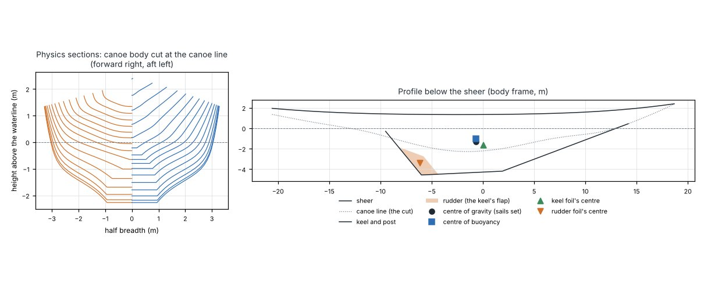
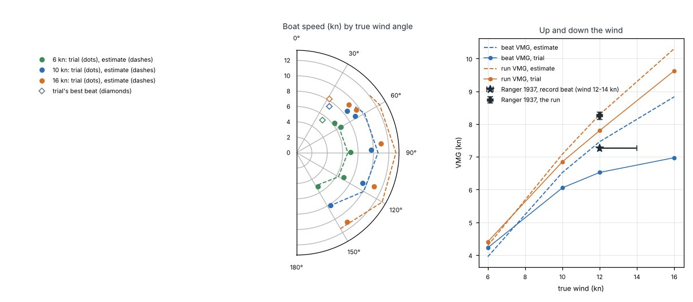

# J-Class 13: Bluebonnet in the physics (the cloud half)

Slice 13 of *Bluebonnet*, our own J-Class sloop of 1937 (plan and Bean's decisions:
<https://claude.ai/artifact/WdUKp8somgyNJZDyESCgyU>; her hull is slice 1, [docs/jclass-1](../jclass-1/README.md), its
plating, keel and rudder slice 2, [docs/jclass-2](../jclass-2/README.md), her deck slice 3,
[docs/jclass-3](../jclass-3/README.md), her spars slice 4, [docs/jclass-4](../jclass-4/README.md), her standing rigging
slice 5, [docs/jclass-5](../jclass-5/README.md), her sails slice 6, [docs/jclass-6](../jclass-6/README.md), her winches
and running rigging slice 7, [docs/jclass-7](../jclass-7/README.md), the rest of her deck hardware slice 8,
[docs/jclass-8](../jclass-8/README.md), below decks slices 9 and 10, [docs/jclass-9](../jclass-9/README.md) and
[docs/jclass-10](../jclass-10/README.md), her wear slice 11, [docs/jclass-11](../jclass-11/README.md), and her light
copy slice 12, [docs/jclass-12](../jclass-12/README.md)). Until now she was a model to look at. This slice is the cloud
half of making her a boat to sail: everything the game's physics needs about her, measured on the model; an estimated
speed polar to hold her to (no polar exists for an invented yacht), checked against the 1930s races; and a trial sail
of her in the game's own physics, built standalone from `Source/SailingPhysics` without Unreal. Like slices 1 to 12 it
is tools and docs only: nothing in `Source/` changes. The Mac's half, before the vertical slice's Nov 27 feature freeze (`docs/slice/README.md`),
makes her an `EBoatType` in `Fleet.cpp` from the two generated `.inl` files, adds her reference polar and tests, and
tunes her from these numbers.

**In short:** she floats on her lines in the physics (pitch 0.03 degrees, 12 mm deeper than her sections, GM within
0.3% of the lines') and holds every point of the polar on her own helm, with 2 to 15 degrees of weather helm (a heavy
helm in 16 knots, as the Js had). In light air and downwind she matches the estimate and the 1937 races; upwind in a
breeze she is slow: 10% under *Ranger*'s record beat in 12 knots, and close-hauled in 16 knots 24% under the estimate,
outside its 20%. Those two points are listed as known gaps for the Mac's tuning, with the knobs that close them
(below); the other 13 are within it.



Left, the physics' 31 half sections of her canoe body (forward to the right, aft to the left), cut flat at the canoe
line where the keel takes over. Right, her profile: sheer, keel and post, the rudder (orange), the canoe line, her
centre of gravity with main and genoa set, her centre of buoyancy, and the centres of the keel foil and the rudder foil
as the physics has them.

## How she becomes a physics boat

`Tools/shipkit/jclass/physics.py <build dir>` reads a build (`build.json`, the lines and the finish reports of slices 1
to 6) and writes `physics.json` (every number below, each marked measured or a knob), `BluebonnetHullData.inl` (her
sections as C++ arrays) and `bluebonnet_trial.inl` (`ApplyBluebonnet(FBoatConfig&)`, her whole config). The knobs that
only sailing her can settle are in `physics_bluebonnet.json`, each with its reason.

**Hull.** The physics floats a hull from half sections (`FHullShape::Stations`: each from the centreline out, half
breadths never shrinking, the same number of points at each). Her lines are cut flat at the canoe line, where the keel
leaves the canoe body: 31 sections of 24 points, 128.05 m³ against the lines' 128.03. Below the canoe line the keel and
rudder are fixed buoyancy (`AppendageVolume`, as the maxi's are): 25.46 m³ at (0.12, -2.49). Together 153.51 m³ (the
lines' 153.50). Waterline 26.02 m, beam 6.56 m (6.09 on the waterline), draft 4.52 m, length 39.93 m.

**Weight.** The physics' water is fresh (1000 kg/m³), so to float on her lines she weighs 1000 times her volume:
153,513 kg. Her weight check's 156.2 long tons (158,704 kg, for the sea) is scaled by 0.967, part by part. Each part is
spread over the model where it is (the lead through the keel's casting, the steel over the shell, the spars up the
mast) and set on the weight check's own centre for that part, so she floats as the build checked her. The physics takes
three masses: the lead (95,239 kg, 3.24 m down), the crew (30 at 80 kg, scaled, on deck) and the rest (55,953 kg),
with radii of gyration of 4.97 m in roll, 6.32 in pitch and 4.11 in yaw from all the parts. Her main and genoa are set
(the weight check stows every sail below), which raises her centre of gravity 6 cm to 1.31 m below the waterline.

**Keel.** A J's keel is not a fin: it is the whole of her lateral plane, the canoe body's profile running into the
keel. So the keel foil is that whole plane below the water, less the rudder: 33.49 m² of canoe body and 34.14 of keel,
less 3.88 cut out for the rudder, 63.74 m² centred at 0.06 m forward, 1.68 m down. Its span is her draft (4.52 m), so
its geometric aspect ratio is only 0.32; the water's surface over it doubles that, and the hull's flare adds a little:
0.9 to start. Long low foils stall late (22 degrees). Its friction is in the hull's (the whole wetted hull, 193.8 m²),
so its own profile drag is only the blunt bottom's.

**Rudder.** Sailed as what it looks like, a lone 3.27 m² blade, it could not hold her: the first trial rounded up
through the wind on a reach in 10 knots with the wheel hard over. But her rudder is hung on the keel's after edge, so
turning it bends the flow over the foil ahead of it, as a wing's flap does. The blade spans the deep part of her
lateral plane, below its head 1.83 m under the water: that band is 30.3 m², 2.73 m deep, 11.1 m long on average, and
the blade's 1.7 m is 15.3% of it. Thin-aerofoil theory makes such a flap worth 0.485 of turning the whole band (Abbott
and von Doenhoff, *Theory of Wing Sections*, 8.4; that share counts the blade's own load too). That lift is one foil in
the physics: 7.62 m² at aspect ratio 2 (end-plated by the keel ahead and the hull above). The physics takes a rudder's
hinge moment as its whole lift times the distance from the stock, so that distance is cut to the blade's own share of
the lift (a quarter): the wheel feels the blade's load, not the keel's. Its friction is already in the hull's (the
lines carry the keel's surface through it), so its own drag is the keel's form drag. With it she holds every point,
with 13 to 15 degrees of helm in 16 knots. A low aspect ratio makes a flap work better than thin-aerofoil theory says
(USAF DATCOM's three-dimensional flap factor), which would lighten that helm; how much is the Mac's call on her feel
(a 10 m² flap gives 9 degrees at 16 knots on the beam: the knob table below).

**Weather helm.** `HeelYawCoef` (how much heeling turns her into the wind) is 0.02, under the J/22's 0.06 and the
maxi's 0.04: her waterlines are long and fine at both ends (length 4.3 beams against the J/22's 2.9), much less
lopsided heeled than a beamy modern hull. In an earlier trial, with the flap then reckoned over her whole lateral
plane (twice today's), 0.05 gave her 9 to 13 degrees of weather helm close-hauled in 10 knots against 3 to 4 at 0.02;
with today's flap 0.02 gives 5 to 7.

**Rig.** Mast 3.0 m forward of midships, masthead 47.8 m; the main 444.9 m², the genoa 341.8 m² as the physics' jib
(the staysail is left out of its single jib: a note for the Mac), the parachute spinnaker 1,091 m², all from slice 6's
sails. Windage from the spars and wires (24.8 m² of drag area) and the hull, deckhouses and crew (12.0). Two reefs
(slice 6's), each bringing up the quadrilateral jib in place of the genoa.

**Water.** Friction is ITTC-57 with a form factor of 1.06 (slender, deep) on her whole wetted surface. Wave-making is
the J/22's table scaled to her slenderness: her waterline is 4.86 times the cube root of her volume against the J/22's
5.69 (she is heavier for her length), which multiplies it by 1.92. Her yaw damping and Munk moment (the hull's own
turning push when she slides sideways) are the maxi's, scaled to her size.

**Helm.** A wheel through a worm gear: 35 degrees each way, about 5 seconds from hard over to hard over, stiff enough
that the blade's load barely moves it.

## Her estimated polar

`Tools/shipkit/jclass/polar_bluebonnet.py <build dir>` writes `polar_estimate.json`. It is the maxi's method
(`Tools/boats/maxi/estimate_polar.py`): the fleet's two measured keelboat polars, the J/22's ORC polar and the Catalina
30's ORC certificate, scaled to her by Froude's law (speeds and winds by the square root of the length), the wind made
stronger for her sail area against her weight, friction at her size, then averaged.

**One number this slice found wrong.** `estimate_polar.py` had (20.7 + 9.2) m² for the J/22's main and jib, which
counts her jib twice: 20.7 m² (223 sq ft) is her main and jib together, her published upwind area and the physics'
main 11.5 plus jib 9.2. Even with a 150% genoa she carries only about 24.6. With 20.7 the two scaled references agree
within 7% at every point of Bluebonnet's polar (with 29.9 they were up to 25% apart), and the estimate agrees with
*Ranger*'s 1937 record race (below). The maxi's tool now has 11.5 + 9.2 too, and her reference polar rose 2 to 9% with
it (the follow-up to this slice).

**How far to trust it.** Her displacement-length ratio, 243, is inside the method's range (the J/22's 151 and the
Catalina 30's 317). The method's own check, the Catalina 30 scaled to the J/22, is rougher with the jib counted once:
the scaled Catalina 30 comes out 10% under the J/22 on average and 4 to 20% under at each point (the 4% first quoted
for it came from the doubled jib). So each point allows 20%, the method's own worst, which is also the fleet's
tolerance for a hand-built estimate (`PolarReference.h`). Points the trial misses by more are listed in `GAPS` with their reason,
reported by the rule check rather than failed, and left at 20% for the Mac to close by tuning: no point's tolerance is
widened to fit. Two kinds of point are weaker than the rest:

- In 6 knots the references are read at 3.3 knots (the J/22) and 3.9 (the Catalina 30), under their lightest measured
  wind, where their tables are straight lines down to zero.
- In a breeze the references are read where they sail far more upright than she can. The trial puts a number on it:
  her righting at 20 degrees over her sail area times its height is 83 N/m², against the J/22's 57 and the Catalina
  30's 44, but she meets 16 knots where they meet 8.8 and 10.4, and heeling goes as the wind squared, so at the matched
  points she meets 2.2 times the J/22's heeling for her righting and 1.3 times the Catalina 30's. Close-hauled she is
  held to her heel limit and the estimate runs ahead of her. This explains the direction of the gap, not its size.

| True wind | 52 deg | 60 deg | 90 deg | 120 deg (spinnaker) | 150 deg (spinnaker) |
| --- | --- | --- | --- | --- | --- |
| 6 kn | 6.05 | 6.42 | 6.67 | 6.29 | 4.97 |
| 10 kn | 9.69 | 10.22 | 10.59 | 10.08 | 8.12 |
| 16 kn | 12.09 | 12.47 | 12.92 | 12.85 | 11.41 |

**Against the races.** A leg's length over its time is a VMG with the tacks, the sea and the tide in it, and the wind a
reporter's figure, so these are rough. The figures are from search results quoting the papers (Wikipedia, Papers Past
and the America's Cup archive could not be reached from the cloud); each source is in `PERIOD` with how far to trust it.

| Race | Raced | Estimate (flat water) |
| --- | --- | --- |
| *Ranger*'s beat, 4 Aug 1937, 15 nm dead to windward in 2:03:55 (a record), wind about 12 kn rising to 14 | VMG 7.26 kn | 7.46 kn at 12 kn |
| *Ranger*'s run, the same race, 15 nm in 1:47:35 to 1:50:35 (the reports' course times differ) | VMG 8.14 to 8.37 kn | 8.29 kn |
| *Endeavour*, 17 Sep 1934, 15 nm to windward and back in 3:38:44, wind 15 kn gusting 20 (low trust) | 8.23 kn | 9.10 kn |
| *Endeavour* today, modern rig and sails, about 17 kn (Yachting World) | 9.5 to 10.5 kn upwind, 12 reaching | an upper bound for 1937 cotton |

A flat-water VMG should be a little above a raced one, and the estimate is: 3% over *Ranger*'s record beat, level with
her run.

## The trial

`Tools/shipkit/jclass/trial/trial.sh <build dir>` compiles `Source/SailingPhysics` with `trial_sail.cpp` and the two
`.inl` files (no Unreal) and sails her as the fleet's reference polars are sailed: the polar's lake
chop, the autopilot steering to the angle, the ideal trimmer (the best of six trims), 70 seconds to settle and 20 to
average; then the best beat over 30 to 52 degrees and the best run over 130 to 180 (a best on an end of either is
flagged; none was). The whole sweep takes 5 minutes on the cloud's four cores and writes `trial.json`.
`polar_bluebonnet.py <build dir> --compare docs/jclass-13` sets it against the estimate (`compare.json`) and draws the
charts.

**At rest** she floats with her bow 0.03 degrees down, 12 mm deeper than her sections say (the physics' columns against
the sections' own sum), heeled 0.9 degrees with her 30 crew sitting on one rail as the physics seats them. Her GM from
her righting at 5 degrees is 2.091 m against the lines' 2.096 (`physics.json`'s `gm_lines_m`, with main and genoa
set). Righting:

| Heel | 5 | 10 | 20 | 30 | 40 | 60 | 80 | 90 |
| --- | --- | --- | --- | --- | --- | --- | --- | --- |
| Righting moment (kN m) | 274 | 546 | 1,098 | 1,585 | 1,898 | 2,134 | 2,329 | 2,247 |
| GZ (m) | 0.18 | 0.36 | 0.73 | 1.05 | 1.26 | 1.42 | 1.55 | 1.49 |

She rights herself to 156 degrees.



**Under sail**, speed in knots (the trial over the estimate in brackets), with her heel and helm (rudder angle to
windward):

| True wind | 52 deg | 60 deg | 90 deg | 120 deg (spinnaker) | 150 deg (spinnaker) |
| --- | --- | --- | --- | --- | --- |
| 6 kn | 6.29 (1.04) | 6.64 (1.03) | 7.02 (1.05) | 6.89 (1.10) | 5.18 (1.04) |
| heel, helm | 7°, 2° | 7°, 2° | 4°, 2° | 6°, 5° | 2°, 4° |
| 10 kn | 8.52 (0.88) | 8.95 (0.88) | 9.71 (0.92) | 9.45 (0.94) | 8.15 (1.00) |
| heel, helm | 16°, 6° | 16°, 7° | 10°, 6° | 14°, 11° | 3°, 5° |
| 16 kn | 9.22 (0.76) gap | 9.54 (0.77) gap | 11.01 (0.85) | 10.95 (0.85) | 11.15 (0.98) |
| heel, helm | 25°, 13° | 25°, 15° | 19°, 13° | 14°, 13° | 5°, 10° |

13 of the 15 points are within 20% of the estimate (0.94 of it on average); the two marked gap, close-hauled in 16
knots, are 24% under. She holds every course: the autopilot steers in proportion to how far off she is, so with a heavy
helm it settles a few degrees off its angle (6.5 at most, at 16 knots on the quarter), and the rule check takes a point
as held when it is within 8 degrees with the helm under 20 (of her 35). The lone blade's failure was both at once: the
wheel hard over and the course gone.

**Up and down the wind** (best VMG, knots):

| True wind | Beat, trial | at | Beat, estimate | Run, trial | at | Run, estimate |
| --- | --- | --- | --- | --- | --- | --- |
| 6 kn | 4.22 | 38° | 3.95 | 4.41 | 143° | 4.29 |
| 10 kn | 6.05 | 35° | 6.52 | 6.85 | 152° | 7.08 |
| 12 kn | 6.52 | 34° | 7.46 | 7.80 | 151° | 8.29 |
| 16 kn | 6.97 | 32° | 8.83 | 9.62 | 164° | 10.30 |

Against the races: *Ranger*'s record beat 0.90 (the trial 6.52 against 7.26), her run 0.93 to 0.96, *Endeavour*'s 1934
course 0.95.

## For the Mac's half

The trial is right in light air and downwind, and under the estimate from close-hauled to a broad reach in a breeze (6
to 12% in 10 knots, 15 to 24% in 16), where she sails at her heel limit. Two things are missing from her model
there, and the knobs to try are:

- **Her overhangs.** A J's long overhangs lengthen her waterline under way, as her bow and stern waves climb them (the
  Universal Rule measured the waterline at rest, which is why the Js have them). The physics keeps her waterline at
  26.02 m for wave-making whatever she does; half a metre of the bow wave's climb up her overhang alone adds over a
  metre. In the physics' own formula ten percent more length lowers her Froude number 5% (its table falls 15 to 20%
  at her close-hauled speed) and makes her 10% more slender (that scale falls by 1.1 cubed, 1.33): 35 to 40% less
  wave-making together. The knob is `residuary_factor` (1.0 to start; that reckoning says about 0.6).
- **The keel's aspect.** 0.9 is a cautious start for her lateral plane; her leeway close-hauled is 3.5 to 5 degrees.

One run each at the trimmer's default settings (the polar's own way, not the sweep's best of six), best VMG at 12 knots
over 32 to 40 degrees, then three points (`trial/probes.sh`, `baseline/probes.txt`):

| Knobs | Beat VMG, 12 kn | 10 kn, 52 deg | 16 kn, 90 deg (helm) | 6 kn, 90 deg |
| --- | --- | --- | --- | --- |
| as the sheet has them | 6.48 | 8.52 | 10.95 (13°) | 6.96 |
| `residuary_factor` 0.8 | 6.70 | 8.92 | 11.27 (14°) | 7.26 |
| `residuary_factor` 0.6 | 7.02 | 9.40 | 11.76 (12°) | 7.61 |
| 0.6, keel aspect 1.3 | 7.09 | 9.45 | 11.68 (13°) | 7.64 |
| `rudder_area` 10 m² | 6.51 | 8.62 | 11.15 (9°) | 6.96 |
| *estimate* | *7.46* | *9.69* | *12.92* | *6.67* |

So 0.6 brings her beat to within 4% of *Ranger*'s record pace (7.02 against 7.26) and the 10-knot reach to within 3%
of the estimate, while 16 knots on the beam stays 9% under and light air runs 14% over it. The keel's aspect hardly
moves her; a bigger flap mostly lightens the helm (9 degrees instead of 13 in 16 knots on the beam). The Mac tunes
them with her polar test (as `PolarGate`) and `--scenarios` (tacks and irons) once she is in `Fleet.cpp`, not to one
number. `TRIAL_SET="residuary=0.7,keel_ar=1.2" trial.sh <build dir> --point 12 38` tries knobs without regenerating
anything (the keys: `keel_x`, `keel_ar`, `rudder_area`, `rudder_ar`, `downwash`, `heel_yaw`, `munk`, `yaw_damping`,
`residuary`).

Wiring her in (slice 13's Mac half): a `Bluebonnet` (or `JClass`) `EBoatType`, `Fleet.cpp`'s `Make` from
`ApplyBluebonnet` and `BluebonnetHullData.inl` (both in `baseline/`, generated: edit `physics.py` or the json, never
the `.inl`), her reference polar from `polar_estimate.json` at its 20%, with the two `GAPS` to close by tuning, the
crew's runners on each tack, and her tests.

## Known gaps

- **Upwind in a breeze she is slow** against the estimate and *Ranger*, as above: close-hauled in 16 knots she is 24%
  under (the two `GAPS`). The knobs are named; the tuning is the Mac's.
- **Her helm is heavy in a breeze.** 13 to 15 degrees in 16 knots, from the flap's effectiveness reckoned for a large
  wing; low-aspect flaps do better than that (DATCOM), so `rudder_area` is a knob, not a measurement.
- **The staysail is not in the physics.** The physics has one jib; the genoa is it. The staysail inside it (slice 6)
  would add a little drive close-hauled.
- **The runners are not handled.** The crew changing the runners on each tack, and the main's boom stopping on the
  leeward runner when it is not let off, are the Mac's half (the plan's "runners the crew handle on each tack").
- **The races are second-hand.** Every 1930s figure is from search results quoting the papers; the archives were not
  reachable from the cloud. The times agree between reports; the winds are one reporter's or one caption's.
- **The light-air estimate is a straight line.** At 6 knots both references are read under their lightest measured
  wind.
- **The Endeavour of today is an upper bound.** Modern sails and rig; kept only to show the estimate is not too high.

## How to run

From the repo root, with the venv of slices 1 to 12 (Python 3.13 with pip `bpy` 5.3, numpy, scipy, pillow; matplotlib
for the charts) as `<venv>/bin/python` and a build in `<out>`:

```
<venv>/bin/python Tools/shipkit/jclass/physics.py <out>                  # physics.json and the two .inl files
<venv>/bin/python Tools/shipkit/jclass/polar_bluebonnet.py <out>         # polar_estimate.json
Tools/shipkit/jclass/trial/trial.sh <out>                                 # trial.json, about 5 minutes
<venv>/bin/python Tools/shipkit/jclass/polar_bluebonnet.py <out> --compare docs/jclass-13
python3 -I Tools/shipkit/jclass/rule_check.py <out>/build.json            # now with the slice 13 lines
Tools/shipkit/jclass/trial/probes.sh <out> > docs/jclass-13/baseline/probes.txt   # the knob table, a minute
```

`trial.sh <out> --quick` sails one trim per point and a coarser VMG search (about a minute); `--point <tws> <twa>
[spin]` prints one run every 5 seconds.

## Files

| File | What it is |
| --- | --- |
| `Tools/shipkit/jclass/physics.py` | new: her physics sheet from a build (sections cut at the canoe line, the keel's volume, the weights scaled and placed, the lateral plane, the rudder as the keel's flap, the rig and sails, windage, resistance), `physics.json` and the two `.inl` files |
| `Tools/shipkit/jclass/physics_bluebonnet.json` | new: the knobs only sailing her settles (crew, sails' aerodynamics, foils' aspect and balance, trimmer, resistance, helm), each with its reason |
| `Tools/shipkit/jclass/polar_bluebonnet.py` | new: the estimated polar (the maxi's method), its 20% tolerance and `GAPS` (points known to be outside it, with their reason), the races and the method's own check |
| `Tools/shipkit/jclass/polar_compare.py` | new: the trial against the estimate and the races, the stiffness comparison, the charts and `baseline/` |
| `Tools/shipkit/jclass/trial/trial_sail.cpp`, `trial.sh` | new: the standalone trial sail (statics, stiffness, the polar's points and the VMG searches on all cores; `TRIAL_SET` knobs) |
| `Tools/shipkit/jclass/trial/probes.sh` | new: the knob probes in the table above |
| `Tools/shipkit/jclass/rule_check.py` | the slice 13 checks: sections well formed, volumes and weight on her lines, centre of gravity on the weight check's, the keel foil's area; with a trial, her trim at rest, her GM, and every point within its tolerance holding its course (within 8 degrees, helm under 20); a `GAPS` point is reported, not failed |
| `docs/jclass-13/` | this page, the two charts, and `baseline/` (physics.json, the two `.inl` files, polar_estimate.json, trial.json, compare.json, probes.txt) |
