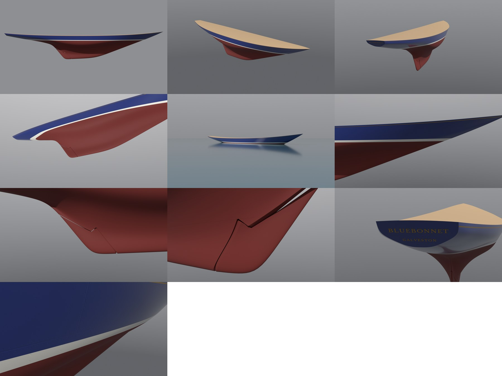
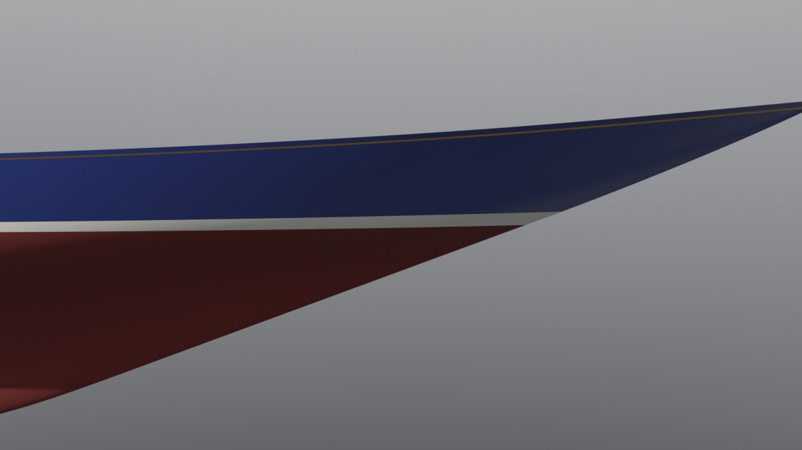
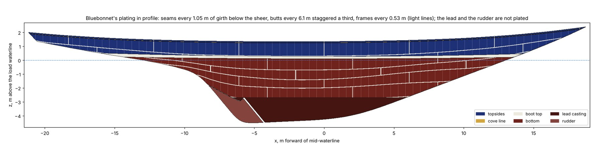
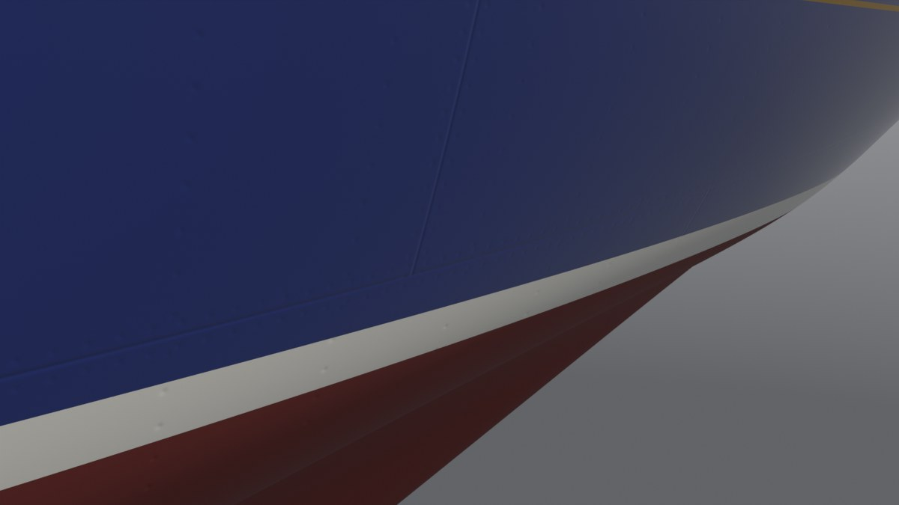
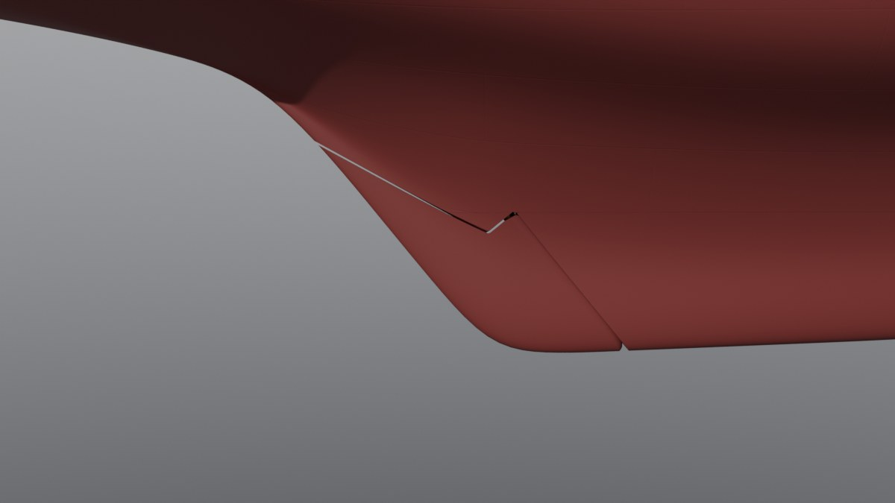
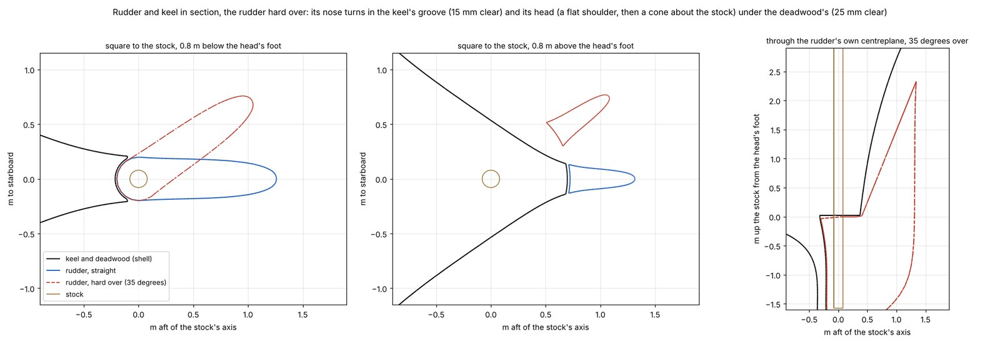
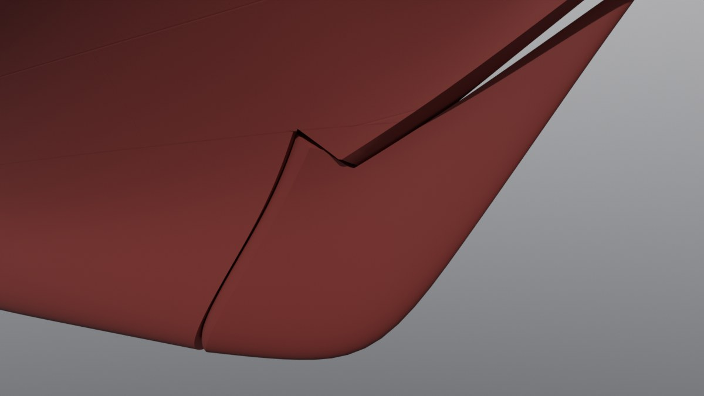
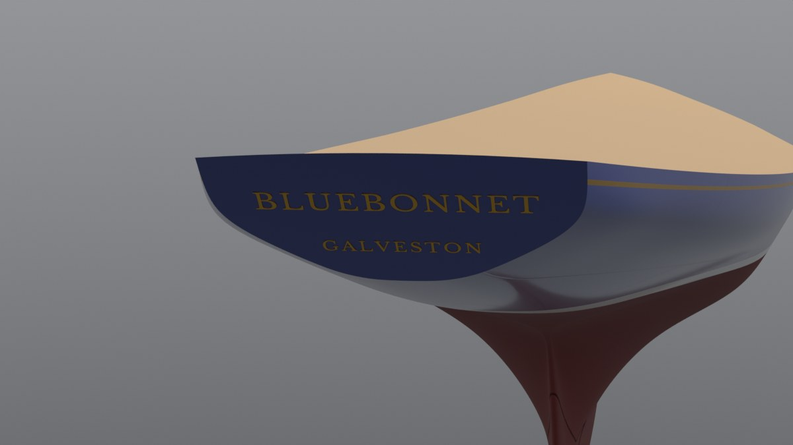

# J-Class 2: Bluebonnet's plating, keel and rudder

Slice 2 of *Bluebonnet*, our own J-Class sloop of 1937 (plan and Bean's decisions:
<https://claude.ai/artifact/WdUKp8somgyNJZDyESCgyU>; the hull's lines are slice 1, [docs/jclass-1](../jclass-1/README.md)).
This slice dresses slice 1's hull as a 1930s steel yacht: the paint lines, the riveted plating under the paint, the
lead ballast casting, the rudder and its bronze stock, and her name and home port on the transom. Like slice 1 it is
post-slice art: tools and docs only, nothing imported into Unreal or wired into the game yet.

The hull's shape is not changed: the finished shell is slice 1's surface, cut along the lines this slice adds.



The renders, left to right in rows of three: the starboard side; the bow and stern quarters; from below the waterline;
afloat on a flat sea from a dinghy's eye height; the boot top at the bow from abeam; the rudder from abeam; the rudder
turned 15 degrees, from aft on the port side; the transom; the plating close to, in a raking light. Each is in
`baseline/` at 1200 pixels wide.

## What slice 2 builds

* **The shell, cut at its paint lines:** a dark red bottom, a white boot top along the waterline, deep blue topsides
  and a gold cove line just under the sheer. Each line is a real edge in the mesh, so each paint is its own material
  slot (named as the game's skins name them: `Antifouling`, `Bootstripe`, `Topsides`, `CoveStripe`, `Keel`) and a skin
  can recolour any of them.
* **The lead casting:** the bottom of the keel, below a level line 2.70 m under the waterline, in its own slot
  (`Keel`), painted with the bottom. Its weight is measured on the finished mesh, so it holds exactly the lead she needs.
* **The rudder:** the keel's after part, cut out along its stock line, with a round nose that turns in a groove in the
  keel's after edge, a head shaped round the stock so it turns under the deadwood, and a bronze stock up through the
  counter. It is its own object, placed by a frame that turns about the stock, so the game can turn it; the build turns
  it hard over each way and checks it never touches the hull.
* **The plating:** steel strakes, butts, frames and rivets, drawn by the paint's material from a UV map rather than
  modelled, so they cost no triangles.
* **The name and home port:** BLUEBONNET over GALVESTON in gilt capitals on the transom, as raised mesh letters.

| Object | Triangles |
| --- | ---: |
| Shell (hull with its paint lines, the lead, the groove round the rudder) | 240,010 |
| Transom | 252 |
| Deck placeholder (slice 3 replaces it) | 11,004 |
| Rudder | 7,158 |
| Rudder stock | 92 |
| Name and home port | 10,480 |
| **Total** | **268,996** |

Slices 1 and 2 together have 550,000 in the plan; this is 86,314 more than slice 1's 182,682. The shell uses a finer
grid than slice 1's hull (460 by 120 points, from 420 by 104) so the cut lines and the slot run smooth, and the cuts
add their own points. Slice 1's moulded hull stays in the `.blend` as `Hull`, hidden from renders and not counted: the
fairness check measures it.

## The paint

The usual dress of a 1930s steel yacht, our own choice of colours (sRGB, for the renders; the game's skins set their
own):

| Paint | Where | Colour |
| --- | --- | --- |
| Topsides | sheer to the boot top | deep blue (30, 48, 118): the bluebonnet's own colour, the Texas flower she is named for |
| Cove line | a 2.5 cm gold band, 8.0 to 10.5 cm below the sheer | gold (212, 166, 64) |
| Boot top | a white band along the waterline | off-white (236, 233, 222) |
| Bottom and lead | below the boot top | dark red (112, 34, 28) |
| Name and home port | the transom | gilt, the cove line's gold |
| Rudder stock | inside the counter | bronze (150, 104, 60) |

The boot top is **sheered**: its edges are at 0.10 and 0.26 m above the load waterline amidships and rise toward the
ends (by 0.10 and 0.16 m at the waterline's ends, on a parabola in x), so the band still shows at the bow and under
the counter, where the hull leaves the water at a shallow angle. A boot top drawn level would vanish there.



## The plating

*Bluebonnet* is plated in steel like the Js of 1934-37, flush-riveted, faired and painted, so the plate edges and
rivets show only faintly in a raking light. The layout is our estimate for a riveted steel yacht of the period (not
read off any real J's plating plan):

* **Strakes** (the rows of plates) run fore and aft, each 1.05 m wide measured down the side from the sheer, so the
  seams between them follow the sheer's curve. They run out where they meet the stem, the keel's edge, the counter's
  centreline or the lead, so each strake ends at its own place.
* **Butts** (the plates' ends) every 6.1 m (20 ft), staggered by a third of a plate from one strake to the next.
* **Frames** every 0.53 m (21 in) along the hull, each with a row of rivets every 110 mm.
* **Rivets** in a row 35 mm each side of every seam and butt, every 75 mm.

The plating is not modelled. The shell carries a UV map named `Plating` (U is x, V the girth below the sheer, both in
metres; -1 where there is no plating, on the lead and the transom), and the paint's material draws the plating from
it as a height for a bump: each seam and butt a soft groove 1 mm deep and 6 mm wide, each rivet a dimple 0.5 mm deep.
Those depths are what the paint lets show, set by eye in a raking light. Rivets fade out between 6 and 14 m from the
camera and seams between 18 and 45 m, where they would be smaller than a pixel and only sparkle; the game's material
will do the same at its own distances.



The plating drawn flat in profile from the same UV map the material reads (`drawings_jclass.py`): seams and butts in
white, frames as light lines, the paint behind them. Every strake runs out where it should, at the stem, the lead, the
counter's centreline or the transom. The lead and the rudder are not plated (the lead is cast; the rudder is left plain
for now).



Close to (2.6 m), in a sun from forward and above: the topside strake's seam meets a butt (the T in the middle), and
the frames' rivets show as faint dimples, clearest on the white boot top.

## The lead casting and her weight as built

The lead is the keel below a level line, forward of the rudder's slot. The line sits 2.70 m below the waterline; it is
the joint between the casting and the plating, drawn faint under the paint like a seam, and the lead is its own material
slot so a skin can pick it out.

Slice 1 left her floating light: the plating stands 8 mm (5/16 in, our estimate) outside the moulded surface the lines
describe, and below the water that is extra buoyancy. This slice measures it, and the water the rudder's slot and the
groove round its nose let in, and puts the difference into the lead, so she floats on her lines:

| | |
| --- | ---: |
| Plated area below the waterline (the wetted surface less the lead, the rudder and the slot's faces) | 154.95 m² |
| The plating's volume there, 8 mm thick | 1.240 m³ |
| Taken away by the rudder's slot and the groove round its nose | 0.051 m³ |
| Extra buoyancy | 1.20 long tons |
| Lead | 92 + 1.20 = 93.20 long tons (8.351 m³) |
| Displacement as built (moulded hull 154.89 + 1.20) | 156.09 long tons |
| Weights | 156.2 long tons (the 0.1 between them is slice 1's rounding of its estimate) |
| Lead's centre | 0.83 m aft of mid-waterline, 3.30 m below the waterline |
| G aft of B | 4 cm: she trims 3 cm by the stern |
| GM (stiffness upright) | 1.89 m |

**How the lead's top is found.** The casting is measured on the finished shell itself: below the casting's top the
shell holds nothing but lead (the rudder is a piece of its own and the slot is open water), so the shell's volume below
that level is the casting, groove and all. The build makes a first guess from slice 1's sections, builds the shell,
measures the plating, the slot and the casting on it, moves the top until the casting holds 92 long tons plus the extra
buoyancy, and builds again at that top to confirm it (the second build moved it 0.02 mm). It stops if the casting ends
up more than 0.05 long tons off. Nothing is set by hand in `finish_bluebonnet.json`, so a change to the hull, the
plating or the rudder carries through to the lead on the next build.

The rule check keeps the moulded hull's displacement, 5,421 cu ft: counting the plating would make D bigger and her
rating smaller (75.57 ft instead of 75.76), so the moulded figure is the safe one to rate her on.

## The rudder

On the Js the rudder is the keel's after edge, hung on a stock that runs along its leading edge. *Bluebonnet*'s is
cut out of the keel along her stock line (slice 1's `rudder_stock_z`: a line raked 39 degrees aft from upright,
parallel to the keel's trailing edge and 1.7 m forward of it, measured level). Everything about the cut is shaped round
the stock, so the rudder can turn without touching the keel:

* **Its nose** (the leading edge) is a half circle about the stock, as wide as the rudder there: up to 0.30 m in
  radius (0.60 m across) at the top, narrowing toward the keel's bottom.
* **The keel's after edge** is hollowed into a groove round the nose, 15 mm clear all round, and the keel's sides end
  0.10 m forward of the stock. That step is the line seen from outside: the slot.
* **Its head** starts at the stock 2.75 m below the waterline as a flat **shoulder**, square to the stock, out to
  0.40 m from it (past the nose), then rises as a **cone** about the stock to the trailing edge 1.83 m below the
  waterline. A point on the head turning with the rudder stays on that shoulder or cone, so it slides along them.
* **The deadwood over the head** (the keel's solid part above the rudder, which carries the stock up into the hull)
  has its underside on the same shoulder and cone, 25 mm higher and further in, so the head turns under it with that
  much to spare.
* **The stock** is a bronze shaft 160 mm across on the stock line, from 0.6 m above the line's foot, up through the
  counter to just under the deck, at 9.27 m aft of mid-waterline, where slice 3's steering gear takes it.

Its area is 3.27 m² (35.2 sq ft) in profile. That is 0.43 m² less than this slice's first try, whose head was a
straight line from the stock to the trailing edge: that rudder jammed against the deadwood after a degree and a half of
helm (the review found it), and the shoulder and cone take a little off the head's forward end to free it.

**It turns clear:** the build turns the rudder from 35 degrees one way to 35 the other in steps of 2.5 degrees and
checks, at each step, that no triangle of the rudder crosses one of the hull's, and how close it comes. Nothing
touches, and the least clearance is 11.7 mm at every step (the 15 mm groove less the flats of its facets).





The rudder against the keel, straight and hard over at 35 degrees (`drawings_jclass.py`): on the left, cut square to
the stock 0.8 m below the head's foot, the nose turns inside the keel's groove; in the middle, 0.8 m above it, the blade
turns out into the water clear of the deadwood's underside; on the right, cut through the turned rudder's own
centreplane, its head (the shoulder, then the cone) under the deadwood's with the 25 mm gap. The render below is a
15 degree turn from aft on the port side.



**For the game (slices 13 and 14):** the rudder and its stock are objects of their own whose origin is on the stock
line at the head's foot, 5.79 m aft of mid-waterline and 2.75 m below the waterline. In Blender their own Z axis runs
up the stock, X toward the trailing edge and Y to starboard (`build.json` `finish.rudder.frame`). Turning them about
their own Z steers her: a positive turn moves the trailing edge to starboard, which swings her bow to starboard, the
game's positive rudder. The build checks that direction each run.

## Left and right

The hull's numbers are in the game's frame: X forward, Y to starboard, Z up. Blender's axes run the other way round
(its Y is to port when X is forward), so slice 1, which put the numbers straight into Blender, built her mirror image:
the view slice 1 calls her port side is what you would see from starboard. The hull is the same on both sides, so none
of slice 1's pictures or numbers change, but the rudder turns and the name reads, so the hand matters now. The build
now turns y over on the way into Blender, as the J/22's build does (the game's import turns it back), and the pictures
here are named for the side they show.

## The name on the transom

BLUEBONNET over GALVESTON in Roman capitals, as a yacht of the period carried them. The letters are mesh standing
4 mm proud of the transom and let 0.5 mm into it (so they sit on the plate with no gap), following its rake, set from
Libre Baskerville. Capital heights are measured on the H, a flat-topped capital:

* **BLUEBONNET** is set for 13 cm capitals with wide letter-spacing; the build shrinks a line that would run past 76%
  of the transom's width there, so it came out 12.0 cm high and 1.38 m long on a 1.81 m transom. Its baseline is
  1.74 m above the waterline.
* **GALVESTON** has 7.5 cm capitals, 0.79 m long, on a baseline 1.52 m up.



## Sources and licence

* **The paint, the plating layout, the rudder and the lead are our own choices** for an invented 1937 J: nothing is
  traced or measured from a real J's drawing, plating plan or photo. The real Js only set the look (a steel hull
  painted in a boot top and a cove line, a rudder on the keel's after edge).
* **The font** is Libre Baskerville (Copyright 2012 The Libre Baskerville Project Authors), under the SIL Open Font
  License 1.1, which allows commercial use. It sits beside the build in `Tools/shipkit/jclass/fonts/` with its licence
  text. The glyphs become part of the model; the font file itself never ships. When she goes into the game, the
  imported model's row in `docs/licences/assets.csv` should say "glyphs from an OFL font", as the J/22's lettering does.

## Checks

The same venv as slice 1 (Python 3.13 with pip `bpy` 5.3, numpy, scipy, matplotlib, pillow); `<venv>/bin/python`
below. Run from the repo root:

```
<venv>/bin/python Tools/shipkit/jclass/build_jclass.py <out>    # jclass.blend, jclass.obj, build.json, plating.png, rudder_sections.png
python3 -I Tools/shipkit/jclass/rule_check.py <out>/build.json
<venv>/bin/python Tools/shapeloop/fairness.py <out>/jclass.blend <out> --object Hull
<venv>/bin/python Tools/shapeloop/fairness.py <out>/jclass.blend <out>/shell --object Shell
<venv>/bin/python Tools/shipkit/jclass/render_jclass.py <out>/jclass.blend <out>/renders --res 1200 --only paint_profile,paint_bow34,paint_stern34,paint_under,paint_afloat34,paint_bowline,paint_rudder,paint_slot,paint_transom,paint_plating
<venv>/bin/python Tools/shipkit/jclass/docs_jclass.py <out> docs/jclass-2/baseline --slice 2
```

* **Every piece closes:** the shell with the transom and deck, the rudder, and the stock are each a closed surface with
  no open, doubled, flipped or degenerate edges. The build stops before writing anything if one doesn't, and
  `rule_check.py` fails a `build.json` with an open piece.
* **The rule:** unchanged from slice 1, rating 75.76 ft against the 76 ft limit, every size on its target (the hull is
  the same): PASS.
* **Her weight:** the build measures the plating, the slot and the lead casting on the finished mesh and stops if the
  casting does not hold the lead she needs within 0.05 long tons (above). Measured independently in review (the
  shell's solid below the casting's top, in Blender, by clipping its triangles), the casting is 8.350 m³, 93.19 long
  tons.
* **Fairness, the moulded hull** (`Hull`, `baseline/fairness.json`): 17 inflections and 23 kinks, the same lines and
  places as slice 1's, so the surface is unchanged.
* **Fairness, the finished shell** (`Shell`, `baseline/fairness_shell.json`): 14 inflections and 19 kinks against the
  moulded hull's 17 and 23, and every difference is at a cut or a level that moved:
  * the waterlines 2.7 and 3.9 m down now end at the slot, so the turns the hull has at the keel's after edge, on what
    is now the rudder, are gone (2 inflections, 2 kinks);
  * the waterline 2.0 m down ends at the head's cut near the post; it has one soft inflection in the garboard's hollow
    at x -6.6 m, where the hull's line (on a level 2 cm lower) turns twice a little further aft (an inflection and a
    kink near the post's fillet);
  * the waterline just below the load waterline sits 1 cm higher in this object's spread of levels and misses the
    hull's soft kink under the counter (x -10.5 m);
  * the waterline 1.8 m up has one new soft kink beside its inflection at the stem bar (x 17.2 m), where the finer
    mesh's triangles meet the bar;
  * the station at x -7.1 m crosses the rudder's head, so it ends at the head's cut 2.4 m down; the hull's station
    turns at 2.4 and 2.7 m down, at and below that end.
* **The rudder turns clear:** the build's helm sweep (above): no touch from 35 degrees to port to 35 to starboard,
  11.7 mm clear at every step. An independent check in review, counting the rudder's vertices that end up inside the
  hull when it is turned, found none at 0, 5, 20 and 35 degrees either way.
* **The renders** show the paint lines, the slot, the lettering and the plating as described, with the shell shaded
  by the surface's own normals so the cuts leave no marks in the shading.

## Review

An independent review of this slice's first build (a fresh read of the code and the model, with its own measurements)
found four things wrong. All are fixed here:

* **The rudder couldn't turn.** Its head was a straight line 30 degrees off the stock, so a point on it swung sideways
  into the deadwood from about 1.5 degrees of helm (77 mm deep at 15 degrees). The head is now a shoulder and a cone
  about the stock (above), and the build's helm sweep checks it on every run.
* **The lead was 0.78 long tons light.** Its top was found from slice 1's sections, which knew nothing of the groove
  round the rudder's nose, so the casting held about 92.4 long tons, not 93.19. It is now measured on the finished mesh.
* **The letters floated.** They stood 2.6 mm off the plate and were only 0.6 to 0.9 mm thick (the relief had been
  scaled with the letters' size). They now stand the full 4 mm, let 0.5 mm into the plate.
* **Left and right were mirrored** in Blender (above), so the rudder's positive turn and the renders' labels were the
  wrong way round.

Smaller fixes from the same review: the plated area no longer counts the slot's own faces (1.6 m²); `rule_check.py`
fails a `build.json` that lacks its closure checks instead of passing it; `docs_jclass.py` takes `--slice` anywhere on
its command line; the stock's top uses the deck's own camber setting; and the nose's size is given as a radius (it read
as a width before).

## Known gaps

* **No rudder hangings.** The stock is the rudder's pivot; there are no pintles, gudgeons or heel bearing, and the
  stock's top waits for slice 3's steering gear.
* **The rudder's trailing edge is blunt:** it is slice 1's keel post, about 10 to 20 cm across near its end rather than
  a fine edge. A finer one is a change to the lines (`half_thickness_post`), for slice 13's physics to decide on.
* **A hundred or so sub-millimetre slivers** sit where two cut lines nearly meet (less than 0.1 cm² in all); they
  don't show.
* **The plating's depths and the fade distances are set by eye** for the renders. The game's paint material will need
  its own twin of the `Plating` node group (slice 11, textures), tuned on screen.
* **The rudder isn't plated** in the paint, and the plating is one thickness (8 mm) all over.
* **The cove line is 2.5 cm wide.** It reads close to; far off it will be thinner than a pixel, which the texture
  slice and the light copy have to handle.
* **The lead's joint is drawn as a seam;** its keel bolts are below decks (slice 9).
* **Slice 1's open design calls are unchanged:** the straight bow (no spoon) and the firm shoulder on the bow's
  topsides wait for Bean.
* **The deck is still a placeholder** (slice 3).

## Words used here

* **Boot top:** the painted band along the waterline, between the bottom paint and the topsides.
* **Cove line:** a thin line, often gilt, along the topsides just under the deck's edge.
* **Antifouling:** the bottom paint, which keeps weed and shells off.
* **Sheer:** the line of the deck's edge seen from the side; a **sheered** stripe curves up toward the ends like it.
* **Strake:** one row of plates running fore and aft. **Seam:** the joint between two strakes. **Butt:** the joint
  between two plates' ends in a strake.
* **Frame:** one of the ribs inside the plating, every 0.53 m.
* **Flush rivets:** countersunk rivets ground and faired smooth, so little shows under the paint.
* **Raking light:** light that skims along a surface, so the smallest bump casts a shadow.
* **Girth:** distance measured along the hull's surface, here down the side from the sheer.
* **Ballast, lead casting:** the lead cast to the keel's shape and bolted on, low down, to keep her upright.
* **Deadwood:** the solid part of the keel between the hull and the rudder's head, which the stock passes through.
* **Shoulder and cone (of the rudder's head):** the flat part of the head square to the stock, and the part rising
  from it that is the surface of a cone about the stock, so it turns into itself.
* **Inflection, kink:** where a line's curve changes direction, and where it turns sharply (the fairness check).
* **Stock:** the shaft the rudder turns on. **Pintles and gudgeons:** the pins and sockets that would hang a rudder on
  its post.
* **Moulded surface:** the shape of the frames, inside the plating (slice 1's lines).
* **Bump (in a material):** shading that makes a flat surface look dented without moving it.

## Files

| File | What it is |
| --- | --- |
| `Tools/shipkit/jclass/finish_bluebonnet.json` | this slice's choices: the paint lines and colours, the plating, the lead, the rudder, the lettering |
| `Tools/shipkit/jclass/shell.py` | the finished shell: cuts slice 1's surface at the paint lines, the lead's top and the rudder; the rudder's nose and head, the groove and the deadwood's underside, the stock; the plating UV; the weight as built and the lead's top solved on the mesh |
| `Tools/shipkit/jclass/build_jclass.py` | the Blender build, now with the materials and their `Plating` node group, the rudder's frame, the helm sweep, the lettering, and the hull turned into Blender's hand |
| `Tools/shipkit/jclass/drawings_jclass.py` | the plating in profile and the rudder's sections hard over, drawn from the build's pieces |
| `Tools/shipkit/jclass/render_jclass.py` | adds the paint views and turns the rudder for a shot |
| `Tools/shipkit/jclass/docs_jclass.py` | copies a build's checks and images into `baseline/`, slice 1's or slice 2's set |
| `Tools/shipkit/jclass/rule_check.py` | reads slice 2's per-piece shell checks, and fails a build that lacks them |
| `Tools/shipkit/jclass/loft.py` | the weight check takes the lead as measured |
| `Tools/shipkit/jclass/sections_jclass.json` | her parts for the shape-loop tools: shell, rudder, lettering, deck |
| `Tools/shipkit/jclass/fonts/` | Libre Baskerville and its OFL licence |
| `docs/jclass-2/baseline/` | this build's stats, fairness checks, drawings and renders |
