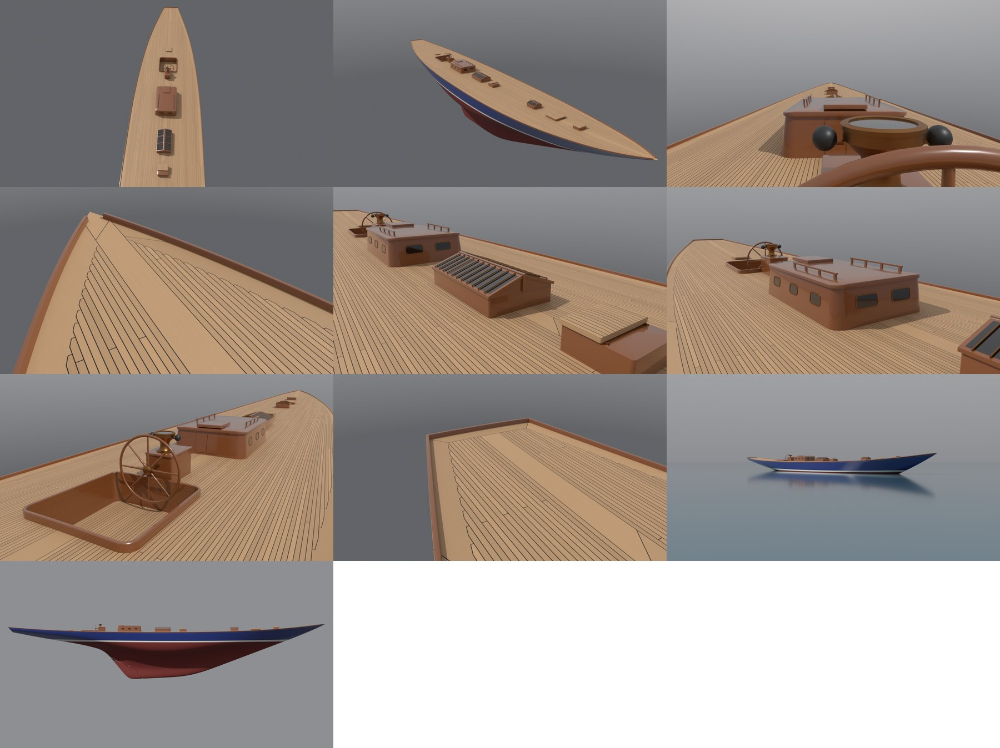
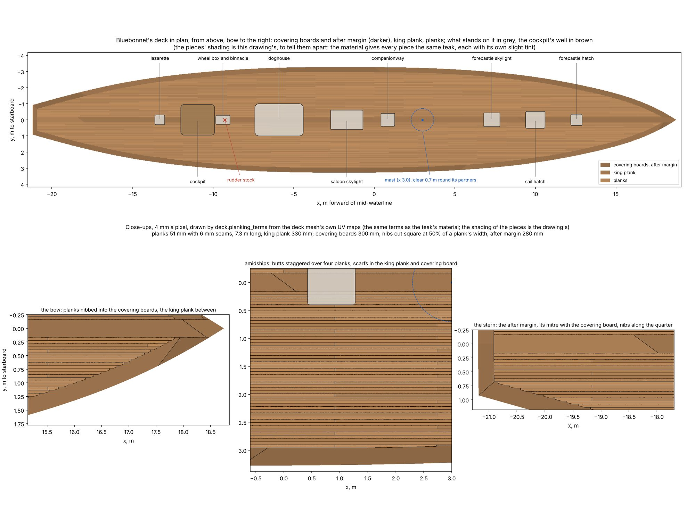
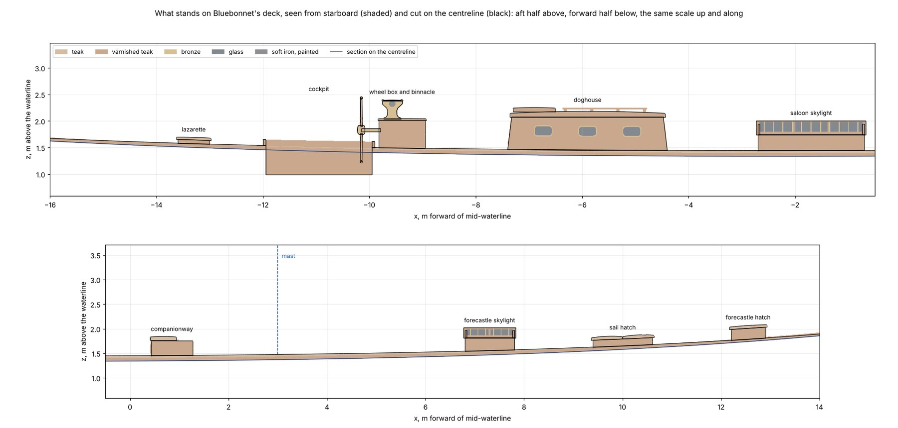
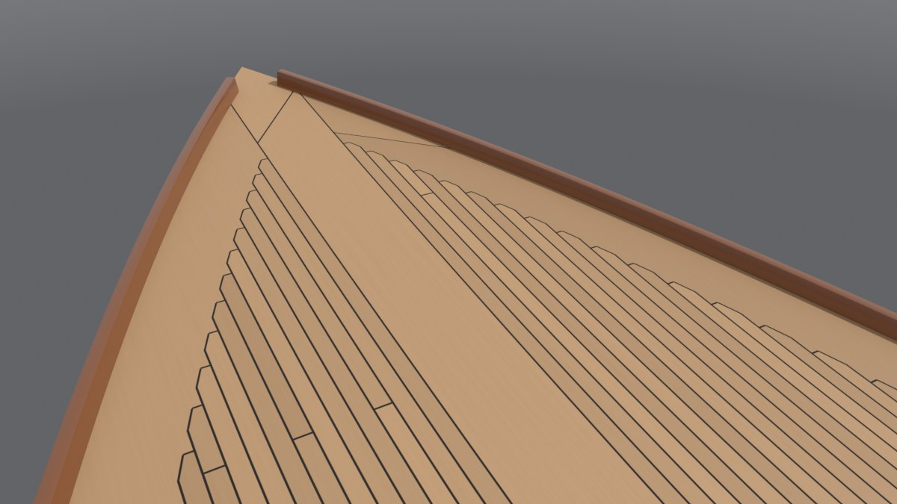
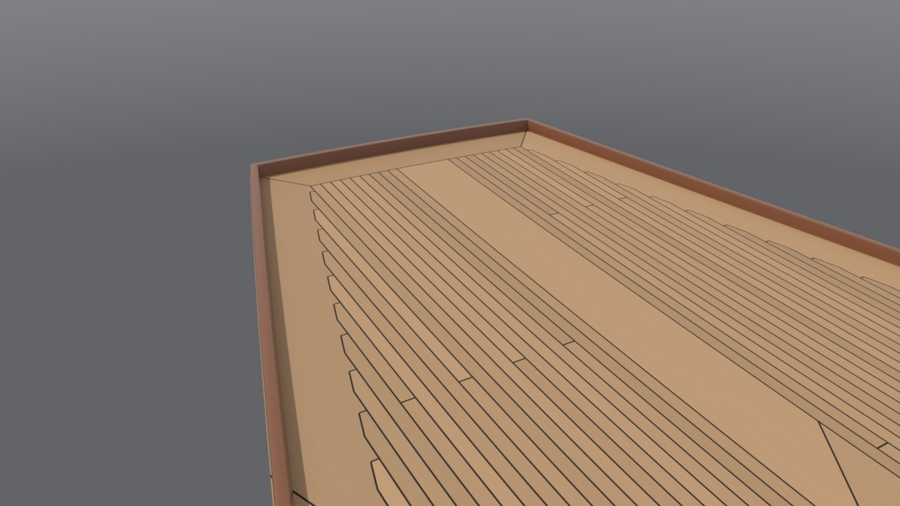
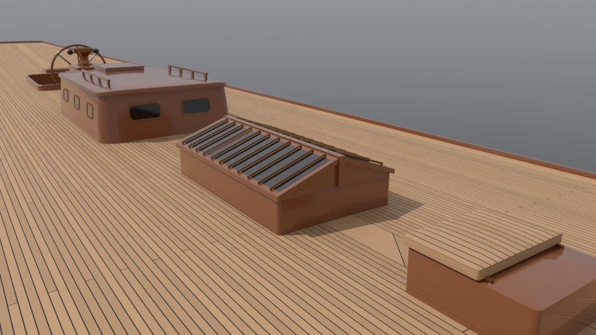
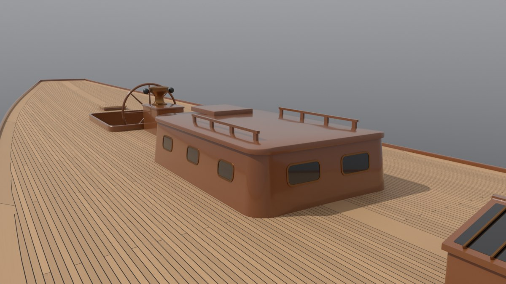
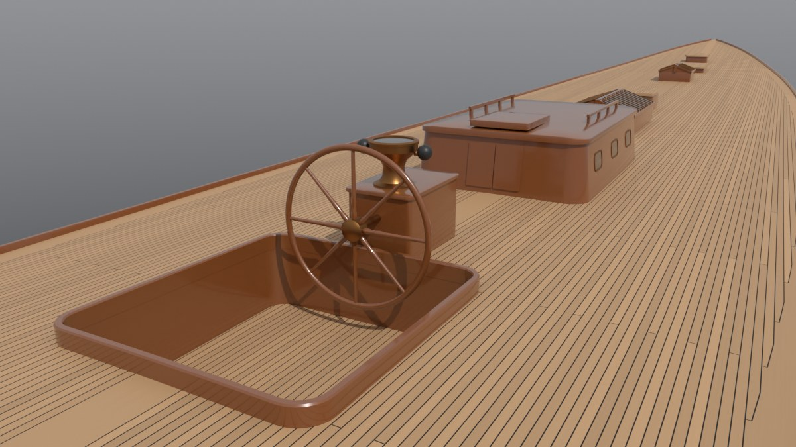
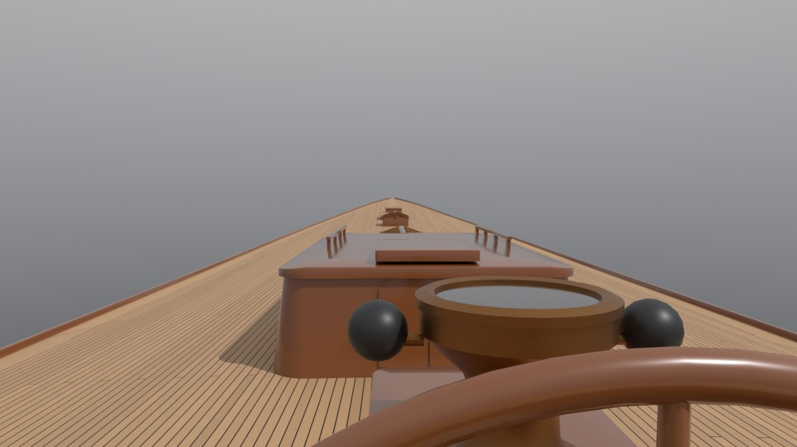

# J-Class 3: Bluebonnet's deck, deckhouses and wheel

Slice 3 of *Bluebonnet*, our own J-Class sloop of 1937 (plan and Bean's decisions:
<https://claude.ai/artifact/WdUKp8somgyNJZDyESCgyU>; the hull is slice 1, [docs/jclass-1](../jclass-1/README.md), and
its plating, keel and rudder slice 2, [docs/jclass-2](../jclass-2/README.md)). This slice gives her a deck: the laid
teak deck with its king plank and covering boards, the toe rail, the hatches and skylights, the companionway and the
doghouse, the helmsman's small cockpit, the wheel, its steering box and the binnacle. Like slices 1 and 2 it is
post-slice art: tools and docs only, nothing imported into Unreal or wired into the game yet.

The deck is laid out in the manner of the Js of 1934-37: a clean flush deck, low skylights and hatches on the
centreline, a small doghouse abaft the saloon skylight, the wheel and binnacle over the rudder's stock with a small
cockpit behind them, and no lifelines (period photos show none). The layout and every size are our own.



The renders, left to right in rows of three: the deck from aloft, forward of the doghouse looking aft; a bow quarter
from above; the helmsman's view forward from the cockpit; the bow's planking close to; the saloon skylight and the
companionway; the doghouse; the helm (wheel, box, binnacle and cockpit); the stern's after margin; afloat; the starboard
side. Each is in `baseline/` at 1200 pixels wide.

## What slice 3 builds

* **The deck:** one mesh over the hull's sheer that closes the shell and transom into one watertight solid, with the
  period's beam camber and the cockpit let into it.
* **The planking**, drawn by the deck's material from three UV maps rather than modelled: a king plank down the
  centreline, planks either side of it, covering boards along the sheer with the planks nibbed into them, and an after
  margin across the transom. The seams are black marine glue.
* **The toe rail:** a low varnished teak rail along the deck's edge and round the transom's top, ending just short of
  the stem head, where slice 8's stem fitting takes both ends.
* **Three hatches** (forecastle, sail hatch, lazarette) and **two skylights** (forecastle and saloon), all on the
  centreline.
* **The companionway** abaft the mast, a varnished box with a sliding hatch and doors.
* **The doghouse:** a low varnished house over the owner's companion and chart table, with sides leaning in, a cambered
  roof, three portlights a side and two windows forward, doors and a sliding hatch aft, and a handrail each side.
* **The cockpit:** a small well for the helmsman, 0.5 m deep, with a teak sole and a low coaming.
* **The steering:** the wheel box over the rudder's head (it holds the steering gear), the binnacle on the box's lid,
  and the wheel on its shaft in the cockpit's forward end. The wheel is its own object so the game can turn it.

| Object | Triangles |
| --- | ---: |
| Deck (with the cockpit's well) | 18,314 |
| Toe rail | 14,992 |
| Hatches | 2,408 |
| Skylights | 3,296 |
| Companionway | 744 |
| Doghouse | 3,216 |
| Cockpit coaming | 816 |
| Steering (box and binnacle) | 2,392 |
| Wheel | 3,520 |
| **Slice 3** | **49,698** |

The plan gives slice 3 500,000. This uses under a tenth of it, because the planking costs no triangles and the deck's
furniture is simple joinery; the rest stays unspent (slice 8's deck hardware will take some). The whole model is now
307,702 triangles, with slice 1's moulded hull hidden and not counted, as before.

## The layout

Every part stands on the centreline, placed by its centre (x, metres forward of mid-waterline). Heights are above the
deck at the part's centre.

| Part | x (m) | Fore and aft x across (m) | Height (m) |
| --- | ---: | --- | --- |
| Forecastle hatch | 12.55 | 0.70 x 0.70 | coaming 0.22, then the lid |
| Sail hatch (lid in two halves) | 10.00 | 1.20 x 1.05 | coaming 0.14 |
| Forecastle skylight | 7.30 | 1.00 x 0.85 | box 0.26, ridge 0.15 above it |
| Mast (slice 4) | 3.00 | kept clear for 0.7 m round | |
| Companionway | 0.85 | 0.85 x 0.80 | 0.30 |
| Saloon skylight | -1.70 | 2.00 x 1.20 | box 0.30, ridge 0.20 above it |
| Doghouse | -5.90 | 3.00 x 2.00 | sides 0.62, roof crowned 0.06 |
| Wheel box | -9.39 | 0.87 x 0.56 | 0.55 |
| Binnacle (on the wheel box's lid) | -9.57 | bowl 0.38 across | bowl's top 0.34 above the lid, 0.89 above the deck |
| Wheel | -10.15 | 1.25 across, outside its rim | hub 0.33 above the deck, 0.84 above the cockpit's sole |
| Cockpit | -10.95 | 2.00 x 1.80 | 0.50 deep, coaming 0.12 |
| Lazarette hatch | -13.30 | 0.60 x 0.60 | coaming 0.07 |

**The mast** steps at x 3.0, about 15.7 m abaft the stem head. Slice 4 builds it; this slice keeps the deck clear
within 0.7 m of its partners. The place comes from her sail plan's proportions: a fore triangle base of about 50 ft to
the stem head and a main boom of about 60 ft, the usual split of a 1930s J's 7,500 sq ft.

**The helm** is over the rudder's stock, which comes up to just under the deck at x -9.27 (slice 2). The wheel box
stands over that point and holds the steering gear (a bronze worm and its wheel on the rudder's head). The wheel's
shaft runs aft out of the box to the wheel, which stands in the cockpit's forward end. The binnacle stands on the
box's lid at its after end, so the helmsman, standing on the sole behind the wheel, reads the compass over the wheel's
rim a metre away. The long counter abaft the cockpit is clear deck.

**The layout's checks** (the build stops if one fails): every part stands at least 0.15 m inboard of the covering
board (the least is the forecastle hatch's 1.50 m), clear of the mast's 0.7 m circle (the nearest is the companionway,
1.73 m from the mast), at least 5 cm from its neighbours, and the stock comes up under the wheel box. Distances are
from the mast to each outline's edges and between outlines edge to edge; an outline that crosses another, or holds the
mast, fails.



The deck in plan from above, bow to the right (`drawings_jclass.py`), and below it the planking close to at the bow,
amidships and the stern, drawn at 4 mm a pixel from the deck mesh's own UV maps by the same terms the teak's material
runs (`deck.planking_terms`). The mast's partners are the blue circle, the stock's top the red cross. The pieces'
shading (the boards and king plank darker) is the drawing's own, to tell them apart: the material gives every piece
the same teak, each with its own slight tint. The seams are exactly the material's.



What stands on the deck seen from starboard, with its section on the centreline in black: the aft half above, the
forward half below.

## The deck's shape

The deck follows the hull's sheer at its edge and rises toward the centreline with the beam camber. Every deck beam
is cut from one mould, as a yard would cut them: a parabola 0.11 m high across the widest beam (6.56 m), so where the
deck is narrower it rises less (`shell.deck_z`). Slice 2's placeholder rose in proportion to the half-breadth instead;
the rudder stock's top follows the new deck down 7 mm.

The mesh is one surface: its edge is the shell's own sheer, point for point, and the transom's top row, so the shell,
the transom and the deck close together (396.5 m³ enclosed). Inside the edge the points are a triangular lattice
0.15 m apart, joined by Blender's constrained Delaunay triangulation, which keeps every edge of the outline and of
the cockpit's hole (its outline has a point every 0.15 m or less, so the rim follows the camber). The cockpit's well
drops 0.50 m below its lowest rim to a flat sole; its walls close the deck again, so the hull stays watertight.

## The planking

A laid teak deck of the period, our own sizes:

* **Planks** 51 mm wide with 6 mm seams (a 57 mm, 2 1/4 in, pitch), 44 mm (1 3/4 in) thick, laid straight and
  parallel to the centreline, in 7.3 m (24 ft) lengths.
* **Butts** (the planks' ends) staggered over four planks, at 0, 1/2, 1/4 and 3/4 of a length, so no two neighbours
  butt within a quarter of a length and the same place repeats every fourth plank. The starboard side's butts sit an
  eighth of a length along from the port side's, so the two sides are not mirror images.
* **The king plank** down the centreline, 330 mm wide, scarfed every 9.1 m with 0.45 m scarfs running across it.
* **The covering boards** (the margin planks along the sheer), 300 mm wide, scarfed every 6.1 m with 0.45 m scarfs,
  starboard's an eighth of a length along from port's.
* **Nibs:** where the covering board's inner edge cuts a plank at a shallow angle, the plank is not run out to a
  feather edge: it follows the board's edge until it is half its width wide, then is cut square across, and the board
  is notched to take it. This shows most at the bow and along the quarters.
* **The after margin**, 280 mm wide across the transom's top, with the planks ending square against it and a mitre
  where it meets each covering board, from the transom's corner to where the board's inner edge meets the margin's.
* **The seams** are caulked and payed with black marine glue, 6 mm wide, measured square to each seam (the scarfs and
  the mitre included).
* **The hatch lids, the companionway's slide and the cockpit's sole** are planked on their own, fore and aft, with no
  butts: their UV maps put them on the middle of one plank in the deck's pattern, clear of every butt, with their
  tops across the planks.

None of it is modelled. The deck mesh carries three UV maps, and the deck's material draws the planking from them:

| UV map | U | V |
| --- | --- | --- |
| `Planking` | x, metres | y, metres |
| `Margin` | distance in plan to the sheer | the covering board's inner edge, as \|y\|, at this x before nibbing |
| `Aft` | distance forward of the deck's after edge | how fast the covering board's edge crosses the planks (for the nibs' square ends) |

`deck.planking_terms` turns those into which piece a point is on and how near it is to a seam. It is written once
and run twice: as Blender math nodes in the teak's material (`build_jclass.planking_group`), and on arrays for the
plan drawing above, so the drawing shows what the material draws. Each plank, king plank length and covering board
length gets its own slight tint, port and starboard apart, with a fine grain along it. The seams fade to the deck's
average tone between 14 and 48 m from the camera, where they would be thinner than a pixel and shimmer; the game's
material will do the same at its own distances.

**For the game**, the same three maps can drive its material, with two catches. Unreal's FBX import flips V, so each
map's V arrives as 1 - V and the material must turn it back. And a static mesh stores its UVs as 16-bit floats unless
full-precision UVs are turned on: between 16 and 32 m from the origin that is a 15.6 mm step, against 6 mm seams. The
deck needs full-precision UVs when it is imported (slice 13).

The deck's tone is bare teak scrubbed pale (176, 140, 102 in sRGB); the coamings, houses, toe rail and wheel are
varnished teak, a deep amber (124, 70, 32).



At the bow the planks run out into the covering boards in a row of nibs, each cut square at half a plank's width, and
the king plank runs on to the stem head between the two covering boards. The toe rail stops short of the stem for
slice 8's stem fitting.



## The deckhouses, hatches and skylights

* **The hatches** have varnished teak coamings and teak-topped lids that overhang them a little and are crowned
  athwartships. The coamings' tops and the lids follow the deck's sheer fore and aft, so a coaming stands the same
  height at either end. The sail hatch, for handing headsails and the spinnaker up from below, has its lid in two
  halves.
* **The skylights** are varnished coaming boxes with two glazed lids hinged along a ridge on the centreline, each lid
  of two or three panes, with bronze guard bars running down over the glass (six a side on the forecastle skylight,
  eleven on the saloon's). Each lid's underside rests on the box's side and rises to the ridge; the box's end boards
  carry up as gables under the lids.
* **The companionway** is a varnished box 0.3 m high whose top's after part is a sliding hatch on runners, with a pair
  of doors in its after face.
* **The doghouse** is 3.0 by 2.0 m and 0.62 m high at the sides, which lean in 7 degrees. Its roof is crowned 6 cm and
  stands out 35 mm past the sides as eaves. Three portlights a side and two windows forward have glass in bronze rims;
  there is a pair of doors and a sliding hatch at its after end and a teak handrail along each side of the roof.
  The doghouse is our design call, for an owner's boat that was also cruised: the Js raced with flush decks and the
  lowest houses they could, and a deck with only skylights and hatches would be as true to the period. It is one
  object and one block of `deck_bluebonnet.json`, so it can come off if Bean prefers.





Each piece is a closed solid let about 5 mm into the deck (the binnacle into the wheel box's lid), so it sits with no
gap.

## The helm

* **The wheel box**, 0.87 by 0.56 m and 0.55 m high with an overhanging lid, stands over the rudder's head.
* **The wheel** is 1.25 m across outside its rim: a varnished teak rim, eight spokes turned with a swell near the hub,
  on a bronze hub and shaft. Its hub is 0.33 m above the deck and 0.84 m above the cockpit's sole, and its rim's top
  1.46 m above the sole, under a standing helmsman's eye. One spoke, the king spoke, stands upright when the helm is
  amidships.
* **The binnacle** is cast bronze, on the wheel box's lid at its after end: a pedestal with its bowl's top 0.34 m above
  the lid (0.89 m above the deck), the compass under glass in a bronze bezel, and the two soft iron corrector spheres,
  painted, either side on brackets. It is a metre from the helmsman's eye, read over the wheel's rim.
* **The cockpit** abaft the wheel is 2.0 by 1.8 m and 0.5 m deep, with varnished sides, a teak sole and a 12 cm coaming.
  The well stands a metre clear of the hull's plating at its nearest (1.00 m, by the sole's after corners).





The helmsman's view from the cockpit's sole behind the wheel, eye 1.6 m up: over the wheel's rim to the binnacle on
the box's lid, then the doghouse, the skylights and the deck to the bow.

**The wheel turns clear:** the build turns it through one spoke's spacing (45 degrees: after that the pattern repeats)
in 5 degree steps and checks that its rim and spokes touch nothing on the deck, the cockpit or the box. Nothing
touches, and the least clearance is 177 mm (the rim to the cockpit's forward wall and coaming).

**For the game (slices 13 and 14):** the wheel is its own object, with its origin at the hub's centre (x -10.15,
1.83 m above the waterline). Its own X axis runs forward along the shaft and Z up (`build.json` `deck.wheel_frame`). A
positive turn about its X is clockwise as the helmsman sees it, the top going to starboard, which steers her bow to
starboard: the game's positive helm, the same sign as the rudder's. The build checks that direction each run.

## Her weight and balance

The deck's weights are measured from the same geometry: each part's volume or area times its timber's thickness and
density (teak 650 kg/m³, bronze 8,800, glass 2,500, the soft iron spheres 7,200; sizes in `deck_bluebonnet.json`),
plus two fixed weights of our own estimate, the steering gear (300 kg) and the compass (20 kg). A box is weighed as its
boards: a coaming as its sides, with its lid on its own, and the companionway's top only forward of the slide (the
rest is the opening); the binnacle as its cast walls, its glass on its own. The planking under every coaming and house
is taken off, the cockpit coaming's ring included. The deck's beams, stringer and tie plates are steel and already
counted in the hull's 30 tons.

| Part | kg | Centre x (m) | Centre z (m) |
| --- | ---: | ---: | ---: |
| Deck planking, 200.3 m² of 44 mm teak, less the 12.8 m² under coamings and houses | 5,362 | -1.52 | 1.53 |
| Toe rail, 82.7 m | 179 | -1.64 | 1.62 |
| Hatches (three) | 122 | 7.55 | 1.83 |
| Skylights (two) | 231 | 0.82 | 1.80 |
| Companionway | 48 | 0.82 | 1.68 |
| Doghouse | 301 | -5.91 | 1.94 |
| Cockpit (sides, sole, coaming) | 184 | -10.96 | 1.20 |
| Wheel box and steering gear | 342 | -9.38 | 1.66 |
| Binnacle and compass | 70 | -9.57 | 2.30 |
| Wheel, hub and shaft | 39 | -10.11 | 1.83 |
| **Deck and deckhouses** | **6,877 (6.77 long tons)** | **-2.23** | **1.58** |

The size card (slice 1) estimated 7.0 long tons at x -1.5, z 1.45. The deck as built is 0.23 long tons lighter, so the
lead takes it up and she still floats on her lines: the build weighs the deck first, then solves the lead's top on
the finished shell for the card's 92 long tons plus slice 2's 1.20 for the plating plus 0.23 for the deck, then builds
the deck again on the finished shell's sheer and stops if the two weighings differ by more than 0.01 long tons.

| | Slice 2 | Slice 3 |
| --- | ---: | ---: |
| Lead | 93.20 long tons | 93.43 long tons (its top 2 mm higher) |
| Total weight | 156.2 long tons | 156.2 long tons |
| G aft of B | 4 cm | 7 cm |
| Trim by the stern | 3 cm | 6 cm |
| GM (stiffness upright) | 1.89 m | 1.89 m |

The deck's weight sits 0.7 m further aft than the card guessed (the steering gear and the cockpit are well aft), which
moves G aft 3 cm. Six centimetres of trim on a 26 m waterline is too little to see; slices 4 to 8 add the mast,
rigging and hardware, whose real weights and centres replace the card's next, and slice 13's physics trims her as she
sits.

## Sources and licence

* **The deck's layout, sizes and timber are our own** for an invented 1937 J, in the manner of the Js of 1934-37 (a
  flush teak deck, low skylights and hatches on the centreline, a small doghouse, the wheel and binnacle over the
  rudder's stock, no lifelines). Nothing is traced or measured from a real J's deck plan or photo.
* **No outside assets:** every mesh is generated by the build from `deck_bluebonnet.json`, and the planking is drawn by
  its material. Nothing needs a licence row until she goes into the game.

## Checks

The same venv as slices 1 and 2 (Python 3.13 with pip `bpy` 5.3, numpy, scipy, matplotlib, pillow); `<venv>/bin/python`
below. Run from the repo root:

```
<venv>/bin/python Tools/shipkit/jclass/build_jclass.py <out>    # jclass.blend, jclass.obj, build.json and four drawings
python3 -I Tools/shipkit/jclass/rule_check.py <out>/build.json
<venv>/bin/python Tools/shapeloop/fairness.py <out>/jclass.blend <out> --object Hull
<venv>/bin/python Tools/shapeloop/fairness.py <out>/jclass.blend <out>/shell --object Shell
<venv>/bin/python Tools/shipkit/jclass/render_jclass.py <out>/jclass.blend <out>/renders --res 1200 --only deck_aloft,deck_34,deck_eye,deck_bow,deck_skylight,deck_doghouse,deck_helm,deck_stern,paint_afloat34,paint_profile
<venv>/bin/python Tools/shipkit/jclass/docs_jclass.py <out> docs/jclass-3/baseline --slice 3
```

* **Every piece closes:** the shell with the transom and the deck (396.5 m³), the rudder, the stock, and each of the
  deck's eight other objects are closed surfaces with no open, doubled, flipped or degenerate edges. The build stops
  before writing anything if one doesn't, and `rule_check.py` now fails a slice 3 `build.json` that lacks a check for
  any of them.
* **The rule:** unchanged, rating 75.76 ft against the 76 ft limit, every size on its target: PASS.
* **The layout:** inboard of the covering boards, clear of the mast and of each other edge to edge, the stock under
  the wheel box (above).
* **The weights:** the deck weighed on the loft's sheer and on the finished shell's agree within 0.01 long tons, and
  the lead's casting holds 93.43 long tons to within 0.05 (above).
* **The rudder still turns clear:** slice 2's helm sweep, now with the deck on, 11.7 mm least clearance from 35 degrees
  to port to 35 to starboard.
* **The wheel turns clear:** 177 mm (above), and a positive turn moves its top to starboard.
* **The cockpit stands clear of the hull:** the least distance from 763 points over its walls and sole to the shell
  and transom is 1.00 m, by the sole's after corners (straight down from those corners it is 1.06 m, and 1.76 m out
  to the side).
* **Fairness:** the moulded hull (`Hull`, 17 inflections and 23 kinks) and the finished shell (`Shell`, 14 and 19) are
  unchanged from slice 2, so the deck changed nothing below the sheer.
* **The renders** show the planking, the nibs and the after margin as the drawing does, and every part seated on the
  deck.

## Review

An independent reviewer, who had not written the code, measured the finished build (rebuilding the deck from the
blend's own sheer, running `planking_terms` through real Blender Math nodes against `np_math`, and checking every
part's seat on the deck) and changed nothing. What they found, most serious first, and what changed:

| Finding | What changed |
| --- | --- |
| The layout check could pass an overlapping layout: it measured to outlines' corners, so a skylight with the mast in its middle, or two crossing outlines, passed | The mast is tested against each outline's edges and for being inside it, and outlines edge to edge, with crossing edges counted as touching |
| The after margin's mitre ran along the corner's bisector, so it stopped 29 mm short of the board's notched inner corner and met no other seam | The mitre runs from the transom's corner to the real inner corner (the deck works it out and passes it to the material and the drawing) |
| About 85 kg was counted twice: hatch coamings and the wheel box weighed with their tops under their lids, the companionway's top over its opening, the binnacle's top under its glass; the planking under the binnacle taken off though it stood on the deck, and not under the cockpit's coaming | Boxes are weighed as their sides, the companionway's top only forward of the slide, the binnacle as its walls; the planking subtraction fixed. The deck weighs 6.77 long tons and the lead takes 0.23 |
| The wheel's rim stood above the helmsman's eye, and the binnacle 2 m forward of the wheel could not be read from the helm | The wheel is 1.25 m with its hub 0.84 m above the sole; the binnacle stands on the wheel box's after end, a metre from the eye |
| `butt_stagger` in the json was never read, and port and starboard were mirror images (butts and tints) | The stagger is read from the json; starboard's butts and scarfs sit an eighth of a length along, and each piece's tint knows its side |
| The README's numbers had drifted from `build.json`, and the game could not use the UV maps as they stand (Unreal flips V, and 16-bit UVs are too coarse for 6 mm seams) | Every number refreshed from this build; the catches are under the planking |
| The scarfs and the mitre were drawn 3 to 4 mm wide instead of 6, a covering board's scarf could stop short of a notch, and the king plank's "scarfs" were square butts | Seam widths are measured square to each seam; the scarf runs to the board's widest; the king plank has real scarfs |
| The cockpit's long straight edges cut 6 mm under the cambered deck, and the deck's inner points were laid to a fixed 3.4 m | The cockpit's outline has a point every 0.15 m; the lattice spans the deck's own width |
| The hatches' tops were level on a sloping deck (the forecastle hatch 45 mm taller at one end), and the skylight lids sank 33 to 38 mm into their boxes | The hatches follow the sheer; each skylight lid rests on its box's side |
| Lids and the cockpit's sole showed the deck's king plank and butts; a lid's side sat 4 mm from a seam | They are planked on their own (above) |
| Smaller details: the companionway doors 62 mm apart, iron spheres in bronze, no upright king spoke, the json's wording on the steering gear and the skylight lids' weight, the drawing's shading and an overlapping label, the build's docstrings, and a cockpit clearance taken only from its corners | The doors meet with 4 mm between; the spheres are soft iron, painted; the king spoke stands upright; the wording, captions, label and docstrings are fixed; the cockpit is measured over its whole well |

They confirmed the rest: every foot is let into the deck (2.7 to 11.8 mm), the toe rail is mitred at the transom's
corners and 6 mm in from the edge all the way, the deck's edge is the shell's sheer exactly, `np_math` matches
Blender's Math nodes (seams within 0.0002), the wheel turns the way the README says, the weights sum, the two-pass lead
solve is right, and the fairness is unchanged. Two things were left as they are, under the known gaps: the butts'
regular lattice, and the doghouse, a design call.

## Known gaps

* **No deck hardware:** winches, cleats, fairleads, chainplates, the mast's partners and collar, the stem fitting and
  the sheet tracks are slice 8. The toe rail stops short of the stem for that fitting, and has no scupper slots yet.
* **No hinges, handles or fastenings** on the hatches, skylights and doors; every lid and door is shut. The glass is
  dark, as if seen against an unlit cabin: the cabins are slices 9 and 10.
* **Under each skylight lid's corners** a sliver up to 14 mm high is open between the box's rounded corner and the
  lid, beyond the gable's end, in the lid's shadow.
* **The companionway's doors are short** (0.19 m), because its box stands only 0.3 m above the deck: the rest of the
  opening is below the deck, with the cabins.
* **The butts and scarfs fall on a regular lattice:** near the nibs a few plank ends come out short (the shortest about
  5 cm), and a covering board can end in a short length at the stem. A yard would have moved those butts; the
  material can't see them, so they stay until the game's material is tuned on screen.
* **The steering gear and the compass are weights only;** nothing shows inside the box or under the binnacle's glass.
* **The wheel has no handles** past its rim: a plain varnished rim, as many yacht wheels of the period had.
* **The planking is drawn, not modelled,** so a seam has no depth at a grazing angle beyond the bump's shading, and
  the seams fade out past 14 m. The game's teak material will need its own twin of `planking_terms` (slice 11,
  textures), tuned on screen.
* **The deck's colours are set by eye** for the renders; the game's skins set their own.
* **The mast's place (x 3.0) is ours, from the sail plan's usual proportions;** slice 4 confirms it with the spars.
* **She trims 6 cm by the stern** on the card's estimates for everything not yet built (above).
* **Slice 1's open design calls are unchanged:** the straight bow (no spoon) and the firm shoulder on the bow's
  topsides wait for Bean.

## Words used here

* **Laid deck:** a deck of separate planks laid side by side over the beams, as opposed to a sheet of plywood.
* **King plank:** the wide plank down the deck's centreline that the others are laid either side of.
* **Covering board:** the wide plank along the deck's edge, over the tops of the frames.
* **Nib, nibbing:** cutting a plank's end square where it meets the covering board at a shallow angle, and notching the
  board to take it, so neither ends in a thin feather edge.
* **Margin plank, after margin:** a plank round an edge (here, across the transom) that the planks end against.
* **Butt:** where two lengths of plank meet end to end. **Scarf:** a long sloping joint between two lengths of a plank.
* **Seam, paying:** the gap between planks, and filling it with glue or pitch after caulking.
* **Camber, round of beam:** the deck's rise toward the centreline, so water runs off.
* **Toe rail:** a low rail along the deck's edge to stop feet (and things) going over.
* **Coaming:** the raised sides round a hatch, skylight or cockpit.
* **Skylight:** a box with glazed lids over a cabin, for light and air. **Companionway:** a hatch with a ladder below.
* **Doghouse:** a small deckhouse, usually aft, with windows.
* **Forecastle:** the crew's quarters in the bow. **Lazarette:** a store in the stern. **Sole:** a floor.
* **Binnacle:** the stand that holds the compass in front of the helmsman. **Corrector spheres:** two iron balls
  either side of the compass that cancel the steel hull's pull on it.
* **Partners:** the deck's strengthened opening where the mast passes through.
* **Helm:** the steering: the wheel, its gear and the rudder. **Positive helm (in the game):** steering the bow to
  starboard.

## Files

| File | What it is |
| --- | --- |
| `Tools/shipkit/jclass/deck_bluebonnet.json` | this slice's choices: the planking, colours, timber, the mast's place, and every part's place and size |
| `Tools/shipkit/jclass/deck.py` | the deck and everything on it: the deck mesh and its UV maps, `planking_terms`, the toe rail, hatches, skylights, companionway, doghouse, cockpit, steering, wheel and binnacle, their weights and the layout's checks |
| `Tools/shipkit/jclass/shell.py` | the deck's camber (`deck_z`, one beam mould); the lead takes the deck's difference from the card |
| `Tools/shipkit/jclass/loft.py` | the weight check takes the deck as measured |
| `Tools/shipkit/jclass/build_jclass.py` | builds the deck twice round the lead's solve, the teak's `Planking` node group, the varnish, glass and painted iron materials, the deck's objects, the wheel's frame and sweep, the cockpit's clearance |
| `Tools/shipkit/jclass/drawings_jclass.py` | adds the deck in plan with the planking close to, and what stands on it in profile |
| `Tools/shipkit/jclass/render_jclass.py` | adds the deck views |
| `Tools/shipkit/jclass/docs_jclass.py` | takes `--slice 3` |
| `Tools/shipkit/jclass/rule_check.py` | requires a closure check for each of the deck's objects in a slice 3 build |
| `Tools/shipkit/jclass/sections_jclass.json` | her parts for the shape-loop tools: the deck, its structures and the steering replace the placeholder |
| `docs/jclass-3/baseline/` | this build's stats, fairness checks, drawings and renders |
