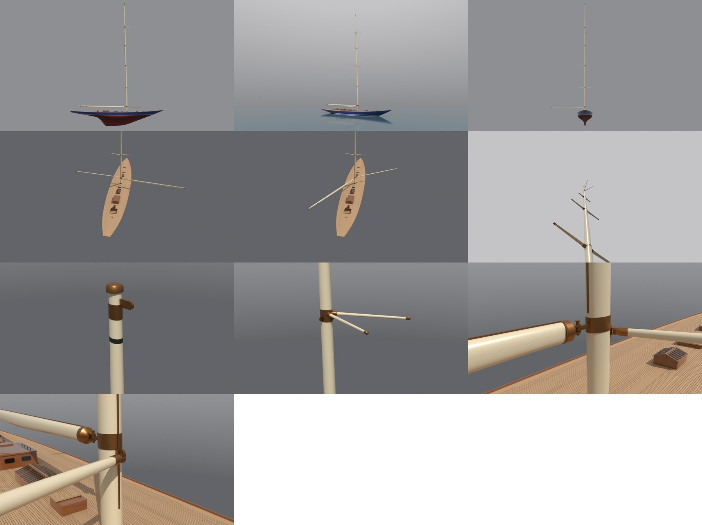
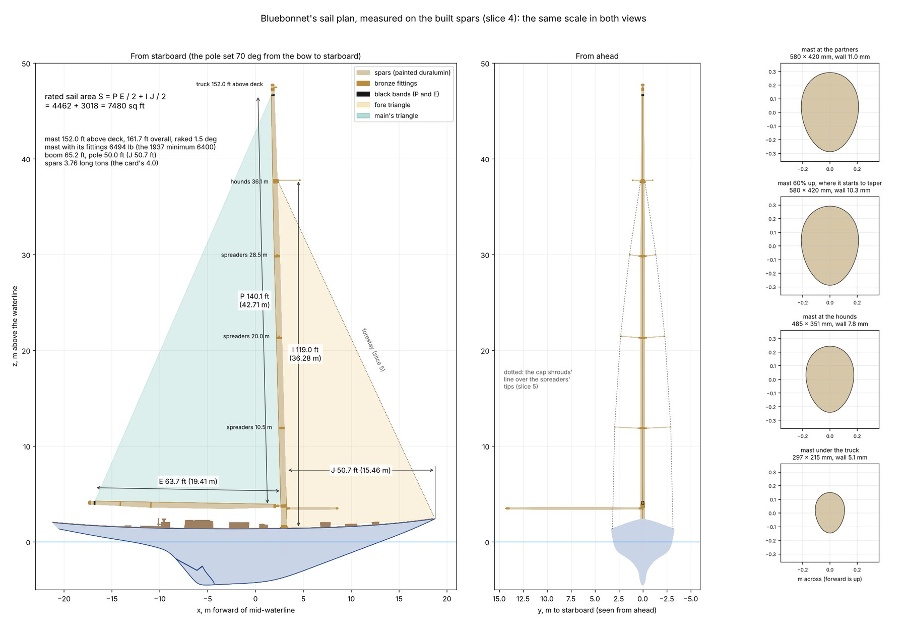

# J-Class 4: Bluebonnet's mast and spars

Slice 4 of *Bluebonnet*, our own J-Class sloop of 1937 (plan and Bean's decisions:
<https://claude.ai/artifact/WdUKp8somgyNJZDyESCgyU>; the hull is slice 1, [docs/jclass-1](../jclass-1/README.md), its
plating, keel and rudder slice 2, [docs/jclass-2](../jclass-2/README.md), and its deck slice 3,
[docs/jclass-3](../jclass-3/README.md)). This slice gives her spars: the riveted duralumin mast with its three sets of
spreaders, the jumper struts at the hounds and the mainsail's track, the long boom on its gooseneck, and the spinnaker
pole on its car. The boom swings and the pole sets on either side. Like slices 1 to 3 it is post-slice art: tools and
docs only, nothing imported into Unreal or wired into the game yet.

The spars are drawn in the manner of the Js of 1934-37: a tall, slightly raked pear-section mast of riveted duralumin
stepped on the keelson, spreaders square to the centreline, jumper struts at the hounds to hold the upper mast, a deep
riveted boom, and a long spinnaker pole on a car on the mast's forward face. Every size and fitting is our own, and the
rule's sail area is measured on these spars.



The renders, left to right in rows of three: from starboard; afloat from the bow quarter; from ahead; from high astern
with the boom squared off to starboard and the pole to port (running); the same with the boom eased to port and the pole
forward to starboard (reaching); the spreaders seen from the deck; the masthead; the hounds and the jumper struts; the
gooseneck; the pole's car. Each is in `baseline/` at 1200 pixels wide.



## What slice 4 builds

* **The mast:** 152 ft (46.33 m) above the deck, 161.7 ft overall from its heel on the keelson, raked 1.5 degrees aft.
  A pear-shaped section, fuller forward, 580 by 420 mm at the deck, the same up to 60% of its height, then tapering to
  half that at the top. Riveted duralumin, its wall 11 mm low down and 5 mm at the top, with ring frames and stringers
  inside.
* **Three sets of spreaders** at 10.5, 20 and 28.5 m above the deck, square to the centreline, streamlined, in bronze
  sockets on the mast and bronze tip fittings.
* **The hounds,** 78% of the way up: a bronze band with the forestay's tang forward and a cap shroud's tang each side,
  and **a pair of jumper struts** pointing forward and out from it.
* **The masthead:** the truck (a bronze cap), a bronze band with a crane aft for the main halyard's block, and the black
  band that marks the top of the mainsail's luff.
* **Two tracks** let into the mast: the mainsail's up its after face from just above the boom to the black band, and the
  pole car's on its forward face.
* **The mast coat:** a bronze collar round the mast where it goes through the deck, its flange let into the deck.
* **The boom:** 65.2 ft of riveted duralumin, a deep oval section deepest in its middle third, its top straight for the
  sail's foot and rising 1 degree aft. It hangs on a vertical pin on a lug from a bronze band round the mast (the
  gooseneck) and swings 85 degrees either side. A bronze jaw forward, an outhaul cap aft, three bands where the
  mainsheet's blocks will hang, a track along its top, and a black band that marks the end of the sail's foot.
* **The spinnaker pole:** 50 ft, a drawn duralumin tube fattest in its middle, with bronze end fittings. Its heel's jaw
  takes a vertical pin on a car on the mast's forward face, 2 m above the deck, so it swings level from beside the
  forestay to square on either side.

| Object | Triangles |
| --- | ---: |
| Mast (with spreaders, jumper struts, tracks, bands, the gooseneck's lug and the pole's car) | 44,200 |
| Boom | 15,224 |
| Spinnaker pole | 4,648 |
| **Slice 4** | **64,072** |

The plan gives slice 4 250,000. This uses about a quarter of it, because the plating is drawn by the paint, not
modelled. The whole model is now 371,774 triangles, with slice 1's moulded hull hidden and not counted, as before.

The mast is one object with everything fixed to it; the boom and the pole are their own objects, each in a frame whose
origin is its pin and whose Z is the pin's axis, so the game turns them about that Z (below).

## The sail plan

A J's rating comes from her waterline length, displacement and sail area (R = 0.18 L √S / ∛D, which must be 76 ft or
less). Slices 1 to 3 used the size card's target area. From this slice the build measures the area on the spars, the
conventional way: the mainsail's triangle P × E / 2 plus the fore triangle I × J / 2, where

* **I** is the fore triangle's height: upright from the deck to where the forestay meets the mast's forward face;
* **J** its base: level from the mast's forward face at the deck to the forestay's tack at the stem head;
* **P** the mainsail's luff: along the mast's after face from the boom's top to the black band;
* **E** its foot: along the boom from the mast's after face to the boom's black band.

The Universal Rule's own text for measuring sail area could not be read from the cloud, so this is an assumption; slice 6
measures the real sails the same way. The boom's black band is placed to make the area 7,480 sq ft, a little under the
size card's 7,500 so the rating keeps its margin.

| Measure | Feet | Metres |
| --- | ---: | ---: |
| I | 119.0 | 36.28 |
| J | 50.7 | 15.46 |
| P | 140.1 | 42.71 |
| E | 63.7 | 19.41 |
| Fore triangle I × J / 2 | 3,018 sq ft | |
| Main's triangle P × E / 2 | 4,462 sq ft | |
| **Rated sail area S** | **7,480 sq ft** | |

The build measures each one between points on the built spars (`build.json`'s `rig.measure_points`): I to where the
forestay's line, run on from its tang past the hole, meets the mast's forward face (36.28 m up, 0.15 m above the
hounds' own height), and
P and E from where the boom's straight top meets the mast's after face, 2.43 m above the deck. Because the black band
is placed to make the target, S always comes out at 7,480; what the rule check gains is that I, J and P are the built
spars', not the card's.

The rating is 75.66 ft against the 76 ft limit: PASS (slice 3's was 75.76 on the card's 7,500). The pole is 50.0 ft,
15.40 m from the mast's face to its end when squared off, no longer than J (the usual limit), and the boom's end is 3.72
m forward of the transom. The drawing above shows the plan from starboard and from ahead at the same scale, with the
triangles shaded between the measured points, the four measures, the forestay's line and the cap shrouds' line over
the spreaders' tips (slice 5 rigs both), and the mast's section at four heights.

## The mast

* **Its place:** the partners (where it goes through the deck) are at x 3.0, as slice 3 assumed. It steps on the keelson
  at z −1.45 (the canoe body's centreline is at −1.79 there; the floors and keelson take up the rest), 0.75 m from the
  plating at the nearest, and rakes 1.5 degrees aft, so the truck's top is at x 1.79, 47.8 m above the waterline.
* **Its section** is egg-shaped, fuller forward (the sail's luff is aft, the forestay's pull and the spinnaker pole's
  thrust forward): 580 mm fore and aft by 420 mm across at the deck and up to 60% of the height, then tapering to
  297 by 215 mm under the truck. At the hounds it is 485 by 351 mm.
* **Its wall** is thickest low down, where the bending is greatest: 11.0 mm to 55% of the height, 7.5 mm at 80%, 5.0 mm
  at the top. The ring frames, stringers, laps and rivets inside add 16% to the skin's weight.
* **The plating is drawn, not modelled,** as the hull's is. The mast and the boom are rolled from duralumin plates in
  two halves, forward and after (the boom's upper and lower), meeting in a lapped seam down each side, each half in
  plates 3.66 m long with their butts staggered half a plate between the halves, and a row of flush rivets each side of
  every seam and butt. The paint reads them from two UV maps the build gives every spar vertex (`Spar`: metres along
  and the fraction of the way round; `SparG`: the girth there), so they cost no triangles. Under the buff paint they
  show only faintly (rivets fade out by 12 m, seams by 40 m).
* **The spreaders** push the cap shrouds out of their straight line from the chainplate at the sheer (abreast the mast)
  to its tang's hole at the hounds. Each tip stands 2.93, 2.31 and 1.38 m out from the centreline, which bends the shroud
  2.5, 2.5 and 2.3 degrees at the tips, and each spreader is angled up to bisect that bend (2.5, 5.0 and 7.4 degrees) so
  the shroud's push runs straight along it. They are 2.73, 2.11 and 1.18 m long from the mast's side, and a bronze band
  round the mast runs through each pair's sockets.
* **The jumper struts** at the hounds are 2.6 m long and come off the mast 22 degrees round from its forward face each
  side. They hold the jumper stays (slice 5) off the upper mast between the masthead and 8 m below the hounds. Each
  stay's two ends are on the mast's surface the same way round as its strut, so the stay and the strut lie in one plane
  and the strut bisects the stay's bend at its tip exactly (it tilts 0.5 degrees up).
* **The fittings** the rigging will need are reported in `build.json`'s `rig.attachments`: the forestay's tang, the
  cap shrouds' tangs, the chainplates' places, the spreaders' and jumpers' tips, the jumper stays' ends, the masthead
  crane's tip, the stem head's forestay tack, and the boom's and pole's pins. Slice 5 rigs her from those points.

## The boom and the pole

The boom's frame has its origin on the gooseneck's pin and its Z up the pin, which is parallel to the mast; a positive
turn about it in Blender takes the boom's end to starboard. The pole's frame has its origin on the pin in the car and
its Z upright; the pole is built set 70 degrees from the bow to starboard, and a positive turn in Blender takes its end
to port. Both are in `build.json` (`rig.boom_frame`, `rig.pole_frame`) for the game to read.

The build swings both through their range and stops if anything touches:

| Sweep | Range | Least clearance to the deck | To the deckhouses and the rest on deck | To the mast |
| --- | --- | ---: | ---: | ---: |
| Boom | 85 degrees to port to 85 to starboard, every 5 | 2,007 mm | 1,110 mm | 50 mm |
| Pole | 10 to 90 degrees from the bow, each side, every 5 | 1,411 mm | 1,451 mm | 25 mm |

The boom's jaw and the pole's jaw are left out of their own sweeps, because they pivot on their pins (the build's pin
and lug are made to clear them by 5 mm above and below, and the jaw's throat clears the eye it turns on). The least
clearances to the mast are those throats, the same at every angle.

## Her weight and balance

The spars are weighed from the same geometry: each spar's skin from its girth, length and wall, the bronze castings
from their area and a cast wall, the solid parts from their volume (duralumin 2,800 kg/m³, bronze 8,800), plus two
fixed weights of our own estimate for what has no shape here (the halyard sheaves and their pins inside the masthead and
at the hounds).

| Part | kg | Centre x (m) | Centre z (m) |
| --- | ---: | ---: | ---: |
| Mast skin, riveted duralumin | 1,998 | 2.52 | 19.64 |
| Its ring frames, stringers, laps and rivets (16% of the skin) | 320 | 2.52 | 19.64 |
| Masthead: truck, band, crane and sheaves | 102 | 1.87 | 47.21 |
| Hounds: band, tangs, sheaves and plates | 95 | 2.07 | 37.63 |
| Spreaders (six) with their sockets, tips and bands | 176 | 2.50 | 20.31 |
| Jumper struts (two) with sockets and tips | 38 | 3.08 | 37.75 |
| Mainsail and pole tracks | 101 | 2.17 | 23.74 |
| Gooseneck band, lug and pin; the pole's car and pin | 116 | 2.94 | 3.65 |
| **Mast with its fittings (the 1937 rule's weight)** | **2,946 (6,494 lb)** | **2.50** | **20.97** |
| Mast coat at the partners (the deck's, on the mast's object) | 60 | 3.01 | 1.56 |
| Boom skin with its frames, laps and rivets | 516 | −7.58 | 3.90 |
| Boom fittings: jaw, end cap, mainsheet bands, track | 143 | −8.04 | 3.96 |
| Spinnaker pole with its heel, jaw and end fittings | 157 | 5.91 | 3.49 |
| **Spars** | **3,822 (3.76 long tons)** | **0.89** | **17.00** |

A casting that sleeves over a spar (a socket, a cap, the mast coat) is weighed as its wall over its outside and its
real ends; the flat ends that only close its mesh inside the spar it fits over are left out.

**The 1937 minimum.** The J class rule was amended in 1937 to make rigs weigh at least 6,400 lb, so the masts would stop
breaking (Wikipedia's J Class page, as a web search quotes it; its sources and the rule's own text could not be read
from the cloud). We read it strictly, as the mast with its fittings, spreaders and struts, but not the mast coat, which
is the deck's: Bluebonnet's weighs 6,494 lb, 94 lb over, and the build stops if it falls under 6,400. That margin is
thin, as a racing yacht's would be, and it leans on our estimate of 165 lb for the sheaves and plates inside the mast.
Enterprise's duralumin mast of 1930 had weighed about 4,000 lb. The mast's centre is 41% of the way up.

**The size card** (slice 1) had one row of 8.5 long tons for the mast, boom and rigging at x 1.5, z 16.0. It is now two:
spars 4.0 at x 2.4, z 17.0, and rigging 4.5 at x 0.7, z 15.1, chosen so the two together keep the old row's weight and
centre. The spars as built are 0.24 long tons lighter than their row and their centre is 1.5 m further aft (the boom's
weight is well aft of the mast). The pole is weighed where it is built, set 70 degrees to starboard; stowed on deck it
would move her centre of gravity less than a centimetre.

**The lead's casting is now fixed.** Slices 2 and 3 solved the casting's top on the finished shell so she floats on her
lines; moving it again for the spars brought it to a height where the keel's slot cut fails (a known weakness of slice
2's cut, under the known gaps). So from this slice the casting's top stays where slice 3 put it (z −2.6994, holding
93.43 long tons), and what she needs beyond it goes into the bilge as trimming ballast: lead pigs on the floors just
forward of the casting's centre (x −0.6, z −1.65), as a yacht is trimmed after she is launched. This build needs
0.24 long tons of it. If later parts came in heavier than the card, she would need a lighter casting, and the build
stops and says so.

| | Slice 3 | Slice 4 |
| --- | ---: | ---: |
| Lead | 93.43 long tons | 93.67 (the casting 93.43 and 0.24 trimming ballast) |
| Total weight | 156.2 long tons | 156.2 long tons |
| G aft of B | 7 cm | 11 cm |
| Trim by the stern | 6 cm | 9 cm |
| GM (stiffness upright) | 1.89 m | 1.92 m |

Nine centimetres of trim on a 26 m waterline is still too little to see; the rigging, sails and hardware (slices 5 to
8) replace the card's rows next, and slice 13's physics trims her as she sits. With the pole set to starboard its
weight is 6.9 m out to that side; the weight check takes fore and aft and height only.

## Sources and licence

* **The spars' sizes, sections, fittings and colours are our own** for an invented 1937 J, in the manner of the Js of
  1934-37 (a raked, riveted duralumin mast with in-line spreaders and jumper struts, a deep riveted boom, a long
  spinnaker pole on a mast car). Nothing is traced or measured from a real J's sail plan or photo. The mast's height is
  the size card's 152 ft (Ranger's was 153).
* **The 1937 minimum weight and Enterprise's mast weight** are from Wikipedia's J Class page as a web search quotes
  it; the rule's own text could not be read.
* **No outside assets:** every mesh is generated by the build from `rig_bluebonnet.json`, and the plating is drawn by
  its paint. Nothing needs a licence row until she goes into the game.

## Checks

The same venv as slices 1 to 3 (Python 3.13 with pip `bpy` 5.3, numpy, scipy, matplotlib, pillow); `<venv>/bin/python`
below. Run from the repo root:

```
<venv>/bin/python Tools/shipkit/jclass/build_jclass.py <out>    # jclass.blend, jclass.obj, build.json and five drawings
python3 -I Tools/shipkit/jclass/rule_check.py <out>/build.json
<venv>/bin/python Tools/shapeloop/fairness.py <out>/jclass.blend <out> --object Hull
<venv>/bin/python Tools/shapeloop/fairness.py <out>/jclass.blend <out>/shell --object Shell
<venv>/bin/python Tools/shipkit/jclass/render_jclass.py <out>/jclass.blend <out>/renders --res 1200 --only rig_profile,rig_afloat34,rig_ahead,rig_run,rig_reach,rig_spreaders,rig_masthead,rig_hounds,rig_gooseneck,rig_polecar
<venv>/bin/python Tools/shipkit/jclass/docs_jclass.py <out> docs/jclass-4/baseline --slice 4
```

* **Every piece closes:** the mast (8.48 m³ enclosed, the spars' hollow insides not modelled), the boom (3.14) and the
  pole (0.64) are closed surfaces with no open, doubled, flipped or degenerate edges, as are slices 1 to 3's pieces. The
  build stops before writing anything if one doesn't, and `rule_check.py` now fails a slice 4 `build.json` that lacks a
  check for any of the three.
* **The rule:** rating 75.66 ft against the 76 ft limit on the measured 7,480 sq ft, every size on its target: PASS.
* **The weights:** the spars weighed on the loft's sheer and on the finished shell's agree within 0.01 long tons; the
  mast with its fittings is over the 1937 minimum (above).
* **The struts:** every spreader and both jumper struts bisect their wire's bend at the tip; the build stops if a jumper
  strut is more than 0.01 degrees off.
* **The boom and the pole swing clear** (above), and the mast's heel stands 0.75 m clear of the plating.
* **The rudder and the wheel still turn clear:** 11.7 mm and 177 mm, as in slice 3.
* **Fairness:** the moulded hull (`Hull`, 17 inflections and 23 kinks) and the finished shell (`Shell`, 14 and 19) are
  unchanged from slices 2 and 3: the casting's top is where slice 3 put it, so the shell is the same mesh.
* **The renders:** the earlier slices' shots each show only their own slice's objects and those before it, so they
  are unchanged (slice 3's `paint_profile` and `deck_aloft`, rendered again, match its baseline).

## Review

An independent reviewer, who had not written the code, measured the finished build (re-running both sweeps at 1-degree
steps against the mast's own mesh, probing the spars' geometry and weights, and checking the paint's UV maps against
the plates note). What they found, most serious first, and what changed:

| Finding | What changed |
| --- | --- |
| The renders unhid slice 1's moulded hull, which the build keeps hidden as the measured reference: every shot drew it over the finished shell (striped bottom, rudder slot filled) | What the build hid stays hidden in every shot; slice 3's shots, rendered again, match its baseline |
| The jumper struts did not bisect their stays' bend and splayed 36 degrees, not 22: the stays' ends were on the mast's forward centreline but the struts' roots 22 degrees round, out of the stays' plane, so the solve crept outward and never settled | Each jumper stay's ends are on the mast the same way round as its strut, so stay and strut share a plane; the strut is solved onto the bisector (0.0001 degrees off) and the build stops if one is more than 0.01 off |
| The spreader bands were at the tips' height, not the roots': the spreaders tilt up, so the 20 m band missed its sockets by 10 mm | Each band is centred where its pair of spreaders meets the mast |
| The sail plan said "the same scale in both views", but the view from ahead was drawn at 0.18 inches a metre against the profile's 0.21 | Both views are drawn at 0.19 inches a metre, their boxes sized from their extents |
| I was taken at the hounds' height, 0.15 m below where the forestay meets the mast's face (the fore triangle 12 sq ft short, so E came out 5 cm long), and P started from the json's boom height, 2 cm above the built boom's top at the mast | I is measured to the forestay's crossing of the face, P from the built boom's top; E is solved from those (19.41 m) and the points are in `build.json` |
| The spreaders were angled for the band's surface, not the tang's hole the shroud will run to (the top set 0.19 degrees off) | The shroud's path ends at the tang's hole |
| The castings that sleeve over a spar counted the flat ends that only close their mesh inside it (26 kg of the mast coat's 85, the parts of its two end discs inside the mast, and a few kg in each end fitting of the boom and pole), and the mast's 1937 weight counted the mast coat | Those ends are left out of the castings' weight; the mast's 1937 weight leaves out the coat (6,494 lb, still over the 6,400) |
| A comment in the build still said the lead's solve sets the casting's top | Fixed |
| Suggestions: the pole limit measured from the pin, not the mast's face; the fore triangle shaded to the deck's height at the stem rather than the forestay's tack | The pole is checked from the face (15.40 m against J's 15.46); the triangles are shaded between the measured points |

They confirmed the rest: the mast's section, taper and rake; the spreaders' tips exactly where the json puts them; the
sweeps (at 1-degree steps the only contacts are the jaws on their own pins, and the cheeks clear the lug and eye by 5
mm); the frames' origins, axes and signs, and that the renders' `swing_boom` and `set_pole` follow them; the weights'
arithmetic, with nothing missing or counted twice; the card's split; the fixed casting's ballast, its sign and its
centre; the plating's UV maps and the paint against the plates note; and the closure checks.

## Known gaps

* **No rigging and no sails:** the forestay, cap shrouds, jumper stays, runners and halyards are slice 5, the sails slice
  6. The drawing shows the forestay's line and the cap shroud's line over the spreaders' tips only to show where they
  will run; the tangs, tips and chainplates' places are in `build.json`.
* **The spars are solid to the eye but hollow by weight:** the meshes are closed outer surfaces; the weights are their
  skins, frames and fittings.
* **No sheaves, blocks or winches** on the spars: the halyard sheaves are weights only, and the mainsheet's blocks,
  the outhaul and the topping lift are slices 5 and 7. The mainsail's slides on the track come with the sails.
* **The pole is level** and swings only about its pin; topping it up or down, and dipping it through the fore triangle
  in a gybe, are the game's (slice 14). The car is fixed at 2 m on its track (the track runs from 0.9 to 4.2 m).
* **The boom swings only about its pin:** no vang, no topping lift, and it doesn't rise or drop.
* **The spars' colour is ours:** a pale buff, the period's mast colour, with black bands. Bean may prefer white or
  varnished-looking spars; it is one colour in `rig_bluebonnet.json`.
* **The sail area is measured by the conventional triangles,** not the Universal Rule's own sail measurement, which
  could not be read from the cloud (above).
* **The casting is fixed and the trim is taken up by ballast in the bilge:** slice 2's keel slot cut still fails at some
  casting heights (about z −2.700 to −2.698, where the lead's top crosses an edge of the slot's cut). Fixing the
  casting sidesteps it; the cut itself is not fixed.
* **She trims 9 cm by the stern** on the card's estimates for everything not yet built (above).
* **Slice 1's open design calls are unchanged:** the straight bow (no spoon) and the firm shoulder on the bow's
  topsides wait for Bean.

## Words used here

* **Spar:** any pole in the rig: the mast, the boom, the spinnaker pole.
* **Duralumin:** an aluminium alloy with copper, strong and light, used for the Js' masts from 1930.
* **Rake:** the mast's lean aft from upright.
* **Partners:** the deck's strengthened opening where the mast goes through. **Mast coat:** the collar over it.
* **Step, heel, keelson:** the mast's foot (heel) stands in a step on the keelson, the backbone inside the hull.
* **Truck:** the cap on the masthead. **Crane:** an arm off the masthead that holds a halyard's block clear.
* **Hounds:** where the forestay and the cap shrouds meet the mast.
* **Spreaders:** struts out from the mast either side that hold the shrouds wider, so they brace the mast better.
* **Jumper struts and stays:** short struts at the hounds, pointing forward, with stays over their tips that keep the
  upper mast from bending forward.
* **Forestay:** the wire from the mast to the bow that the jib sets on. **Cap shroud:** the wire from the hounds over the
  spreaders' tips to the side. **Chainplate:** the fitting at the side the shroud is made fast to.
* **Tang:** a fitting on the mast that a wire is made fast to.
* **Gooseneck:** the hinge between the mast and the boom. **Jaw:** a fork on a spar's end round a pin.
* **Track and car:** a rail on a spar, and a slide on it (the mainsail's slides, the pole's car).
* **Black bands:** marks on the mast and boom that the sail must not be hauled past; they fix P and E.
* **I, J, P, E:** the fore triangle's height and base, and the mainsail's luff and foot, as measured for the rule.
* **Trimming ballast:** loose lead in the bilge that sets a yacht to her lines after she is built.

## Files

| File | What it is |
| --- | --- |
| `Tools/shipkit/jclass/rig_bluebonnet.json` | this slice's choices: the spars' sizes, sections, walls, plating, fittings, how far each moves, and the rated sail area |
| `Tools/shipkit/jclass/spars.py` | the mast, spreaders, jumper struts, tracks, bands, gooseneck, pole car, boom and pole, their UV maps and weights, the sail plan's measures and the rigging's attachment points |
| `Tools/shipkit/jclass/build_jclass.py` | builds the spars into the yacht, the spars' `SparPlating` node group and materials, the boom and pole sweeps, the mast's heel room, their frames, and the spars in the weight check and the rule check |
| `Tools/shipkit/jclass/shell.py`, `finish_bluebonnet.json` | the lead's casting fixed at slice 3's top, with trimming ballast for the rest |
| `Tools/shipkit/jclass/specs_bluebonnet.json` | the card's mast, boom and rigging row split into spars and rigging |
| `Tools/shipkit/jclass/drawings_jclass.py` | adds the sail plan |
| `Tools/shipkit/jclass/render_jclass.py` | adds the rig views, swings the boom and sets the pole per shot, and shows each shot's own slices only |
| `Tools/shipkit/jclass/docs_jclass.py` | takes `--slice 4` |
| `Tools/shipkit/jclass/rule_check.py` | requires a closure check for each spar in a slice 4 build |
| `Tools/shipkit/jclass/sections_jclass.json` | her parts for the shape-loop tools: the spars are a section of their own |
| `docs/jclass-4/baseline/` | this build's stats, fairness checks, drawings and renders |
