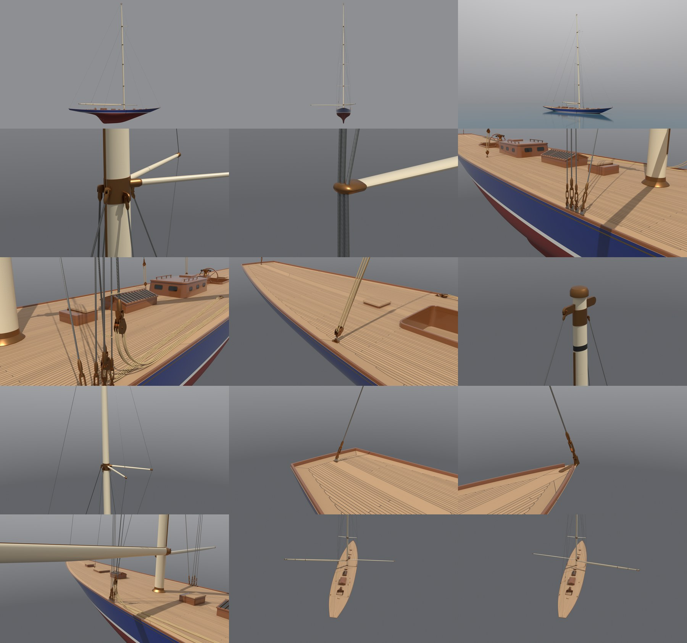
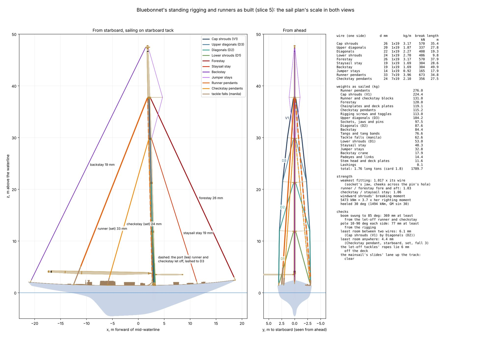

# J-Class 5: Bluebonnet's standing rigging and runners

Slice 5 of *Bluebonnet*, our own J-Class sloop of 1937 (plan and Bean's decisions:
<https://claude.ai/artifact/WdUKp8somgyNJZDyESCgyU>; the hull is slice 1, [docs/jclass-1](../jclass-1/README.md), its
plating, keel and rudder slice 2, [docs/jclass-2](../jclass-2/README.md), its deck slice 3,
[docs/jclass-3](../jclass-3/README.md), and her spars slice 4, [docs/jclass-4](../jclass-4/README.md)). This slice
rigs the mast: the shrouds over the spreaders, the forestay, the staysail stay, the jumper stays, the backstay, and the
running backstays and checkstays on their tackles, each with its fittings down to the chainplates and padeyes on deck.
The runners and checkstays come in two states, set and let off, so the game can show either on each side. Like slices
1 to 4 it is post-slice art: tools and docs only, nothing imported into Unreal or wired into the game yet.

The rigging is drawn in the manner of the Js of 1934-37: galvanised steel wire, poured bronze sockets, bronze rigging
screws and toggles, steel chainplates through the deck, a continuous shroud plan over three sets of spreaders, jumper
stays forward over struts at the hounds, a permanent backstay to the counter, and runners and checkstays set up by
tackles. Every size and fitting is our own.



The renders, left to right in rows of three, all sailing on starboard tack (the starboard runner and checkstay set, the
port pair let off) unless noted: from starboard; from ahead; afloat from the bow quarter; the hounds from aft and
above; a lower spreader's tip with the four shrouds in its grooves; the starboard chainplates and rigging screws; the
let-off port runner and checkstay lashed to the aftermost shroud, their tackles overhauled along the deck; the set
starboard runner's tackle and padeye; the masthead with the backstay's crane aft; the jumper stays over their struts;
the backstay's chainplate on the counter; the forestay at the stem head; the boom squared off to port, 85 degrees, past
the let-off pair; running on starboard tack (boom to port, pole to starboard); and running on port tack (the other way,
the port pair set). Each is in `baseline/` at 1200 pixels wide.



## What slice 5 builds

* **The shrouds, each side:** a cap shroud (V1) from its tang at the hounds over all three spreaders' tips to the deck,
  and three diagonals in line with it: D3 from a tang under the top spreaders over the middle and lower tips, D2 from
  under the middle spreaders over the lower tips, and D1 (the lower shroud) from under the lower spreaders straight
  down. It is a continuous rig: each wire runs unbroken from its tang to its chainplate, in a groove of its own in each
  tip fitting it passes (the diagonals 30 mm either side of the cap shroud), bent there to 8 times its radius. Below the
  lower spreaders the four come down side by side to a row of four chainplates abreast the mast, 0.16 m apart along the
  sheer and 0.14 m in from it, clear of the toe rail.
* **The tangs:** bronze plates off the mast, reaching seven times their wire's radius out from its surface (eight for the
  checkstays', so the set pendant's jaw clears the band below), on bronze bands 0.2 m under each pair of spreaders
  (slice 4's tangs at the hounds take the cap shrouds and the forestay).
* **The forestay** from slice 4's tang at the hounds to a bronze plate let into the stem head, on exactly the line slice
  4 measured I and J on (0.0 mm off it). The plate has a flange bedded on the deck aft of it, which follows the deck's
  sheer and camber and narrows with it, 12 mm inside the deck's edge.
* **The staysail stay** from a tang on the forward face of the top spreaders' band to a deck plate on the centreline at
  x 11.4, between the sail hatch and the fo'c'sle hatch.
* **The jumper stays** from the masthead over the jumper struts' tips to the mast 8 m below the hounds, on small tangs.
* **The backstay** from a new bronze crane aft at the masthead (0.36 m under the truck, reaching 0.3 m past the mast's
  after face, so the backstay clears the mainsail's headboard) to a chainplate on the centreline 0.32 m forward of the
  transom's top. Slice 4's crane is forward, for the spinnaker halyard's block (slice 4's README said aft for the main
  halyard; that was wrong and is corrected there).
* **The running backstays** (runners) from tangs aft on the hounds band, and **the checkstays** from tangs aft on the top
  spreaders' band: each a 7x19 wire rope pendant to a four-part tackle (two double bronze blocks, the standing part on
  the lower block's becket) on a padeye on deck. The runners' padeyes are at x −12.5, 0.3 m in from the sheer, the
  checkstays' at x −6.0, 2.1 m out. Each tang lies in the plane that best takes both its pulls, set and let off (4.6
  degrees off the worse one for the runners, 5.4 for the checkstays). The pendant's jaw at its upper block takes a lug
  the size of a tang for its wire.
* **At every wire's lower end** a bronze rigging screw (a toggle on the chainplate's pin, the studs, the open body, and
  the wire's socket), and at its upper end a poured socket whose jaw straddles the tang on a clevis pin. Where a tang
  reaches further past its pin than the socket behind the jaw starts (slice 4's tangs at the hounds are bigger than
  ours), the jaw is lengthened so the socket clears the plate's end.
* **The chainplates:** galvanised steel straps through the deck to the frames below, under bronze deck plates, their
  pins 0.1 m up the wire's line from the deck. The part below the deck is weighed but not drawn.
* **Every fitting is stronger than its wire** (the build checks it: below).

The wires' lay is drawn, not modelled: every wire vertex carries the same two UV maps as the spars (`Spar`: metres along
the wire and the fraction of the way round; `SparG`: its girth), and the paint draws the outer strands from them, 12 a
1x19 strand going once round in 13 diameters, 6 a 7x19 rope's in 7.5, 3 a manila rope's in 3.4, fading out between 2 and
25 m from the camera. So the strands cost no triangles.

| Wire, one side | Diameter | Construction | Length | Breaking load |
| --- | ---: | --- | ---: | ---: |
| Cap shroud (V1) | 26 mm | 1x19 strand | 35.4 m | 570 kN |
| Upper diagonal (D3) | 20 mm | 1x19 | 27.8 m | 337 kN |
| Diagonal (D2) | 22 mm | 1x19 | 19.3 m | 408 kN |
| Lower shroud (D1) | 24 mm | 1x19 | 9.8 m | 486 kN |
| Forestay | 26 mm | 1x19 | 37.9 m | 570 kN |
| Staysail stay | 19 mm | 1x19 | 28.6 m | 304 kN |
| Backstay | 19 mm | 1x19 | 49.9 m | 304 kN |
| Jumper stay | 14 mm | 1x19 | 17.9 m | 165 kN |
| Runner pendant | 33 mm | 7x19 wire rope | 34.8 m | 673 kN |
| Checkstay pendant | 24 mm | 7x19 | 27.5 m | 356 kN |

Each wire's breaking load is its steel's area (the construction's fill of the circle: 76% for 1x19, 59% for 7x19) at
1,570 MPa, the galvanised improved plough steel of the day, times the share of the wires' strength the rope keeps (90%
and 85%). The standing wires are 1x19, stiff and strong for their size; the runners' and checkstays' pendants are the
more flexible 7x19, as they are let off and taken forward every tack, and each is sized so that it breaks no sooner than
the stay it balances (below).

| Object | Triangles |
| --- | ---: |
| Shrouds (both sides, with their tangs, bands, sockets, rigging screws and chainplates) | 11,384 |
| Stays (forestay, staysail stay, jumper stays, backstay and its crane) | 6,540 |
| RunnerFittings (the four tangs and four padeyes) | 832 |
| Runner.Starboard.Set | 2,508 |
| Runner.Port.LetOff | 8,428 |
| Checkstay.Starboard.Set | 2,508 |
| Checkstay.Port.LetOff | 7,508 |
| **Slice 5, as sailed on one tack** | **39,708** |
| The other tack's four (hidden) | 20,952 |

The plan gives slice 5 250,000; this uses about a sixth of it. The whole model shown is now 411,482 triangles.

## The runners and checkstays

A J's mast is held aft above the spreaders by the runners and checkstays on the windward side, set up hard each tack,
while the leeward pair are let off so the boom and the mainsail can swing out past them. So each runner and checkstay is
built twice, as its own object:

* **Set** (the windward side): the pendant runs straight from its tang toward its padeye and the tackle takes up the
  rest, taut. The runner's blocks are 3.24 m apart, its upper block about 3.5 m above the deck; the checkstay's 1.13 m
  apart.
* **Let off** (the leeward side): the pendant is taken forward and lashed to the aftermost shroud (D3), the runner's
  1.5 m above the deck with the lashing holding the pendant 15 cm aft of the shroud, the checkstay's lower, 0.9 m up and
  15 cm inboard of it, so the checkstay's pendant comes down past the runner's block on the shroud's inboard side and
  neither crosses the other. The upper block hangs head up on the pendant's end, 0.32 m below the lashing, its sheaves
  in the plane of the pendant and the lead aft; the lower block lies on its side at the padeye with its sheaves level,
  so the two blocks' sheaves are at right angles and the parts lead fair. The tackle is overhauled: each of its four
  parts leaves the upper block straight down, hangs to the deck, lies along it in a lane of its own (12 mm between the
  ropes, 6 mm above the planking, the lanes counted inboard from the lead so they keep clear of the shroud's rigging
  screw), and rises to the lower block, entering it along the block.

The pendant is one wire, the same length in both states: let off, it just reaches from its tang to the block hung below
the lashing, so set, the tackle's blocks are as far apart as the pendant leaves them. The tackle's rope is one length in
both too: the let-off parts (61.9 m for a runner, 35.5 m for a checkstay) and 6 m of tail for the winch in slice 7,
weighed but not drawn (67.9 and 41.5 m in all). Each state weighs the same.

The objects are named `Runner.<Side>.<State>` and `Checkstay.<Side>.<State>` (sides Starboard and Port, states Set and
LetOff). The build shows the starboard-tack four (`Runner.Starboard.Set`, `Runner.Port.LetOff`,
`Checkstay.Starboard.Set`, `Checkstay.Port.LetOff`) and hides the others; the game shows one state a side and swaps them
when she tacks (slice 14). On port tack it is the mirror. The renders' `rigging_run_port` shot shows the port-tack set.

The let-off falls lying on the deck are slack rope, drawn as a smooth drape (it hangs over 1.3 times the block's height
above the deck before it lands); they are not simulated.

## The mast's bands and the mainsail's track

The bands round the mast that the track crosses (slice 4's hounds band and three spreader bands, and this slice's three
tang bands) now stop 33 mm either side of the after face, a C round the mast with square ends, so the mainsail's slides
can run up the track past them (slice 6 sets the sail). The build checks a lane for the slides up the whole track, 30 mm
either side of the mast's centre plane and from its after face to 50 mm past it: nothing but the track may cross it or
lie inside it, on either tack (the runners' tang pins are 101 mm and the checkstays' 156 mm off the centre plane).

So slice 4's Mast object changes a little in this slice: its bands are open, and its jumper struts are solved again for
this slice's stay pins (their splay 21.97 degrees, was 22.02; their tilt 0.52, was 0.50). Leaving the bands open took
4.5 kg off the mast: with its fittings it now weighs 6,484 lb, still over the 1937 minimum of 6,400 (the build stops if
it falls under).

## Checks

The same venv as slices 1 to 4 (Python 3.13 with pip `bpy` 5.3, numpy, scipy, matplotlib, pillow); `<venv>/bin/python`
below. Run from the repo root:

```
<venv>/bin/python Tools/shipkit/jclass/build_jclass.py <out>    # jclass.blend, jclass.obj, build.json and six drawings
python3 -I Tools/shipkit/jclass/rule_check.py <out>/build.json
<venv>/bin/python Tools/shapeloop/fairness.py <out>/jclass.blend <out> --object Hull
<venv>/bin/python Tools/shapeloop/fairness.py <out>/jclass.blend <out>/shell --object Shell
<venv>/bin/python Tools/shipkit/jclass/render_jclass.py <out>/jclass.blend <out>/renders --res 1600 --only rigging_profile,rigging_ahead,rigging_afloat34,rigging_hounds,rigging_tip,rigging_chainplates,rigging_lashing,rigging_tackle,rigging_masthead,rigging_jumpers,rigging_counter,rigging_stemhead,rigging_boom_lee,rigging_run,rigging_run_port
<venv>/bin/python Tools/shipkit/jclass/docs_jclass.py <out> docs/jclass-5/baseline --slice 5
```

The build stops before writing anything if any of these fail; `rule_check.py` prints the slice 5 ones and fails a
`build.json` that lacks them.

* **The rule check of this slice: the boom clears the let-off runner and checkstay.** Swung to its full 85 degrees on
  each tack it passes 369 mm from the let-off pair at its least (the limit is 100 mm), with nothing touching. Swung
  through its whole range it stays 541 mm from the rest of the rigging; the spinnaker pole, set 10 to 90 degrees each
  side, stays 77 mm from it (squared off, by the windward shrouds). Both sweeps measure from the swung spar's vertices
  to the rigging's faces and from points every 5 cm along every wire and rope to the spar's faces, so a wire passing the
  middle of a face counts.
* **Every wire and rope has room along its whole length:** each one's centreline is sampled every 5 cm against the faces
  of everything else shown (the hull, the deck and what stands on it, the spars, the other wires and fittings), leaving
  out its own fittings and, within 0.35 m of a spreader's or a strut's tip it passes over, the tip; a tackle's falls
  leave out only their own falls, sheaves and becket, so they are held clear of their blocks' cheeks, heads and pins.
  A sample inside a solid (behind the nearest face, and an odd number of that piece's faces along a ray from it) counts
  as less than no room. Under 3 mm fails. On either tack the least is 4.4 mm, a set checkstay's fall leaving its lower
  block past the cheek; between two wires 6.1 mm, the cap shroud and D2 in their grooves at the lower spreader's tip; to
  the spars 44 mm (a jumper stay by the masthead band); the let-off tackles' ropes lie 6 mm off the deck, as drawn.
* **No fitting crosses anything but by design:** every face of the rigging is tested against the hull, the deck, the
  spars and the rest of the rigging. The allowed contacts are named by the kind of piece: a chainplate or padeye
  through or on the deck (or the stem plate in the stem), and nothing else on deck, not the toe rail or a deckhouse; a
  tang or tang band into the mast's skin or a band on it; a pin through its tang; a wire through a spreader's or a
  strut's tip only within 0.35 m of where it passes over it; a link through its padeye; a lashing round its shroud.
* **The mainsail's slides' lane is clear** on either tack (above).
* **Every fitting is stronger than its wire, and each running stay than the stay it balances** (below); the build stops
  if one is not.
* **Every piece closes:** each of the eleven rigging objects is a closed surface with no open, doubled, flipped or
  degenerate edges, as are slices 1 to 4's pieces.
* **The struts:** the jumper stays' pins stand 35 mm off the mast on small tangs, and slice 4's solve now puts each
  jumper strut on the bisector of the stay's bend between those pins (0.001 degrees off as built; the build stops over
  0.01).
* **The rule:** rating 75.66 ft against the 76 ft limit, every size on its target: PASS.
* **Fairness:** the moulded hull (`Hull`, 17 inflections and 23 kinks) and the finished shell (`Shell`, 14 and 19) are
  unchanged.
* **The earlier slices' renders** show only their own slices' objects, so slices 1 to 3's are unchanged; slice 4's
  would show the mast's open bands (above), and its pages in `docs/jclass-4` are left as that slice built them.

## Strength

**The fittings.** Each fitting is checked against its wire's breaking load, in tension and shear on its weakest
section: the jaw's clevis pin in double shear (at 0.6 of the bronze's breaking stress, 550 MPa for high-tensile
manganese bronze), the jaw's two cheeks across the pin's hole and beyond it (shear out along two planes each, the usual
check for a pin-connected plate), the rigging screw's studs at the thread's root (0.8 of their diameter) and its body's
two bars, and the plate each end pins to (a tang, slice 4's tangs at the hounds, the backstay's crane, a chainplate in
mild steel at 430 MPa, the stem plate, the runner's lug on its upper block) across its hole and beyond it. The weakest
are the jaws' cheeks across the pin's hole and the screws' bars, 1.017 times their wire; slice 4's bigger tangs at the
hounds are well over. Sized this way the fittings weigh two and a half times what they did before the review (about 400
kg in all). The runners' tackles (blocks, padeyes, links and falls) are drawn, not sized: that is slice 7's, with the winches.

**The runners.** Each running stay must hold the stay it balances: the runner the forestay, the checkstay the staysail
stay. The runner's fore-and-aft pull is 0.367 of its tension (it leads steeply down to the counter), the forestay's
0.422, so at breaking the runner's 673 kN gives 247 kN fore and aft against the forestay's 241 (1.03 times); the
checkstay's 356 kN gives 97 kN against the staysail stay's 92 (1.06).

**The shrouds.** A rough check of the windward shrouds: the moment about the centreline at the deck of their breaking
loads (each wire's breaking load times the upright part of its pull, times its chainplate's distance out) is 5,473 kNm,
3.7 times her righting moment heeled 30 degrees (1,494 kNm: her weight times GM times sin 30, the small-angle figure).
That is the right order for a racing yacht's rig of the day, which ran lighter margins than a cruiser's. It is not a
rig analysis: the mast's own bending is not in it.

## Her weight and balance

The rigging is weighed from its own geometry: each wire from its length and its steel's area (steel 7,850 kg/m³), the
manila from its length (860 kg/m³ of the rope's circle), the fittings from their volume (bronze 8,800), the chainplates
with the part hidden below the deck. As sailed on one tack (one runner and checkstay set, the other pair let off):

| Part | kg | Centre x (m) | Centre z (m) |
| --- | ---: | ---: | ---: |
| Cap shrouds (V1), both | 224 | 2.52 | 19.77 |
| Upper diagonals (D3) | 104 | 2.58 | 15.81 |
| Diagonals (D2) | 88 | 2.79 | 11.58 |
| Lower shrouds (D1) | 53 | 3.01 | 6.78 |
| Forestay | 120 | 10.44 | 20.26 |
| Staysail stay | 48 | 6.93 | 15.88 |
| Backstay, and its crane | 84 + 18 | −9.63, 1.53 | 24.89, 47.44 |
| Jumper stays | 33 | 3.48 | 38.54 |
| Runner pendants | 276 | −1.23 | 20.73 |
| Checkstay pendants | 115 | 0.31 | 16.03 |
| Runner and checkstay blocks | 131 | −6.31 | 2.42 |
| Tackle falls (manila) | 63 | −6.82 | 2.21 |
| Tangs and tang bands | 77 | 2.40 | 23.72 |
| Sockets, jaws and pins | 98 | 0.52 | 23.84 |
| Rigging screws and toggles | 113 | 4.28 | 3.00 |
| Chainplates and deck plates; the stem head's | 119 + 12 | 1.92, 18.61 | 1.25, 2.41 |
| Padeyes, links and lashings | 14 | −9.25 | 1.47 |
| **Rigging** | **1,790 (1.76 long tons)** | **0.91** | **15.41** |

**The size card.** Slice 4 left the card's rigging row at 4.5 long tons (x 0.7, z 15.1). It is now two rows: the
standing rigging with the runners and checkstays, 1.8 long tons at x 1.0, z 15.0, which this slice replaces with the
measured 1.76, and the running rigging (halyards, sheets and their blocks: slice 7), 2.7 at x 0.5, z 15.17, chosen so
the two together keep the old row's weight and centre. (The first draft of this slice split it 1.5 and 3.0; the
fittings sized to their wires and the heavier runners took the standing rigging past 1.5.)

| | Slice 4 | Slice 5 |
| --- | ---: | ---: |
| Lead | 93.67 long tons (the casting 93.43 and 0.24 trimming ballast) | 93.71 (the casting 93.43 and 0.28 trimming ballast) |
| Total weight | 156.2 long tons | 156.2 long tons |
| G aft of B | 11 cm | 11 cm |
| Trim by the stern | 9 cm | 9.4 cm |
| GM (stiffness upright) | 1.92 m | 1.92 m |

The rigging came in 0.04 long tons under its row, so the trimming ballast takes 0.04 more. The let-off pair's weight is
1.9 m to one side; the weight check takes fore and aft and height only.

## Sources and licence

* **The rigging's sizes, layout, fittings and colours are our own** for an invented 1937 J, in the manner of the Js of
  1934-37 (continuous rigging over in-line spreaders, jumper stays, a permanent backstay, runners and checkstays on
  tackles; galvanised plough steel, poured bronze sockets, bronze rigging screws). Nothing is traced or measured from a
  real J's rigging plan or photo.
* **The steel's breaking stress** (1,570 MPa for improved plough steel) and the constructions' fill and efficiency are
  textbook round figures for wire rope, not a maker's table; so are the fittings' (550 MPa for high-tensile manganese
  bronze, 430 for mild steel) and the shear rules (0.6 of the breaking stress, two shear planes beyond a pin's hole).
* **No outside assets:** every mesh is generated by the build from `standing_bluebonnet.json`, and the lay is drawn by
  its paint. Nothing needs a licence row until she goes into the game.

## Review

An independent review rebuilt the slice and measured it against this page and the plan before the pull request. It
confirmed the shrouds' paths and grooves, the fittings lined up on their wires, the forestay on slice 4's line, the
backstay, the jumpers, the pendants' and ropes' lengths, the wires' weights and strengths, the two states weighing the
same, the card's split, the ballast, every piece closing, the UVs and the slides' lane. It found seven things, all
fixed before the pull request:

| Found | Fixed |
| --- | --- |
| The let-off tackles' blocks lay flat on the deck and the falls cut through their cheeks; the lashing passed through the pendant's jaw | The upper block hangs head up on the pendant's end below the lashing and the lower block lies on its side, sheaves level, so the parts lead fair; each part leaves its sheave in the sheave's plane and drapes to a lane of its own; the lashing holds the pendant clear of the shroud (15 cm aft for the runner, 15 cm inboard for the checkstay); the falls are now checked against their own blocks |
| The chainplates and their deck plates cut into the toe rail | They are 0.14 m in from the sheer (was 0.06) and 0.16 m apart (was 0.13, as their deck plates grew); a chainplate, padeye or deck plate may now meet only the deck and the shell |
| Several fittings were weaker than their wires | The fittings are resized and the build checks each against its wire (Strength, above) |
| The runner and the checkstay were weaker than the stays they balance | The runner pendant is 33 mm (was 24) and the checkstay's 24 (was 19); the build checks the balance |
| The checks had gaps: a wire might cross a spreader's or a strut's body anywhere, a wire inside a solid passed the room check, the sweeps measured only from the spar's vertices (the pole was 124 mm from D1, not the 136 reported), and the falls were not checked against their own blocks | A wire may meet a tip only within 0.35 m of its pass; the room check finds samples inside solids; the sweeps also measure from points along every wire; the falls are checked against their blocks' cheeks, heads and pins |
| The forestay's deck flange overhung the stem head and crossed the shell, and the rigging screw's jaw was cut for a chainplate, thinner than the stem plate | The flange follows the deck and narrows with it inside its edge; the jaw is cut for the stem plate's real thickness |
| This page claimed a 6 m tail that is not drawn, older tang angles and clearances, and that slice 4's renders were unchanged | Corrected: the tail is weighed, not drawn; the numbers are this build's; slice 4's Mast changed (open bands, struts solved again) |

The stricter checks then caught two more, both fixed: the set checkstay's falls left their lower block 2.5 mm from its
cheek (the sheaves' grooves now stand 4 mm clear of the cheeks, was 2), and on the port side the let-off checkstay's
falls touched D3's rigging screw (the lanes were laid toward the shroud on one side only; they are now counted inboard
from the lead on both, and the lashing holds the checkstay's pendant 15 cm inboard, was 9). The checkstays' tangs reach
eight times the wire's radius, so the bigger set pendant's jaw clears the tang band.

## Known gaps

* **No running rigging and no sails:** the halyards, sheets, the mainsheet's blocks and the winches are slice 7, the
  sails slice 6. The runners' tackles' 6 m tails, for the winches, are weighed but not drawn yet.
* **The let-off falls are drawn slack, not simulated:** one fixed drape per side. In the game (slice 14) they will not
  move with the boat.
* **Only two states each:** set and let off. Easing a runner part way, or the moment of a tack when both are set, are
  the game's.
* **The strength checks are piece by piece** (above): each fitting's weakest section in tension or shear against its
  wire, not bending, fatigue or how the tangs are fixed to the mast; and the shrouds' sum is the windward shrouds'
  breaking moment against a small-angle righting moment, not a rig analysis.
* **The runners' tackles are drawn, not sized:** the blocks, padeyes, links and manila falls have the period's look, but
  a four-part manila tackle is far weaker than the 33 mm pendant it sets up. Slice 7, with the winches, sizes the
  purchase.
* **The weights of the steel's galvanising, the seizings and the leathers** at the spreaders' tips are left out (a few
  kilograms).
* **Slice 1's open design calls are unchanged:** the straight bow (no spoon) and the firm shoulder on the bow's
  topsides wait for Bean.

## Words used here

* **Standing rigging:** the wires that hold the mast up and stay set: shrouds, stays. **Running rigging:** the ropes
  that are worked (halyards, sheets).
* **Shroud:** a wire from the mast to the side. **Cap shroud (V1):** the one from the hounds over every spreader.
  **Diagonals (D1 to D3):** the shorter ones from under each pair of spreaders. **Continuous rigging:** each shroud one
  wire from the mast to the deck, passing over the spreaders' tips, not broken at each tip.
* **Forestay:** the wire from the hounds to the bow that the jib sets on. **Staysail stay:** an inner forestay for the
  staysail. **Backstay:** the wire from the masthead to the stern. **Jumper stays:** the stays over the jumper struts
  that keep the upper mast from bending forward.
* **Running backstays (runners) and checkstays:** stays from high on the mast's after side to the deck, set up on the
  windward side each tack and let off on the leeward side so the boom can swing out.
* **Pendant:** the wire part of a runner, from the mast to its tackle. **Tackle:** two blocks with a rope rove between
  them to multiply the pull (four parts: four times). **Overhauled:** a tackle pulled out to its length, slack. **Fall:**
  the rope of a tackle; its free end is the tail.
* **Tang:** a fitting on the mast that a wire is made fast to. **Socket:** the fitting poured onto a wire's end.
  **Jaw:** its fork round a pin. **Rigging screw (turnbuckle):** the screw at a wire's foot that sets its tension.
  **Toggle:** a hinge under it so it can line up with the wire. **Chainplate:** the strap through the deck the wire's
  foot is made fast to. **Padeye:** a small eye on deck.
* **1x19 strand, 7x19 wire rope:** 19 wires laid up in one strand (stiff), and seven strands of 19 laid round each other
  (flexible). **Lay:** the twist of the strands. **Breaking load:** the pull the wire breaks at.
* **Righting moment:** how hard she pushes back upright when heeled. **GM:** the height that sets it.

## Files

| File | What it is |
| --- | --- |
| `Tools/shipkit/jclass/standing_bluebonnet.json` | this slice's choices: the wires' sizes and constructions, the paint and lay, the fittings' sizes, the shrouds' layout, the stays, the runners and checkstays with their tackles and lashings |
| `Tools/shipkit/jclass/rigging.py` | the shrouds, stays, runners and checkstays with every fitting, their weights, the wires' paths for the checks, the fittings' strength, the runners' balance and the shrouds' strength sum |
| `Tools/shipkit/jclass/spars.py` | the attachment points the rigging needs; bands left open where they cross the track; the slides' lane; the jumper struts solved for the stays' pins |
| `Tools/shipkit/jclass/rig_bluebonnet.json` | the slides' lane; the jumper stays' pins off the mast; the chainplates 0.14 m in from the sheer; the hounds note corrected (the jumpers and the backstay hold the upper mast) |
| `Tools/shipkit/jclass/build_jclass.py` | builds the rigging into the yacht, the wire, rope and lay materials, the wire room (with the inside test), contact and slides' lane checks, the sweeps against each tack's rigging (from the spar and from along the wires), the rigging in the weight check |
| `Tools/shipkit/jclass/specs_bluebonnet.json` | the card's rigging row split into standing (1.8 long tons) and running rigging (2.7) |
| `Tools/shipkit/jclass/rule_check.py` | the boom past the let-off pair, and the rigging's room, contacts and lane, in a slice 5 build |
| `Tools/shipkit/jclass/drawings_jclass.py` | adds the rigging plan |
| `Tools/shipkit/jclass/render_jclass.py` | adds the rigging views, and the tack each shot is sailed on |
| `Tools/shipkit/jclass/docs_jclass.py` | takes `--slice 5` |
| `Tools/shipkit/jclass/sections_jclass.json` | the rigging is a section of its own |
| `docs/jclass-5/baseline/` | this build's stats, fairness checks, drawings and renders |
| `docs/jclass-4/README.md` | its masthead crane is forward, for the spinnaker halyard (it said aft) |
