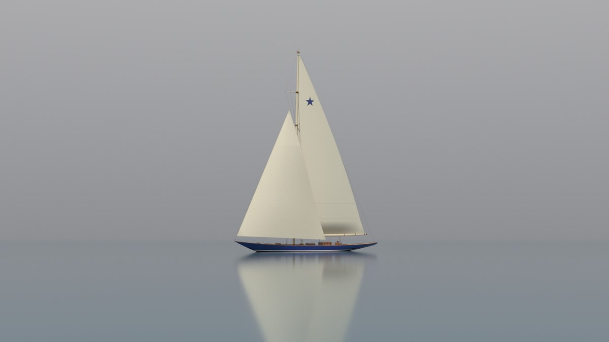
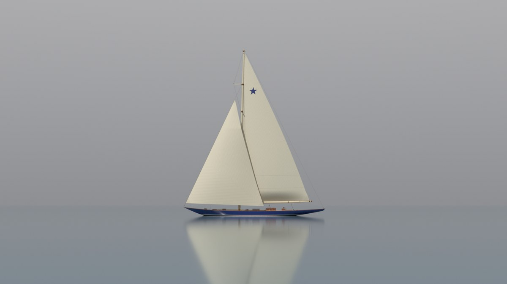
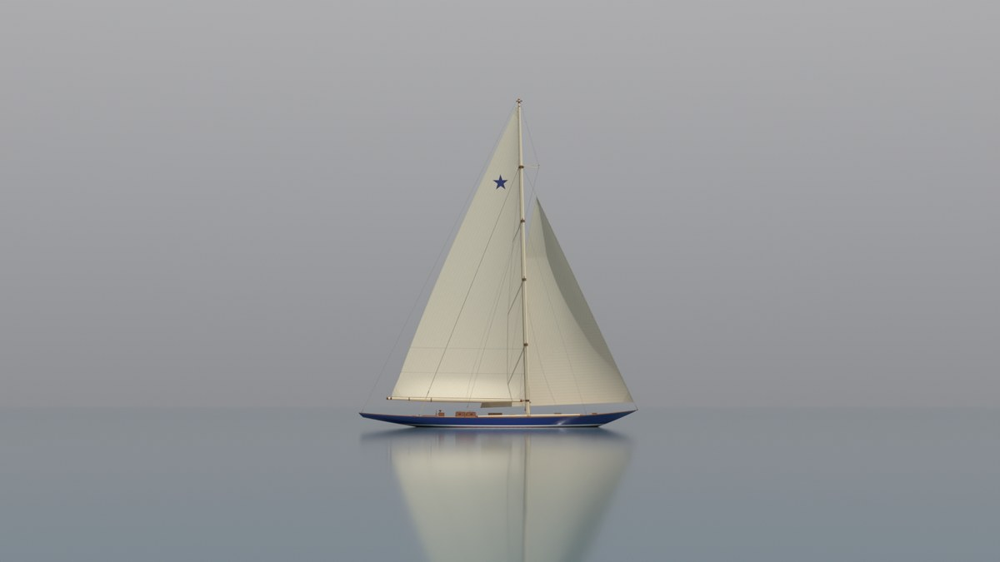
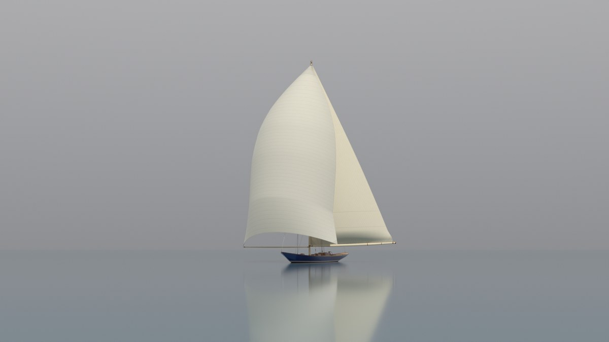
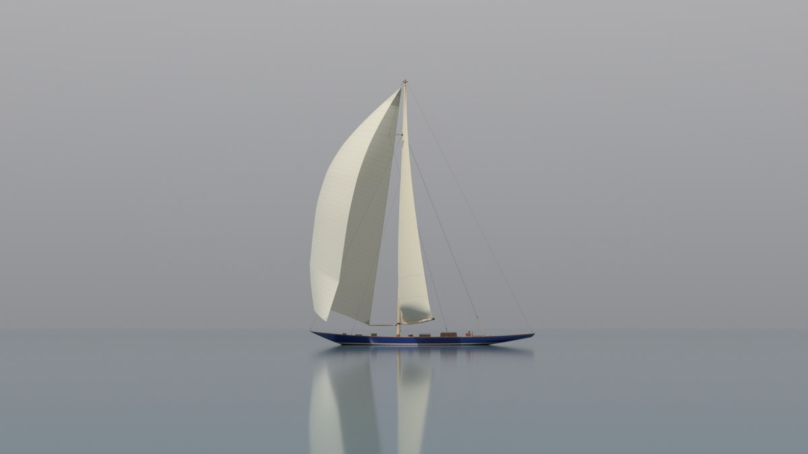
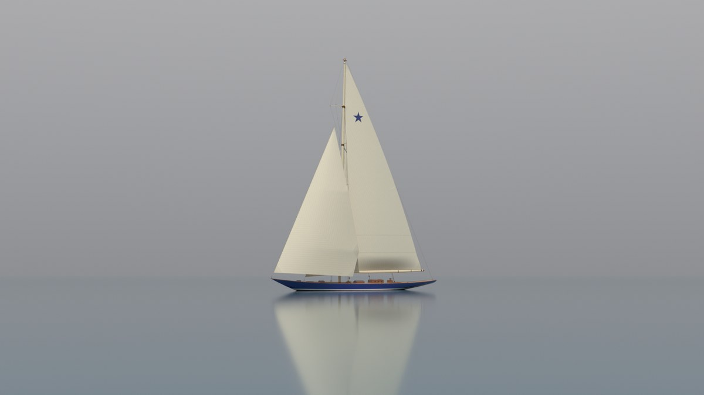
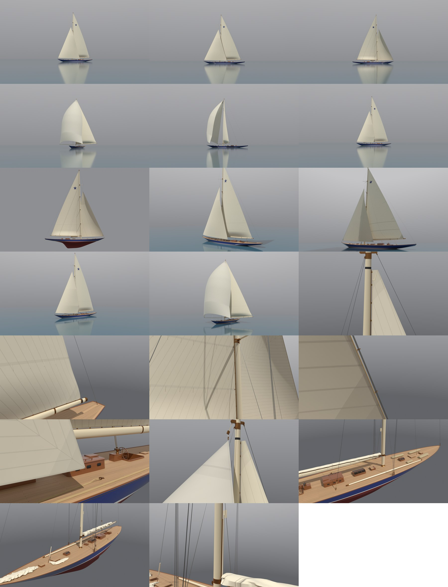
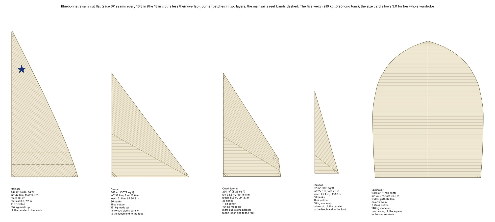
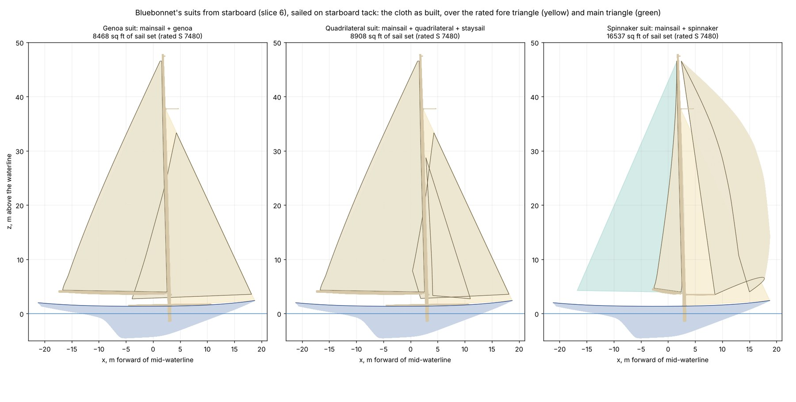

# J-Class 6: Bluebonnet's sails

Slice 6 of *Bluebonnet*, our own J-Class sloop of 1937 (plan and Bean's decisions:
<https://claude.ai/artifact/WdUKp8somgyNJZDyESCgyU>; the hull is slice 1, [docs/jclass-1](../jclass-1/README.md), its
plating, keel and rudder slice 2, [docs/jclass-2](../jclass-2/README.md), its deck slice 3,
[docs/jclass-3](../jclass-3/README.md), her spars slice 4, [docs/jclass-4](../jclass-4/README.md), and her standing
rigging slice 5, [docs/jclass-5](../jclass-5/README.md)). This slice makes her sails: the mainsail, the overlapping
genoa, the quadrilateral jib and the staysail that sets inside it, and the parachute spinnaker, in cream cotton cut the
period's way, with seams, tablings, corner patches and reef points. Each sail comes in its states (set, lowered, flaked
on the boom or bagged on deck), and the states are grouped into the six suits she would show: under main and genoa,
under main, quadrilateral and staysail, under main and spinnaker, moored, and with her headsails hauled down. Like
slices 1 to 5 it is post-slice art: tools and docs only, nothing imported into Unreal or wired into the game yet.

The mainsail carries the Bolivar Roads Yacht Club's star in the hull's blue instead of a sail number, as the plan says.

## Milestone A: the silhouette

The plan's first milestone comes with this slice: she should read as a J from 200 m under main and genoa, and under
spinnaker. Bean reviews these before slice 7 starts. Each is a 50 mm lens at eye height (3 m) over a flat sea, 200 m
off, under a grey sky with the sun high beside or behind the camera.

Under main and genoa, from the lee bow:



Under main and genoa, abeam to leeward and to windward:




Under main and spinnaker, running, from ahead on the lee bow and abeam to leeward:




And under main, quadrilateral and staysail, from the lee bow (not asked for by the milestone, shown for comparison):



What makes her read as a J at that distance, and what we checked against: the very tall, narrow mainsail on a long boom
reaching most of the way to the stern, its foot well above the deck; the low, long hull with long overhangs under it;
the headsail tacked at the stem head, overlapping the mast (the genoa) or in two (the quadrilateral and the staysail);
and a spinnaker 32 m across at its widest, 0.8 of her length overall, set on a 15 m pole. Nothing in these views is
traced from a real J's photograph; the proportions come from slice 4's rated triangles.

## All the renders



The renders, left to right in rows of three: the six 200 m views above; from starboard (orthographic, under main and
genoa); a quarter view from the lee side, high; the mainsail backlit from the lee quarter, showing its seams, patches
and battens against the sun; the quadrilateral suit from the lee bow; the spinnaker suit from the lee bow; the
mainsail's headboard under the black band; its clew at the boom's end, with the first reef band's points and leech
cringle above it; its luff slides on the mast's track; the genoa's hanks on the forestay; the genoa's clew; the
spinnaker's head at its swivel, under its halyard's block; moored (the mainsail flaked on the boom under its ties, the
headsails and spinnaker bagged on deck and the pole lashed down on the side deck); lowered (the mainsail dropped on the
boom, the quadrilateral and staysail hauled down on deck still hanked on); and the lowered mainsail's luff stacked up
the mast's track from the boom to its headboard. Each is in `baseline/` at 1200 pixels wide.





## What slice 6 builds

| Sail | Area | Luff | Foot | Leech | Cloth | Made up |
| --- | ---: | ---: | ---: | ---: | --- | ---: |
| Mainsail | 445 m² (4,789 sq ft) | 42.59 m | 19.28 m | 45.92 m (straight line) | 15 oz cotton | 357 kg |
| Genoa | 342 m² (3,679 sq ft) | 32.85 m | 22.57 m | 31.85 m | 11 oz | 191 kg |
| Quadrilateral | 290 m² (3,126 sq ft) | 32.85 m | 16.84 m | 31.30 m | 11 oz | 164 kg |
| Staysail | 92 m² (993 sq ft) | 27.28 m | 7.31 m | 25.42 m | 11 oz | 58 kg |
| Spinnaker | 1,091 m² (11,748 sq ft) | 47.21 m (each) | 30.48 m | (widest girth 32.00 m) | 2.75 oz | 146 kg |

* **The mainsail** is bent to the mast's track by 48 bronze slides on its luff rope and to the boom's track by 22 on its
  foot (from the start of the boom's track), a slide every 0.9 m. As built, its highest point is 36 mm under the
  mast's black band and its aftmost 60 mm inside the boom's, so it measures inside P and E as the rule requires (slice
  4's black bands are what the rule measured). It has a duralumin headboard 0.3 m wide (narrow enough to clear the
  backstay, which slice 5's crane holds aft for it), a roach of 30 m²
  (1 m at its deepest, 38% of the way up the leech) held by four short ash battens in pockets on the port side, and
  two reef bands at 3.6 and 7.2 m up the luff, each with a cotton reef point every 0.9 m hanging 0.32 m on each face
  and a cringle at each end. Its manila bolt rope runs down the luff and along the foot. The club's star, 2.5 m across,
  is in the hull's blue on both faces, three quarters of the way up and halfway along its row.
* **The genoa** is a big overlapping headsail, 135% of the fore triangle's base (its LP, the shortest distance from the
  clew to the luff, is 20.8 m against J's 15.46). It is hanked to the forestay by 36 bronze piston hanks, its tack
  0.55 m up the stay from the stem head and its head 4.5 m under the forestay's top (below).
* **The quadrilateral jib** is the 1934 Js' double-clewed jib: a big jib with its clew cut off by a line from 17% up
  its leech to a point on its foot 14% of the foot's length from the clew, so it has four sides and two clews, each
  with its own sheet (slice 7). Its LP is 18.1 m, 117% of J. It hangs on the forestay as the genoa does, and is set
  with the staysail.
* **The staysail** is hanked to the staysail stay (slice 5) by 30 hanks, inside the quadrilateral jib.
* **The spinnaker** is a symmetrical parachute spinnaker, its head on a swivel under its halyard's block, which hangs
  on a short pendant from the masthead's forward crane (slice 4); its tack is at the pole's end and its clew free to
  leeward. It is sized from the pole: its foot twice the pole's length and its widest girth 2.1 times, with luffs 3%
  longer than the longer of the two straight lines from the head to its corners as set. It is cut in two halves
  joined down a centre seam with the cloths square to it.

### The states

Every sail is built in each of its states as its own object, named `<Sail>.<State>`:

| Object | What it is | Triangles |
| --- | --- | ---: |
| `Mainsail.Set` | close-hauled on starboard tack, the boom 4 degrees to port | 28,204 |
| `Mainsail.Run` | squared off under the spinnaker, the boom 75 degrees to port | 28,204 |
| `Mainsail.Lowered` | dropped on the boom in loose folds | 4,800 |
| `Mainsail.Flaked` | flaked down on the boom and tied with sail ties | 9,332 |
| `Mainsail.Stack` | the luff slides and the headboard stacked at the foot of the mast's track (with Lowered or Flaked) | 1,712 |
| `Genoa.Set`, `Quadrilateral.Set`, `Staysail.Set` | close-hauled on starboard tack | 22,236; 18,691; 10,113 |
| `Genoa.Lowered`, `Quadrilateral.Lowered`, `Staysail.Lowered` | hauled down in a heap on the foredeck, still hanked to the stay | 6,280; 6,280; 5,112 |
| `Genoa.Bagged`, `Quadrilateral.Bagged`, `Staysail.Bagged` | in its bag on deck | 928; 832; 448 |
| `Spinnaker.Set` | drawing on a run, the pole 70 degrees to starboard | 26,791 |
| `Spinnaker.Bagged` | in its bag on deck | 768 |

The mainsail's Lowered and Flaked objects are in the boom's frame, so they swing with it (each carries the boom's frame
as its `frame` property); everything else is in the hull's frame. The port-tack sails are the mirror image about the
centreline; they are not built separately.

### The suits

A suit is the states shown together, with the boom and the pole posed for them (`build.json` `sails.suits`):

| Suit | Sails | Boom | Pole | Triangles |
| --- | --- | ---: | ---: | ---: |
| Genoa | `Mainsail.Set`, `Genoa.Set` | 4° to port | stowed on deck | 50,440 |
| Quadrilateral | `Mainsail.Set`, `Quadrilateral.Set`, `Staysail.Set` | 4° to port | stowed | 57,008 |
| Spinnaker | `Mainsail.Run`, `Spinnaker.Set` | 75° to port | set 70° to starboard, its car 2 m up the mast | 54,995 |
| Moored | `Mainsail.Flaked`, `Mainsail.Stack`, all four bags | amidships | stowed | 14,020 |
| Lowered | `Mainsail.Lowered`, `Mainsail.Stack`, `Quadrilateral.Lowered`, `Staysail.Lowered` | amidships | stowed | 17,904 |
| Doused | `Mainsail.Lowered`, `Mainsail.Stack`, `Genoa.Lowered` | amidships | stowed | 12,792 |

All suits are sailed with slice 5's starboard-tack runners (the starboard pair set, the port pair let off). The build
saves the `.blend` showing the Genoa suit, with the boom and the pole posed for it and the other states hidden. The plan
gives slice 6 300,000 triangles; the biggest suit uses 57,008 and every state together 170,731. The whole model shown
(Genoa suit) is now 461,922 triangles.

Except under the spinnaker, the pole is unshipped from its car and lashed down on the starboard side deck, as a J's
was: from 4.5 m abaft the waterline's middle to 10.7 m forward of it, 2.05 m out from the centreline (0.43 m inboard
of the deck's edge, outboard of the deckhouses and the bags), resting on its end fittings 5 mm above the deck
(`pole_stowed` in the json; the chocks and lashings are not modelled).

## How the sails are shaped

**The set sails are shaped, not simulated.** Each is a grid of rows parallel to its foot (the spinnaker's square to its
centre seam), and each row is given a camber: its depth as a share of its chord and where along the chord it is
deepest, both varying up the sail, and the rows turn off the wind more toward the head (twist). The close-hauled
mainsail is up to 10% deep with 9 degrees of twist; squared off for the run it is up to 14% deep with 14. The
headsails are up to 12 or 13% deep, set to 6 to 8 degrees of twist from feet trimmed 7.8 (genoa), 8.6 (quadrilateral)
and 13 (staysail) degrees off the centreline; the row-by-row trim below then turns them where the rig needs it. The
numbers are in `sails_bluebonnet.json` under each sail's trim.

**The genoa and the quadrilateral jib are sheeted outside the rigging.** Their leeches reach well abaft the mast, and a
J's chainplates are on the rail, so an overlapping jib cannot pass inside the shrouds: it lies outside them, sheeted to
the rail, against the spreader tips. The staysail is short enough to set inside. Before anything else, each row of a
jib is turned (eased by up to 12 degrees past its trim, or sheeted in as far as the centreline) so it passes between
what must stay inside it (the mast, the windward rigging, the mainsail) and what must stay outside it (the lee shrouds,
for the staysail), and made flatter where it cannot. The rows' angles are then smoothed and never fall from one row to
the next up the sail: a leech twists off steadily, so a row eased past the spreaders eases every row above it as much.
As built:

| Jib | Foot, middle, head (degrees off the centreline) | Rows eased | Most eased |
| --- | --- | ---: | --- |
| Genoa | 8.3, 13.5, 19.5 | all 102 | 7.4 degrees, 71% of the way up (between the middle and the upper spreaders) |
| Quadrilateral | 11.1, 16.4, 17.8 | all 103 | 5.5 degrees, 56% of the way up |
| Staysail | 13.8, 17.1, 20.2 | 19 of 86 (19 sheeted in) | 0.8 degrees |

No row of any jib needed flattening, and a row with no room would fail the build.

**The jibs' heads stop 4.5 m under the forestay's top.** Slice 5's jumper stays come down from the masthead over the
jumper struts to the mast 8 m below the hounds, and about 3 m under the hounds their lower legs pass so close abaft the
forestay that a jib's head there would put its cloth through the lee one. The 4.5 m costs the genoa about 47 m² (half
of 4.5 m times its LP) against a head at the hounds; the rule does not mind, as it measures the triangles, not the
sails.

**Then each set sail is pressed off what it would touch:** the way a genoa lies on the spreader tips or a squared
mainsail on the lee shrouds. Each obstacle is on one side of the cloth, and each point of the grid that is on the wrong
side, or nearer than its clearance (45 mm from the rig, 120 mm from another sail, 60 mm from the deck), is moved along
the cloth's normal until it clears. Each move is spread as a smooth bump at least 0.8 m across, and wider for a bigger
move so the cloth's slope stays under 1 in 4, so the cloth bends round the obstacle rather than creasing. The held
edges never move (the luff and the corners, and the mainsail's foot on its slides), and the cloth eases away from
them over at least 0.1 m instead of breaking at them. As built:

* the close-hauled mainsail moves at most 38 mm, near its head, by the windward runner, checkstay and backstay;
* the genoa 24 mm and the quadrilateral 68 mm (the row-by-row trim has already taken them outside the lee spreader
  tips and shrouds, which they now only brush);
* the running mainsail 0.51 m: it lies on the lee shrouds, spreaders and the let-off runner, which hold it back;
* the staysail and the spinnaker not at all.

The build measures each sail's sharpest turn between neighbouring cells of its grid, as shaped and as pressed, and
fails if the press adds more than 10 degrees to it (a crease rather than a bend). The press adds 1.2 degrees on the
genoa (7.1 to 8.3) and 7.9 on the running mainsail (10.4 to 18.3, where it bends round the let-off runner's tang under
the hounds), and nothing on the others. Next to two held points an obstacle still asks for more than the held point
gives, by design: the spinnaker's head at its swivel under the crane (0.12 m) and the running mainsail's luff by the
runner's tang (0.11 m).

**The spinnaker** is hung from its head, its tack at the pole's end (the pole 70 degrees from the bow to windward, its
car 2 m up the mast) and its clew 11.5 m out to leeward, 15 m forward of the waterline's middle and 4 m above the
water: with the pole squared aft on a run the clew rides forward, under the main's boom end and out to leeward. That
places both its luffs as set within 1% of their cut length (47.09 and 47.09 m against 47.21; the build fails over 1%),
and its foot, by its own shape, passes well ahead of the forestay: no part of the cloth comes within half a metre of a
wire, and the press does not move it. Its girths bulge downwind as circular arcs, the shoulders spread apart and
leaning forward, and the foot lifts 0.3 m in the middle.

## The cloth and its cut

The cloth is one sheet with two faces, its vertices carrying the same three UV maps as the game's sail cloth
(`FSailCloth`, [SailCloth.h](../../Source/SailingSim/Public/SailCloth.h)): UV0 in metres (along the row from the luff,
and up from the foot), UV1 the share along the row and up the sail, and UV2.x the metres left along the row to the
leech, so UV0.x + UV2.x is the row's length, as the game's material takes it. UV2.y carries what the cut needs: on the
mainsail and the headsails the distance in from the leech's straight line (a headsail's mitre seam is where that equals
the height above the foot, UV2.y = UV0.y), on the spinnaker the distance from the centre seam. So the game's
`M_SailCloth` can draw these sails from the same maps when she goes in (slice 14).

The cut is drawn by each sail's material from those maps, with no image textures, so it costs no triangles:

* **The mainsail's cloths run parallel to its leech,** the older "vertical" cut still used on classic yachts: the
  leech's strain runs along the threads, so the cotton does not hollow there as it stretches. A seam every 16.75 in
  (the 18 in cloths less their 1.25 in overlap), each a double band of cloth with two rows of stitching.
* **The headsails are mitre cut:** their cloths run parallel to the leech above a seam bisecting the clew's angle and
  parallel to the foot below it.
* **The spinnaker** is two halves of 36 in light cotton joined down a centre seam, the cloths square to it.
* **Tablings** (the edges turned over) on every side, **corner patches** in two layers at the tack, the clew and the
  head (and the quadrilateral jib's upper clew), each cut straight across its corner, and the mainsail's two **reef
  bands**.
* **The star** on the mainsail.

Each layer of cloth darkens the sail a little in reflected light and a lot against the light: the shader mixes a rough,
sheened cotton with a translucent one whose colour falls with the number of layers, so a backlit sail shows its seams,
patches, battens and the star dark, as cotton does (the `sails_backlit` render). The stitching fades out between 15
and 40 m from the camera. The bolt ropes, slides, hanks, battens' pockets, headboard, reef points, sail ties, bags and
the spinnaker's halyard block are modelled, as closed solids, and the cloth as one sheet with a single rim; the build
checks both for every sail.

The sails' colours are a warm cream for the working sails (sRGB 232, 222, 196), a paler one for the light spinnaker
cloth, and a khaki canvas for the bags.

## Stowed

* **Lowered:** the mainsail dropped on the boom in loose folds, 1 m wide at the mast narrowing to 0.55 m, hanging
  0.22 m below the boom's sides; a headsail hauled down in a heap along the foredeck, still hanked to its stay.
* **Flaked:** the mainsail flaked down neatly on the boom (0.62 m wide narrowing to 0.36 m) and tied with a sail tie
  every 1.6 m.
* **Bagged:** each headsail and the spinnaker in a canvas bag on deck, sized to hold its cloth (its area times its
  thickness) with the air between the folds: the staysail's bag holds 0.14 m³, the quadrilateral's 0.44, the genoa's
  0.52 and the spinnaker's 0.51.
* **The slides' stack:** when the mainsail is down, its 48 luff slides stand stacked on the track above the gooseneck,
  2 mm apart (0.08 m slides pitched 0.082 m), with the headboard on top: 3.96 m of them, about a tenth of the luff.
  The luff's cloth gathered between them is drawn as a smooth roll 9 cm thick just aft of the slides, which stand
  clear of it.
* **The pole** lashed down on the starboard side deck (above).

The heaps and folds are fixed shapes, not simulated cloth.

## Checks

The build stops before writing anything if any of these fail; `rule_check.py` prints the slice 6 ones and fails a
`build.json` that lacks them.

* **The rule of this slice: the sails lie within the measured triangles.** The 1930s rule rated the triangles, not the
  cloth, so the sails must fit inside what slice 4 measured, each measured from the built mesh: the mainsail's
  highest point under the mast's black band (36 mm) and its aftmost inside the boom's (60 mm), so inside P and E; the
  three jibs' highest points under the forestay's hounds (4.28 m under them for the genoa and the quadrilateral, 8.89 m
  for the staysail); and the spinnaker's pole, laid straight forward, reaching no further than J from the mast's face
  (15.40 m with its end fitting, against 15.46). The spinnaker's tack is 0.1 m beyond the pole's end, so the sail
  itself reaches 15.50 m; only the pole is rated, so that is legal. All pass. S stays at the triangles' 7,480 sq ft,
  and the rating at 75.66 ft against the 76 ft limit: PASS.
* **Every suit is clear:** each suit is posed (the boom, the pole) and each of its sails' faces is tested against the
  hull, the deck and what stands on it, the spars (the pole set or stowed), the rigging (starboard tack) and the
  suit's other sails. The allowed contacts are named by kind: the mainsail's luff slides in the mast's track and its
  foot slides in the boom's, a hank round its stay, and a headsail's heap or bag, or the spinnaker's bag, on the deck.
  Nothing else crosses, in any suit.
* **Every free face of a set sail's cloth has room:** at least 10 mm between it and everything else in its suit
  (within 1 m), measured both ways: from points spread over the cloth's faces (each vertex, the edges' thirds and the
  faces' centres) to the other things' faces, and from the other things' vertices to the cloth's faces. The least, by
  suit:

  | Suit | Mainsail | Headsails or spinnaker |
  | --- | --- | --- |
  | Genoa | 30 mm to the let-off runner's pendant jaw; 52 mm to the mast's track (at the head); 348 mm to the boom | the genoa 34 mm to the forestay near its head, 102 mm to the spreader tips |
  | Quadrilateral | as above | the quadrilateral 35 mm to the forestay, 148 mm to the spreader tips; the staysail 38 mm to its stay, 262 mm to the mast, 882 mm to the mainsail |
  | Spinnaker | running, 12 mm to the port runner's pendant tang under the hounds, 38 mm to the mast's track, 348 mm to the boom, 813 mm to the spinnaker's head swivel | the spinnaker 534 mm to the starboard jumper stay (its nearest wire), 244 mm to the pole's end fitting, 913 mm to the mast |

  The stowed suits have no set sail, so only the crossing test applies to them.
* **The pole, stowed, crosses nothing** in the five suits that stow it: it rests 5 mm above the deck, and in the
  Moored suit comes no nearer than 0.27 m to the bags.
* **No set sail is creased by the press** (above): it may add at most 10 degrees to a sail's sharpest turn between
  neighbouring cells.
* **Every sail object is closed:** its cloth one sheet with a single rim (no edge shared by more than two faces, none
  flipped), every other piece a closed solid.
* **Every sail tie goes round the boom:** each tie is drawn round the heap and the boom's section at its station (the
  boom's points within 0.3 m of it), and the build fails if it finds too few of them.
* **The roach clears the backstay** with the boom amidships by 0.30 m at its least (at the head; the limit is 0.28).
* **Every jib row has room** between what must stay inside and outside it (none failed or needed flattening), and **the
  spinnaker's luffs as set are within 1%** of their cut (above).
* **The slides' stack** does not overlap: the slides are pitched at least their own height apart (0.082 m for 0.08 m
  slides, so 2 mm apart).
* **The budget:** 57,008 triangles for the biggest suit against slice 6's 300,000.
* **Fairness:** the moulded hull (`Hull`, 17 inflections and 23 kinks) and the finished shell (`Shell`, 14 and 19) are
  unchanged.
* **Nothing else changed:** apart from the new `sails` section and the triangle counts, this build's `build.json` is
  the same as slice 5's (the hull, the weights, the rig and the rigging, and their checks). The earlier slices' renders
  show only their own slices' objects, so they are unchanged; the boom and the pole render from their own rest frames,
  not from the Genoa suit's pose saved in the `.blend`.

## Her weight

The sails are weighed from their own geometry: each sail's cloth from its area at its weight (ounces to the
sailmaker's yard of 28½ by 36 in), plus a share for tablings, linings, patches and reef bands (15% on the mainsail, 12%
on the headsails, 8% on the spinnaker); its ropes from their lengths; its slides and hanks at a set weight each (0.22
and 0.16 kg); its battens (ash) and headboard (a 6 mm duralumin plate, 10 mm thick in its cloth) from their volumes;
and the spinnaker's halyard block and swivel at bronze's weight.

| Sail | Cloth | Ropes | Fittings | Made up |
| --- | ---: | ---: | ---: | ---: |
| Mainsail | 329 kg | 7 kg | 21 kg | 357 kg |
| Genoa | 180 | 4 | 7 | 191 |
| Quadrilateral | 153 | 4 | 7 | 164 |
| Staysail | 49 | 3 | 6 | 58 |
| Spinnaker | 139 | 4 | 4 | 146 |
| **The five** | | | | **916 kg (0.90 long tons)** |

The size card allows 3.0 long tons for the sails aboard, stowed below when not set. That row stands for her whole
wardrobe (a J raced with spare and light-weather headsails and more than one spinnaker), so it stays the weight check's
estimate and the lead and the trim are as slice 5 left them: 156.2 long tons, G 11 cm aft of B, 9.4 cm by the stern,
GM 1.92 m. The set sails' weight aloft, and how it heels her, is the game's (slice 14).

## Sources and licence

* **The sails' sizes, cuts and colours are our own** for an invented 1937 J, in the manner of the Js of 1934-37.
  Nothing is traced or measured from a real J's sail plan or photo.
* **The quadrilateral jib:** a double-clewed headsail introduced on *Endeavour* in 1934 and used that year by *Rainbow*
  and *Yankee* too, and still carried by the Js racing today (Endeavour's history pages, americascup.com's 1934 page
  and the J Class Association's history, as a web search quotes them in November 2026). Before it, jibs were triangles.
* **The cut:** cotton mainsails cut with the cloths parallel to the leech (Yachting, 1922; T. W. Ratsey's 1894 patent
  lays the weft parallel to the leech and the foot); mitre-cut headsails.
* **The spinnaker:** parachute spinnakers came to the Js in 1934 and grew fast; sources disagree on the biggest (one
  credits *Endeavour II* in 1936 with 18,000 sq ft, a museum record calls *Ranger*'s the largest sail ever made). Ours
  is sized from the pole.
* **The cloth's weights,** the ropes', slides' and hanks' sizes and the finish shares are our estimates.
* **No outside assets:** every mesh is generated by the build from `sails_bluebonnet.json`, and the cut is drawn by the
  materials from the UVs. Nothing needs a licence row until she goes into the game.

## Review

An independent review (a separate session, given the code and the renders but not our conclusions) probed the build
and found seventeen things, the first worst. All are dealt with in this pull request:

| # | Found | Done |
| --- | --- | --- |
| 1 | The spinnaker's foot lay across the forestay and the press pushed it 2.1 m forward into a peak, plain at 200 m. | The clew moved forward and up (above) and the foot lifts in the middle, so the foot clears every wire by more than half a metre by its own shape; the press no longer moves it. |
| 2 | The press made single-point spikes and creases (115 degrees between cells on the genoa by the cap shroud, 96 on the quadrilateral). | Each push is now a smooth bump that widens with the push, the cloth eases away from its held edges, and the build fails if the press adds more than 10 degrees to a sail's sharpest turn. The most it adds now is 7.9 (the running mainsail). |
| 3 | The genoa's and the quadrilateral's twist rose and then fell up the sail; the README quoted the json's targets. | The rows' angles never fall going up; the trim report gives the most-eased row; the table above is as built. |
| 4 | The pole's posed angle had the wrong sign in the build's own pose (latent) and in the suits drawing (the pole drawn aft). | Fixed in both, and the build checks the posed pole's end is under the spinnaker's tack. |
| 5 | The room check measured from the cloth's vertices only, so it overstated the room by up to 60 mm. | Measured over the faces, both ways (the table above). |
| 6 | The rule check's "within the triangles" flags came from the settings, so they could not fail. | Each is measured from the built mesh; the spinnaker's tack beyond the pole is explained. |
| 7 | Four of the eleven sail ties on the flaked mainsail did not go round the boom. | Each tie takes the boom's section at its station; the build fails if it cannot. |
| 8 | The first foot slide sat 0.22 m ahead of the boom's track. | The foot slides start at the track's start (slice 4's report now gives the track's ends). |
| 9 | UV2.x was measured square to the leech's line, not along the row as the game's material reads it (up to 2.6 m off on the quadrilateral). | UV2.x is now the metres along the row to the leech; the distance from the leech's line moved to UV2.y; the material and the cut drawing follow. |
| 10 | The clew render did not show the reef band it was said to show. | Framed wider and higher. |
| 11 | The stowed pole stuck out over the water, 2 m above the deck. | Lashed down on the side deck in every suit but the spinnaker's, and checked clear. |
| 12 | The sail objects' closure was not checked. | Checked for every sail (the cloth one sheet with one rim, every other piece closed); the rule check requires it. |
| 13 | The lowered luff's roll swallowed the stacked slides; "each touching" was wrong. | The roll lies aft of the slides; the slides are 2 mm apart and the README says so. |
| 14 | The spinnaker's head hung under the crane with no block. | A halyard block on a short pendant from the crane, with its piece of halyard to the head. |
| 15 | The bags held about two thirds of the volume claimed. | Each bag's width is solved for its volume; the volumes are quoted. |
| 16 | Wording: 0.8 of her length, not three quarters; the quadrilateral's lower clew; the 12 degrees; the spinnaker's luffs; the mainsail's foot held too; the headboard's thickness and weight; a comment on the stitching's fade; the cut drawing missing the roach's seams. | All corrected; the headboard is weighed as its 6 mm plate. |
| 17 | Small things: the deck contacts allowed too broadly; the held points' asks; one luff slide off its rope on the running mainsail; the bolt rope on the luff's centre line; the baseline missing. | The deck contacts are named sail by sail; the asks are reported (above); the slide and the bolt rope are known gaps (below); the baseline is in this pull request. |

The review also confirmed, from its own probe: the areas, lengths, counts, weights and trim; the sails on the right
sides for starboard tack and the genoa outboard of the shrouds; the hanks clear of the stays; the backstay's room; the
spars posed right in Blender and in every render; every sail solid closed and the cloth free of self-crossings;
fairness unchanged; and `build.json` unchanged from slice 5 apart from the sails.

## Known gaps

* **No running rigging:** the halyards, sheets, tack pendants, the mainsheet and the spinnaker's guy are slice 7, with
  the winches. Until then the sails' corners are where the ropes will be made fast, and nothing holds them there.
* **Starboard tack only:** the set sails are built for starboard tack; port tack is their mirror about the centreline,
  which the game will draw (slice 14), as for slice 5's runners.
* **One trim per suit:** close-hauled under the working sails, a run under the spinnaker. Reaching trims, a reefed
  mainsail (its bands and points are drawn, but no reefed state is built), and the sails luffing or flogging are the
  game's cloth (slice 14), which starts from these shapes.
* **The set sails are shaped and pressed, not simulated,** and the stowed heaps and folds are fixed shapes.
* **The headsails' heads stop under the jumper stays** (above), 4.5 m under the forestay's top. A real J's jib may have
  gone higher with the jumpers set up differently; ours are slice 5's.
* **The sails' weight is checked, not used:** the card's 3.0 long tons stays (above).
* **The stowed pole rests on its end fittings:** the chocks and lashings that would hold it are not modelled, and
  its car stays on the mast where slice 4 put it.
* **The spinnaker's halyard** runs only from its block to the head; its fall down the mast is slice 7's.
* **Small things left:** one luff slide on the running mainsail sits 13.5 mm off its bolt rope 29.6 m up, where the
  luff curves away from the track; every slide sits 1 mm behind its track's face rather than astride it; and the bolt
  ropes are centred on the edges, where a sailmaker sews them to one side.
* **Slice 1's open design calls are unchanged:** the straight bow (no spoon) and the firm shoulder on the bow's
  topsides wait for Bean.

## Words used here

* **Mainsail:** the sail abaft the mast, on the boom. **Headsail (jib):** a sail forward of the mast, on a stay.
  **Genoa:** a big headsail that overlaps the mast. **Quadrilateral jib:** a four-sided jib with two clews.
  **Staysail:** a smaller headsail on an inner stay. **Spinnaker:** a big, light, ballooning sail for sailing
  downwind, set on a pole.
* **Luff:** a sail's front edge. **Leech:** its back edge. **Foot:** its bottom edge. **Head, tack, clew:** its top,
  front bottom and back bottom corners. **Roach:** the curve of a mainsail's leech beyond the straight line, held out
  by **battens**. **Headboard:** a stiff plate in the mainsail's head.
* **Slides:** fittings on the mainsail's edge that run in a track on the mast and the boom. **Hanks:** clips that hold
  a jib's luff to its stay. **Bolt rope:** a rope sewn along a sail's edge.
* **Reef:** making the mainsail smaller by lowering it partway and tying the spare cloth along the boom with the **reef
  points**; the **cringles** are the eyes at each end of the reef band.
* **Camber (depth):** how deep a sail's curve is. **Twist:** how much more the head stands off than the foot.
  **Sheeted outside:** the sheet leads to the rail outside the shrouds. **LP:** the shortest distance from a jib's
  clew to its luff; with **J** (the fore triangle's base) it says how much it overlaps.
* **Cloths:** the strips of sailcloth a sail is sewn from. **Seam:** where two cloths overlap and are stitched.
  **Tabling:** an edge turned over and sewn. **Mitre cut:** a headsail whose cloths change direction at a seam from
  the clew.
* **Flaked:** folded neatly back and forth on the boom. **Doused:** a headsail taken down.
* **P, E, I, J:** the rule's measured lengths: the mainsail's luff and foot, and the fore triangle's height and base.

## How to run

The same venv as slices 1 to 5 (Python 3.13 with pip `bpy` 5.3, numpy, scipy, matplotlib, pillow); `<venv>/bin/python`
below. Run from the repo root:

```
<venv>/bin/python Tools/shipkit/jclass/build_jclass.py <out>    # jclass.blend, jclass.obj, build.json and eight drawings
python3 -I Tools/shipkit/jclass/rule_check.py <out>/build.json
<venv>/bin/python Tools/shapeloop/fairness.py <out>/jclass.blend <out> --object Hull
<venv>/bin/python Tools/shapeloop/fairness.py <out>/jclass.blend <out>/shell --object Shell
<venv>/bin/python Tools/shipkit/jclass/render_jclass.py <out>/jclass.blend <out>/renders --res 1600 --only sails_200m_genoa,sails_200m_genoa_abeam,sails_200m_genoa_windward,sails_200m_spin,sails_200m_spin_abeam,sails_200m_quad,sails_profile,sails_lee34,sails_backlit,sails_quad34,sails_spin34,sails_head,sails_clew,sails_luff,sails_hanks,sails_genoa_clew,sails_spin_head,sails_moored,sails_lowered,sails_stack
<venv>/bin/python Tools/shipkit/jclass/docs_jclass.py <out> docs/jclass-6/baseline --slice 6
```

The build takes about two minutes on the cloud's CPU, and the twenty renders about ten more.

## Files

| File | What it is |
| --- | --- |
| `Tools/shipkit/jclass/sails_bluebonnet.json` | this slice's choices, each with its note: the cloths, the grid, the press's clearances, the ropes, the mainsail (its fit to the bands, headboard, roach and battens, reefs, slides, star, trims and stowing), the headsails (hanks, tacks and heads, clews, trims, heaps and bags), the spinnaker, the pole stowed on deck, and the suits; the sources |
| `Tools/shipkit/jclass/sails.py` | builds every sail in each state: the planforms, the rows' trim, the jibs' row-by-row trim between the rig's sides, the press, the spinnaker's shape, the stowed heaps, folds and bags, the slides, hanks, battens, headboard and ropes, the UVs, the weights, and the checks above |
| `Tools/shipkit/jclass/sail_materials.py` | the sails' materials in Blender: the cut (seams, tablings, patches, reef bands, the star) drawn from the UVs, layered for backlight; the heap, bag and line materials |
| `Tools/shipkit/jclass/build_jclass.py` | builds the sails into the yacht, poses each suit (the pole set or stowed) and checks it (crossings, the cloth's room over its faces, the stowed pole), checks each sail's closure, saves the Genoa suit, and writes the sails' report |
| `Tools/shipkit/jclass/rule_check.py` | the sails within the measured triangles, every suit clear, the stowed pole clear and no set sail creased, in a slice 6 build |
| `Tools/shipkit/jclass/spars.py` | reports where the boom's track starts and ends (for the foot slides) |
| `Tools/shipkit/jclass/drawings_jclass.py` | adds the sails cut flat and the three sailing suits |
| `Tools/shipkit/jclass/render_jclass.py` | adds the sails' views (Milestone A's at 200 m), each posing its suit's spars |
| `Tools/shipkit/jclass/docs_jclass.py` | takes `--slice 6` |
| `Tools/shipkit/jclass/sections_jclass.json` | the sails are a section of their own |
| `docs/jclass-6/baseline/` | this build's stats, fairness checks, drawings and renders |
