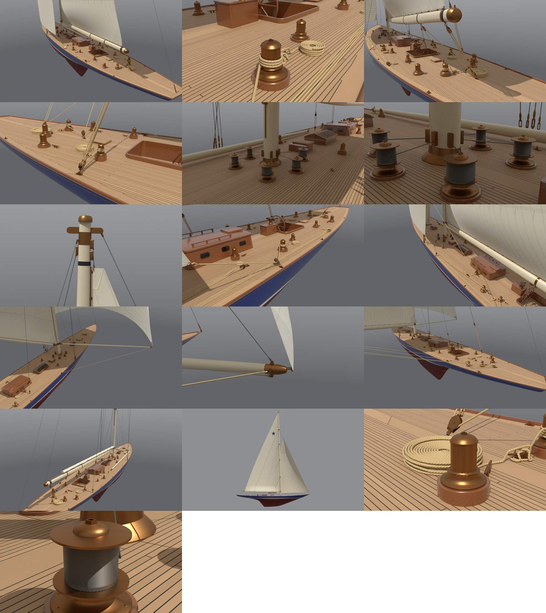
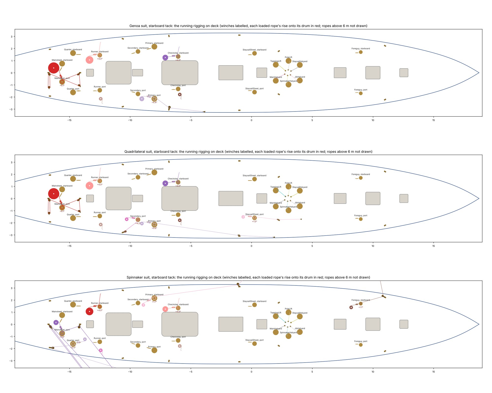

# J-Class 7: Bluebonnet's winches and running rigging

Slice 7 of *Bluebonnet*, our own J-Class sloop of 1937 (plan and Bean's decisions:
<https://claude.ai/artifact/WdUKp8somgyNJZDyESCgyU>; the hull is slice 1, [docs/jclass-1](../jclass-1/README.md), its
plating, keel and rudder slice 2, [docs/jclass-2](../jclass-2/README.md), its deck slice 3,
[docs/jclass-3](../jclass-3/README.md), her spars slice 4, [docs/jclass-4](../jclass-4/README.md), her standing
rigging slice 5, [docs/jclass-5](../jclass-5/README.md), and her sails slice 6, [docs/jclass-6](../jclass-6/README.md)).
This slice puts the winches on her deck and leads the ropes that work the sails: 22 bronze winches on teak pads (16
capstans for rope in three sizes, each with its horn cleat, and 6 reel winches for the wire halyards), the lead blocks
on their padeyes, the halyards' sheave boxes on the mast, and in each of slice 6's six suits the sheets, the guy and
foreguy, the mainsheet's tackle, the halyards and the runners' and checkstays' tails, each led through its blocks to its
winch, turned three times round the drum, hitched on its cleat and flemished down on the deck. Like slices 1 to 6 it is
post-slice art: tools and docs only, nothing imported into Unreal or wired into the game yet.

The winches went through the part detail loop as their own part; their card is [winch.md](winch.md).



The renders, left to right in rows of three, all on starboard tack (the sheets to port, the starboard runner and
checkstay set): the after deck under main and genoa, from the port quarter, high; the port primary with the genoa
sheet's three turns, its hitch on the cleat and its coil; the mainsheet's four-part tackle from the boom's after bands
to the counter, and its fall to the port mainsheet winch; the starboard runner's tackle with its fall led to its winch
on its pad and the tail coiled down; the six reel winches round the mast's foot, each wire led from its box on the
mast; the reels closer; the masthead from port (the main halyard's box and the topping lift's on the after
face, the halyard down to the headboard); the genoa sheet from the clew through its lead block on the port rail to the
primary, with the let-off runner and checkstay along the deck; the quadrilateral suit's three sheets from the port
quarter; under the spinnaker from the windward quarter, high (the guy, the foreguy and the pole's lift); the pole's end
with its four eyes, the tack lashed to the forward one; the run from the lee quarter (the spinnaker sheet to the port
quarter winch, the mainsheet eased with the boom squared off); moored (the topping lift holding the boom, the halyards
hauled aloft); from starboard (orthographic); and the part card's two views, an idle capstan (the starboard mainsheet
winch) and an idle reel (the topping lift's). Each is in `baseline/` at 1200 pixels wide.



## What slice 7 builds

### The winches

| Winch | Size | Where (x, y from the waterline's middle) | Pad | Works |
| --- | --- | --- | ---: | --- |
| Primary, a pair | large capstan | -8.0, ±2.15 m (by the cockpit, abreast the wheel box) | 0.09 m | the genoa sheet, the quadrilateral's lower sheet, the spinnaker's guy |
| Secondary, a pair | medium | -9.35, ±1.75 | 0.05 | the quadrilateral's upper sheet |
| Staysail sheet, a pair | medium | 0.25, ±1.6 | 0.15 | the staysail sheet |
| Checkstay, a pair | medium | -6.04, ±1.34 | 0.15 | the checkstay's tackle fall |
| Runner, a pair | medium | -12.50, ±1.45 | 0.15 | the runner's tackle fall |
| Mainsheet, a pair | large | -15.6, ±0.75 | 0.12 | the mainsheet's fall (the lee one) |
| Quarter, a pair | large | -14.7, ±1.62 | 0.06 | the spinnaker sheet |
| Foreguy, a pair | small | 9.0, ±1.7 | 0.08 | the spinnaker pole's foreguy |
| Six reels round the mast | reel | 2.0 to 3.98, ±0.64 to ±0.98 | 0.04 | the main, headsail, staysail and spinnaker halyards, the pole's lift and the boom's topping lift |

The sizes, features and triangles of each winch are on the part card ([winch.md](winch.md)): a large capstan's drum is
220 mm across and 250 mm high, a medium's 164 by 190, a small's 120 by 140, each drum about 7 to 9 times the diameter
of the ropes it works; a reel's barrel is 140 mm with 360 mm flanges. Each pad is let 4 mm into the deck and stands as
high as its winch needs for its loaded rope to rise onto the drum's bottom turn (the checks below); the
runners' and checkstays' winches stand on pads about 0.15 m high, each where its fall leaves slice 5's lower block
(about 0.28 m up) square to the sheave's axle and rises 4 degrees onto the drum.

### The blocks and the boxes

* **Lead blocks** in bronze, each hanging by a galvanised link from a padeye on deck (the padeyes fixed, the block
  swinging on its link to lie along its rope's pulls, its sheave in their plane): the genoa's lead block on the rail at
  -6.8 m, a rail block at -1.0 m (the quadrilateral's lower sheet to leeward, the spinnaker's guy to windward), the
  quadrilateral's quarter block at -10.6 m for its upper sheet, the staysail's lead block at 2.25 m, the spinnaker
  sheet's quarter block at -16.6 m and the foreguy's lead block at 11.0 m, a pair of each; and the mainsheet's two deck
  blocks on the centreline of the counter at -16.72 and -14.12 m, the after one with a becket for the standing part.
  Each padeye's eye is turned along the mean pull on it over the suits.
* **The mainsheet's boom blocks** hang from eyes under the boom's two after bands, and a third eye on top of the boom's
  end cap takes the topping lift (slice 4's boom gains the three eyes).
* **The halyards' sheave boxes:** the halyards run inside the mast, so each has a bronze box aloft where it comes out
  (on the mast's after face for the main halyard and the topping lift, the forward face for the rest) and another
  0.38 m above the deck where it comes out at the foot, turned to face its reel so the wire leaves the sheave square.

### The ropes in each suit

The ropes are manila (the sheets 20 to 28 mm, the guy 26, the mainsheet 26, the foreguy 18) and the halyards and lifts
flexible 7x19 galvanised wire (11 to 16 mm). Each is one tube along its centreline with the lay drawn by its paint. In
each suit only the ropes and blocks in use are drawn:

| Suit | Sheets and guys | Halyards in use | Always |
| --- | --- | --- | --- |
| Genoa | the genoa sheet (port) through its lead block to the port primary | main, headsail | the mainsheet; the starboard runner's and checkstay's falls on their winches, the port pair's cast off |
| Quadrilateral | the lower sheet through the rail block to the port primary; the upper sheet through the quarter block to the port secondary; the staysail sheet through its lead block to the port staysail winch | main, headsail, staysail | as above |
| Spinnaker | the sheet through the port quarter block to the port quarter winch; the guy from its eye on the pole's end fitting through the starboard rail block to the starboard primary; the foreguy from under the pole's end through its lead block to the starboard foreguy winch; the tack lashed to the pole's tip | main, spinnaker, the pole's lift | as above, the mainsheet eased with the boom 75 degrees to port |
| Moored, Lowered, Doused | none | the topping lift, holding the boom | as above |

* **The sheets** are shackled to their sails' clews (slice 6's cringles) and the guy and foreguy to their eyes on the
  pole's end fitting; each runs through its block to its winch, rises onto the drum's foot, takes three turns up the
  drum (clockwise, seen from above), leaves the top turn level for a hand's breadth and goes down to its horn cleat,
  where it is made fast: in beside the cleat and under the far horn, a turn round the base, a figure of eight over the
  horns and a locking turn, each crossing a diameter above the one under it, so the rope never passes through itself
  or the cleat; the rest of its cut length is flemished down on the deck where the hitch's tail ends.
* **The mainsheet** is a four-part tackle: its standing part on the after deck block's becket, up round the after boom
  block, down round the after deck block, up round the forward boom block, down round the forward deck block and its
  fall aft to the lee mainsheet winch. It is cut 112 m long, enough to square the boom off to 75 degrees on a run;
  close-hauled, 95 m of it lies in its coil.
* **The halyards** are wire from the sail's head over the box aloft, down inside the mast, out over the box at its
  foot and onto its reel, which stores the wire the hoist does not use (from a metre above the deck to the box aloft:
  from 19.9 m for the pole's lift to 44.6 m for the topping lift). The main halyard is shackled through the headboard,
  the headsail halyards to their heads' cringles, the spinnaker's halyard comes from the head's block under the crane
  (slice 6's) into the mast, the lift to the eye on top of the pole's end and the topping lift to the boom's end cap.
  A halyard out of use is hauled up to its box aloft, its shackle hanging closed under the sheave, clear of the sails.
* **The runners' and checkstays' tails:** each tackle's fall (slice 5's) leaves its lower block's second sheave
  inboard, square to the axle, to its winch on its pad; on the let-off side it is cast off its winch and lies along
  the deck from the block to its coil. Their lengths are slice 5's: the falls with the tackle overhauled, and a tail
  allowance.
* **The coils:** each tail runs on from the hitch's end along the deck into its coil, flemished down as a flat spiral
  (clockwise seen from above) from its outer turn, at most 0.45 m out, in to a 50 mm eye, then back out on top, a
  rope's diameter higher each layer. The coil lies just beyond where the tail ends, on the side its spiral comes round
  from, so the rope runs on into the outer turn in a smooth curve; where something else is on deck there (a plan mask of
  everything else in that suit), it moves to the nearest free spot. The mainsheet's close-hauled coil is the biggest, 0.9 m across in 5
  layers.

### The triangles

| Object | What it is | Triangles |
| --- | --- | ---: |
| `Winches` | the 22 winches on their pads and the 16 cleats | 156,736 |
| `RunningFittings` | the lead blocks' padeyes, the halyards' boxes and each halyard's wire from its foot box to its reel | 4,540 |
| `Running.Genoa` | that suit's ropes, blocks, shackles, turns, hitches and coils | 161,680 |
| `Running.Quadrilateral` | | 192,008 |
| `Running.Spinnaker` | | 173,048 |
| `Running.Moored`, `.Lowered`, `.Doused` | | 139,652 each |

The plan gives slice 7 400,000 triangles; a suit shows the winches, the fittings and its own ropes, 300,928 for the
stowed suits and 353,284 at most (the quadrilateral's). The ropes' turns, hitches and coils are most of each suit's
count (a coil is a long tube); the game's own rope drawing will make its own. The whole model shown under main and
genoa is now 785,242 triangles, against 2,250,000 for slices 1 to 7.

## Checks

The build stops before writing anything if any of these fail; `rule_check.py` prints the slice 7 ones and fails a
`build.json` that lacks them.

* **Every rope has room along its length:** each rope's centreline is sampled every 50 mm (closer for a thin rope:
  every 1.8 times its radius and the margin) and at every vertex, and measured to everything shown in its suit within
  0.12 m (the hull and deck, the spars posed, the rigging, the suit's sails, the winches, the fittings and the other
  ropes), leaving out only what that piece of it may touch by design: its own blocks' sheaves and cheeks where it runs
  through them (a part of the mainsheet also the block it leaves and the after block's becket), its drum, its cleat
  where it is hitched (measured on its own, below), the mast it runs into, the deck under its coil, a sail's corner
  where it is shackled. The gap must be at least 3 mm. The least, in every suit, is 4.5 mm, where a tail comes down
  onto the deck beside its cleat; aloft, the halyards keep 37.5 mm or more off the mast and the stays (the headsail
  halyard 37.5 mm off the forestay near its shackle), and at the foot their wires keep 9 to 11 mm off the mast's skin
  on their way to the reels.
* **Every rope is clear of itself:** each rope's centreline, resampled every 3 mm, is measured segment to segment
  against itself, leaving out the parts within four diameters of each other along it; they must be a diameter apart,
  less 1 mm at most. All are clear, in every suit: the turns on the drums, the hitches' crossings, the coils' turns and
  layers and the mainsheet's parts. The closest is 0.26 mm clear, where the starboard checkstay's fall runs into its
  coil.
* **Every hitch is clear of its cleat:** the room check lets a hitch touch its own cleat, so each hitch is also
  measured to the winches and cleats with nothing left out, and may not come into them: the least is 0.9 mm.
* **No kinks:** away from the sheaves, the drums, the hitches and the coils, no rope may turn more than 60 degrees
  over three of its diameters; the most is 39 degrees, where the mainsheet's tail goes down from its drum's top turn
  to its cleat.
* **Every lead settles:** each lead is found by repeating its solve (the blocks swing on their links, the drum's
  entry moves, the shackle turns) until it stops moving; each of the 55 must move less than 0.5 mm on its last pass,
  and the worst moves less than a ten-thousandth of a millimetre.
* **No fitting crosses anything:** every face of the winches, pads, cleats, padeyes, boxes, blocks, links and shackles
  is tested against every other object in the suit. The allowed contacts are named by kind: a pad, padeye or cleat on
  the deck, a halyard box in the mast's skin, a block's link through its own padeye or a spar's eye, a shackle in its
  own block's becket (the mainsheet's), and a shackle or lashing at a sail's corner (in the cringle, or within 25 mm of its ring, 0.1 m of a headboard).
  Nothing else crosses, in any suit; the farthest a corner's shackle reaches past its ring is 16 mm (on the
  quadrilateral jib, where the cloth is drawn whole up to the ring).
* **The mainsail's slides keep their lane:** in each suit nothing of the winches, the fittings, the ropes or their
  blocks comes into the lane the luff slides need up the mast's track (30 mm each side of it, 50 mm out, from 2.5 m to
  45.1 m up the track), but the main halyard and its shackle, which ride up the lane above the headboard, ahead of the
  slides.
* **Every lead is fair:** each loaded rope rises onto its drum's foot by 0 to 12 degrees, so the turns climb the drum
  rather than ride over each other (as built, 0.6 to 7.8 degrees: the most is the mainsheet's on the run); and each part
  meets each sheave within 4 degrees of the sheave's plane (the blocks swing on their links, so all are within 0.1 of
  a degree), or within 8 degrees at a halyard's box aloft, whose sheave is fixed in the mast while the sail's head swings (the main halyard 6.9 degrees on
  the run). One lead is exempt, with its reason in the json: the pole's lift leaves its box on the mast's forward face
  36 degrees off the sheave's plane with the pole squared to starboard (a known gap, below).
* **Every running object is closed:** the winches, the fittings and each suit's ropes are closed solids.
* **The budget:** 353,284 triangles at most against slice 7's 400,000.
* **The weights:** the running rigging is weighed from its geometry and replaces the size card's estimate (below); the
  winches and cleats must weigh no more than the card's 3.5 long tons for winches and deck hardware.
* **Fairness:** the moulded hull (`Hull`, 17 inflections and 23 kinks) and the finished shell (`Shell`, 14 and 19) are
  unchanged.

## Her weight and balance

| Part | Weight | Centre (x, z) |
| --- | ---: | --- |
| Blocks, padeyes and boxes (bronze; the links galvanised), both sides' | 283.6 kg | -5.14, 5.94 m |
| Shackles, both sides' | 11.2 kg | 2.80, 7.80 m |
| Rope: the sheets, guy, foreguys and mainsheet at their cut lengths, both sides' | 198.1 kg | -10.31, 1.66 m |
| Wire halyards: each on its reel, at its foot, inside the mast and hauled up aloft | 273.1 kg | 2.46, 21.91 m |
| **The running rigging** | **766 kg (0.754 long tons)** | -3.65, 10.55 m |
| Winches (bronze, hollow round their gears: 42% of solid) | 983.2 kg | |
| Their teak pads | 176.0 kg | |
| Cleats | 44.4 kg | |
| **The winches and cleats** | **1,204 kg (1.19 long tons)** | -6.09, 1.70 m |

The size card allowed 2.7 long tons for the running rigging, centred 15 m up. As built it weighs 0.754, so, as for the
deck, the spars and the rigging before it, the trimming ballast in the bilge takes up the difference: 1.946 long tons
more (2.227 in all, 1.65 m below the waterline), the lead 95.66 long tons, and she still floats on her lines at 156.2
long tons. Moving that weight from aloft to the bilge stiffens her: G drops from 1.13 to 1.36 m below the waterline,
GM rises from 1.92 to 2.15 m, and she trims 12 cm by the stern (9.4 before). Her righting moment heeled 30 degrees rises
to 1,674 kNm, so the windward shrouds' breaking moment is now 3.27 times it (3.66 before).

The winches and cleats are checked, not yet counted: they weigh 1.19 long tons, inside the card's 3.5 for the winches
and the deck hardware together, and slice 8 (the rest of the deck hardware) replaces that estimate with the measured
whole.

## Changes to earlier slices

Slice 7 needed some fittings the earlier slices did not have. Their reports and weights in `build.json` change with
them; their own docs pages and renders are not redone.

* **Slice 4's spars:** the boom gains the two mainsheet eyes under its after bands and the topping lift's eye on its
  end cap (2.4 kg); the spinnaker pole's end fitting gains four eyes (2.2 kg): the lift's on top of its sleeve, the
  foreguy's under it, the guy's on its after side, and at its tip, on the forward side toward the sail, the eye the
  spinnaker's tack is lashed to. Stowed on deck, the pole now rests on the foreguy's eye, 56 mm higher than slice 6 had
  it, and still clear of the deck by 5 mm.
* **Slice 5's runner blocks:** the bridge across each block's head is cut back clear of the rope where it wraps round
  the sheaves (the tails are drawn round them now), 4.4 kg lighter over the 68 pieces, and the report gives the sheave
  each fall leaves from.
* **Slice 6's sails:** the cringles at each sail's corners are reported (with the headboard's hole for the main
  halyard's shackle and the spinnaker's halyard block), so the ropes can be shackled to them; the short piece of the
  spinnaker's halyard from its block to its head is now wire, as the rest of it; the flaked mainsail's ties, drawn round
  the boom's section at each, change with the boom's new eyes (84 triangles fewer).
* **Slice 2's ballast:** the trimming ballast takes the running rigging's difference (above); the lead's casting is
  unchanged.

## Sources and licence

* **The winches, blocks and leads are our own** for an invented 1937 J, in the manner of the Js of 1934-37: bronze
  capstans with ribbed drums turned by loose handles, reel winches for wire halyards, internal wire halyards,
  runners and checkstays on tackles. *Ranger* (1937) is said to have carried 27 winches (as a web search quotes the
  histories in November 2026); we carry 22. No self-tailing winches (they came decades later), and no winch is copied
  from a maker's catalogue: there was none in reach to measure (the part card says how its checks stand).
* **No outside assets:** every mesh is generated by the build from `running_bluebonnet.json`. Nothing needs a licence
  row until she goes into the game.

## Review

An independent review read the code and the build before this went up and found twelve things; all are fixed or
listed.

| # | What the review found | What changed |
| ---: | --- | --- |
| 1 | Every drum wound anticlockwise seen from above, though the docs said clockwise: the hull's frame (x forward, y to starboard, z up) is left-handed seen from above, and the winding code treated it as right-handed | Fixed: the drum entries, the turns and the coils now wind clockwise seen from above. The runners' and checkstays' winches moved to suit (each fall now meets its drum on the other side) and stand on 0.15 m pads instead of 0.27 m plinths. |
| 2 | The mainsheet passed through itself at its blocks, and its solve flipped between two states without settling | Fixed: a rope round a sheave takes the open way round (the arc away from both its leads), the mainsheet's solve is damped, and every lead's solve must now settle to 0.5 mm or the build stops (each one's last move is in `build.json`). The "3.0 degrees" at the mainsheet's forward blocks was this flip, and is gone. |
| 3 | Every cleat hitch passed through itself | Fixed: the hitch is rebuilt: the standing part comes in beside the cleat and under the far horn, then a turn round the base, a figure of eight and a locking turn, each crossing a rope's diameter and 2 mm above the one under it, climbing only beside the horns. Tried on every cleat size with every rope it takes and five angles of lead, it clears itself by 1.7 mm and the cleat by 0.9 mm at least, and the build now checks every hitch against its cleat. |
| 4 | Each hitch's tail turned back sharply (116 to 131 degrees) into its coil | Fixed: the coil now lies just beyond where the tail ends, on the side its spiral comes round from, and the rope runs into its outer turn in a curve. A new check fails any bend over 60 degrees across three diameters outside the sheaves, drums, hitches and coils. |
| 5 | The checks could not see a rope against itself, some allowances were too wide, a thin rope could cross between the room check's samples, the slides' lane saw only the fixed fittings, and any link could touch any padeye | Fixed: a new check holds each rope clear of itself; each part of the mainsheet may touch only the block it leaves and the after block's becket; a tail may no longer touch its cleat on the way down to it; the room check samples a thin rope more closely; the slides' lane is checked in each suit with its ropes and blocks; a link may touch only its own padeye and a shackle only its own block's becket. The new self-clearance check then found the mainsheet's tail under its own parts on the run, so the mainsheet winches' cleats moved inboard. |
| 6 | The lifts' wire was counted twice | Fixed: each halyard weighs the wire on its reel, at its foot, inside the mast and its shortest run aloft. |
| 7 | The lazy side's blocks were not weighed, though both sides' sheets were | Fixed: each padeye's block is weighed once, and a block or shackle drawn on one side only is weighed again for the other. |
| 8 | The mainsheet's fall runs aft to its winch, not forward | Fixed in the text and the json. |
| 9 | Under sail the topping lift is hauled up to its box, where the Js would slack it off on the boom | Listed below as a known gap. |
| 10 | The retrim takes only what is modelled, so she looks stiffer than she will be | Listed below: her GM here is an upper bound until slice 8 and the gear not drawn. |
| 11 | The winch card's medium row, the tails' names, the centreline padeyes, three renders | Fixed: the card's medium capstan works 18 to 24 mm rope, 6.8 to 9.1 times its diameter; the tails are named for the tackles' falls; the centreline padeyes turn to both tacks' pulls; the capstan, pole-end and spinnaker views are re-aimed. |
| 12 | No solve checked it had settled, the pole's eyes were taken unposed, and the padeyes' weights assumed two rows each | Fixed: every solve must settle; the build stops if a suit leads a rope to the pole without setting it at its built 70 degrees; the padeyes' weights are counted as they are added. |

## Known gaps

* **Starboard tack only:** every suit is led for starboard tack; port tack is the mirror about the centreline, which
  the game will draw (slice 14), as for slices 5 and 6.
* **One lead per suit, fixed:** the ropes are shaped for slice 6's trims, not simulated. In the game the ropes follow
  the boom and the sails as they move (the plan's "lines follow the boom and sails"), which is the Mac's live rope
  drawing (rope realism's `RopeLay`), starting from these leads.
* **No lazy sheets:** only the ropes in use are drawn in each suit (the windward genoa sheet, the lazy spinnaker guy and
  sheet, and their blocks, are not), though both sides' sheets and blocks are weighed.
* **The halyards out of use are hauled aloft,** their shackles under the boxes. A crew might as often keep the main
  halyard on the lowered headboard or the headsail halyards made fast at the mast's foot.
* **Under sail the topping lift is unshackled and hauled up to its box aloft,** like a halyard out of use; on the Js it
  more often stayed on the boom's end, slacked off so it would not hold the boom up or chafe the leech.
* **She is a little stiffer here than she will be:** the trimming ballast takes up the card's 2.7 long tons less only
  what is drawn, and the card's figure also covered gear this slice does not draw (spare sheets and blocks, sail bags,
  the crew's gear). Slice 8 measures the rest of the deck hardware against its own allowance; until then her GM below
  is an upper bound.
* **The stored wire is the same in every suit:** each reel holds the wire for a halyard hoisted a metre above the deck,
  whatever is set.
* **The pole's lift leads off its box aloft 36 degrees off the sheave's plane** with the pole squared to starboard,
  over the box's flared lip; a swivel block on an eye there would lead it fair.
* **The main halyard meets its box aloft 6.9 degrees off** on the run (inside the 8 allowed aloft, but not square).
* **The mainsheet sweeps low across the after deck on the run:** its parts from the counter's blocks to the boom
  squared off to port cross the deck about knee high.
* **Shackles meet the cloth inside the rings,** because the sails' cloth is drawn whole up to each cringle.
* **The winches have no loose handles drawn** (they were stowed below), and **the reels have no brake lever or pawl**;
  the part card lists them.
* **No period winch photo:** the part loop's outline and blind checks wait for a reference photo of a classic yacht's
  bronze winches (the part card).

## Words used here

* **Running rigging:** the ropes that are hauled and eased (sheets, halyards, guys), against the standing rigging
  that holds the mast up.
* **Sheet:** the rope that trims a sail from its clew. **Halyard:** the rope or wire that hoists a sail. **Guy:** the
  rope that holds the spinnaker pole aft; **foreguy:** the one that holds it down and forward; **lift:** the one that
  holds it up. **Topping lift:** the wire that holds up the boom's end when the mainsail is down.
* **Capstan (winch):** a drum turned by a handle that the rope takes a few turns round, so the crew can haul a loaded
  rope; **reel winch:** a winch that winds a wire halyard onto a reel. **Horn cleat:** a fitting with two horns that a
  rope is made fast round.
* **Block:** a pulley; its **sheave** is the wheel, its **cheeks** the sides, its **becket** an eye at its tail.
  **Padeye:** a plate with an eye, bolted to the deck. **Tackle:** ropes rove through blocks to multiply the pull; its
  **fall** is the part that is hauled.
* **Lead:** the path a rope takes to its winch. **Fair lead:** one that meets each sheave square and rises onto the
  drum so the turns don't ride over each other; **fleet angle:** how far it is off square.
* **Flemished down:** a tail coiled flat on the deck in a spiral. **Cast off:** taken off its winch or cleat.
* **Lazy sheet (guy):** the one on the side not in use.

## How to run

The same venv as slices 1 to 6 (Python 3.13 with pip `bpy` 5.3, numpy, scipy, matplotlib, pillow); `<venv>/bin/python`
below. Run from the repo root:

```
<venv>/bin/python Tools/shipkit/jclass/build_jclass.py <out>    # jclass.blend, jclass.obj, build.json and nine drawings
python3 -I Tools/shipkit/jclass/rule_check.py <out>/build.json
<venv>/bin/python Tools/shapeloop/fairness.py <out>/jclass.blend <out> --object Hull
<venv>/bin/python Tools/shapeloop/fairness.py <out>/jclass.blend <out>/shell --object Shell
<venv>/bin/python Tools/shipkit/jclass/render_jclass.py <out>/jclass.blend <out>/renders --res 1600 --only running_afterdeck,running_primary,running_mainsheet,running_runner,running_mast_foot,running_reel,running_masthead,running_genoa_lead,running_quad,running_spin34,running_pole_end,running_spin_quarter,running_moored,running_profile,running_capstan,running_reel_close
<venv>/bin/python Tools/shipkit/jclass/docs_jclass.py <out> docs/jclass-7/baseline --slice 7
```

The build takes about five minutes on the cloud's CPU, and the sixteen renders about twenty-five more.

## Files

| File | What it is |
| --- | --- |
| `Tools/shipkit/jclass/running_bluebonnet.json` | this slice's choices, each with its note: the winches' sizes, places and pads, the cleats, the ropes' sizes, the blocks and their padeyes, the halyards and their boxes, the sheets and the mainsheet, the tails, the coils, and the checks' limits |
| `Tools/shipkit/jclass/winches.py` | builds the capstans, reel winches, pads and horn cleats, the turns on a drum, the hitch on a cleat and a flemished coil |
| `Tools/shipkit/jclass/running.py` | builds the running rigging: the padeyes, the halyards' boxes, and in each suit the blocks, shackles and every rope's lead, turns, hitch and coil, with what each piece may touch; the leads' checks and the weights |
| `Tools/shipkit/jclass/build_jclass.py` | builds the running rigging into the yacht, checks each suit (the ropes' room, the fittings' contacts, the slides' lane, the leads), retrims the ballast, and writes the report |
| `Tools/shipkit/jclass/shell.py` | `retrim`: the trimming ballast takes a later slice's difference from the size card |
| `Tools/shipkit/jclass/spars.py`, `rig_bluebonnet.json` | the boom's and the pole's new eyes |
| `Tools/shipkit/jclass/rigging.py` | the runner blocks' head bridge, and where each fall leaves its lower block |
| `Tools/shipkit/jclass/sails.py` | reports each sail's cringles, the headboard's hole and the spinnaker's halyard block |
| `Tools/shipkit/jclass/rule_check.py` | the slice 7 checks in a slice 7 build |
| `Tools/shipkit/jclass/drawings_jclass.py` | adds the running rigging's plan on deck in the three sailing suits |
| `Tools/shipkit/jclass/render_jclass.py` | adds the running rigging's views |
| `Tools/shipkit/jclass/docs_jclass.py` | takes `--slice 7` |
| `Tools/shipkit/jclass/sections_jclass.json` | the running rigging is a section of its own |
| `docs/jclass-7/winch.md` | the winches' part card |
| `docs/jclass-7/baseline/` | this build's stats, fairness checks, drawing and renders |
