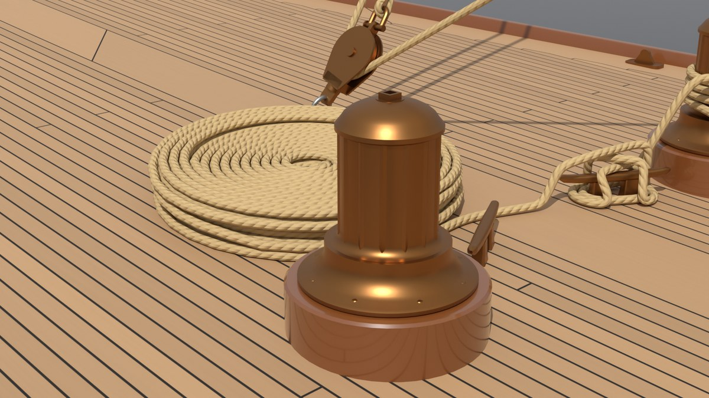
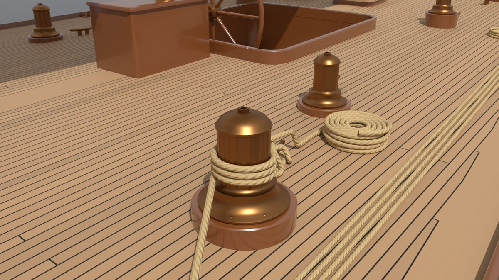
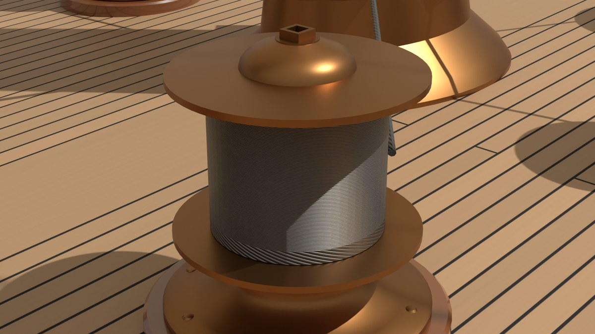

# Bluebonnet's winches (part card, slice 7)

The part detail loop's card ([docs/part-detail-loop](../part-detail-loop/README.md)) for the J's deck winches: what
they are, where they go, the sizes and features we built to, the budget, and which of the loop's five checks could run.
The builder is `Tools/shipkit/jclass/winches.py`; sizes and places are in `running_bluebonnet.json`.

## The card

| | |
| --- | --- |
| What | Period bronze deck winches for a 1937 J: capstans for rope (a ribbed drum on a skirted base flange bolted through a teak pad, a band where the pawls are housed, a domed cap with a square socket for a loose handle) in three sizes, each with a bronze horn cleat for the tail; and reel winches for the wire halyards (the wire stored on a flanged reel over a brake drum and band, the same base and cap). No self-tailers: they came decades later. |
| Boat | *Bluebonnet* only: 16 capstans (8 pairs) and 6 reels, 22 winches in all (*Ranger* is said to have carried 27). |
| Distance | From the cockpit and the side deck at arm's reach; the deck views and close-ups pass within a metre of the primaries and the reels. |
| Before | Nothing: slices 1 to 6 had no winches. |
| Budget | The loop's hero budget is 20,000 triangles and 8 material slots per part. |

## Sizes

All sizes are ours, chosen for the ropes they work (a capstan's drum about 7 to 9 times its rope's diameter) and to
stand in scale with the deck; there is no period catalogue in reach to hold them to (see the checks below).

| Size | Drum (dia. × height) | Base flange | Height above its pad | Ribs | Works | Rope | Drum / rope |
| --- | ---: | ---: | ---: | ---: | --- | ---: | ---: |
| Large capstan | 220 × 250 mm | 400 mm | 420 mm | 14 | genoa sheet, quadrilateral's lower sheet, spinnaker guy (the primaries); spinnaker sheet (the quarter winches); mainsheet | 24 to 28 mm | 7.9 to 9.2 |
| Medium capstan | 164 × 190 mm | 300 mm | 335 mm | 12 | quadrilateral's upper sheet, staysail sheet, the runners' and checkstays' falls | 18 to 24 mm | 6.8 to 9.1 |
| Small capstan | 120 × 140 mm | 230 mm | 265 mm | 10 | the pole's foreguy | 18 mm | 6.7 |
| Reel | 140 mm barrel, 360 mm flanges, 220 mm between them | 400 mm | 421 mm | none | the six wire halyards and lifts | 11 to 16 mm wire | 8.8 to 12.7 |

Each rope takes three turns on its capstan, clockwise seen from above, rising onto the drum's bottom turn (the build
checks every loaded lead rises 0 to 12 degrees onto it, so the turns climb rather than ride over each other). Each reel
stores the wire its hoist does not use (from a metre above the deck to its sheave aloft), wound to the radius that length needs at 85% packing.

## Features

| Feature | Built | How it is checked |
| --- | --- | --- |
| Ribbed (whelped) drum, the ribs narrow and rounded | yes: 14, 12 or 10 ribs, 3 to 4 mm proud | object labels (`... \| drum`), close-up render |
| The drum's foot flaring out so a turn can't slip off | yes, a quarter round | close-up render |
| A skirted base flange bolted down | yes, 6 or 8 bolt heads round it | close-up render |
| The band where the pawls are housed | yes, between the skirt and the drum | close-up render |
| A domed cap with a square socket for the handle | yes, the socket black inside | object labels (`... \| socket`) |
| A teak pad under each winch, let into the deck | yes (the runners' and checkstays' are about 0.15 m high) | labels, contact check (`pad` on `Deck` allowed) |
| A horn cleat by each capstan for the tail | yes, the kit's horn cleat scaled per size, with the rope's hitch on it (a turn round the base, a figure of eight and a locking turn, clear of itself and the cleat) | labels, room check, the rope's own clearance |
| Reel: flanged reel with the wire stored on it | yes, the wire drawn by its paint as turns | labels (`... \| wire on reel`) |
| Reel: brake drum and band | yes (the band in iron) | labels |
| Reel: brake lever and pawl | **no** (a gap) | |
| Loose winch handles | **no**: stowed below in the period, not drawn | |

## Triangles

| Part | Triangles | Slots |
| --- | ---: | --- |
| Large capstan with its pad | 6,224 | Bronze, Black, Wood |
| Medium capstan with its pad | 5,888 | Bronze, Black, Wood |
| Small capstan with its pad | 5,696 | Bronze, Black, Wood |
| Reel with its pad and wire | 6,288 | Bronze, Black, Iron, WireRope, Wood |
| Horn cleat (each size) | 1,448 | Bronze |

Every part is well inside the loop's 20,000 and 8 slots; the 22 winches and 16 cleats together are the `Winches`
object's 156,736 (with the ropes' turns on the drums counted in the suits).

## The loop's five checks

| Check | Result |
| --- | --- |
| Sizes | pass against our own targets above (no catalogue to hold them to) |
| Outline | **not run**: no reference photo |
| Features | 9 of 11 above (the reel's brake lever and pawl, and loose handles, are not built) |
| Blind review | **not run**: no reference photo to show the reviewers |
| Budget | pass (6,288 triangles at most, 5 slots) |

No free photo of a period bronze yacht winch could be fetched from the cloud for this slice: Wikimedia Commons searched
from here (Nov 14 2026) gave no free landscape photos for "bronze winch classic yacht" or "deck winch sailing yacht
brass", and its category lookups failed. The restored Js race with modern winches, so photos of them would not help.
The outline and blind checks wait for a reference: a photo Bean takes of a classic yacht's bronze winches (at a
classic regatta or museum ship), or a free photo found later, measured only and kept out of the repo as the loop says.
