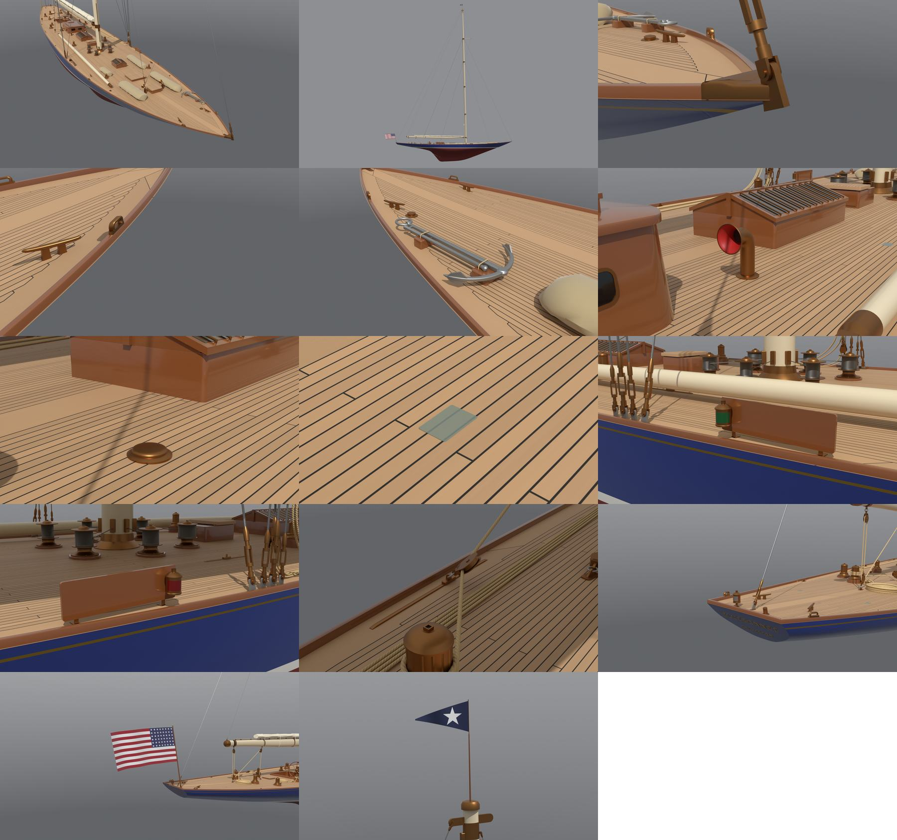
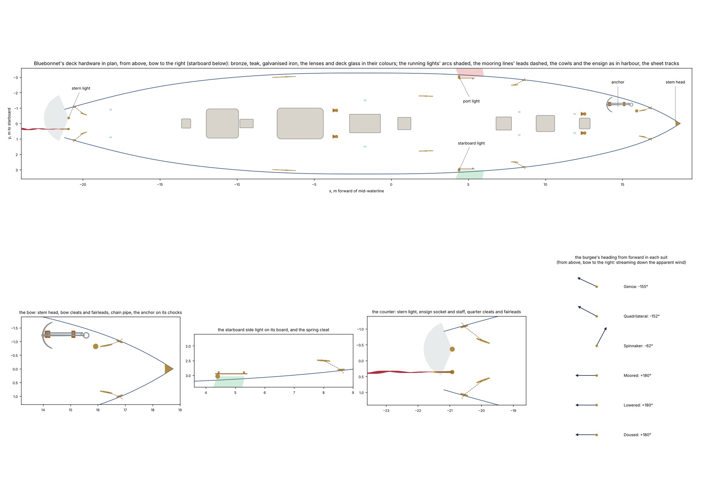

# J-Class 8: Bluebonnet's deck hardware

Slice 8 of *Bluebonnet*, our own J-Class sloop of 1937 (plan and Bean's decisions:
<https://claude.ai/artifact/WdUKp8somgyNJZDyESCgyU>; the hull is slice 1, [docs/jclass-1](../jclass-1/README.md), its
plating, keel and rudder slice 2, [docs/jclass-2](../jclass-2/README.md), its deck slice 3,
[docs/jclass-3](../jclass-3/README.md), her spars slice 4, [docs/jclass-4](../jclass-4/README.md), her standing
rigging slice 5, [docs/jclass-5](../jclass-5/README.md), her sails slice 6, [docs/jclass-6](../jclass-6/README.md),
and her winches and running rigging slice 7, [docs/jclass-7](../jclass-7/README.md)). This slice finishes her outside:
the stem head fitting, the mooring cleats and their fairleads, the sheet tracks, the cowl vents, the deck prisms, the
anchor stowed on deck, the side and stern lights, the ensign staff and ensign, and the club burgee at the masthead.
Milestone B, the plan's second review ("outside done: full rig, deck and hardware"), comes next. Like slices 1 to 7 it
is post-slice art: tools and docs only, nothing imported into Unreal or wired into the game yet.



The renders, left to right in rows of three: the foredeck moored, from aloft on the starboard bow (the cowls up, the
sails in their bags); her profile moored, from starboard (orthographic), the ensign flying and the burgee at the
masthead; the stem head fitting over the deck's tip, taking the toe rail's ends, the forestay's toggle above it; the
starboard bow cleat and its fairlead; the anchor on its chocks on the port foredeck, with the chain pipe; the after
starboard cowl in harbour, its red mouth turned aft; the same flange capped at sea (the genoa's suit); a deck prism;
the starboard side light on its board, and the port one, under main and genoa; the genoa's sheet track on the port
side, its car carrying slice 7's lead block; the counter, with the stern light, the quarter cleats and fairleads and the
ensign's empty socket (the sails lowered); the ensign from the starboard quarter; and the burgee on its stick above the
truck, streaming aft and to port close-hauled. Each is in `baseline/` at 1200 pixels wide.



## What slice 8 builds

### The pieces

| Piece | Where (x, y from the waterline's middle) | What it is |
| --- | --- | --- |
| Stem head fitting | 18.45 m to the bow's tip at 18.73 | a bronze casting over the deck's tip, 68 mm high, cast round the forestay's plate; the toe rail's ends (at 18.52) run into its after part, which rises over them to stand 4 mm above the rail's top and eases down over 0.06 m |
| Mooring cleats, three pairs | bow 16.3, ±0.85; springs 8.0, ±2.5; quarters -19.95, ±0.62 | bronze horn cleats 450 mm long (slice 7's cleat at a mooring size), each turned toward its fairlead |
| Fairleads, three pairs | on the toe rail at 16.8 (bow), 8.6 (springs) and -20.55 (quarters) | closed bronze chocks 240 mm long, 85 mm high and 40 mm across, cast along the rail's curve and let 10 mm into it; the 130 by 42 mm hole is bored skewed toward its cleat (25, 28 and 18 degrees off square), so a line coming in square to the rail turns half its angle at each mouth |
| Sheet tracks, two pairs | the genoa's from -7.7 to -6.2 m by the rail (y ±3.03 at its car); the staysail's from 1.8 to 2.7 m (±1.78) | bronze bars 32 mm wide and 12 mm high along the deck, their ends sloped down, each with a car 150 mm long whose eye carries slice 7's lead block; the car sits where slice 7's padeye was, so the leads are unchanged |
| Cowl vents, two pairs | forward 12.55, ±0.62 (the fo'c'sle); aft -3.55, ±0.85 (the after cabins) | bronze cowls painted red inside, 0.49 m high, mouths turned aft, standing in flanges 0.2 m across; at sea they are struck below and each flange takes a screw cap |
| Deck prisms, four pairs | 11.9, ±0.62; 8.3, ±0.75; -1.7, ±1.5; -18.2, ±0.9 | glass prisms 150 by 100 mm let into the planking, their tops 1 mm proud of the deck at every point, their pendants 85 mm down |
| Anchor | crown at 14.0, -1.22 (the port foredeck), shank forward | a fisherman's kedge of about 70 kg: 1.5 m shank, arms 0.93 m across with flat palms, its 1.28 m stock folded beside the shank, on two teak chocks and lashed at each; its lowest iron is 56 mm off the deck |
| Chain pipe | 15.92, -0.82 | the bronze pipe the bower's chain goes below by, capped |
| Side lights | 4.4, ±3.03 (just forward of the shrouds) | bronze lanterns, a green lens to starboard and red to port over the arc from right ahead to two points abaft the beam, each on a teak board 1.1 m long and 0.3 m high on two bronze brackets, the lamp 0.22 m above the deck; the board reaches 0.94 m forward of the lens |
| Stern light | -20.92, -0.36 (the counter) | the same lantern with a clear lens over twelve points about right astern, on a short bronze standard, the lamp 0.16 m above the deck |
| Ensign staff and ensign | socket at -20.92, 0.36 | a bronze socket (always), and in harbour a 3.2 m staff raked 10 degrees aft with a gilt ball, flying a 48-star ensign 3.33 m on the fly and 1.75 m on the hoist |
| Burgee | on the mast's truck, its top 49.6 m up | the club's navy burgee with a white star, 0.95 m on the fly, laced to a bronze spindle on a 1.2 m spruce stick, streaming down each suit's apparent wind (the plan's inset gives each heading) |

Each piece was placed clear of what lies on deck in every suit: the sail bags, the lowered headsails' heaps, the stowed
pole, the ropes' coils and the let-off runners. The ground tackle that went below (the bower anchor, its chain and the
windlass) is not drawn until the interior; it is weighed as an estimate (below).

### The suits

| Suit | Shown |
| --- | --- |
| Genoa, Quadrilateral, Spinnaker, Lowered, Doused | the fixed hardware (`DeckHardware`), the cowls' flanges capped (`CowlCaps.<Suit>`), the burgee streaming down that suit's wind (`Burgee.<Suit>`) |
| Moored | the fixed hardware, the cowls standing (`Cowls.Moored`), the ensign on its staff (`Ensign.Moored`), the burgee hanging aft |

### The triangles

| Object | What it is | Triangles |
| --- | --- | ---: |
| `DeckHardware` | the stem head, cleats, fairleads, cowls' flanges, prisms, anchor and chocks, chain pipe, lights and the ensign's socket | 29,040 |
| `Cowls.Moored` | the four cowls standing | 11,840 |
| `CowlCaps.<Suit>` | the four caps, one set for each other suit | 2,240 each |
| `Ensign.Moored` | the staff and the ensign | 1,824 |
| `Burgee.<Suit>` | the stick, spindle and burgee, one for each suit | 896 each |
| `RunningFittings` (slice 7's) | gains the sheet tracks and their cars | 6,748 (4,540 before) |

The plan gives slice 8 300,000 triangles; a suit shows 32,176 of them under sail and 43,600 moored. The whole model
shown under main and genoa is now 819,626 triangles, against 2,550,000 for slices 1 to 8.

## Checks

The build stops before writing anything if any of these fail; `rule_check.py` prints the slice 8 ones and fails a
`build.json` that lacks them.

* **No piece crosses anything:** every face of the hardware is tested against every other object in each suit (the hull,
  deck and deckhouses, the spars posed, the rigging, the suit's sails, the winches, the fittings and its ropes). The
  allowed contacts are named by kind: a casting, chock, bracket, standard or socket bedded in the deck, a fairlead let
  into the toe rail, the stem head over the stem's plating, taking the rail's ends and cast round the forestay's plates,
  and the burgee's stick on the mast's truck. Nothing else crosses, in any suit.
* **Everything has room:** within 0.05 m of the hardware nothing comes closer than 3 mm; the nearest is the stem head,
  15.2 mm under the forestay's jaw.
* **The mooring lines lead fair:** each line's lead (from 0.15 m outboard of its fairlead, through the hole and on to
  its cleat's horns) is measured to everything shown in each suit, the part in the hole allowed to touch only its own
  fairlead and the part from the hole's inboard mouth only its own cleat. The least room is 3.9 mm, where the bow line
  leaves its fairlead's mouth.
* **No wire is fouled:** the standing rigging, with the starboard runner and checkstay set, keeps 3 mm from the
  hardware; none of it comes within 0.15 m.
* **Every piece is bedded:** a new check casts rays down onto the deck (the fairleads onto the rail) from each piece's
  vertices. Each piece's feet (its downward faces with nothing of its own under them) must be no more than 0.5 mm above
  the surface and none of it more than 30 mm below. All 31 pieces are bedded: each one's highest foot is let in 1.7 to
  5.9 mm, and the deepest is the chain pipe's neck, 21.7 mm down. The prisms' tops are 0.99 to 1.05 mm proud all round,
  and the anchor's lowest iron must clear the deck by 10 mm (56 mm as built).
* **The running lights are the 1910 rules':** in each suit, rays every degree from each lamp, within and 10 degrees past
  its arc:
  * each lens's arc, measured off the lens itself, must be the rules' (fixed in the check): right ahead to 112.5
    degrees on its own side for the side lights, 112.5 to 247.5 degrees for the stern light; they are, to 0.05 degrees;
  * every ray in the arc must leave through the lens and meet nothing of the yacht (the light's own board and brackets
    included) for 60 m: 113 of 113 for each side light and 135 of 135 for the stern light;
  * each side light's board must reach three feet (0.914 m) forward of its lens: it reaches 0.941 m;
  * from a flame 25 mm across, light past the board may show no more than 6 degrees across the bow: it shows 4.75
    degrees (10.5 without the board).
* **Every object is closed:** the hardware, the cowls, their caps, the ensign and each burgee are closed solids.
* **The budget:** 43,600 triangles at most against slice 8's 300,000.
* **The weights:** all the deck hardware, the winches and cleats and the ground tackle's estimate must weigh no more
  than the card's 3.5 long tons: they weigh 2.263.
* **Fairness:** the moulded hull (`Hull`, 17 inflections and 23 kinks) and the finished shell (`Shell`, 14 and 19) are
  unchanged.

## Her weight and balance

| Part | Weight | Centre (x, z) |
| --- | ---: | --- |
| Stem head fitting (bronze) | 19.6 kg | 18.54, 2.41 m |
| Mooring cleats and fairleads (bronze), six of each | 74.6 kg | 1.46, 1.92 |
| Cowl vents (bronze): the four cowls, their flanges and caps | 71.2 kg | 4.45, 1.79 |
| Deck prisms (glass) | 19.2 kg | 0.08, 1.60 |
| Anchor (iron), its chocks and lashings | 81.9 kg | 14.57, 2.05 |
| Chain pipe (bronze) | 6.2 kg | 15.92, 2.07 |
| Side and stern lights and the light boards | 27.2 kg | -0.58, 1.70 |
| Ensign staff, socket and ensign | 12.3 kg | -21.21, 2.73 |
| Burgee and its stick | 0.8 kg | 1.73, 48.91 |
| **The deck hardware** | **313 kg (0.308 long tons)** | 5.78, 2.06 |
| Sheet tracks and cars (bronze) | 33.0 kg | -3.20, 1.40 |
| Winches and cleats (slice 7's) | 1,204 kg | -6.09, 1.70 |
| Ground tackle below (estimated, not drawn): the bower anchor 180 kg, 75 m of 16 mm chain 420 kg, a hand windlass 150 kg | 750 kg | 15.34, 1.43 |
| **All the deck hardware** | **2,300 kg (2.263 long tons)** | 2.56, 1.66 |

Each piece is weighed from its geometry: solid castings, the thin ones (the cowls, the lanterns) as their skin times a
4 mm wall, the cowls' flanges and the chain pipe less their bores, the stem head as a casting with 12 mm walls. The
cowls and their caps are both aboard (one set stowed below while the other is up) and the ensign and its staff are
weighed where they stand in harbour (at sea they are stowed below).

The size card allowed 3.5 long tons for the winches and deck hardware. As built and estimated they weigh 2.263, so, as
for every slice before it, the trimming ballast in the bilge takes up the difference: 1.237 long tons more (and 0.013
for the running rigging, whose genoa and staysail padeyes became the tracks' cars), 3.477 in all, 1.65 m below the
waterline; the lead is 96.91 long tons and she still floats on her lines at 156.2 long tons. G drops from 1.363 to 1.388
m below the waterline and GM rises from 2.15 to 2.18 m; the ground tackle forward takes her trim from 12.3 cm by the
stern to 3.8. Her righting moment heeled 30 degrees rises to 1,694 kNm, so the windward shrouds' breaking moment is now
3.23 times it (3.27 before). The card's line for the winches and hardware is now all counted, drawn or estimated.

## Changes to earlier slices

Slice 8 changes some earlier slices' pieces. Their reports and weights in `build.json` change with them; their own docs
pages and renders are not redone.

* **Slice 7's running rigging:** the genoa's and staysail's lead blocks now hang from cars on sheet tracks instead of
  padeyes on the deck (each car's eye where the padeye's was, so every lead is unchanged); the tracks and cars are in
  `RunningFittings` (2,208 triangles more) but weighed as deck hardware, so the running rigging is 12.8 kg lighter.
  Slice 7's renders and its `running_plan` would now show the tracks.
* **Slice 7's cleat** takes its size and its weight's row from its caller, so the mooring cleats can be larger; slice
  7's own cleats are unchanged.
* **Slice 2's ballast:** the trimming ballast takes the deck hardware's difference (above); the lead's casting is
  unchanged.

## Sources and licence

* **Our own pieces**, sized and placed for an invented 1937 J in the manner of the Js of 1934-37: cast bronze cleats,
  fairleads, cowls and stem head, teak light boards and chocks, a galvanised iron anchor. None is copied from a maker's
  catalogue or a particular yacht.
* **The ensign** is the 48-star flag of the United States (1912 to 1959), the flag a 1937 American J would fly: its
  design is in the public domain. Its hoist 1 to fly 1.9 and its six rows of eight stars, one point up, are the 1912
  executive order's (as a web search quotes it in November 2026); the union over seven stripes and 0.76 of the hoist
  along the fly, and the star 0.0616 of the hoist across, are the proportions the flag kept to 1959. The order left the
  stars' exact places to a Navy blueprint we could not reach: here they sit evenly in the union (a known gap). Its
  colours are drawn by `hardware_materials.py` from the faces' own coordinates (no image texture). Its size, 3.33 m on
  the fly, is the usual inch of fly to the foot of a yacht's length.
* **The running lights** follow the International Regulations for Preventing Collisions at Sea of 1910, in force in
  1937: the side lights show "from right ahead to two points abaft the beam" on their own sides, with inboard screens
  "projecting at least three feet forward from the light, so as to prevent these lights from being seen across the
  bow". Article 10 let a vessel being overtaken carry a fixed white light astern, showing over twelve points about right
  astern, in place of showing a lamp when one came up: that is her stern light. The reviewer remembered a rule that it
  stand "as nearly as practicable on the same level as the side lights"; we could not find those words in the 1910 text
  and left her lamp as low as clears the counter's toe rail (a known gap).
* **The burgee** is our invented club's (navy, a white five-pointed star), not a real club's.
* **No outside assets:** every mesh is generated by the build from `hardware_bluebonnet.json`. Nothing needs a licence
  row until she goes into the game.

## Review

An independent review read the code and the build before this went up and found fourteen things; all are fixed or
listed.

| # | What the review found | What changed |
| ---: | --- | --- |
| 1 | The bow mooring lines ran through their fairleads' bronze: every hole was square to the rail, the bow lines turned 68.6 degrees off it toward their cleats and cut 6.9 mm into the ring, and the lead check, which let the whole fairlead, rail and deck touch the line, could not see it | Fixed: each hole is bored skewed toward its cleat, halving the line's turn at each mouth (25 degrees at the bow, 28 at the springs, 18 at the quarters), and the bow fairleads moved 0.45 m aft to x 16.8 so the bow lead turns less (moving the cleats instead put them under the lowered jib's heap). The lead check now lets the part in the hole touch only its own fairlead and the part from the mouth to the horn only its own cleat: the least room is 3.9 mm, where the bow line leaves its mouth. |
| 2 | The lights check could not fail: its rays started inside the lantern, which stopped every ray outside the arc whether the board was there or not; the light's own board was left out of the blocking test; the arcs were checked against the numbers that drew them; the three-foot screen was only a report value, and 0.861 m from the lens | Fixed: the arcs are measured off the lens itself against the 1910 rules' (fixed in the check, not read from the json); every piece but the lens and the lantern's own body may block a light, its own board included; the board is lengthened to 1.1 m and must reach three feet forward of the lens (0.941 m); and a flame 25 mm across is traced across the bow past the board with the lantern left out: it shows 4.75 degrees across, against 10.5 without the board, and may show 6 at most. |
| 3 | The deck prisms' tops were level, so on the sloping deck their corners stood 4.4 mm under to 6.4 mm proud | Fixed: each top follows the deck, 1 mm proud at every point (0.99 to 1.05 mm as built). |
| 4 | The toe rail's top showed through the stem head's rounded after edge | Fixed: over the rail's ends the casting rises to stand 4 mm above the rail's top, easing down over 0.06 m forward. |
| 5 | Nothing checked that the hardware sat on the deck: a cleat floating a centimetre up or a cowl sunk 10 cm would pass | Fixed: a new check (above) beds every piece on what it stands on. It found the fairleads' rings overhanging the rail's rounded edges, so the fairleads are now cast along the rail's curve, 40 mm wide inside its top, and let 10 mm in. |
| 6 | The profile render cut off the burgee | Fixed: it is framed on the burgee's top. |
| 7 | The ensign's hoist edge sat up to 2.4 mm inside its tapered, raked staff | Fixed: the hoist stands 2 mm off the staff at each height, square to its axis. There is no halyard (a known gap). |
| 8 | The ballast retrim took the size card's whole allowance as drawn, though the bower anchor, its chain and a windlass were weighed nowhere | Fixed: the ground tackle below is estimated (750 kg in the forepeak) and counted with the deck hardware, so the trimming ballast takes only the rest. |
| 9 | The sheet tracks showed in no slice 8 drawing or render, slice 7's views would now show them, and the car's frame was taken from a point 0.15 m from the car | Fixed: the plan draws the tracks and their cars, a new render looks along the genoa's track, and the car's frame comes from the track's tangent at the car. Slice 7's renders are not redone (below). |
| 10 | The port light's label in the plan overprinted the title, and a render's description named a genoa it did not show | Fixed. |
| 11 | Period seamanship: the cowls stood in the genoa's sweep at sea, the ensign was small for her (2.0 m on the fly), the side lights low, the stern light higher than they, a racing flag might fly in the burgee's place, and nothing leads a cable over the bow | The cowls are struck at sea and their flanges capped; the ensign is 3.33 m on the fly, the usual inch to the foot. The rest are known gaps, below. |
| 12 | The union's stars may sit in a simpler grid than the 1912 Navy drawing's | A known gap: the drawing could not be reached. |
| 13 | The cowls' flanges, the chain pipe and the stem head were weighed as solid bronze; the anchor's reported height was the json's, not measured | Fixed: the flanges and chain pipe are weighed less their bores, the stem head as a casting 12 mm thick, and the report gives the anchor's lowest iron, measured (56 mm above the deck). |
| 14 | The anchor's lashings ended inside the chocks round nothing; the folded stock lay outside both, 1 mm into the forward chock | Fixed: each lashing is a closed loop through its chock, round the shank and over the stock, and the stock is bedded in the forward chock's saddle as the shank is. Its folding beside the shank, not over it, is a known gap. |

## Known gaps

* **The lights are not lit:** their lenses are coloured glass, not emitting; the game will light them at night from
  the lamps and arcs in `build.json`. She has no anchor light (the white light hoisted forward at anchor).
* **The side lights stand low:** on light boards by the rail just forward of the shrouds, 0.22 m above the deck. Heeled,
  the lee one is near the water and under the genoa's foot; many big yachts of the period carried their boards in the
  lower shrouds instead, which would take a new fitting on slice 5's shrouds.
* **The stern light is higher than the side lights** (the counter's sheer rises aft): as low as clears the toe rail
  there, 0.16 m above the deck. If the 1910 rules asked it to stand level with them, as the review remembered, it would
  need a lower mounting on the transom; we could not confirm the words.
* **The flags are fixed shapes,** one per suit, waved and drooping but not moving; the game's cloth (`FSailCloth`) or a
  flag shader will fly them. The ensign has no halyard on its staff, and the burgee's stick no halyard to the truck.
* **The burgee flies in every suit:** racing, a yacht may have flown a racing flag at the masthead in its place; we
  could not confirm what the 1937 rules asked, so she keeps her club's burgee.
* **The 48-star union's stars sit evenly in it:** the 1912 order left their places to a Navy drawing we could not reach,
  whose edges may be wider than ours.
* **The mooring lines are not drawn:** only their leads are checked, from 0.15 m outboard of each fairlead to its cleat.
  The game draws the lines when she is tied up.
* **The ground tackle below is an estimate, not drawn:** the bower anchor, its chain and the windlass are weighed where
  the interior (slices 9 and 10) will put them. On deck there is no windlass, no bitts and no bow chock or roller to
  lead a cable over the bow.
* **The anchor's stock folds beside its shank,** in the arms' plane and held by the lashings; a fisherman's folded stock
  more often lay over the shank.
* **The deck prisms have no light below yet:** their pendants hang under the deck's planking into the cabins slices 9
  and 10 will build.
* **Starboard tack only,** as for slices 5 to 7: the burgee streams for starboard tack; port tack is the mirror the
  game will draw.

## Words used here

* **Stem head fitting:** the casting over the bow's tip that the forestay's plate and the toe rail's ends are bolted
  into.
* **Fairlead:** a fitting a rope passes through to lead it fair, here a closed bronze chock on the toe rail that a
  mooring line goes through on its way to its cleat. **Mooring cleat:** a big horn cleat the mooring lines are made
  fast to; **springs:** the lines from amidships that stop her moving ahead or astern alongside.
* **Sheet track:** a bronze rail on the deck that a sheet's lead block slides along on its **car**, so the lead can be
  moved fore and aft for each sail and trim.
* **Cowl vent:** a bell-mouthed ventilator on a pipe through the deck, turned to catch or shed the wind; painted red
  inside, as yachts' cowls were. **Struck:** taken down and stowed.
* **Deck prism:** a glass prism let into the deck planking, its flat top flush with the deck, its pointed underside
  spreading daylight in the cabin below.
* **Fisherman's anchor:** the traditional anchor with a stock across the top (here folded down beside the shank to
  stow), a shank, two arms, and a flat palm on each arm. **Chocks:** the blocks it is lashed down on. **Chain pipe:**
  the hole in the deck the anchor's chain goes below through, capped at sea. **Ground tackle:** her anchors, chain and
  windlass. **Bower:** the main anchor; **kedge:** a smaller one.
* **Side lights:** the green (starboard) and red (port) lights that show from right ahead to 22.5 degrees abaft the
  beam; **stern light:** the white light showing astern. **Light board:** the board each side light stands on, its
  screen. **Points:** a compass point is 11.25 degrees.
* **Ensign:** a ship's national flag, flown from a staff at the stern in harbour. **Burgee:** a yacht club's small
  flag, flown at the masthead; **truck:** the cap at the mast's top.

## How to run

The same venv as slices 1 to 7 (Python 3.13 with pip `bpy` 5.3, numpy, scipy, matplotlib, pillow); `<venv>/bin/python`
below. Run from the repo root:

```
<venv>/bin/python Tools/shipkit/jclass/build_jclass.py <out>    # jclass.blend, jclass.obj, build.json and ten drawings
python3 -I Tools/shipkit/jclass/rule_check.py <out>/build.json
<venv>/bin/python Tools/shapeloop/fairness.py <out>/jclass.blend <out> --object Hull
<venv>/bin/python Tools/shapeloop/fairness.py <out>/jclass.blend <out>/shell --object Shell
<venv>/bin/python Tools/shipkit/jclass/render_jclass.py <out>/jclass.blend <out>/renders --res 1600 --only hardware_foredeck,hardware_profile,hardware_stem_head,hardware_bow_cleat,hardware_anchor,hardware_cowl,hardware_cowl_capped,hardware_deck_prism,hardware_sidelight,hardware_sidelight_port,hardware_track,hardware_stern,hardware_ensign,hardware_burgee
<venv>/bin/python Tools/shipkit/jclass/docs_jclass.py <out> docs/jclass-8/baseline --slice 8
```

The build takes about eight minutes on the cloud's CPU, and the fourteen renders about nineteen more.

## Files

| File | What it is |
| --- | --- |
| `Tools/shipkit/jclass/hardware_bluebonnet.json` | this slice's choices, each with its note: the stem head, the mooring cleats and fairleads, the cowls, the deck prisms, the anchor and its chocks, the chain pipe, the side and stern lights, the ensign and the burgee, the ground tackle's estimate, and the densities |
| `Tools/shipkit/jclass/hardware.py` | builds the deck hardware, the cowls and their caps, the ensign and each suit's burgee, the mooring lines' leads for the room check, and weighs them |
| `Tools/shipkit/jclass/hardware_materials.py` | the flags drawn from their UVs (the 48-star ensign, the burgee), the lenses, the deck glass and the cowls' red paint |
| `Tools/shipkit/jclass/running.py`, `running_bluebonnet.json` | the genoa's and staysail's lead blocks ride cars on sheet tracks; the tracks are weighed apart, as deck hardware |
| `Tools/shipkit/jclass/winches.py` | the cleat takes its sizes and its weight's row from its caller (the mooring cleats are bigger) |
| `Tools/shipkit/jclass/build_jclass.py` | builds the hardware into the yacht, leads and coils the ropes round it, checks it in each suit (contacts, room, the mooring lines' leads, the wires, the lights against the 1910 rules), checks it bedded on the deck, weighs all the deck hardware against the card, retrims the ballast, and writes the report |
| `Tools/shipkit/jclass/rule_check.py` | the slice 8 checks in a slice 8 build |
| `Tools/shipkit/jclass/drawings_jclass.py` | adds the hardware's plan |
| `Tools/shipkit/jclass/render_jclass.py` | adds the hardware's views |
| `Tools/shipkit/jclass/docs_jclass.py` | takes `--slice 8` |
| `Tools/shipkit/jclass/sections_jclass.json` | the deck hardware is a section of its own |
| `docs/jclass-8/baseline/` | this build's stats, fairness checks, drawing and renders |
