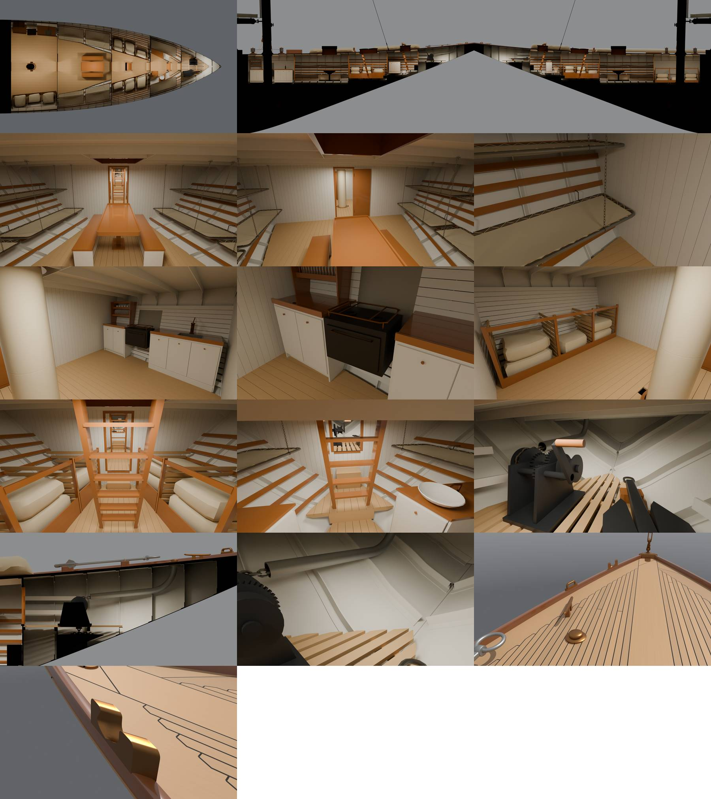
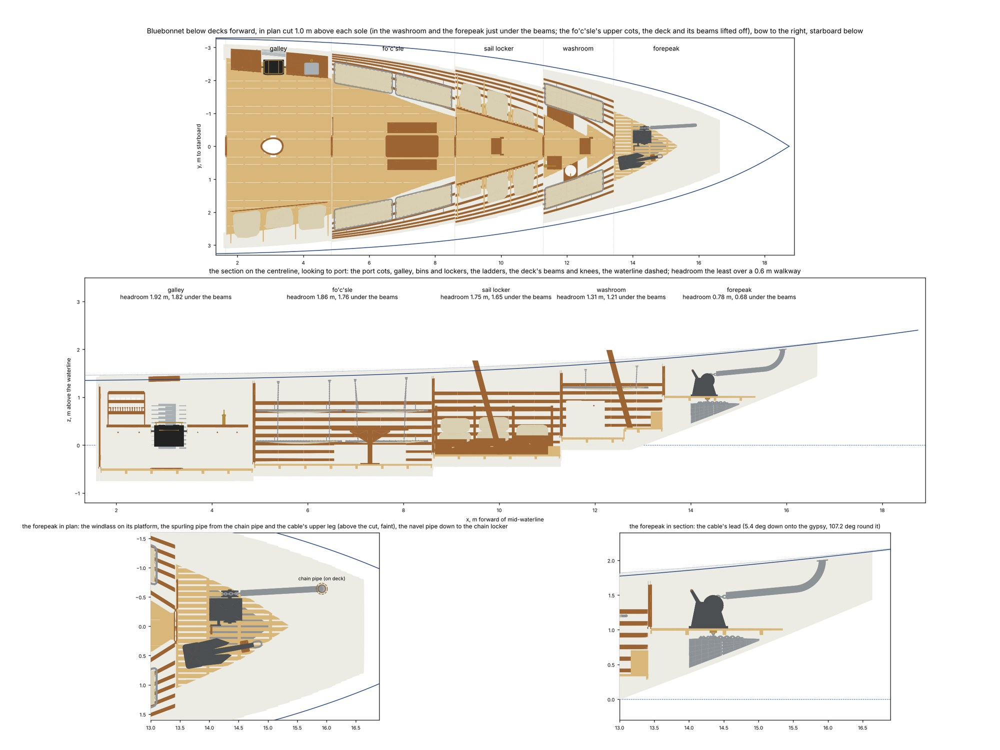

# J-Class 9: Bluebonnet below decks, forward

Slice 9 of *Bluebonnet*, our own J-Class sloop of 1937 (plan and Bean's decisions:
<https://claude.ai/artifact/WdUKp8somgyNJZDyESCgyU>; the hull is slice 1, [docs/jclass-1](../jclass-1/README.md), its
plating, keel and rudder slice 2, [docs/jclass-2](../jclass-2/README.md), its deck slice 3,
[docs/jclass-3](../jclass-3/README.md), her spars slice 4, [docs/jclass-4](../jclass-4/README.md), her standing
rigging slice 5, [docs/jclass-5](../jclass-5/README.md), her sails slice 6, [docs/jclass-6](../jclass-6/README.md),
her winches and running rigging slice 7, [docs/jclass-7](../jclass-7/README.md), and the rest of her deck hardware
slice 8, [docs/jclass-8](../jclass-8/README.md)). Bean passed Milestone B, her finished outside, on 15 November. This
slice goes below: the crew's end of the yacht, from the forepeak aft to the bulkhead forward of the saloon. It builds the
steel she is built inside (frames, deck beams, knees and the plating's inside face), the ceiling, the bulkheads and
soles, the fo'c'sle with its pipe cots and mess table, the galley, the sail bins round the mast and in the sail locker,
the crew's washroom, the ladders up the forecastle hatch and the sail hatch, and the forepeak with its hand windlass,
chain locker, cable and bower anchor; on deck it adds the bow chock the cable leads over. All of it is streamed in only
when you go below. Like slices 1 to 8 it is post-slice art: tools and docs only, nothing imported into Unreal or wired
into the game yet.



The renders, left to right in rows of three: the cabins forward from above, cut 1.25 m over the waterline (under every
beam), the bow to the right; the port half from the centreline, and the starboard half (both orthographic, the camera
cutting the yacht at the centreline); the fo'c'sle looking forward, the mess table under the skylight and the cots
lowered each side, the sail locker's ladder beyond the door; the fo'c'sle looking aft to the galley's door; a starboard
cot, its outboard pipe in its hooks on the ceiling and its inboard pipe on chains from the beams; the galley to port:
the dresser and the ice chest's counter aft, the range in its recess, the sink and its pump; the paraffin range on its
gimbals; the sail bins round the mast to starboard, the sails' bags in them; the sail locker looking forward, its ladder
up the sail hatch between the bins; the washroom looking forward to the forepeak's scuttle, the basin's cabinet to
starboard and the ladder up the forecastle hatch; the forepeak, the windlass on its platform and the bower in its
chocks; the forepeak cut through the gypsy (orthographic), the spurling pipe leading the cable down from the deck onto the
gypsy and the navel pipe taking it down onto the chain locker's heap; the windlass close to, its gearing and crank; on
deck, the cable's lead from the bow chock to the chain pipe (moored); and the bow chock on the port bow. Each is in
`baseline/` at 1200 pixels wide. The lamps under the deckhead are the renders', not the model's (lighting below is
slice 10's), and the views below use Blender's AgX colour, so bright paint rolls off instead of clipping white.



## What slice 9 builds

### The rooms

From forward to aft, each between two bulkheads standing on frames. Headroom is measured from the sole to the underside
of the lowest deck beam over the room ("under the beams") and to the deckhead between the beams, on the centreline and
across a walkway 0.6 m wide; the table gives the least of the two.

| Room | From, to (x) | Sole | Headroom between the beams, under them | What is in it |
| --- | --- | --- | --- | --- |
| Forepeak | 13.41 to the forward bulkhead at 16.62 | a slatted platform at 1.02 m | 0.78 m, 0.68 | the hand windlass on the platform, the chain locker under it with the cable's heap, the bower anchor on its chocks, the bosun's shelves; a scuttle 0.5 by 0.62 m aft into the washroom |
| Washroom | 11.27 to 13.41 | 0.15 m, raised to 0.36 forward of 12.62 | 1.31 m, 1.21 (from the raised sole) | a pump WC and the folding basin's cabinet to starboard, the oilskin lockers to port, the ladder up the forecastle hatch, and a pipe cot each side over them |
| Sail locker | 8.60 to 11.27 | -0.20 m | 1.75 m, 1.65 | slatted sail bins each side, three pens a side, and the ladder up the sail hatch between them |
| Fo'c'sle | 4.85 to 8.60 | -0.40 m | 1.86 m, 1.76 | the crew's quarters and mess: eight pipe cots in two tiers each side and the mess table with its benches under the forecastle skylight |
| Galley | 1.64 to 4.85 | -0.50 m | 1.92 m, 1.82 | the galley to port (ice chest, range, sink, dresser), the sail bins round the mast to starboard |

The bulkhead at 1.64 is the forward face of slice 10's owner's end: its door is drawn shut. Each joiner's bulkhead has a
door 0.56 m wide on the centreline, its leaf hooked back to port; where two soles differ by more than 0.2 m a step joins
them: one of 0.175 m up into the washroom, and one of 0.34 m from the washroom's raised sole to the forepeak's scuttle,
whose sill is 0.34 m higher again (the platform beyond is 2 cm under the sill).

### The pieces

| Piece | Where | What it is |
| --- | --- | --- |
| Plating's inside face | the whole length, from under the soles to the deckhead | a 6 mm skin just inside slice 1's moulded surface, painted white; in the forepeak, where it is drawn down to the stem bar, each side's skin runs 4 mm past the centreline |
| Frames, deck beams and knees | 29 frames 0.535 m apart, 1.64 to 16.62 | angle-bar frames (76 by 64 by 8 mm) riveted to the plating, ending under the deck's beams, a deck beam (100 by 64 by 9 mm) under the deck on each, joined by a bracket knee 0.22 m on each leg. The spacing keeps every beam clear of the chain pipe, the forward cowls' flanges and the deck prisms |
| Carlins, headers and partners | round the mast, the forecastle skylight, the sail hatch and the forecastle hatch | eight beams are cut for an opening and landed on fore-and-aft carlins either side of it; across each end of each opening a header (an angle like a beam's) runs between the carlins and carries the planking's ends; the mast stands between two frames in its partners (carlins 0.3 m either side, a short beam across fore and aft of it, and wedges round the mast, the deckhead cut round them) |
| Ceiling | every room but the forepeak | pine battens 70 by 19 mm at 0.17 m on the frames, from 5 cm above the sole to 0.32 m under the deckhead; the galley lined with painted tongue-and-groove instead |
| Bulkheads | 1.64, 4.85, 8.60, 11.27 and 13.41; a steel plate forward at 16.62 | tongue-and-groove pine 22 mm thick, painted, each up to the beam over it, with its door hung on two hinges, its frame (the head under the beam) and its sill; the forward bulkhead is a 10 mm plate on the last frame, part of the steel |
| Soles and steps | each room | pine planks 0.11 m wide on bearers across the frames, out to 1 cm from the frames; the forepeak's platform is slatted, on four bearers |
| Pipe cots | four rows of two in the fo'c'sle (4.94 to 6.70 and 6.80 to 8.50, at 0.48 and 1.12 m above the sole), one row of two in the washroom (11.33 to 13.10, 1.05 m up) | galvanised pipe frames 0.62 m wide with canvas laced inside, the outboard pipe resting in hooks on the ceiling and the inboard one hung from the beams by a chain at each end; drawn let down for the night |
| Mess | x 7.3, under the forecastle skylight | a teak table 1.6 by 0.66 m on a centre post, its top 0.74 m up with fiddles round it, and a fixed bench each side |
| Galley | to port, 1.80 to 4.75 | a counter 0.9 m high with lockers under it; from aft the zinc-lined ice chest, a paraffin pressure range on gimbals in a recess lined with zinc, and the sink with its bronze pump; the dresser's three shelves and plate rack over the after counter |
| Sail bins | round the mast to starboard (1.80 to 4.75), and both sides of the sail locker (8.68 to 11.10) | open-fronted pens of slats 60 by 20 mm with 40 mm gaps, against the ceiling, their floors raised where the hull's turn would leave them too narrow; fifteen sail bags lie in them, five in each place |
| Ladders | under the forecastle hatch and the sail hatch | teak, 0.46 m wide, leaning 15 degrees, at even rises of 0.27 and 0.25 m from the sole to the coaming's top |
| Washroom fittings | 11.4 to 12.3 | a pump WC to starboard and the basin's cabinet forward of it, the oilskin lockers to port, low enough for the cots over them |
| Windlass | on the forepeak's platform at 14.35, 0.34 m to port | a hand windlass of our own: two cast cheeks on a bed, the barrel across them at 1.35 m, the gypsy for the cable outboard of the port cheek (with whelps on its shoulders) and a warping drum to starboard, turned through spur gearing of 2.8 to 1 by one crank handle 0.25 m long on a crankshaft 0.19 m aft of the barrel; the crank's grip clears the platform by 35 mm |
| Spurling and navel pipes | from the chain pipe's foot to the gypsy, and from the gypsy into the locker | the spurling pipe (1.63 m long) leads the cable down from the chain pipe in one smooth bend (0.42 m radius), 3 degrees off fore and aft, onto the gypsy's top at 5 degrees below the horizontal; the cable wraps 107 degrees round the gypsy and leaves it down through the navel pipe in the platform |
| Chain locker and cable | under the platform, 14.0 to 15.4 | 75 m of 16 mm cable (420 kg), 84 links drawn from inside the spurling pipe over the gypsy and down onto the heap; the heap lies on the frames in the locker's V, 0.12 cubic metres (the cable's 0.053 of steel packed at 0.45), its top at 0.87 m |
| Bower anchor | crown at 13.72, 0.50 to starboard, on the platform | a stockless anchor of our own proportions, 241 kg: shank 1.05 m, flukes turning on the crown, seated on two teak chocks, its crown clear of the scuttle |
| Bosun's shelves | 13.4 to 14.3, at 1.22 and 1.45 m | two shelves each side across the forepeak's after end, on the bare frames |
| Bow chock | on the port toe rail at x 17.70 | an open bronze chock, 0.28 m long and 0.09 m high, its foot cut flat 10 mm under the rail's rounded crown (so about 1 mm deep at the rail's edges), its U throat 75 mm wide bored along the anchor's lead (10 degrees outboard of ahead), at a slant across the rail (52.5 degrees off square to it); the cable runs straight out through it to the anchor and turns 11.9 degrees in plan at the inboard mouth toward the chain pipe (12.6 degrees in all, dropping 8.2); each mouth's floor rounds down on a 16 mm radius |

The deck is now opened under the forecastle hatch, the sail hatch and the forecastle skylight (slice 3 left it closed
under them), each coaming carried down through the deck as a lining; every skylight's lids (the saloon's too) are now
glazed frames, so light comes through; and the deck prisms, the forward cowls and the chain pipe are bored through the
deck and the deckhead.

### The objects and triangles

| Object | What it is | Triangles |
| --- | --- | ---: |
| `Below.Structure` | the plating's inside face, frames, beams, knees, carlins, headers and partners, the forward bulkhead's plate, the deckhead | 242,896 |
| `Below.Ceiling` | the battens and the galley's lining | 4,672 |
| `Below.Joinery` | the bulkheads, doors and hinges, soles, bearers and steps, the mess, the galley's joinery, the bins, the ladders, the washroom's cabinets, the forepeak's platform, chain locker and shelves, the windlass's bed, the bower's chocks | 52,964 |
| `Below.Fittings` | the cots' pipes, chains and hooks, the range, sink and pump, the WC, the windlass and its gearing, the spurling and navel pipes, the cable and the bower | 72,884 |
| `Below.Canvas` | the cots' canvas and lacing, the sail bags | 13,560 |
| `DeckHardware` (slice 8's) | gains the bow chock, and the chain pipe, prisms and cowls' flanges bored through | 32,750 (29,040 before) |

Below decks forward comes to 386,976 triangles, against slice 9's 600,000; it is streamed in only when you go below, so
it is not in the count of what shows from outside (`build.json` lists the five objects under `streamed_below`). Most of
the structure's count is the plating's inside face and the deckhead, drawn finely so the frames, beams and bulkheads fit
them to a fraction of a millimetre. The whole model shown under main and genoa is now 823,796 triangles, from 819,626:
`DeckHardware` gains 3,710 (the bow chock and the bored fittings), the hatches' and skylights' linings 576, and the deck
loses 116 where it is opened.

## Checks

The build stops before writing anything if any of these fail; `rule_check.py` prints the slice 9 ones and fails a
`build.json` that lacks them.

* **Every object is closed:** each of the five objects below is a closed solid, and the shell, transom and deck still
  close with the deck's new openings capped (the caps only for the check).
* **Nothing crosses anything but by design:** each of the 50 groups of furniture (65 meshes: a cot's frame and its
  canvas are one group in two objects) is shrunk 1 mm along its faces' normals, so pieces resting on each other or on
  the sole do not count, and tested against the structure, the ceiling, the bulkheads, doors and soles, the shell, the
  deck, the hatches' and skylights' linings, the deck hardware carried down through the deck, every other group and its
  own meshes in the other objects. The 125 fixed groups (the structure's, the ceiling's, the bulkheads', the soles' and
  the deck's) are tested against each other too, both shrunk, so faces that only touch do not count. The contacts
  allowed by design name both groups and kinds: the range's gimbal pins through the counter's end boards, the sail bags
  pressed together in a bin, each cot's hooks in a batten and its lacing round its frame, the deckhead's holes ending
  inside the coamings and the fittings carried down through the deck, and the two sides' skins lapping at the stem bar.
  Nothing else crosses.
* **Everything rests on something:** every one of the 2,179 pieces below must touch another (within 0.5 mm), and each
  set of pieces touching each other must reach the hull or the deck. None is loose and no set floats.
* **Headroom:** standing room (6 ft, 1.83 m) between the beams in the galley (1.917 m) and the fo'c'sle (1.857);
  stooping room (1.6 m) in the sail locker (1.752); sitting room (1.25 m) in the washroom (1.307), each the least over
  the centreline and a walkway 0.6 m wide. None is asked of the forepeak, whose platform is the chain locker's top.
* **The pieces fit the hull:** the build raises an error if a beam or a header passes under a deck fitting's hole (the
  frames would need re-spacing), a header comes on an uncut beam, a unit's front stands outside the hull at its floor, a
  ladder lands on a step, the ceiling comes in past a cot's outboard pipe, a ceiled room gets no row of battens, or the
  windlass's crank comes within 20 mm of anything as it turns.
* **The bow chock is bedded and the cable leads fair:** slice 8's bedding check now takes the chock (32 pieces). The
  cable's leads on deck (moored) are measured against everything on deck, the cable lifted 4 mm off the throat's floor:
  in the throat it must clear the U and its lips (3.7 mm); toward the anchor it must clear the chock, the rail and the
  bow at 10, 20 and 30 degrees down (3.7 mm at each); and from the chock to the chain pipe's mouth it may bear on the
  inboard mouth for its first 0.1 m and touch only the chain pipe after that (13.6 mm). Steeper dips are reported, not
  required: 2.3 mm at 35 degrees, 0.8 at 40, and 0.6 mm into the chock at 45 (a known gap).
* **The ground tackle is drawn:** the bower and its chocks, the cable, the windlass and its pipes are weighed from the
  model (882.4 kg) and replace slice 8's estimate in the deck hardware's weight; the build fails if one of these groups
  goes missing, so a renamed piece cannot drop out of the sum.
* **The weights:** all the deck hardware must still weigh no more than the card's 3.5 long tons (2.400), and the
  accommodation forward must leave room in the card's 6.0 long tons for slice 10's cabins aft (2.030, leaving 3.970).
  `build.json` records slice 10's target: 3.97 long tons centred at x -4.89, z -0.87 m keeps the card's centre.
* **Every earlier slice's checks** still pass, and the moulded hull and the finished shell are as fair as before.

## Her weight and balance

| Part | Weight | Centre (x, y, z; y to starboard) |
| --- | ---: | --- |
| Bulkheads, doors and sills (pine) | 519 kg | 6.46, -0.05, 0.61 m |
| Soles, bearers, steps and the forepeak's platform (pine) | 659 kg | 6.54, 0.00, -0.30 |
| Ceiling and the galley's lining (pine) | 181 kg | 6.07, 0.06, 0.37 |
| Galley: counter, dresser, ice chest, range on its gimbals and its recess, sink and pump | 252 kg | 2.96, -2.51, 0.20 |
| Sail bins | 110 kg | 8.04, 0.60, 0.14 |
| Fo'c'sle and washroom cots, the mess table and benches | 151 kg | 7.56, 0.00, 0.31 |
| Washroom: WC, basin's cabinet, oilskin lockers | 92 kg | 11.80, 0.13, 0.57 |
| Ladders, the mast's collar and partners, bosun's shelves, chain locker | 60 kg | 11.00, 0.00, 1.01 |
| The coamings' linings under the deck (teak) | 38 kg | 9.73, 0.00, 1.58 |
| **The accommodation forward** | **2,062 kg (2.030 long tons)** | 6.62, -0.28, 0.23 |
| Bower anchor (iron) | 240.6 kg | 13.90, 0.47, 1.14 |
| The bower's chocks (teak) | 3.9 kg | 14.06, 0.44, 1.05 |
| Cable, 75 m of 16 mm | 420.0 kg | 14.28, -0.01, 0.78 |
| Windlass and its gearing | 194.4 kg | 14.30, -0.33, 1.24 |
| Spurling and navel pipes | 23.5 kg | 15.26, -0.60, 1.58 |
| **The ground tackle below** | **882.4 kg (0.868 long tons)** | 14.21, 0.04, 1.00 |
| Bow chock (bronze) | 7.1 kg | 17.68, -0.58, 2.36 |

The joinery is weighed from its geometry at pine's or teak's density, the pipes by their length, the canvas by its
area; the range, the ice chest and the WC are estimated (their works are not drawn). The steel (plating, frames, beams,
headers, the forward bulkhead) is the hull's, already counted in slice 1's 30 tons. The fifteen sail bags in the bins
are her spare and light-weather sails: the size card's 3.0 long tons of sails aboard is her whole wardrobe and stays the
estimate in her weight (slice 6 weighs only the five sails it builds), so the bags are not weighed again here.

The size card allows 6.0 long tons for all the accommodation, slices 9 and 10 together. The forward end weighs 2.030,
leaving 3.970 for the saloon and cabins aft, which must centre at x -4.89, z -0.87 m for the whole to keep the card's
centre (x -1.0, z -0.5); until slice 10 builds them, the card's whole 6.0 at its centre stands in her weight and
balance, so the accommodation forward does not move the trimming ballast yet.

The ground tackle as drawn (882.4 kg) is 132 kg more than slice 8's estimate and the bow chock adds 7 kg, so all the
deck hardware now weighs 2.400 long tons against the card's 3.5. The deck itself is 23.1 kg lighter than slice 8's,
mostly not from its openings: the planking taken out under the three openings and at the fittings' holes (68.5 kg) was
nearly all planking already deducted under the coamings (65.7 kg less is deducted now), so together they take 2.8 kg;
the skylights' lids, now glazed frames instead of solid lids with panes on top, take 17.8 kg (the saloon's) and 3.0 kg
(the forecastle's), and the coamings carried down gain 0.5 kg. The trimming ballast in the bilge takes the difference:
3.363 long tons (3.477 before), so the lead is 96.79 long tons and she floats on her lines at 156.2. G is 1.388 m
below the waterline as before, GM 2.18 m, and she trims 3.1 cm by the stern (3.8 before). Her righting moment heeled 30
degrees is 1,694 kNm, and the windward shrouds' breaking moment stays 3.23 times it.

## Changes to earlier slices

Slice 9 changes some earlier slices' pieces. Their reports and weights in `build.json` change with them; their own docs
pages and renders are not redone.

* **Slice 3's deck** is opened under the forecastle hatch, the sail hatch and the forecastle skylight, each coaming
  carried down through the deck as a lining to the deckhead (`Hatches` 2,632 triangles, 2,408 before; `Skylights`
  3,648, 3,296 before); every skylight's lids, the saloon's as well as the forecastle's, are glazed frames, their panes
  set in rebates, instead of solid lids with panes on top. The deck stays closed under the after hatches until slice 10
  opens it.
* **Slice 8's hardware:** the deck prisms, the forward cowls' flanges and the chain pipe are bored through the deck to
  the deckhead; the chain pipe moved in from 0.82 m to port to 0.64, so the cable on deck leads inboard of the port bow
  cleat, the pipe's flange stays clear of the lowered headsails' heap and the spurling pipe below runs nearly fore and
  aft to the gypsy; the bow chock is new; and the ground tackle below is drawn and weighed in place of the 750 kg
  estimate.
* **Slice 8's mooring leads check** samples each rope at the least of its step, 1.8 times its radius plus the margin,
  and its own `step_m` (the cable's leads take 4 mm), and a rope marked `report_only` is reported but cannot fail.
* **Slice 2's ballast:** the trimming ballast takes the deck hardware's new weight (above).

## Sources and licence

* **Our own layout and pieces,** in the manner of the 1934-37 Js and the big yachts of the period: a racing crew's
  fo'c'sle with pipe cots in two tiers and a mess table, the galley by the mast, slatted sail bins, a crew's washroom
  with a pump WC, and the forepeak's hand windlass over the chain locker. None is copied from a particular yacht's plans,
  a maker's catalogue or a photograph; the sizes are ours, checked by the build (room, headroom, weights).
* **The bower** is a stockless anchor of our own proportions, and the windlass a two-cheeked hand windlass with a gypsy
  for the cable and a warping drum, again our own.
* **No outside assets:** every mesh is generated by the build from `interior_bluebonnet.json` (and the bow chock from
  `hardware_bluebonnet.json`). The materials are flat colours and the renders' own shaders: no image textures, nothing
  that needs a licence row until she goes into the game.

## Review

An independent review measured the first build of this slice and found twelve things to fix. Each is fixed below or
listed under the known gaps.

| # | What the review found | What changed |
| --- | --- | --- |
| 1 | The overlap check only looked for crossings: nothing checked that a piece rests on anything, the fixed pieces (structure, ceiling, bulkheads, soles) were never tested against each other, a group spanning two objects was never tested against itself, and the allowed contacts matched by kind across the whole ship. Fixed pieces crossed: the scuttle's head 7 mm into its beam, the forward frames up through the deck, no hole in the deckhead for the mast, a step in its frame, carlins in beams, the washroom's battens across each other | The build now tests every fixed group against every other and against the shell and deck (each shrunk, so faces that only touch don't count), and a group's pieces in different objects against each other; each allowed contact names its groups as well as its kinds. A support check joins every piece to the hull through the pieces it touches (within 0.5 mm) and fails on any piece loose or any set floating. Every crossing the review listed is gone: the deckhead is cut round the mast, the frames end under the deck's beams, the scuttle's head is under its beam, and the steps, sills, carlins and battens cross nothing (the fixed check fails the build on any of them) |
| 2 | Many pieces floated: the cots' hooks 3 to 21 mm off the ceiling, their pipes off the hooks and the chains short of the pipes, the bower 44 mm over a chock, the cable 61 mm outside its pipe and above the gypsy, the heap 28 mm over the frames, the bosun's shelves 20 mm off the frames, the doors touching nothing, and more | Every resting piece now touches what holds it or stands a fraction of a millimetre into it, and the support check passes: 2,179 pieces, none loose, nothing floating. The doors hang on hinges, the soles lie on bearers, the shelves are on the bare frames, the bags on the bins' floors |
| 3 | The windlass could not be worked: the crank's grip swept 3 cm through the platform and through the bower's shackle; no gearing; the cable wrapped the gypsy 70 degrees with no whelps; the spurling pipe ended 0.43 m off the gypsy, so it needed mitred bends that jam chain | The crank is 0.25 m and turns 35 mm over the platform (the build fails under 20 mm), through 2.8 to 1 spur gearing; the gypsy has whelps and the cable wraps it 107 degrees; the chain pipe moved to 0.64 m to port so the spurling pipe runs one smooth bend of 0.42 m radius, 3 degrees off fore and aft, onto the top of the gypsy |
| 4 | The chain's heap was too small: 420 kg drawn as 0.038 cubic metres, denser than steel | The heap is sized from the cable's steel and a packing of 0.45: 0.12 cubic metres, lying on the frames in the locker's V |
| 5 | The 244 kg bower was stowed below with no forepeak hatch, its crown in the scuttle's mouth, and floating over a chock | It is seated on its two chocks, the crown moved clear of the scuttle; how it comes on deck is a known gap |
| 6 | The bow chock was let 1.2 mm into the rail, not the 10 mm claimed; its 6.9 degree turns were in plan only; the cable's lead to the anchor was tested level, and a cable dipping toward the water cut 11 to 32 mm into the chock | The let-in is described as it is (10 mm at the rail's crown, about 1 mm at its edges, where the rail is rounded); the turns are given in plan and in three dimensions; each mouth's floor rounds down on a 16 mm radius and falls away, and the cable is tested clear over the outboard mouth at 10, 20 and 30 degrees down (the steeper dips are reported) |
| 7 | README numbers and wording: the steps, the let-in, "40 of them", the 23 kg from opening the deck, the skylights, the triangle credit, the collision bulkhead's object, the bower's weight with its chocks, the sail bags counted twice and all in the galley, the render time | All corrected in this page |
| 8 | The coamings' linings below the deck were weighed nowhere, and slice 10's target was not recorded | The linings are weighed with the accommodation (38 kg); build.json records what slice 10 must weigh and where its centre must be to keep the card's |
| 9 | The "collision bulkhead" stood 3.6 m forward of the waterline's end, protecting nothing; the openings ended between beams with no headers | It is now the forward bulkhead, a steel plate in the structure; each cut opening has a header across each end, between its carlins |
| 10 | Headroom was measured on the centreline only, between the beams | It is measured on the centreline and over a 0.6 m walkway, under the beams and between them; the check takes the least. A six-foot man still ducks under the fo'c'sle's beams (a known gap) |
| 11 | Two fo'c'sle renders blown white, a hot spot in the plan, the forepeak's chain dangling into an empty locker, the drawing's forepeak inset missing the chain pipe and the washroom's cots only partly in plan, and 10 of the 16 renders only at low resolution | The work lights are lamps under the deckhead and the views below use AgX colour; the cable runs onto its heap; the inset draws the chain pipe, the spurling pipe and the cable's upper leg over its cut, and the plan is cut under the beams in the washroom; all sixteen are rendered at full size |
| 12 | Fragile code for slice 10: clearances with no notes, weights grouped by name, the forepeak's empty ceiling loop, the chain's twist after a vertical run, no explicit streaming set | furniture.py explains its contacts and clearances; the ground tackle's weight fails the build if one of its groups goes missing; the forepeak is bare by name and a ceiled room with no rows fails; the chain's links are laid by parallel transport; build.json lists the objects streamed below |

## Known gaps

* **Ten cots forward:** eight in the fo'c'sle and two in the washroom. A J raced with a larger crew than that; where the
  rest berth is slice 10's to settle. The upper cots in the fo'c'sle have 0.58 to 0.64 m under the beams and the
  washroom's cots 0.39 m: room to sleep, not to sit up.
* **Headroom under the beams** is a little under six feet in the fo'c'sle (1.76 m) and the galley (1.82 m), so a
  six-foot man ducks under each beam there; between the beams it is over six feet. The canoe body is deep enough to
  lower the soles about 0.1 m, which would move every unit, step and ladder with them; they are left where they are
  for Bean to call.
* **The bower is stowed below, a guess:** to come on deck it would go out through the scuttle (0.5 by 0.62 m) and up the
  forecastle hatch on a tackle. A J of the period might have carried it on deck in chocks or had a forepeak hatch;
  either is a change for Bean to call.
* **The forward bulkhead is not a collision bulkhead:** it stands at the last frame, 3.6 m forward of the waterline's
  end. A rule collision bulkhead would stand near x 11.7; a 1937 yacht may well have had none, so none is drawn.
* **The cable on deck is not drawn:** with the anchor stowed the cable is unshackled and the chain pipe capped. Its leads
  over the bow chock and to the chain pipe are only checked (moored), as the mooring lines are.
* **The cable's steepest dips over the bow chock:** past about 30 degrees down (the cable short, weighing anchor) it
  bears on the outboard mouth's far corner, where the slanted throat meets the rail's edge: 2.3 mm clear at 35 degrees,
  0.8 at 40, and 0.6 mm into the chock at 45. These are reported, not required; a real chock would be flared more there,
  or the cable led up and down over the stem.
* **The bow chock's throat is skewed 52.5 degrees to the rail,** bored along the anchor's lead, because the rail runs aft
  and out at 27 degrees there while the cable runs nearly fore and aft; a real chock might sit on a pad square to the
  cable instead. The cable's lead aft lets it bear on the inboard mouth for its first 0.1 m.
* **The mooring and rope room checks sample along each rope,** every 1.8 times its radius plus the margin at most. A
  sharp corner between two samples can come up to about 0.4 of the rope's radius nearer than measured: up to about 5 mm
  for slice 7's and 8's largest ropes. The anchor cable's leads are sampled every 4 mm, so theirs is under 0.1 mm.
* **There is no lighting below:** the renders use lamps of their own. Slice 10 has the light budget, the lamps and the
  skylights' and prisms' daylight.
* **The galley's works are estimated:** the range's burners and tank, the ice chest's lining and the pump's works are
  not drawn, only weighed.
* **The cots are drawn let down;** by day they hook up against the ceiling. The game may want both states.
* **No hammocks, oilskins, crockery or the crew's gear;** the dresser carries plates only.
* **Room names are plain strings** shared by the json, the build and the checks (`Galley`, `Fo'c'sle`, `SailLocker`,
  `Washroom`, `Forepeak`); renaming one means renaming it everywhere.

## Words used here

* **Fo'c'sle (forecastle):** the crew's quarters in the bow, under the forecastle hatch and skylight. **Pipe cot:** a
  folding berth, a frame of iron pipe laced with canvas, its outboard pipe resting in hooks on the hull side and its
  inboard one hung from the deck beams by chains; let down at night and hooked up against the side by day.
* **Ceiling:** a ship's inside lining, here pine battens on the frames (and tongue-and-groove boards in the galley).
  **Sole:** the cabin floor. **Deckhead:** the underside of the deck; **deck beams** run across under it on each
  frame, joined to the frames by **knees**. **Carlins:** short fore-and-aft beams where a deck beam is cut for a hatch
  or the mast; **headers:** the short beams across each end of such an opening, between the carlins. **Partners:** the
  framing and wedges round the mast where it passes through the deck.
* **Bulkhead:** a wall across the yacht; **forward bulkhead:** here the steel plate on the last frame, right forward
  (a **collision bulkhead** is a watertight one nearer the waterline's forward end, which she does not have);
  **scuttle:** a small door, here into the forepeak.
* **Galley:** the kitchen. **Range:** the stove, here a paraffin pressure range on **gimbals** (pivots that keep it
  level as she heels). **Dresser:** the shelves and plate rack over the counter. **Fiddle:** the raised rail round a
  table or shelf that stops things sliding off.
* **Sail locker:** where the sails not set are stowed, here in slatted **bins** so they dry.
* **Forepeak:** the space right forward, here over the **chain locker**, where the anchor's cable is stowed.
  **Windlass:** the winch that hauls the anchor up; its **gypsy** is the wheel shaped to grip the chain's links, with
  **whelps** (ribs) on its shoulders that catch them, its **warping drum** a plain drum for a rope. **Spurling pipe:**
  the pipe the cable comes down from the deck by; **navel pipe:** the pipe it goes down into the locker by.
  **Cable:** the anchor's chain. **Bower:** her main anchor; **stockless:** an anchor with no crossbar, whose flukes
  turn on the crown. **Bow chock:** the open fairlead on the rail at the bow the cable runs through to the water.
* **Headroom:** the height to stand, from the sole up to the deck beams' undersides (under the beams) or to the
  deckhead (between them).
* **Long ton:** 2,240 lb, 1,016 kg, the size card's unit.

## How to run

The same venv as slices 1 to 8 (Python 3.13 with pip `bpy` 5.3, numpy, scipy, matplotlib, pillow); `<venv>/bin/python`
below. Run from the repo root:

```
<venv>/bin/python Tools/shipkit/jclass/build_jclass.py <out>    # jclass.blend, jclass.obj, build.json and eleven drawings
python3 -I Tools/shipkit/jclass/rule_check.py <out>/build.json
<venv>/bin/python Tools/shapeloop/fairness.py <out>/jclass.blend <out> --object Hull
<venv>/bin/python Tools/shapeloop/fairness.py <out>/jclass.blend <out>/shell --object Shell
<venv>/bin/python Tools/shipkit/jclass/render_jclass.py <out>/jclass.blend <out>/renders --res 1600 --only below_plan,below_half_port,below_half_starboard,below_fcsl_forward,below_fcsl_aft,below_cot,below_galley,below_range,below_galley_bins,below_sail_locker,below_washroom,below_forepeak,below_forepeak_section,below_windlass,below_cable_lead,below_bow_chock
<venv>/bin/python Tools/shipkit/jclass/docs_jclass.py <out> docs/jclass-9/baseline --slice 9
```

The build takes about ten minutes on the cloud's CPU, and the sixteen renders at full size about an hour more.

## Files

| File | What it is |
| --- | --- |
| `Tools/shipkit/jclass/interior_bluebonnet.json` | this slice's choices, each with its note: the structure, the ceiling (the forepeak bare), the rooms, the bulkheads, the cots, the mess, the galley, the bins and bags, the ladders, the washroom, the forepeak and its ground tackle (the windlass's gearing and crank, the heap's packing), the deck's openings, the materials and the densities |
| `Tools/shipkit/jclass/interior.py` | builds the structure (plating's inside, frames, beams, knees, carlins, headers, partners, the forward bulkhead's plate, the deckhead), the ceiling, the bulkheads with their doors and hinges, soles, bearers and steps, weighs the coamings' linings, measures the headroom (centreline and walkway), checks the crank's sweep, and assembles the five objects with their report and weights |
| `Tools/shipkit/jclass/furniture.py` | builds the furniture: the cots, the mess, the galley, the bins and bags, the ladders, the washroom, and the forepeak's platform, shelves, chain locker, geared windlass, pipes, cable and heap, and the bower on its chocks; its docstring says how contacts and clearances are drawn |
| `Tools/shipkit/jclass/deck.py` | opens the deck under the forward hatches and skylight (`region_slab`, `coaming_ring`), every skylight's lids as glazed frames, and now holds `ear_clip` and `loft_section` for the interior too |
| `Tools/shipkit/jclass/hardware.py`, `hardware_bluebonnet.json` | bores the prisms, the forward cowls and the chain pipe through the deck; moves the chain pipe in; adds the bow chock (its mouths rounded and falling away) and the cable's leads on deck at each dip; the ground tackle's weight comes from the interior |
| `Tools/shipkit/jclass/build_jclass.py` | builds the interior, checks it (closure, the furniture's and the fixed pieces' crossings, every piece's support, the cable's leads), weighs the ground tackle into the deck hardware and the accommodation forward against the card, records slice 10's target and the streaming set, and writes the report |
| `Tools/shipkit/jclass/rule_check.py` | the slice 9 checks in a slice 9 build |
| `Tools/shipkit/jclass/drawings_jclass.py` | adds the cabins' plan, profile and section (`interior_plan.png`), the forepeak's inset with the pipes over its cut |
| `Tools/shipkit/jclass/render_jclass.py` | adds the views below, by lamps under the deckhead in AgX colour, and the bow chock's on deck |
| `Tools/shipkit/jclass/docs_jclass.py` | takes `--slice 9` |
| `Tools/shipkit/jclass/sections_jclass.json` | the interior is a section of its own; the note says what each of the five objects holds |
| `docs/jclass-9/baseline/` | this build's stats, fairness checks, drawing and renders |
