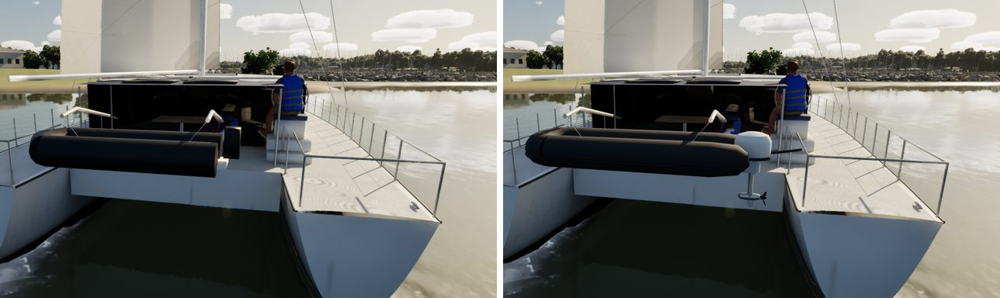
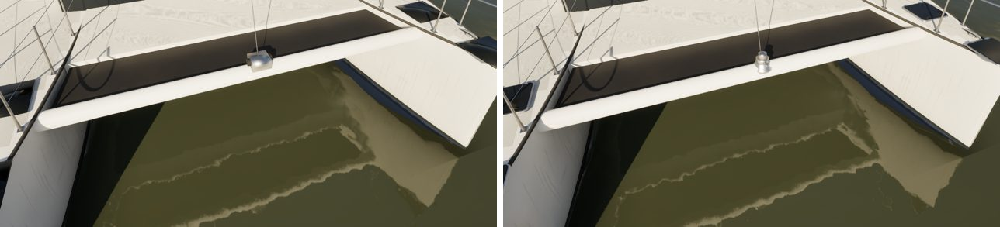

# Lagoon 42, assembly by assembly (boat fidelity: pc/lagoon-fidelity)

The last of the seven fleet boats in the boat-fidelity queue, done with the Sunfish's method. There are no Bean Lagoon
photos yet, and no Commons reference on this machine, so this pass works from the class layout and charter-cat
practice. The renders are the game at Ultra.

## What changed (`Tools/blender/build_fleet.py`)

| Assembly | Before | Now |
| --- | --- | --- |
| Tender on the davits | black cylinders, a plank and a box | a RIB: hypalon tubes swept round the bow and tapering to cones past her transom, a rubbing strake, a moulded GRP hull with its keel line, a floor and a thwart, and the kit's brand-free outboard on her transom |
| Windlass | a box and a cylinder | a vertical windlass: its base, the motor housing, the chain gypsy, the warping drum on top, a stripper toward the roller |
| Foredeck hatches | dark boxes | the kit's low acrylic hatches |

There is a new helper, `ttube`, for tubes whose radius changes along them.

## Kept as they were

- **Sockets:** all unchanged, so there were no socket moves to report.
- **Measures:** FleetMesh's are unchanged.
- **Triangles:** hull 256,212 (Nanite).
- **Material slots:** unchanged.
- **The helm station:** as it was (pc/lagoon-helm).

## Renders (before | after)

