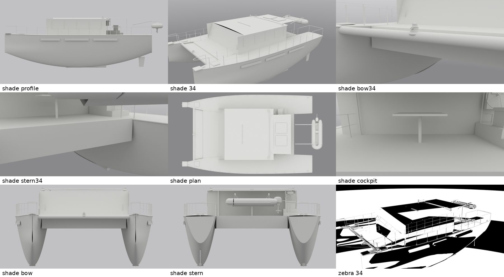
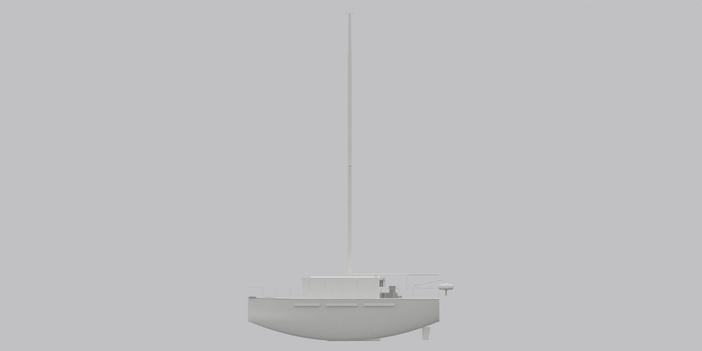

# Lagoon 42 rebuild, slice 0: size card, size check, references and "before"

The Lagoon 42 is the fleet's big cruising catamaran (the Corsair 880 is the trimaran). She has never had the rebuild
the J/22, Sunfish, Catalina 22, frigate and J-Class got: she is still drawn by the shared fleet template
(`Tools/blender/build_fleet.py`, the `Lagoon42` branch and `lagoon_detail`), set to her sizes and dressed with kit
hardware in the October fidelity pass. Bean asked for the bigger cat's full rebuild on Nov 25 2026, by the same
process, ahead of the Hobie 16's (which goes on in its own thread).

This is post-slice work: nothing here is imported into Unreal and nothing in the game changes. The new files are under
`Tools/`, so the pull request still needs Bean's `bean-approved` label (the Sensitive files check), and it stays a draft
until after the Dec 11 release.

## The plan

One draft pull request per slice, each checked against the size card below:

| Slice | What | Where |
| --- | --- | --- |
| 0 | Size card, size check, references, "before" renders | cloud (this) |
| 1 | The two hulls: near-plumb stems, the topsides' chine, hull windows, sugar-scoop sterns | cloud |
| 2 | Bridge deck and its nose, the forward crossbeam, bowsprit, trampolines and the forward lounge well | cloud |
| 3 | Deck, coachroof, the saloon's windows | cloud |
| 4 | Cockpit, the raised helm station, the hard top | cloud |
| 5 | Keels, rudders, saildrives and propellers | cloud |
| 6 | Mast, spreaders, standing rigging | cloud |
| 7 | Sails: square-top main, self-tacking jib (and the Code 0's furler) | cloud |
| A | Milestone: Bean looks at stills | Bean |
| 8 | Hardware, running rigging, nets, swim steps, davits | cloud |
| B | Milestone: Bean looks again | Bean |
| 9 | The saloon you can walk into (like the frigate's below decks) | cloud |
| 10 | Textures and wear | cloud |
| 11 | Light copy (a quarter of the detailed boat), sockets | cloud |
| 12 | Physics hulls and keels, gates | Mac, after Dec 11 |
| 13 | Import and gates | PC, after Dec 11 and Bean's "resume pc" |

## Words used here

- **Bridge deck:** the platform between the two hulls that carries the saloon. **Bridge-deck clearance:** its
  underside's height over the water; too low and waves slam it.
- **Nacelle (bridge-deck nose):** the rounded front of the bridge deck under the saloon's front windows.
- **Coachroof:** the saloon's roof. **Hard top:** the rigid roof over the cockpit, here joined to the coachroof.
- **Chine:** a crease along the hull's side where the topsides change angle. **Sugar scoops:** the stepped sterns down
  to the swim platforms.
- **Air draft:** the masthead's height over the water. **Light displacement:** the empty boat's weight.
- **Self-tacking jib:** a jib whose sheet runs to one car on a track across the deck, so it tacks with no one touching it.
- **Sockets:** named points on the model where the game hangs the rig's wires, the ropes and the crew.
- **Shape loop:** the J/22's way of reshaping a boat in rounds: fixed camera views, measurements by part, and blind
  reviewers. **Zebra stripes:** a mirror-like render that shows whether a surface is smooth ("fair").

## The size card

`Tools/shipkit/lagoon42/specs_lagoon42.json` holds her published sizes, the source of each, the game's current physics
numbers, how the check measures each target, and the triangle and texture budgets per slice. The tolerance is 3%, as
for the C22 and the Hobie.

| Measure | Published (Lagoon) | Target |
| --- | --- | ---: |
| Hull length | 42 ft | 12.79 m |
| Length overall, with the bowsprit | 43 ft 4 in | 13.22 m |
| Waterline length | (not published) | 12.5 m |
| Beam | 25 ft 2 in | 7.68 m |
| Draft | 4 ft 2 in | 1.26 m |
| Air draft | 67 ft 7 in | 20.6 m |
| Light displacement (EEC) | 26,681 lb | 12.1 t |
| Square-top main / self-tacking jib | 635 / 377 sq ft | 59 / 35 m² |

Every published number was read on Lagoon's own page for the boat. Lagoon now calls her its previous model (the
"42 Millennium" replaced her); the game keeps the 2016 boat, which her physics and polar were made from. The waterline
length isn't published by Lagoon, so it is the third-party figure the physics was fitted to, and slice 1 rechecks it.

**Her weight and her waterline.** The game floats her at 15.5 t: the 12.1 t light boat plus 3.08 t of water, fuel,
tender and stores and four 80 kg crew (`Fleet.cpp`). Lagoon's draft and air draft go with the light boat, so the
check measures from the light boat's waterline, 0.148 m above the game's: 3.4 t over her two hulls' waterplane
(24.3 m² at the game's waterline, 21.5 m² 15 cm lower, measured on today's hulls).

## The size check

`Tools/shipkit/lagoon42/lagoon42_check.py <stats.json> [<sockets.json>] [--slice N]` is the Hobie's check made for a
cruising cat. It reads the stats from `Tools/shapeloop/measure.py` and measures the hull length, beam and waterline
length; the draft (the keels' lowest point, less the load's sink); the air draft (the masthead socket plus the sink);
and the light weight (the two canoe bodies' volume, less the load and crew). The sail areas wait for slice 7's build
report.

Today's model against the card:

| Measure | Target | Today | Off |
| --- | ---: | ---: | ---: |
| Hull length | 12.790 | 12.790 | 0.0% |
| Waterline length | 12.500 | 12.510 | +0.1% |
| Beam | 7.680 | 7.700 | +0.3% |
| Draft | 1.260 | 1.122 | **-11.0%** |
| Air draft | 20.600 | 20.768 | +0.8% |
| Light weight (kg) | 12,100 | 12,015 | -0.7% |

**Her sizes and weight are right, but her hulls are the wrong shape.** Each formula hull is a deep round "banana"
canoe that reaches 1.27 m below the waterline amidships, as deep as her whole draft, and her keels are 0.2 m strips
on the bottom. A real Lagoon 42's hulls are fuller and much shallower, with a fixed keel under each one doing the rest
of the draft. Slice 1 makes the hulls shallower and fuller at the same volume, and slice 5 hangs real keels under them.

**Her draft is 14 cm short** if Lagoon's 1.26 m is the light boat's figure, as read here. If Lagoon quotes it loaded,
today's keels are right. Slice 5 settles which before it sets the keels' depth.

Triangles as built: 356,612 in all. The two hull shells are 33,588, the keels 1,520, the rudders 716, the mast and
boom 1,850, and everything else (bridge deck, saloon, bimini, crossbeam, nets, helm station, davits, tender and the kit
hardware) is 318,938 in one object. The detailed boat may go to 3 million (Bean, Nov 9); the card budgets about
2.0 million outside, 0.8 million for the saloon, and a light copy of about 0.7 million.

`Tools/shapeloop/sections_lagoon42.json` names today's parts for the loop. Today's model builds the bridge deck,
saloon and hardware into one object, so `fittings` holds all of them until slice 2's build names the bridge deck.

## Before: today's model



Clay renders from the shape loop's fixed cameras (`Tools/shapeloop/render_set.py`), so every later slice renders the
same views for its before-and-after sheet. Each view is in `baseline/` at 1200 px. What they show against the real
boat, which the slices fix:

- **Hulls (slice 1):** deep round sections that come to a point at the keel, the same rocker fore and aft, raked
  overhanging stems, a dead-flat sheer, and thin strips for hull windows. The real hulls have near-plumb stems, a
  chine along the topsides, long slim windows and stepped sugar-scoop sterns.
- **Bridge deck (slice 2):** a flat-ended box with a flat underside, and a plain tube for the forward crossbeam. The
  real boat has a rounded nose under the saloon's front windows, a forward lounge well between the trampolines, and a
  short bowsprit for the Code 0 (the photo below shows the well).
- **Coachroof and saloon (slice 3):** straight vertical walls and a flat cambered lid. The real coachroof's front
  windows are near vertical in a dark band and its sides slope in.
- **Cockpit and helm (slice 4):** a soft flat bimini on four legs. The real boat has a composite hard top joined to
  the coachroof, carrying the mainsheet traveller; the raised helm station is there today and keeps its place.
- **Rig (slice 6):** a plain tube mast stepped on the roof; the spreaders and shrouds are only sockets.



## Reference photos

`Tools/shipkit/lagoon42/refs.json` lists the photos for looking and measuring: CC0, public domain or plain CC BY only
(no NC, ND or SA), never traced, never in the repo. Unlike the Hobie, the Lagoon 42 has almost no open-licence photos:

- Wikimedia Commons has no file of a Lagoon 42. Its Lagoon category holds other models (380, 400, 450 F, 500 and up),
  two files or fewer each, none from the 42's generation.
- Openverse and Flickr's own search, filtered to CC BY, CC0 and public domain, find one: `Two Canoes - 2019 42ft
  LAGOON 42 Catamaran Yacht` (CC BY 2.0, Craig Doring, Bahamas Catamaran Charters), a drone view of a 2019 boat at
  anchor from off her bow. It is the best single view for slices 1 to 4.
- The same owner's other four Lagoon 42 photos are all rights reserved, and a 2012 "lagoon42" photo is an older boat.

Lagoon's own photos, drawings and virtual tour, and charter and broker listings, are copyrighted. Whether the rebuild
may look at them for shape (never traced, never stored) is Bean's call; Bean's own photos of a Lagoon 42 at a boat
show or charter base would be the best reference either way.

## Reproduce

```
SRC=Source/SailingPhysics
clang++ -std=c++17 -O2 -I$SRC/Public $(ls $SRC/Private/*.cpp | grep -v SailingPhysicsModule.cpp) \
    Tools/BoatExport/main.cpp -o <work>/boat-export
<work>/boat-export lagoon42 <work>/lagoon42.json
FLEET_SHAPE_BLEND=1 blender -b --factory-startup -P Tools/blender/build_fleet.py -- <work>/lagoon42.json Lagoon42 <work>
blender -b -P Tools/shapeloop/measure.py -- <work>/Lagoon42_shape.blend Tools/shapeloop/sections_lagoon42.json <work>/before
blender -b -P Tools/shapeloop/render_set.py -- <work>/Lagoon42_shape.blend Tools/shapeloop/sections_lagoon42.json <work>/hull --res 1200
blender -b -P Tools/shapeloop/render_set.py -- <work>/Lagoon42_shape.blend Tools/shapeloop/sections_lagoon42.json <work>/rig --res 1200 --with-other
python3 -I Tools/shipkit/lagoon42/docs_lagoon42.py <work>/hull <work>/rig docs/lagoon42-1/baseline
python3 -I Tools/shipkit/lagoon42/lagoon42_check.py <work>/before/stats.json <work>/Lagoon42_sockets.json
```

In the cloud, `blender -b -P <script> --` was a Python 3.13 venv with `pip install bpy numpy pillow` (bpy 5.3), through
a wrapper that imports `bpy` first and sets `sys.argv`, as for the C22 and the Hobie. The check exits non-zero on
today's model (the draft): that is the "before".

## Next: slice 1, the hulls

Her own hulls from sections, in a new build in `Tools/shipkit/lagoon42/`: shallower and fuller below the water at the
same light weight, near-plumb stems, the topsides' chine, the windows and the sugar-scoop sterns. Slice 1 solves the
camera of the drone photo, checks fairness, volume and trim against the card, and puts three blind reviewers on it
against today's model. Below the waterline the new hulls are the design for slice 12's physics; until then the game
keeps today's physics hulls.
