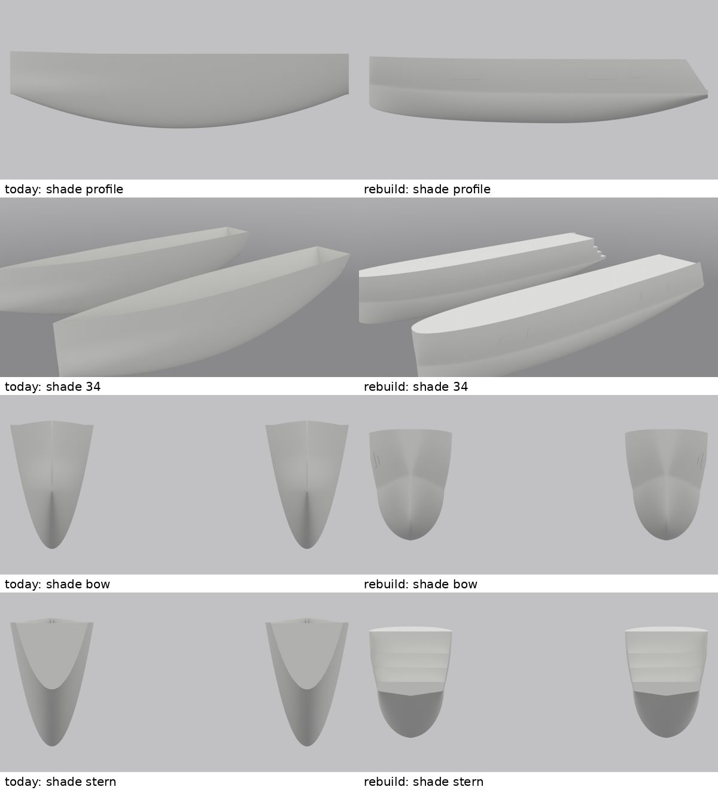
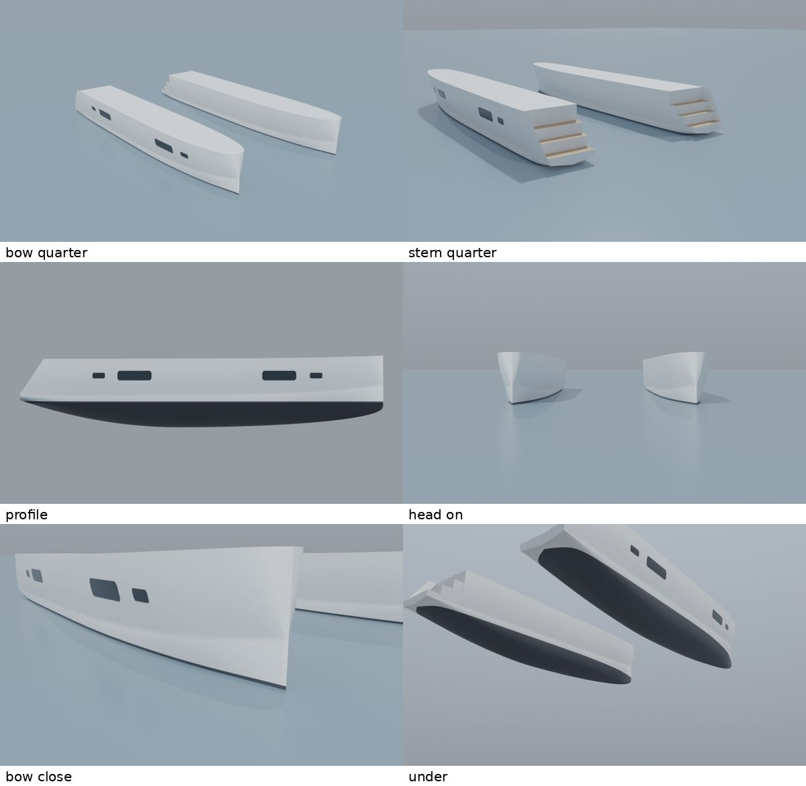
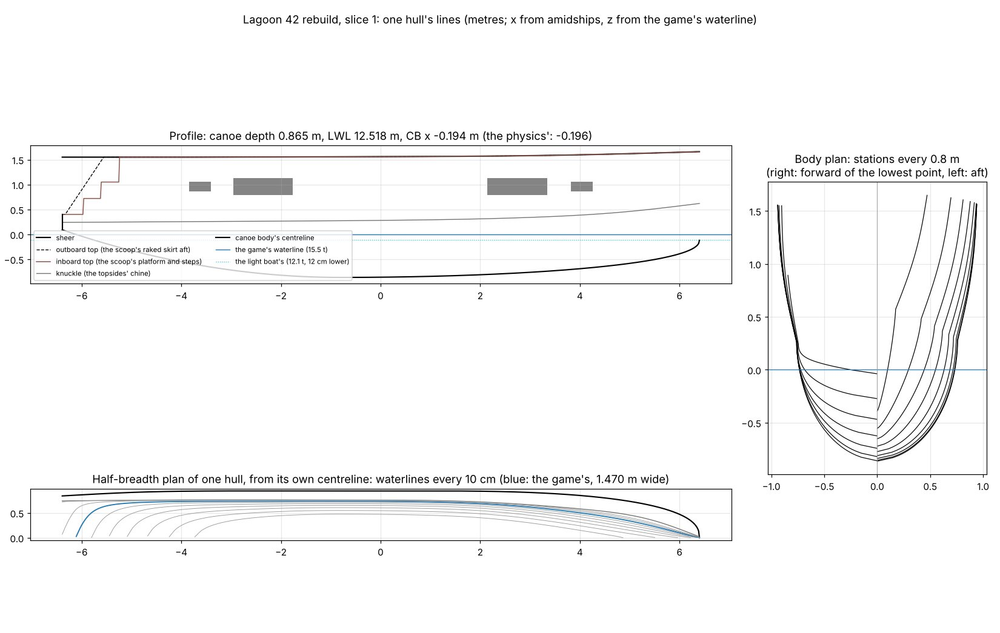

# Lagoon 42 rebuild, slice 1: the two hulls

Slice 1 gives the Lagoon 42 hulls of her own. Slice 0 (`docs/lagoon42-1`) showed that today's fleet-template hulls are
the right size but the wrong shape: deep round "banana" canoes that reach 1.27 m under the water, as deep as her whole
draft. The new hulls are shallower and fuller at the same weight. They have plumb stems, a knuckle (a soft crease)
along the topsides, four hull windows a side and sugar-scoop sterns with a swim platform and two steps.

Nothing is imported into Unreal and nothing in the game changes. The game keeps today's model and physics hulls until
slices 12 and 13. The new files are under `Tools/`, so the pull request needs Bean's `bean-approved` label, and it stays
a draft until after the Dec 11 release.





## Words used here

Slice 0's README explains the boat words (bridge deck, chine, sugar scoops, shape loop). New here:

- **Lines:** the curves a hull is drawn from. The **profile** is her side outline, the **half-breadth plan** her
  waterlines seen from above, the **body plan** her cross-sections (**sections** or **stations**).
- **Knuckle:** a crease running along the hull's side. Below it is the rounded underwater body; above it the topsides
  lean outward (**flare**) up to the deck's edge (the **sheer**).
- **Canoe body:** the hull without its keel and rudder. **Canoe depth:** how far it reaches under the waterline.
- **Forefoot:** where the stem curves into the bottom. **Run:** the bottom aft, rising to the transom.
- **Centre of buoyancy (CB):** the centre of the underwater volume. The boat floats level when it sits under her centre
  of weight, so it has to match the physics' (x -0.196 m).
- **Waterplane:** the area of the hulls where the water cuts them. The bigger it is, the less a load sinks her.
- **Boot top:** the line between the white topsides and the dark antifouling paint.
- **Skirt:** the outboard wall of the sugar scoop, raked from the swim platform up to the deck.
- **Fair:** smooth, with no bumps, flats or creases that weren't meant. An **inflection** is a line bending one way and
  then the other; a **kink** is a sharp peak in how fast it bends.

## How she's drawn

`Tools/shipkit/lagoon42/lines_lagoon42.json` holds a few curves, and `hull_lagoon42.py` turns them into a surface. The
design is one hull, mirrored about its own centreline and set 2.9 m either side of the boat's, as today's are.



- **The ends.** The plumb stem stands at x 6.40 and the transom at x -6.39 (12.79 m, Lagoon's hull length), where
  today's are, so the game's sockets and physics still line up. The 0.43 m bowsprit is slice 2's.
- **The sheer** is 1.56 m over the game's waterline amidships, nearly flat, rising 10 cm to the bow.
- **The deck's edge, seen from above,** is 0.94 m from each hull's centreline at its widest (the boat is 7.68 m wide,
  Lagoon's beam). It is full aft for the cabins and the scoops. Forward it keeps its width well toward the bow and then
  rounds into a blunt nose at the stem, as her bows look in the drone photo (below).
- **The knuckle** runs 0.24 m over the water at the transom, rising to 0.62 m at the stem. Below it each section is a
  rounded canoe body with 8° of deadrise (a shallow V at the keel): firm and full aft, round amidships, a V forward.
  Above it the topsides flare out to the sheer with a slight outward bow.
- **The profile.** The plumb stem goes down to 12 cm under the waterline and turns into the bottom through a round
  forefoot. The bottom is flat at its lowest point, 0.8 m aft of amidships. The run aft rises in one smooth bend to the
  transom's foot, 9 cm over the game's waterline, so the waterline ends 27 cm forward of the transom.
- **The sugar scoops.** Aft, each hull's inboard top steps down to a teak swim platform 0.40 m over the game's
  waterline (0.42 m long), then up two steps (0.72 m and 1.05 m, 0.36 m deep each) to about the cockpit's level. The
  last riser climbs to the deck here; slice 4 builds the cockpit sole the steps really lead to. Outboard, a skirt rakes
  from the platform's corner up to the deck 0.83 m forward of the transom, so the steps sit inside a wall on the
  outboard side and open to the cockpit inboard.
- **The hull windows.** Four on each hull's outboard side, flush dark panes with rounded corners: a long one (1.2 m)
  and a small one (0.44 m) toward each end, all centred about 0.96 m over the water. None inboard.
- **A placeholder deck,** a flat lid at the sheer from the scoops to the stems, so the renders read as hulls and not
  open boxes. Slice 3 builds the real deck in its place.

The canoe depth isn't drawn: `solve_depth` finds the depth at which both hulls, plus an allowance of 0.56 m³ for the
two keels and two rudders (a guess until slice 5 builds them), float the game's 15.5 t. It comes out at 0.865 m under
the game's waterline.

`build_lagoon42.py` meshes it in Blender: 228 stations along her length (closer together at the ends and doubled at each
riser) by 121 points round each section (closer together near the keel). It cuts the shell 5 cm over the game's
waterline for the boot top. The two hulls with their scoops are 111,606 triangles and the windows 3,072, against the
slice's budget of 350,000; the placeholder deck is 758.

## Against the size card

`lagoon42_check.py` on the new build:

| Measure | Target | Rebuild | Off |
| --- | ---: | ---: | ---: |
| Hull length | 12.790 | 12.790 | 0.0% |
| Waterline length | 12.500 | 12.520 | +0.2% |
| Beam | 7.680 | 7.680 | 0.0% |
| Light weight (kg) | 12,100 | 12,094 | -0.05% |
| Draft | 1.260 | slice 5 (the keels) | |
| Air draft | 20.600 | slice 6 (the mast) | |

The check passes. Her shape below the water against today's:

| | Today | Rebuild |
| --- | ---: | ---: |
| Canoe depth under the game's waterline | 1.269 m | 0.865 m |
| Canoe depth when light (12.1 t) | 1.121 m | 0.748 m |
| Centre of buoyancy, x (physics -0.196) | -0.196 | -0.194 |
| Centre of buoyancy, height | -0.425 | -0.307 |
| Waterplane, both hulls | 24.3 m² | 30.3 m² |
| The game's load sinks her by | 0.148 m | 0.117 m |

Each new hull is 1.470 m wide at the waterline, 8.5 times as long as it is wide there, with a prismatic
coefficient (how full her ends are against her middle) of 0.64, in the usual range for a cruising cat's hulls.

Two things follow for later slices:

- **Her load sinks her less.** The new hulls' waterplane is a quarter bigger, so the game's 3.4 t of stores and crew
  sink her 11.7 cm, not 14.8. The build report now carries the hulls' own sink (`load_sink_m`), and the check measures
  the draft and air draft from it, not from the card's figure for today's hulls.
- **The keels have more to do.** Light, the canoe body reaches 0.75 m down, so slice 5's keels must reach 0.51 m under it
  for Lagoon's 1.26 m draft (today's 0.2 m strips leave her 11% short).

The physics keeps today's hulls until slice 12. The new ones carry their buoyancy 12 cm higher and have a bigger
waterplane, so slice 12 will find her stiffer and quicker to pitch, and checks her trim and polar again then.

## What the photos say

- **The CC BY drone photo** (`refs.json`, Craig Doring, Flickr, CC BY 2.0), looked at and compared by eye: her bows
  keep their width at the deck almost to the stem and end in a blunt, rounded nose over a fine entry, with the
  topsides flaring out above a line low on the hull. The first build's deck edge tapered to a point, so the bow's plan
  was redrawn as a superellipse that holds its width (above). The hull windows read as drawn: from forward, a small one,
  a long one, then a long one and a small one aft, at about mid-height.
- **Lagoon's own profile sketch and photos,** studied by eye under Bean's "look, never copy" (Nov 25): nothing traced,
  saved or put in the repo or the game. They gave the plumb stem, the knuckle, the window layout, the sugar scoop
  ("just two steps" from the swim platform to the cockpit) and its raked outboard skirt. They also show the helm station
  on the **port** side of the cockpit, where today's model has it to starboard: slice 4 checks that and moves it.
- **The drone photo's camera isn't solved yet.** A solve needs points spread in depth, and the hulls alone give only
  points along the sheer and waterline (the photo match loop warns that those leave the camera's height free). Slice 3's
  coachroof and its windows give the points, so the solve moves there.

## Fairness

`Tools/shapeloop/fairness.py` cuts the hull shell with 10 waterline and 10 station planes:

- **The waterlines in the topsides** (6 planes from 0.28 m to 1.46 m over the water) have no kinks and no inflections.
  Today's had 3 to 7 kinks each.
- **The underwater waterlines** have kinks only at their ends: at the stem's edge and where they close at the keel's
  shallow V. The one 19 cm under the water bends both ways near the stem, where it runs round the forefoot (a slight
  hollow just aft of the stem), and once more aft: 4 inflections on that line, none on the others.
- **The stations** each have two inflections a side, at the knuckle: the rounded body below and the flared topsides
  above bend one way and the crease between them the other. Their kinks are the knuckle and the keel's V, both drawn on
  purpose. Aft, the firm bilge of the full stern sections and the V's shoulders add four more.

There are no bumps or flats where none were drawn. The first build had one: its run aft started steeper than flat
(a power under 1), which put a point in the keel line at the lowest station and a kink in two waterlines. The run is now a
power of 2, flat at the lowest point.

## Not yet

- **Blind reviewers** look at Milestone A, after slice 7, when there is a whole boat to judge.
- **The bridge deck** meets the hulls' inboard topsides in slice 2, and **the deck** replaces the lid in slice 3.
- **The keels and rudders** are slice 5's; their 0.56 m³ allowance in the volume is replaced by their own then.

## Reproduce

```
blender -b --factory-startup -P Tools/shipkit/lagoon42/build_lagoon42.py -- <work>/s1
blender -b -P Tools/shapeloop/measure.py -- <work>/s1/lagoon42.blend Tools/shapeloop/sections_lagoon42_rebuild.json <work>/s1/m
python3 -I Tools/shipkit/lagoon42/lagoon42_check.py <work>/s1/m/stats.json --slice 1
blender -b -P Tools/shapeloop/fairness.py -- <work>/s1/lagoon42.blend <work>/s1/fair --object L42_Hull
blender -b -P Tools/shapeloop/render_set.py -- <work>/s1/lagoon42.blend Tools/shapeloop/sections_lagoon42_rebuild.json <work>/s1/r --res 1200
blender -b -P Tools/shipkit/lagoon42/render_lagoon42.py -- <work>/s1/lagoon42.blend <work>/s1/v --res 1200
python3 Tools/shipkit/lagoon42/lines_plot_lagoon42.py docs/lagoon42-2/lines.jpg <work>/s1/lagoon42_report.json
python3 -I Tools/shipkit/lagoon42/docs_lagoon42.py --slice <work>/before_hull <work>/s1/r <work>/s1/v docs/lagoon42-2
```

`<work>/before_hull` is `render_set.py` on slice 0's `Lagoon42_shape.blend` with a sections file holding only her
`hull` section, so the before and after frame the hulls alike. `python3 -I Tools/shipkit/lagoon42/hull_lagoon42.py`
prints the hydrostatics without Blender. In the cloud, `blender` was the pip `bpy` 5.3 venv (with numpy, scipy,
matplotlib and Pillow) through the wrapper slice 0 describes.

## Next: slice 2, the bridge deck

The bridge deck between the hulls with its rounded nose under the saloon's front windows, its underside clear of the
water (the card's 0.85 m), the forward crossbeam, the bowsprit, the trampolines and the forward lounge well the drone
photo shows between them.
