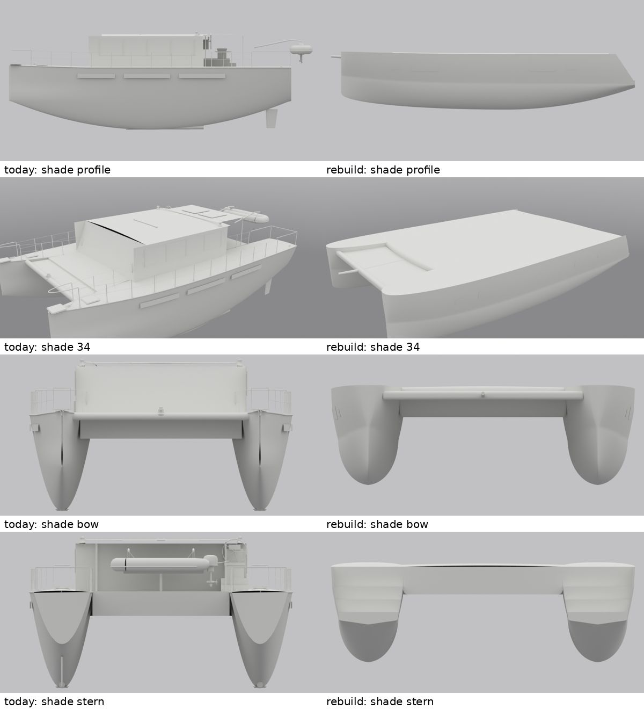
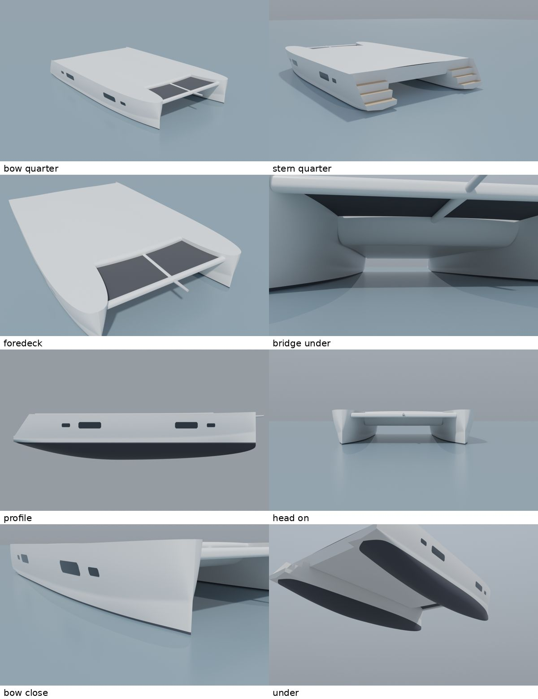

# Lagoon 42 rebuild, slice 2: the bridge deck, the crossbeam and the trampolines

Slice 2 builds the platform between the Lagoon 42's two hulls and what sits forward of it: the bridge deck with its
rounded nose, the flat foredeck in front of the saloon, the forward crossbeam between the bows, the centre beam, the
short bowsprit and the two trampolines. Today's model has a flat-ended box for the bridge deck and a plain tube for the
crossbeam (`docs/lagoon42-1`).

Nothing is imported into Unreal and nothing in the game changes. The new files are under `Tools/`, so the pull request
needs Bean's `bean-approved` label, and it stays a draft until after the Dec 11 release.





## Words used here

Slices 0 and 1 explain the boat words used before. New here:

- **Nose (nacelle):** the rounded front of the bridge deck, under the foredeck.
- **Fillet:** a rounded inside corner, here where the bridge deck's underside meets each hull.
- **Crossbeam:** the beam across the bows that holds the hulls together forward and carries the forestay.
- **Centre beam:** the beam along the centreline from the bridge deck to the crossbeam, between the trampolines.
- **Trampolines:** the nets stretched between the hulls forward of the bridge deck.
- **Bowsprit:** the short spar past the bows for the Code 0's tack (the Code 0 is a big light-air headsail).
- **Furler:** the drum that rolls the jib up round its forestay.

## How it's drawn

`Tools/shipkit/lagoon42/bridgedeck_lagoon42.json` holds the numbers, and `bridgedeck_lagoon42.py` turns them into
surfaces that end on the hulls of slice 1. `span(x, z)`, the half-width of the open water between the two hulls'
inboard topsides at any station and height, is what the bridge deck, the crossbeam and the trampolines are cut to.

- **The underside** is flat, 0.85 m over the game's waterline (0.97 m over the light boat's), from the top of the
  sugar scoops' steps (x -5.25, where slice 4's cockpit sole starts) forward to the nose. It is 4.04 m wide amidships
  and turns up into each hull through a 14 cm fillet.
- **The nose** is a quarter ellipse in profile, from the underside at x 3.70 forward and up to the foredeck's front
  edge at x 4.25, 4 cm under the sheer. In plan it bows 14 cm forward at the centreline. Its fillets fade out as it
  rises.
- **The foredeck** runs from the nose aft to the saloon's front (x 2.8), at the hulls' sheer with 3 cm of camber. Aft
  of it, a flat placeholder lid at the sheer covers the bridge deck until slice 3's saloon and slice 4's cockpit
  stand there. A flat aft face closes the bridge deck at x -5.25.
- **The forward crossbeam** is at x 6.05, about 35 cm aft of the stems, as the drone photo shows it meeting each hull's
  deck just behind the stem's head. It is a rounded box 0.20 m fore and aft by 0.22 m deep, its top 14 cm under the
  hulls' deck, and it runs 4.99 m between the hulls with its ends 3 cm into them.
- **The centre beam** is a rounded tube 0.16 m square, from inside the nose to the crossbeam's middle.
- **The bowsprit** runs from the crossbeam's middle to 0.43 m past the stems (x 6.83), 13 cm thick at its root and 9 cm
  at its tip, rising 5 cm.
- **The trampolines** are two nets, one each side of the centre beam, from the nose (x 4.10 at the hulls, 4.24 at the
  centre beam) to the crossbeam's aft face (x 5.95). They hang 13 cm under the foredeck's front and sag 4 cm in the
  middle. Their edges run 2 cm into the crossbeam and the centre beam: laid exactly to the beams' sides, the beams'
  rounded corners left a slot that let the sun draw a bright streak on the nose.

The bridge deck is 22,491 triangles, the crossbeam with the centre beam 2,968, the bowsprit 412 and the trampolines
2,880: 28,751 against the slice's budget of 250,000. The placeholder lid is 11,040.

## What the photo says

The drone photo (`refs.json`, CC BY 2.0) was looked at and measured by eye for the places along her length:

- **The trampolines** run from about 4.1 m forward of amidships at the hulls to the crossbeam, a little shorter than
  the gap between the hulls is wide. The bridge deck's front stays about where today's box ends (x 4.3).
- **The crossbeam** meets each hull's deck just behind the stem's head, so it went forward from today's x 5.2 to 6.05,
  and the trampolines are twice as long as today's 0.9 m.
- **No forward lounge well.** Slice 0's write-up named a lounge well between the trampolines. On a closer look the
  photo shows the two trampolines either side of a centre beam, and a flat foredeck with hatches in front of the
  saloon. The rebuild follows the photo.

## Against the size card

`lagoon42_check.py` now measures the **length overall**: from the transom to the foremost point of anything built,
once something reaches past the stems. With the bowsprit it is 13.220 m, Lagoon's 13.22. The rest is as in slice 1:
hull length 12.790, waterline 12.520, beam 7.680, light weight 12,094 kg. The check passes.

## For later slices

- **The forestay.** The real furler sits on the crossbeam's middle at about x 6.05. Today's `ForestayTack` socket is on
  today's crossbeam at x 5.2, which is now over the trampolines. Slice 6 moves the socket. The physics' jib (slice 12) follows it, so her sail plan is
  checked again there.
- **The bridge deck's clearance** is today's game value, 0.85 m over the game's waterline. It isn't published and the
  drone photo doesn't show it. The build report carries it (`bridgedeck_clearance_m`, `bridgedeck_clearance_light_m`)
  so a photo from the side can check it later.
- **Inside the bridge deck,** the hulls' inboard topsides still run up to the sheer. They are hidden now. Slice 9's
  walkable saloon cuts them away where the saloon opens into the hulls.

## Reproduce

```
blender -b --factory-startup -P Tools/shipkit/lagoon42/build_lagoon42.py -- <work>/s2
blender -b -P Tools/shapeloop/measure.py -- <work>/s2/lagoon42.blend Tools/shapeloop/sections_lagoon42_rebuild.json <work>/s2/m
python3 -I Tools/shipkit/lagoon42/lagoon42_check.py <work>/s2/m/stats.json --slice 2
blender -b -P Tools/shapeloop/render_set.py -- <work>/s2/lagoon42.blend Tools/shapeloop/sections_lagoon42_rebuild.json <work>/s2/r --res 1200
blender -b -P Tools/shipkit/lagoon42/render_lagoon42.py -- <work>/s2/lagoon42.blend <work>/s2/v --res 1200
python3 -I Tools/shipkit/lagoon42/docs_lagoon42.py --slice <work>/hull <work>/s2/r <work>/s2/v docs/lagoon42-3
```

`<work>/hull` is slice 0's "before": `render_set.py` on today's `Lagoon42_shape.blend` with
`Tools/shapeloop/sections_lagoon42.json`, the boat without her rig. `python3 -I
Tools/shipkit/lagoon42/bridgedeck_lagoon42.py` prints the main numbers without Blender.

## Next: slice 3, the deck, the coachroof and the saloon's windows

Each hull's deck with its camber, toe rail and hatches in place of the lid, and the coachroof over the saloon with its
dark band of near-vertical front windows and its sloping sides. The coachroof's corners give the drone photo's camera
solve the points in depth it needs, so slice 3 solves it and lays the model over the photo.
