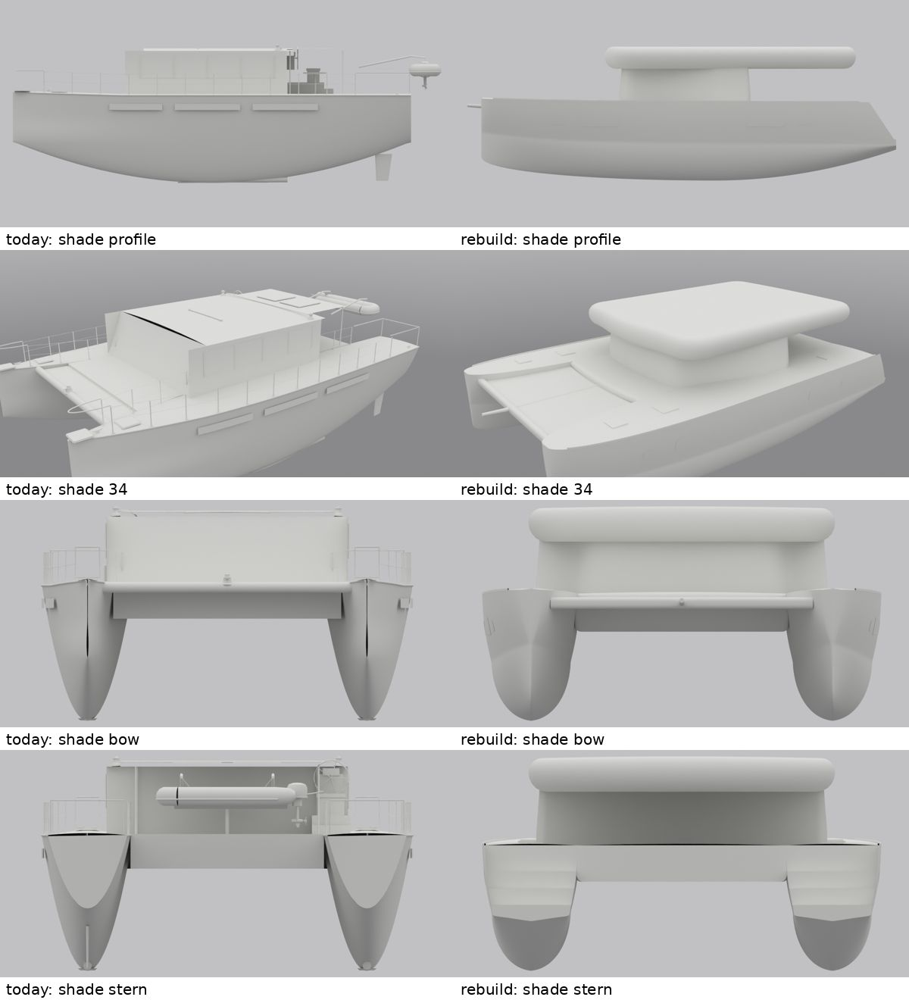
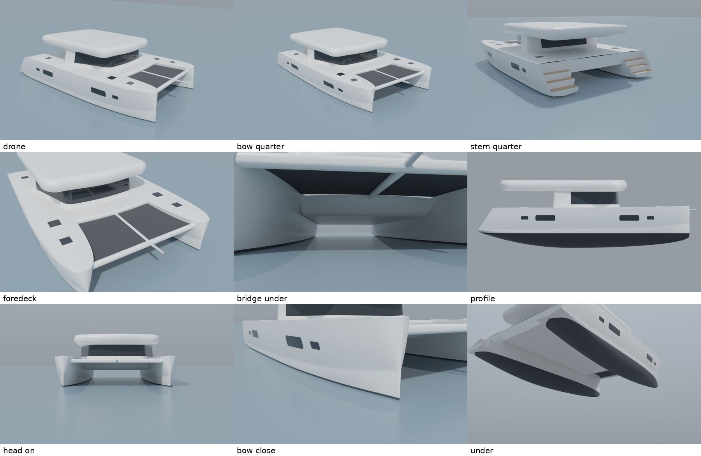

# Lagoon 42 rebuild, slice 3: the decks, the saloon's windows and the roof

Slice 3 builds what stands on top of the hulls and the bridge deck. Each hull gets its own deck with a slight crown, a
toe rail along the outside edge and three hatches. The saloon gets its walls with the dark band of front and side
windows. Over the saloon and the cockpit goes the roof, which is one big moulding with a thick rounded edge. It also
solves the drone photo's camera, so the photo can be measured, and lays the model over the photo as a check.

Nothing is imported into Unreal and nothing in the game changes. The new files are under `Tools/`, so the pull request
needs Bean's `bean-approved` label. It stays a draft until after the Dec 11 release.





## Words used here

Slices 0 to 2 explain the boat words used before. These are the new ones:

- **Camber (crown):** a deck rises slightly in the middle so that water runs off it.
- **Toe rail:** a low lip along the deck's outer edge that stops your foot (and things on deck) going over the side.
- **Hatch:** an opening window in the deck over a cabin, flush with the deck in a low frame.
- **Saloon:** the big room on the bridge deck between the hulls, with the galley and the table.
- **Coachroof and hard top:** the roof over the saloon and the fixed roof over the cockpit behind it. On the Lagoon 42
  they are one moulding, and this write-up calls it **the roof**.
- **Plinth:** the white wall under the windows.
- **Rake and tumblehome:** a wall leaning back (rake, the front windows) or leaning in (tumblehome, the sides) as it
  rises.
- **Camera solve:** finding where a photo was taken from, which way it points and its lens, from points picked on the
  photo whose place on the boat is known. Once it's solved, any pixel in the photo can be turned back into a place on
  the boat.

## How it's drawn

`Tools/shipkit/lagoon42/saloon_lagoon42.json` holds the numbers, and `saloon_lagoon42.py` turns them into surfaces.
That script is pure geometry and needs no Blender. `build_lagoon42.py` meshes them as `L42_Deck`, `L42_Hatches`,
`L42_Saloon` and `L42_Roof`, which replace slice 2's deck placeholder on the hulls.

- **The hulls' decks** run from the top step of the sugar scoop (x -5.25) to the stem. Each spans its hull from the
  inboard sheer to the outboard sheer and is crowned 3 cm over the hull's centre.
- **The toe rail** runs along each hull's outboard edge from x -5.25 to the crossbeam (x 6.05). It is 3.5 cm high and
  3 cm wide.
- **The hatches** sit on each hull's centreline over the cabins: two forward (x 4.55, 42 cm square; x 3.05, 50 cm) and
  one aft (x -3.7, 45 cm). Each is a dark flush pane in a frame 2.5 cm proud of the deck.
- **The saloon's plan** has front windows that bow forward from the corners (x 1.95, 1.9 m either side of the
  centreline) to x 2.15 on the centreline. Each corner turns through a rounded bend into a side wall. The side wall
  runs aft and slightly outboard to where the side windows end (x -0.8, 2.75 m out), then on to the aft bulkhead (x
  -1.9, 2.8 m out).
- **The saloon's walls** stand on the foredeck and the hulls' decks. Below 1.78 m they are white. From 1.78 to 2.55 m
  they are dark glass along the front and the side windows, and on the aft bulkhead across the sliding door's 3.8 m.
  Above the glass, the walls run up into the roof. The front leans aft 8 cm over its height and the sides lean in 5
  cm.
- **The roof** runs from x 2.6 to x -5.15, so it is 7.75 m long and 5.9 m wide. In plan it is a rectangle with rounded
  corners, and its front bows 25 cm forward at the centreline. Its top is 3.26 m over the game's waterline on the
  centreline and 4 cm lower at the sides. The edge is thick and rounded: it curves out from the flat top to its widest
  at 2.95 m, then back under to a flat underside at 2.58 m. At the front it reaches 0.45 m past the windows.

The decks are 11,268 triangles, the hatches 60, the saloon 720 and the roof 6,236. That makes 18,284 against the
slice's budget of 300,000. The lid between the hulls (11,040, a placeholder) stays until slice 4 builds the cockpit.

## What the photo says

The drone photo (`refs.json`, by Craig Doring, Bahamas Catamaran Charters, CC BY 2.0) was looked at and measured, but
it is not in the repo. Only the pixel positions picked from it are. Lagoon's own photos were looked at for shape and
never traced (Bean, Nov 25: "look, never copy").

- **The camera.** `match_two_canoes.json` holds 15 points on the hulls picked by eye (the stems at the deck and the
  water, the hull windows' corners and the top of the starboard stern), plus two check points.
  `Tools/boatkit/photomatch/solve_camera.py` solves the camera from them to 5.3 px rms. That gives a lens of about
  18.6 mm on a 36 mm-wide sensor, and a drone 12.5 m forward of amidships, 14 m out to starboard and 6.8 m up
  (`match_two_canoes.camera.json`). The lens is only loosely fixed by these points, but a lens anywhere from 16 to
  21 mm moves the heights below by under 3 cm.
- **The mast's foot.** Traced back onto the centreline, it is at x -0.42 (today's game mast is at -0.4). It stands on
  the roof 3.26 m over the game's waterline. Today's coachroof is at 2.97, so the real roof is about 0.3 m higher.
- **The windows.** The dark band, drawn over the photo through the solved camera, fits front windows about 3.8 m wide,
  from 1.78 to 2.55 m up. Their corners turn aft into side windows that reach about x -0.8.
- **The roof's aft corner** traces back to about x -5.15 at the roof's height. The cockpit's roof reaches almost to
  the sugar scoops.
- **The trampolines are shorter than slice 2 drew them.** Their aft edge meets the hulls at about x 3.3, not 4.1.
  Slice 2's placement was by eye, and the solved camera is better. So the bridge deck's nose moved 0.8 m aft (it now
  runs from x 2.90 at the underside to 3.45 at the deck), and the foredeck now ends at the saloon's front corners
  (x 1.95). The trampolines are now about 2.5 m long. Slice 2's write-up gave the old numbers.

### The model laid over the photo

`render_lagoon42.py --only drone` renders the model through the solved camera (the first of the coloured views above).
`photo_lines_lagoon42.py` uses the same camera to turn the model's lines into the photo's pixels, and writes them as
JSON and as a clear SVG to lay over the photo. Drawn over the photo, these lines all land within about 5 px of the
real boat, which is the camera's own accuracy: the sheer on both hulls, the trampolines' aft edge, the crossbeam, the
hatches, the window band, the roof's outline and the mast. The two biggest misses are both small. At the port end, the
bottom of the front windows is about 8 px lower in the model than in the photo. At the front starboard corner, the
roof's rounded edge sits about 5 px higher than the photo's. Both are about the size of the solve's own error on that
side of the boat, so neither changed a number. The overlay image shows the photo itself, so it isn't in the repo.

## Against the size card

The check passes, and slice 3 changes none of its numbers: hull length 12.790, length overall 13.220, waterline
12.520, beam 7.680, light weight 12,094 kg. The build report now also carries the roof's height (`roof_top_z_m` 3.26,
`roof_top_light_m` 3.38 on the light boat) and the measured mast foot (`mast_foot_measured`).

## For later slices

- **The roof's aft half floats.** Over the cockpit it has nothing under it yet. Slice 4 builds the cockpit, the helm
  station and the posts and aft beam that hold the roof up there.
- **The mast** goes on the roof at x -0.42, 3.26 m up (slice 6). Today's mast stands on the 2.97 m coachroof, so the
  rig is checked against the 20.6 m air draft there. Slice 6 also moves `ForestayTack` to the new crossbeam (slice 2).
- **Inside the saloon** there is nothing yet, and the hulls' inboard topsides still run up through it. Slice 9's
  walkable saloon builds the inside and cuts the hulls open where the saloon steps down into them.
- **The hulls' decks may overhang inboard** a little where the trampolines meet them. The photo's two sides didn't
  agree well enough to say, so they are drawn flush.

## Reproduce

```
blender -b --factory-startup -P Tools/shipkit/lagoon42/build_lagoon42.py -- <work>/s3
blender -b -P Tools/shapeloop/measure.py -- <work>/s3/lagoon42.blend Tools/shapeloop/sections_lagoon42_rebuild.json <work>/s3/m
python3 -I Tools/shipkit/lagoon42/lagoon42_check.py <work>/s3/m/stats.json --slice 3
blender -b -P Tools/shapeloop/render_set.py -- <work>/s3/lagoon42.blend Tools/shapeloop/sections_lagoon42_rebuild.json <work>/s3/r --res 1200
blender -b -P Tools/shipkit/lagoon42/render_lagoon42.py -- <work>/s3/lagoon42.blend <work>/s3/v --res 1200
python3 -I Tools/shipkit/lagoon42/docs_lagoon42.py --slice <work>/hull <work>/s3/r <work>/s3/v docs/lagoon42-4
```

To solve the camera again: `python3 Tools/boatkit/photomatch/solve_camera.py
Tools/shipkit/lagoon42/match_two_canoes.json Tools/shipkit/lagoon42/match_two_canoes.json` (the second file stands in
for a sockets file: every point carries its own place). It needs numpy, not the photo. `<work>/hull` is slice 0's
"before" (see `docs/lagoon42-3`). `python3 -I Tools/shipkit/lagoon42/saloon_lagoon42.py` prints the main numbers
without Blender, and `python3 -I Tools/shipkit/lagoon42/photo_lines_lagoon42.py <out.json> <out.svg>` writes the lines
for the overlay.

## Next: slice 4, the cockpit and the helm

The cockpit between the saloon's aft bulkhead and the sugar scoops: its sole, the benches and the aft table, the steps
down into each hull, the raised helm station by the bulkhead (to port, as Lagoon's photos show it, where today's model
has it to starboard), and the posts and the aft beam that hold the roof up over it.
