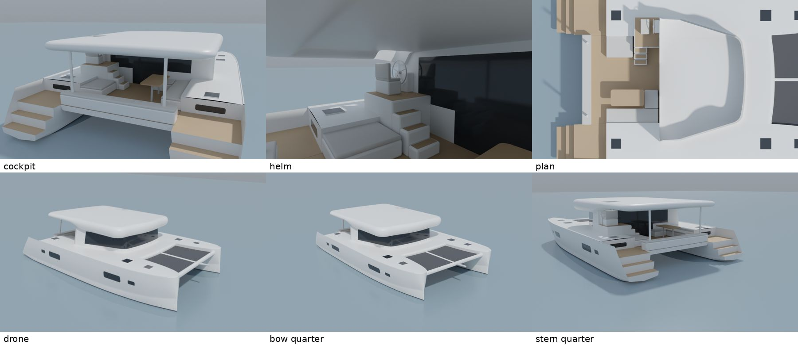
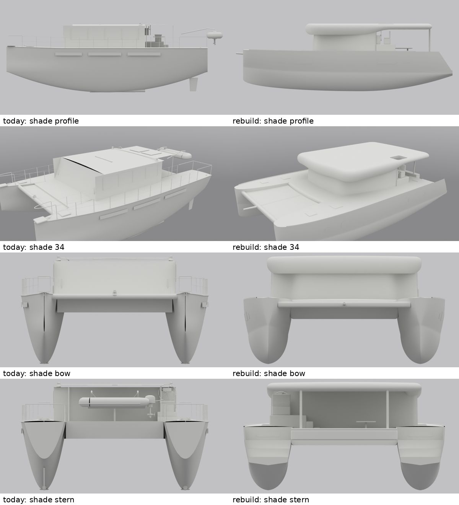

# Lagoon 42 rebuild, slice 4: the cockpit and the helm

Slice 4 builds the cockpit between the saloon's back wall and the sugar scoops. It has a teak floor, a bench across the
stern, an L-shaped settee with its table to starboard and a bench to port. It also builds the two posts that hold up
the roof's back end, and the raised helm station at the saloon's port corner with its steps, seat and wheel. The roof
gets a ceiling inside its rounded edge and an opening over the helm.

Nothing is imported into Unreal and nothing in the game changes. The new files are under `Tools/`, so the pull request
needs Bean's `bean-approved` label. It stays a draft until after the Dec 11 release.





## Words used here

Slices 0 to 3 explain the boat words used before. These are the new ones:

- **Cockpit:** the open-air living space at the back of the boat, between the saloon and the sterns, under the roof.
- **Sole:** a boat's floor.
- **Landing:** the flat top step of each sugar scoop, level with the cockpit's floor.
- **Riser:** the upright face of a step.
- **Bulkhead:** an upright wall across the boat. The saloon's aft bulkhead is its back wall, with the sliding door.
- **Settee:** a fixed bench seat, here L-shaped round the cockpit table.
- **Helm station:** where the boat is steered from: the wheel, the helmsman's seat and the engine controls.
- **Headroom:** the height you can stand up in.

## How it's drawn

`Tools/shipkit/lagoon42/cockpit_lagoon42.json` holds the numbers, and `cockpit_lagoon42.py` turns them into parts.
That script is pure geometry and needs no Blender. `build_lagoon42.py` meshes them as `L42_Cockpit`.

- **The sole** is teak, 1.05 m over the game's waterline. It runs from the bridge deck's back edge (x -5.25) to the
  saloon's aft bulkhead and reaches across to the hulls' inner sides: 4.04 m wide at the back and 3.99 m at the front.
  It is level with the saloon's floor and with the scoops' top step, "just two steps" up from the swim platforms, as
  Lagoon describes it.
- **The landings.** Each scoop's top step now runs forward over the whole hull to x -4.15, at the sole's level, so the
  cockpit opens straight onto both scoops. A riser 0.5 m high climbs from there to the side deck. Each riser has a dark
  window in it (the aft cabin's), as Lagoon's stern photo shows. Slice 1 had the step climbing to the deck at x -5.25.
- **The aft bench** runs across the stern between the hulls, from x -5.25 to -4.82, with its back to the water. Its seat
  is 0.45 m over the sole. The way in from each landing is the 0.67 m between it and the risers.
- **The posts** are round, 10 cm across, at x -5.0 and 1.65 m either side of the centreline. They run from the aft
  bench up into the roof. Slice 3 expected a beam across under the roof's back edge as well, but the edge is thick
  enough to span between the posts, so there isn't one.
- **The settee and table.** To starboard, an L-shaped settee runs along the hull from x -4.15 to the bulkhead, then back
  inboard along the bulkhead. Inside the L stands the teak table, 1.5 by 0.75 m, 0.72 m over the sole on two legs.
- **The lounge** is a bench along the port side, from x -4.15 to -2.95, aft of the helm's steps.
- **The helm** is raised at the saloon's port aft corner.
  - Its deck stands against the bulkhead, 0.95 m over the sole (0.45 over the side deck). It is 1.15 m fore and aft and
    1.41 m across, reaching out over the port side deck.
  - Three steps lead up to it from the cockpit, each 0.24 m high.
  - The seat faces forward and has a backrest.
  - A console on the bulkhead carries a 0.7 m wheel with five spokes.
  - Seated, the helmsman's eye is about 3.2 m up, level with the roof's top (3.23 m there). So the roof has an opening
    over the helm, 0.95 by 0.75 m with rounded corners, and the helmsman looks forward over the roof through it.
- **The saloon's aft bulkhead** moved 15 cm forward, from x -1.9 to -1.75, as the deck plan draws it. Between the hulls
  it now comes down to the sole. Its glass reaches 2.95 m, just under the cockpit's ceiling, and the sliding door (1.5 m
  wide) is glass from the sole up.
- **The roof's underside.** Inside its rounded edge the roof now has a lip 0.5 m wide, then a cove rising to a ceiling
  15 cm under the top. The ceiling is 2.06 m over the sole. Over the cockpit (aft of x -2.5) the lip is shallower: its
  underside is 2.9 m up and its edge 3.05 m, where at the saloon's front they are 2.58 and 2.95. So the headroom under
  the roof's back edge is 1.85 m. Between x -2.5 and -1.0 the lip eases from one depth to the other.
- **The placeholder lid** over the bridge deck now stays only inside the saloon, until slice 9 builds its floor.

The cockpit is 6,384 triangles against the slice's budget of 300,000. The roof is now 7,206 with its opening, and the
decks 10,008, since they now start at the landings (x -4.15). The whole boat so far is 173,127.

## What the plan and photos say, and what is chosen

- **Lagoon's own deck plan and stern photo** were looked at by eye for the layout. Nothing was traced, saved or put in
  the repo (Bean, Nov 25: "look, never copy"). Positions were read off the plan and rounded to about 5 cm. Heights are
  chosen for people: seats 0.40 to 0.45 m over the floor, a table at 0.72 m, steps 0.24 m high.
- **The helm is to port.** The deck plan and the stern photo both show it there, and reviews agree: katamarans.com
  describes the helm offset to port on the main bulkhead. Today's model has it to starboard (docs/lagoon-helm), which
  was a guess.
- **The drone photo can't see under the roof.** Raising the roof's back edge by 10 cm moves its outline in the photo
  by at most 3 px, which is less than the camera solve's own 5.3 px. So slice 3's overlay still holds.
- **Chosen, not measured:** the lip's depth over the cockpit (and so the headroom), the helm seat's height, the
  opening's size and the table's size.
- **The foredeck lounge.** Lagoon's deck plan draws cushions on the deck in front of the saloon, but the drone photo
  shows a bare deck there, so they aren't built. They may be an option on some boats. Slice 8 can add them if Bean wants
  them.

## Against the size card

The check passes, and slice 4 changes none of its numbers: hull length 12.790, length overall 13.220, waterline
12.520, beam 7.680, light weight 12,094 kg. The build report now also carries the cockpit: `cockpit_sole_z_m` 1.05,
`cockpit_headroom_m` 2.06, `helm_side` port and `helm_eye_m` (-2.36, -2.40, 3.20), the seated helmsman's eye.

## For later slices

- **The crew's helm position.** Today's model and the crew's helm stance (`CrewMotion.cpp`, `CrewPose.cpp`) have the
  wheel to starboard. The rebuild's helm is to port and 0.95 m up. Slice 12 moves the helm's seat, feet and the cockpit
  camera to the report's `helm_eye_m`.
- **Steps up to the side decks.** The side decks are a 0.5 m step up from the sole, and there are no steps beside the
  saloon yet. Slice 8 adds them, with the stern rail, the guard rails, the engine controls and instruments on the
  console, and the cushions' backs.
- **The sole has no drains, lockers or hatches** yet. Slice 8 adds them.
- **Inside the saloon** there is still nothing (slice 9).

## Reproduce

```
blender -b --factory-startup -P Tools/shipkit/lagoon42/build_lagoon42.py -- <work>/s4
blender -b -P Tools/shapeloop/measure.py -- <work>/s4/lagoon42.blend Tools/shapeloop/sections_lagoon42_rebuild.json <work>/s4/m
python3 -I Tools/shipkit/lagoon42/lagoon42_check.py <work>/s4/m/stats.json --slice 4
blender -b -P Tools/shapeloop/render_set.py -- <work>/s4/lagoon42.blend Tools/shapeloop/sections_lagoon42_rebuild.json <work>/s4/r --res 1200
blender -b -P Tools/shipkit/lagoon42/render_lagoon42.py -- <work>/s4/lagoon42.blend <work>/s4/v --res 1200 --only cockpit,helm,plan,drone,stern_quarter,bow_quarter
python3 -I Tools/shipkit/lagoon42/docs_lagoon42.py --slice <work>/hull <work>/s4/r <work>/s4/v docs/lagoon42-5
```

`python3 -I Tools/shipkit/lagoon42/cockpit_lagoon42.py` prints the main numbers without Blender. `<work>/hull` is
slice 0's "before" (see `docs/lagoon42-3`).

## Next: slice 5, the keels, rudders and propellers

Under each hull: a keel deep enough for Lagoon's 1.26 m draft (the light hulls float 0.75 m deep, so the keels reach
about 0.5 m below them), a rudder aft and a saildrive with its propeller.
