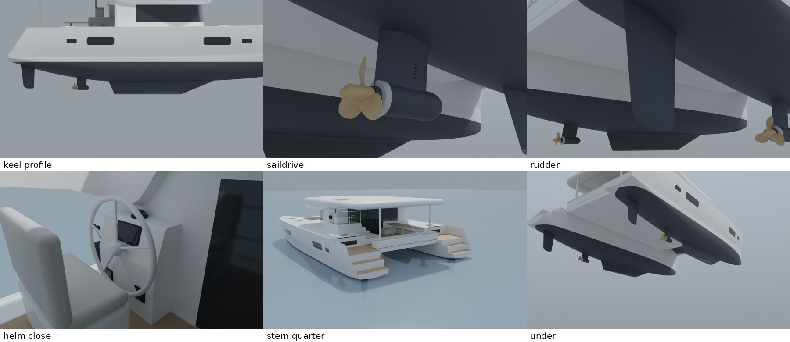
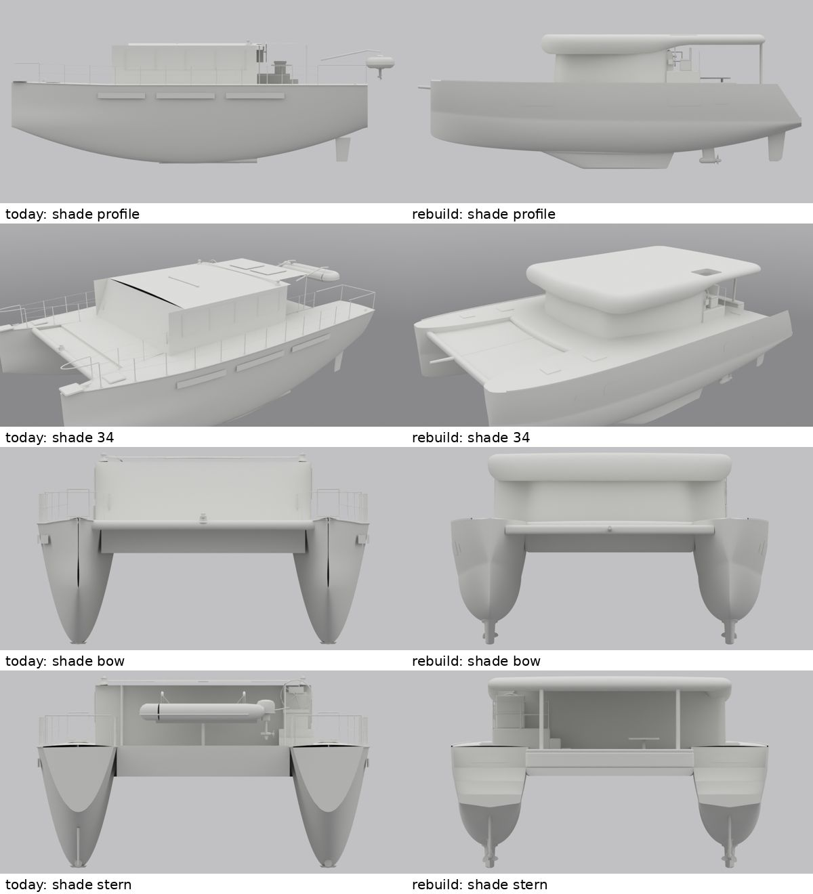

# Lagoon 42 rebuild, slice 5: the keels, rudders and saildrives

Slice 5 builds what hangs under the hulls. Each hull gets a long, low keel that reaches Lagoon's 1.26 m draft, a spade
rudder aft, and a saildrive between them with its propeller. The hulls are then solved again for the water these parts
displace, so the boat still floats at the game's 15.5 t. It also fills in slice 4's helm: the console's instruments,
the throttles, a proper wheel and the guard rails round the helm's deck.

Nothing is imported into Unreal and nothing in the game changes. The new files are under `Tools/`, so the pull request
needs Bean's `bean-approved` label. It stays a draft until after the Dec 11 release.





## Words used here

Slices 0 to 4 explain the boat words used before. These are the new ones:

- **Keel:** the fin under each hull that stops the boat sliding sideways. A cruising cat's keels are long and shallow
  and fixed, so she can sit on a beach.
- **Draft:** how deep the boat reaches under the water, here from the waterline to the bottom of the keels.
- **Shoe:** a strip along the keel's bottom meant to be worn away or replaced after a grounding.
- **Fillet:** a smooth curved joint between two surfaces, here where the keel meets the hull.
- **Spade rudder:** a rudder blade hung on its stock alone, with nothing under it. **Stock:** the shaft it turns on.
  **Balanced:** part of the blade is ahead of the stock, so the wheel is lighter.
- **Saildrive:** an engine drive that goes straight down through the hull. The leg holds a pod with the gears, and the
  propeller is on the back of the pod.
- **Anode:** a zinc ring that corrodes in place of the drive's aluminium.
- **Pitch:** how far a propeller would move forward in one turn if it screwed through the water like a screw through
  wood.
- **NACA section:** a standard streamlined shape for a foil's cross-section, rounded at the front and sharp at the back.
- **Chart plotter:** the screen at the helm that shows the chart and the boat's position on it.
- **Throttle:** the lever that sets an engine's speed. On a boat the same lever also puts the engine in gear, ahead or
  astern.

## How it's drawn

`Tools/shipkit/lagoon42/appendages_lagoon42.json` holds the numbers, and `appendages_lagoon42.py` turns them into
solids. That script is pure geometry and needs no Blender. `build_lagoon42.py` meshes them as `L42_Keels`,
`L42_Saildrives`, the two propellers `L42_Prop_S` and `L42_Prop_P`, and the two rudders `L42_Rudder_S` and
`L42_Rudder_P`. Lagoon publishes only the draft, so the sizes come from the game's physics (the foils and engines in
`Fleet.cpp`) and from what a cruising cat's underwater parts look like, looked at by eye in photos (Bean, Nov 25: "look,
never copy").

- **The keels.**
  - Each keel runs along its hull's centreline. Its root meets the hull from x -2.0 to 2.6 (4.6 m), and its flat
    bottom runs from x -1.75 to 1.15 (2.9 m).
  - The bottom is 1.377 m under the game's waterline, which is Lagoon's 1.26 m under the light boat's waterline. That
    is 0.52 m under the hull's lowest point.
  - The leading edge rakes down and aft at a shallow slope, so a grounding rides the keel up rather than stopping it.
    It rounds into the bottom through a 0.5 m curve. The trailing edge is nearly upright.
  - The sections are NACA shapes 26 cm thick at the root and 21 cm at the bottom. The bottom's edges are rounded (5 cm)
    and the root is faired into the hull by a 7 cm fillet.
  - The bottom 6 cm is the sacrificial shoe, drawn in its own colour.
  - The keel's side area is 2.0 m², centred at x +0.03. The physics has 2.2 m² about x +0.3, which slice 12 checks.
- **The rudders.**
  - Each rudder turns on an upright stock at x -5.35. The physics puts the blade's centre of pressure 5 cm aft of it,
    at x -5.4.
  - The blade's top follows the hull's bottom 12 mm under it, and its tip is 1.12 m down. That is 0.26 m above the
    keels' bottom, so the keels take a grounding first.
  - About a fifth of the blade is ahead of the stock. The chord narrows from 0.64 m at the top to 0.44 m at the tip,
    the sections are 12% thick, and the tip's corners are rounded (6 cm at the front, 20 cm at the back). Its area is
    0.47 m² (the physics has 0.5).
  - The stainless stock shows only in the gap.
  - Each rudder is its own object, with its origin at the top of the stock: the game's `RudderPivot` socket, so the
    game can turn it. Both rudders share one mesh.
- **The saildrives.**
  - Each saildrive's leg runs from x -2.95 to -3.37 and its propeller is at x -3.5, by the physics' engines (x -3.3).
  - The leg is 42 cm long and 12 cm thick, raked aft 5 cm. A 3 cm fillet at the top stands for the drive's rubber seal.
  - The leg carries a pod 19 cm across, whose axis is 0.40 m under the hull.
  - A zinc anode ring stands proud just in front of the propeller.
  - Each side of the leg has a row of five cooling water intake slots.
- **The propellers.**
  - Each propeller is 0.43 m across, as in the physics, with three fixed bronze blades and a 0.33 m pitch.
  - The blades are widest at about 0.6 of the radius and skewed back toward the tips, on a hub with a cone aft.
  - The port propeller turns the other way, as the physics' pair does, so its blades are the starboard's mirrored.
  - Each propeller has its origin on its axis, so the game can spin it later.

All of this displaces 0.747 m³, where slice 1 had guessed 0.56. Solved again with it, the hulls' lowest point is
0.856 m under the game's waterline (it was 0.865), and the centre of buoyancy stays at x -0.193 (the physics' -0.196).

The keels, saildrives and propellers are 22,440 triangles, and the rudders 4,720. That makes 27,160 against the
slice's budget of 80,000.

## The helm, in detail

Bean asked on Nov 25 for the small parts to be modelled well, not just the big shapes. Slice 4's helm was a box with a
wheel, so this slice fills it in. The numbers are in `cockpit_lagoon42.json` under `helm`, and Lagoon's photos were
looked at by eye only.

- **The console** is one moulding on the bulkhead, 0.6 m across. Its upper face slopes back toward the helmsman and its
  top edges are rounded.
- **The instruments.** A chart plotter (24 by 14 cm) sits on the sloping face above the wheel's hub. Two square
  instrument displays sit on the upright face below it, seen through the spokes. Each has a black bezel with its dark
  screen set into it. A flush compass sits on the console's top.
- **The wheel** is 0.7 m across, stainless, with a domed hub, five spokes and an axle into the sloping face.
- **The throttles.** A black control box on the console's outboard side, to the helmsman's left, carries the two engines'
  levers. Each lever is stainless with a black knob and rakes aft in neutral.
- **The guard rails** are stainless, with a top and a middle rail, where the helm's deck drops away: along its aft edge
  and along its inboard edge forward of the steps. The steps come up between them.

The cockpit is now 10,422 triangles (it was 6,384), and the whole boat so far is 204,325.

## The draft

Lagoon's table gives the 1.26 m draft next to the light displacement, without saying which load it is for. This slice
reads it as the light boat's figure, as slice 0 did. In the game she floats at 15.5 t, so she draws 1.38 m. If Lagoon
means the loaded boat, the keels are 12 cm too deep, and the fix is one number (`keel.draft`). The spec sheets that
might settle it couldn't be fetched from here.

## Against the size card

The check passes: hull length 12.790, length overall 13.220, waterline 12.520, beam 7.680, light weight 12,094 kg, and
now the draft, 1.258 against 1.26 (-0.2%). The build report carries the keel's bottom and area, the rudders' area, the
rudders' pivots (`rudder_pivots_m`) and the propellers' axes (`prop_axes_m`) for slice 13's sockets, and the
appendages' volume as built.

## For later slices

- **Slice 12** checks the physics against these parts: the keel's area and centre, the rudders' area, the engines'
  depth. The propellers' axis is 1.09 m down, where the physics has 1.0.
- **Slice 13** makes `RudderPivot` and `RudderPivot_1` the rudders' origins (x -5.35, z -0.242) and can spin the
  propellers.
- **Slice 10** gives the shoe, the anodes and the bronze their textures.

## Reproduce

```
blender -b --factory-startup -P Tools/shipkit/lagoon42/build_lagoon42.py -- <work>/s5
blender -b -P Tools/shapeloop/measure.py -- <work>/s5/lagoon42.blend Tools/shapeloop/sections_lagoon42_rebuild.json <work>/s5/m
python3 -I Tools/shipkit/lagoon42/lagoon42_check.py <work>/s5/m/stats.json --slice 5
blender -b -P Tools/shapeloop/render_set.py -- <work>/s5/lagoon42.blend Tools/shapeloop/sections_lagoon42_rebuild.json <work>/s5/r --res 1200
blender -b -P Tools/shipkit/lagoon42/render_lagoon42.py -- <work>/s5/lagoon42.blend <work>/s5/v --res 1200 --only keel_profile,saildrive,rudder,under,stern_quarter,bow_quarter
python3 -I Tools/shipkit/lagoon42/docs_lagoon42.py --slice <work>/hull <work>/s5/r <work>/s5/v docs/lagoon42-6
```

`python3 -I Tools/shipkit/lagoon42/appendages_lagoon42.py` prints the main numbers without Blender. If the parts change,
set `bottom.appendage_volume_m3` in `lines_lagoon42.json` to its printed total and run it again until the two agree (two
rounds). `<work>/hull` is slice 0's "before" (see `docs/lagoon42-3`).

## Next: slice 6, the mast and rigging

The mast on the roof at x -0.42, 3.26 m up, to the 20.6 m air draft, with its boom, shrouds, forestay to the crossbeam
(slice 2 moved it to x 6.05) and the running rigging's paths.
