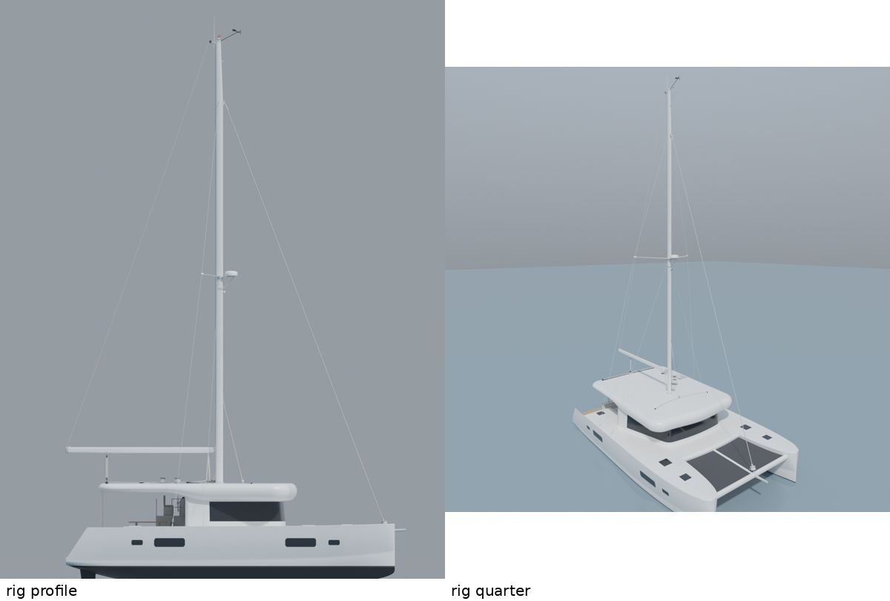
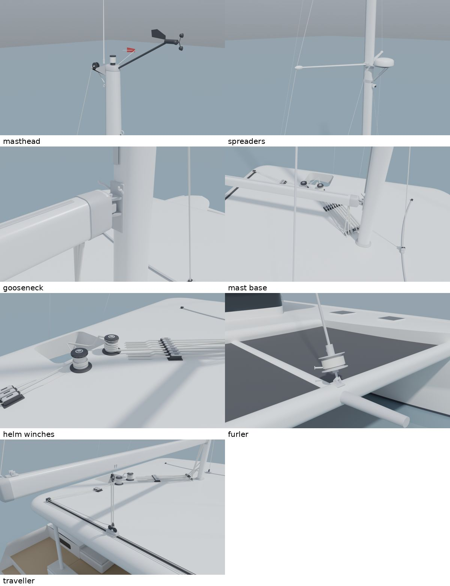
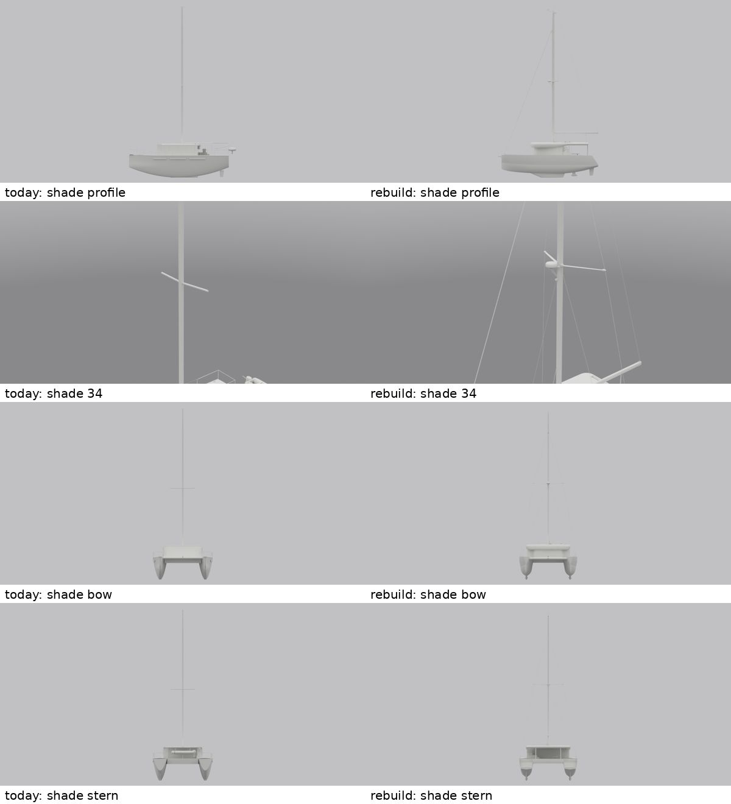

# Lagoon 42 rebuild, slice 6: the mast and rigging

Slice 6 stands the rig on the roof. That means the mast with its spreaders and masthead, the boom, and the wires that
hold the mast up. It also adds the forestay with its furler and the lines that run from the mast to the helm, with
their blocks, clutches and winches. The rig reaches Lagoon's 20.6 m air draft, and the small fittings are modelled
the way Bean asked on Nov 25.

Nothing is imported into Unreal and nothing in the game changes. The new files are under `Tools/`, so the pull request
needs Bean's `bean-approved` label. It stays a draft until after the Dec 11 release.







## Words used here

Slices 0 to 5 explain the boat words used before. These are the new ones:

- **Air draft:** how high the boat reaches above the water, here to the top of the mast.
- **Step:** the fitting the mast's foot stands on. **Heel:** the mast's foot. **Truck:** the mast's very top.
- **Hounds:** the place high on the mast where the forestay and the top shrouds are fixed. On this boat it is below
  the top, so the rig is called **fractional**.
- **Shrouds:** the wires that hold the mast up from the sides. The **caps** go to the hounds over the spreaders' tips;
  the **lowers** go to the mast just under the spreaders.
- **Spreaders:** the struts out from the mast's sides that push the caps out, so they hold the mast at a better angle.
  **Swept** spreaders angle aft, so the caps also hold the mast forward and the boat needs no backstay.
- **Chainplate:** the strap on the hull a shroud is fixed to. **Turnbuckle:** the threaded fitting between the wire and
  the chainplate that tightens it. **Tang:** a fitting on the mast a wire hangs from. **T-ball:** a wire end shaped
  like a T that hooks into a slot in the mast.
- **Forestay:** the wire from the bow to the hounds. The jib is set on it.
- **Furler:** the gear that rolls the jib up round the forestay: a **drum** at the foot that a line turns, a **foil**
  (a grooved tube round the wire the sail slides into) and a **swivel** at the top that the halyard pulls on.
- **Halyard:** a line that pulls a sail up. **Topping lift:** a line from the masthead that holds the boom's end up.
- **Masthead crane:** an arm out the back of the masthead that holds the main halyard's pulleys clear of the mast.
- **Sheave:** the wheel inside a block or a mast that a line runs over. **Block:** a pulley.
- **Boom:** the spar along the foot of the mainsail. **Gooseneck:** its hinge on the mast.
- **Reefing:** making the mainsail smaller in strong wind. **Reef lines** pull the sail down to the boom, and a
  **reef horn** at the gooseneck holds the sail's front corner.
- **Outhaul:** the line that pulls the mainsail's back corner (the **clew**) along the boom.
- **Mainsheet:** the line that sets the main's angle, through blocks between the boom and the boat.
- **Traveller:** a track across the boat that the mainsheet's lower block slides along, so its angle can be set too.
- **Self-tacking jib:** a jib whose sheet runs to a car on a curved track in front of the mast, so it goes about on its
  own when the boat tacks. **Car:** the slider on a track.
- **Clutch:** a lever that grips a line so it can be taken off the winch. **Winch:** the drum a line is wound round to
  pull it in. **Self-tailer:** the jaws on top of the winch that hold the line's tail, so one person can wind.
- **Code 0:** a big light-air sail set from the bowsprit.
- **Radar dome:** the radar's antenna in a round housing. **VHF whip:** the radio's thin aerial.

## How it's drawn

`Tools/shipkit/lagoon42/rig_lagoon42.json` holds the numbers, and `rig_lagoon42.py` turns them into parts. That
script is pure geometry and needs no Blender. `build_lagoon42.py` meshes the parts as five objects:

- `L42_Mast`: the mast and everything fixed to it. Its origin is the mast step's top, the game's `MastStep` socket.
- `L42_Boom`: the boom and its fittings. Its origin is the gooseneck's pin, so the game can swing it.
- `L42_Wires`: the forestay, caps and lowers.
- `L42_RigFittings`: the fittings on the boat: chainplates, turnbuckles, the furler, the jib's track, the turning
  blocks, the clutches, the winches and the traveller.
- `L42_Running`: the lines.

The blocks, winches, clutches, traveller, chainplates and turnbuckles are the boat kit's own parts
(`Tools/boatkit/bk_parts.py`), the same ones the J/22 and the Catalina 22 wear, at the sizes a 42-footer needs. The
build checks every kit part's fittings land where `rig_lagoon42.py` expects them: they all do, to the millimetre.

Lagoon publishes only the air draft. The rest comes from the CC BY drone photo (below), from the game's physics
(`Fleet.cpp`) and from Lagoon's photos, looked at by eye only (Bean, Nov 25: "look, never copy").

- **The mast.**
  - It stands on the roof's centreline at x -0.42, on a cast step 3.5 cm high. The physics has it at x -0.40.
  - It is 17.19 m long, from its heel at 3.30 m to its truck at 20.48 m over the game's waterline. That is 20.6 m over
    the light boat's.
  - Its section is 28 by 16 cm, a rounded box. Above the hounds it tapers to 19 by 13 cm at the top, keeping its back
    face straight for the mainsail's track.
  - It is painted white, as in the drone photo. A T-shaped track for the main's slides runs up its back face.
- **The spreaders.**
  - One pair, at 11.3 m on the mast. Their tips are 1.94 m out and 0.69 m aft of the mast, so they are swept 19.6°.
  - Each is an aerofoil, 13 cm wide at the root and 8.5 cm at the tip, in a cast socket on the mast. It has a clamp
    on the cap at its tip and a white boot over the clamp.
- **The shrouds.**
  - The caps run from the hounds at 18.1 m over the spreaders' tips to chainplates on each hull's outer deck at x
    -2.25. The lowers run from under the spreaders to chainplates at x -1.05.
  - Wire is 10 mm for the caps and forestay and 8 mm for the lowers. Each wire has a T-ball at the mast and a
    turnbuckle on a stainless chainplate at the deck.
- **The forestay.**
  - It runs from a tang on the crossbeam's middle (x 6.05) to the hounds: 17.7 m long, at 69° to the water.
  - At its foot are a toggle, the furler's drum with its line guide, and the tack swivel the jib's corner hooks to.
  - Above them the foil runs up to 17.98 m, under the top swivel, which holds the jib's head at the physics' 17.8 m.
- **The masthead.**
  - A cast cap sits on the truck, with a crane aft carrying the main halyard's and topping lift's sheaves.
  - On the cap are the all-round white light, a VHF whip, the wind instrument on a pole raked forward (vane and cups)
    and a wind indicator.
- **On the mast's front.**
  - Under the masthead, the Code 0's halyard comes out of a sheave box with a small crane at 19.6 m. The jib's halyard
    comes out of a box under the forestay's tang.
  - At the spreaders, the radar dome sits on a platform with a strut under it, as the drone photo shows. Under it is
    the deck light.
  - At 6.5 m is the box the self-tacking jib's sheet goes into.
- **The gooseneck.**
  - A bracket on the mast's back face, with cheeks and an upright pin. The boom's forward casting forks round it.
  - A reef horn each side, and the exits where the two reef lines and the outhaul leave the boom for the deck.
- **The boom.**
  - It is 5.79 m long, a rounded box 22 by 13 cm, 1.29 m over the roof. That height is where the drone photo's
    sail bag sits on it.
  - At its end are the topping lift's eye and the outhaul's car on a short track. The clew's socket is at the
    physics' x -6.25.
  - The mainsheet's upper block hangs from a bail at x -4.8.
- **The traveller and the mainsheet.**
  - A 4.4 m traveller track runs across the roof's aft end, with a ball-bearing car and end controls.
  - The mainsheet runs between the car's lower block and the boom's upper block in four parts.
  - Its tail, and the car's two control lines, turn forward out of the port end, to a bank of three clutches and the
    aft winch at the helm.
- **The self-tacking jib's track.**
  - A curved T-track on the roof in front of the mast. It is an arc about the forestay's foot, 3.8 m from end to end,
    so its ends curve forward, as the drone photo shows.
  - Its car carries a sheave. The sheet goes from the car up to the box on the mast at 6.5 m, inside the mast, and
    down to the mast's base.
- **The lines to the helm.**
  - All the lines lead to the raised helm to port. The halyards (main, jib, Code 0), the topping lift and the jib
    sheet come down the mast. The two reef lines and the outhaul come down from the boom's front end.
  - All eight turn on a row of blocks behind the mast and run straight across the roof. They go through a bank of
    eight clutches to the forward winch, just inboard of the helm's opening, at the helmsman's right hand.
  - The jib sheet is shown on the forward winch and the mainsheet on the aft one, three turns each and off the
    self-tailers. The other lines stop in their clutches.
  - The winches are the kit's 50-size self-tailers.

## Read from the drone photo

`rig_photo_lagoon42.py` reads the rig from the CC BY drone photo. Only the picked pixel numbers are in the repo,
never the photo (`match_two_canoes.json` says which photo it is).

Slice 3's camera was solved from the hull alone. Those points lie close to one plane, so the camera's roll was loosely
held. The script solves the camera again with the sea's horizon too, since the horizon must be level. Then it reads
heights where each pick's sight line passes the mast's axis or the centreline.

| Part | From the photo | In the rebuild |
| --- | --- | --- |
| Hounds | 18.03 m (18.18 if the mast rakes 1.8° aft) | 18.1 m |
| Spreaders at the mast | 11.28 and 11.34 m | 11.3 m |
| Spreader tips, as a pair | 0.69 m aft, 1.94 m out, 11.38 m up | the same, 11.4 m up |
| Each tip alone | 11.19 and 11.63 m | 11.4 m |
| Sail bag's bottom and top at the mast | 4.65 and 5.43 m | the boom's pin at 4.55 m, under the bag |

Some of the photo's readings are less sure than others:

- **The mast's lean.** The picks up the mast stray from an upright line by up to 0.45 m at the top. Either the mast
  rakes aft about 1.8°, or the camera's roll is still slightly off. Lagoon doesn't say. Either way the heights above
  change by 0.15 m at most (the hounds) and by 0.02 m elsewhere, so the mast is drawn upright.
- **The spreaders' tilt.** The spreaders rise 2.9° from root to tip. A spreader whose tip bisected the angle the cap
  makes over it would rise 11.6°, which is the usual way to fit them, with no load sliding along the tip. The photo's
  two tips disagree by 0.44 m, but neither is that high, so the rebuild takes the photo's pair. The tip's clamp holds
  the difference, as on many rigs. `spreader.tip_z` is the one number to change.
- **The chainplates and the jib's track** were placed by eye on the photo, to within about 0.3 m. The script prints
  where they land in it.
- **The roof at the mast's foot** reads 3.07 m, where the roof is 3.26. So heights read near the roof may be about
  0.2 m low. The boom's 1.29 m over the roof also agrees with a broadside photo looked at by eye (1.2 to 1.3 m).

## The air draft

Lagoon gives 20.6 m and doesn't say what it includes. The rebuild puts the truck, the top of the masthead's cap, at
20.6 m over the light boat's waterline. The light, whip and wind instrument stand above it. If Lagoon's figure
includes them, the mast is about 0.9 m too tall, and the fix is one number (`mast.air_draft`).

## Against the size card

The check passes:

- Length 12.790, overall 13.220, waterline 12.520, beam 7.680.
- Light weight 12,094 kg and draft 1.258.
- Now the air draft: 20.601 against 20.6 (+0.0%).

The rig is 116,268 triangles against its budget of 150,000. The kit's parts, at their light copies where they are
small, are most of it. The whole boat so far is 320,593.

The build writes `Lagoon42_sockets.json` with the rig's sockets in the game's names, for the size check and for
slice 13. The build report carries the rig's main numbers under `rig`.

## For later slices

- **Slice 7** sets the sails on this rig: the main on the track with its lazy bag and lazy jacks, the jib on the foil
  and its sheet from the clew down to the car, and the reef lines up the leech.
- **Slice 8** adds the rest of the deck hardware, the furling line's path aft and the rope bags at the helm.
- **Slice 10** gives the paint, the wire and the ropes their colours and textures. The ropes are one plain colour
  here.
- **Slice 12** checks the physics against this rig:
  - The physics' main foot is at 3.2 m, but the boom is at 4.55 m.
  - The jib's foot is at 3.15 m, below the roof's edge, and its tack is at x 4.65, where the forestay is at x 5.45 at
    that height.
  - The mast is at x -0.40 in the physics and -0.42 here.
  - The physics' comment says the lowers stop the boom at about 81°. Here the caps stop it first, at 67°. That is still
    past the 65° the mainsheet allows.
- **Slice 13** imports her. The rebuild's sockets include `JibSheetMast` (the box at 6.5 m) and `Gooseneck`. The game
  draws the jib sheet straight from the car to the winch today. It should route the sheet through `JibSheetMast`.
  There is no `Boom_Vang` socket, since a cat's boom has no vang, and the game skips the vang when the socket is
  missing. `JibWinch_S` and `JibWinch_P` are both the forward winch at the helm.

## Reproduce

```
blender -b --factory-startup -P Tools/shipkit/lagoon42/build_lagoon42.py -- <work>/s6
blender -b -P Tools/shapeloop/measure.py -- <work>/s6/lagoon42.blend Tools/shapeloop/sections_lagoon42_rebuild.json <work>/s6/m
python3 -I Tools/shipkit/lagoon42/lagoon42_check.py <work>/s6/m/stats.json <work>/s6/Lagoon42_sockets.json --slice 6
blender -b -P Tools/shapeloop/render_set.py -- <work>/s6/lagoon42.blend Tools/shapeloop/sections_lagoon42_rebuild.json <work>/s6/r --res 1200
blender -b -P Tools/shipkit/lagoon42/render_lagoon42.py -- <work>/s6/lagoon42.blend <work>/s6/v --res 1200 --only rig_profile,rig_quarter,masthead,spreaders,gooseneck,mast_base,helm_winches,furler,traveller
python3 -I Tools/shipkit/lagoon42/docs_lagoon42.py --slice <work>/rig <work>/s6/r <work>/s6/v docs/lagoon42-7
```

`python3 -I Tools/shipkit/lagoon42/rig_lagoon42.py` prints the rig's main numbers and its sockets without Blender.
`python3 -I Tools/shipkit/lagoon42/rig_photo_lagoon42.py` prints the photo's readings. `<work>/rig` is today's boat
rendered by `render_set.py` with `--with-other`, so her rig shows.

## Next: slice 7, the sails

The mainsail on its track with full battens, its lazy bag and lazy jacks; the self-tacking jib on the furler; the
Code 0 on the bowsprit. Their areas go to the size card: 59 m² for the main and 35 m² for the jib.
