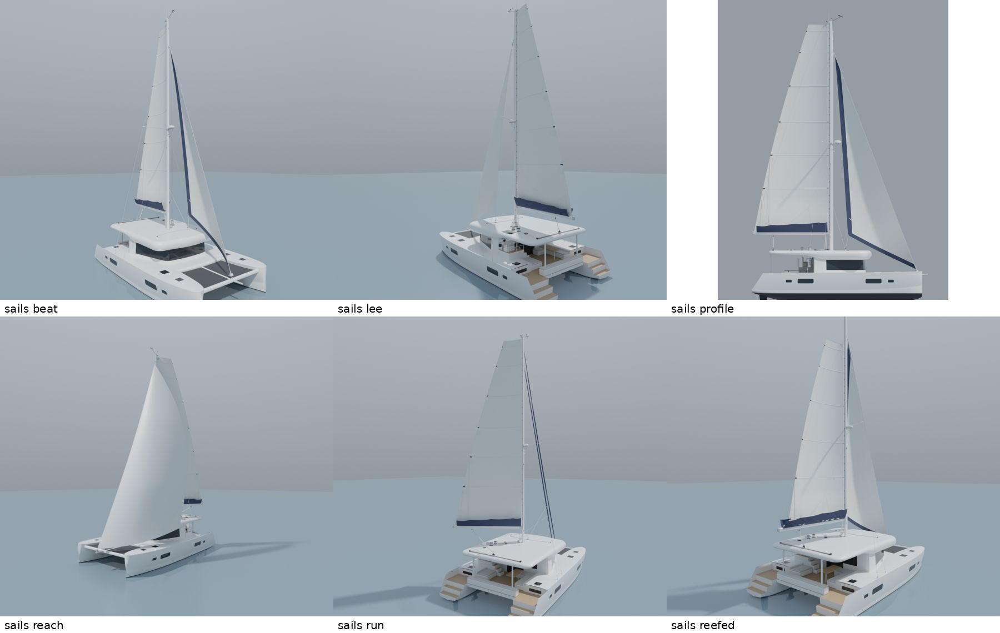
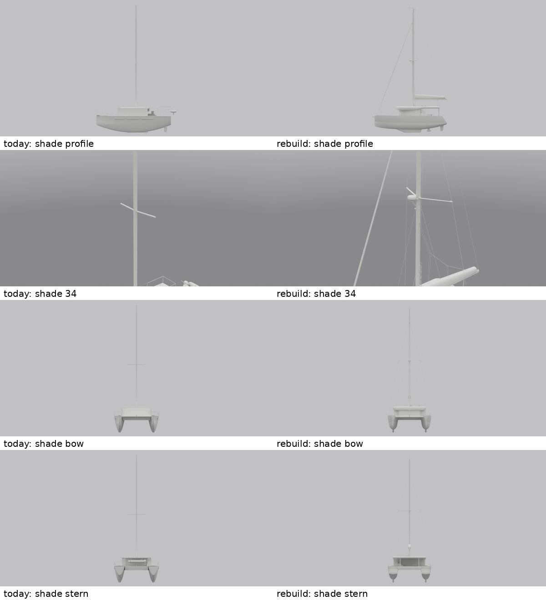

# Lagoon 42 rebuild, slice 7: the sails

Slice 7 bends the sails on to slice 6's rig. That means the square-top mainsail on the mast's track with its full
battens, the lazy bag on the boom that it drops into, and the lazy jacks that hold the bag up. It also adds the
self-tacking jib on the forestay's furler and the Code 0 on the bowsprit. Each sail is built in the states the boat
shows it in: hoisted, reefed, furled or packed away. The areas are Lagoon's: 59 m² for the main, 35 m² for the jib and
78 m² for the Code 0, the same numbers the physics sails with.

Nothing is imported into Unreal and nothing in the game changes. The new files are under `Tools/`, so the pull request
needs Bean's `bean-approved` label. It stays a draft until after the Dec 11 release.






## Words used here

Slices 0 to 6 explain the boat words used before. These are the new ones:

- **Luff, leech, foot:** a sail's front edge, back edge and bottom edge. **Tack, clew, head:** its front bottom corner,
  back bottom corner and top.
- **Square-top main:** a mainsail whose top is cut wide, like a short gaff, instead of coming to a point. It carries
  more sail up high. Lagoon sells it as an option, and it is the one the game's physics sails.
- **Roach:** the curve of the leech out past a straight line from the clew to the head.
- **Battens:** stiff strips in pockets across the sail that hold the roach out. **Full battens** run all the way from
  the luff to the leech.
- **Slides and batten cars:** the plastic slides on the luff run up the mast's track. Where a batten meets the luff,
  a **car** with rollers takes its push instead. The **headboard** is the stiff plate at the head, on its own long car.
- **Lazy bag:** a canvas trough along the boom that the main drops into when it is lowered, then zips shut over it.
  **Lazy jacks:** the lines from the mast down to the bag's sides that hold it up and guide the sail in.
- **Reef:** a band of the sail that is folded down to make it smaller. The **cringles** are the reinforced rings at
  each end of a reef line on the luff and the leech. The folded part is the **bunt**.
- **Camber or depth:** how curved a sail is from luff to leech, as a share of its width. **Draft position:** where
  along the width the deepest point is. **Twist:** how much more the top of a sail opens out than the bottom.
- **Furled:** rolled up round its stay. A **UV strip** is a cover sewn along the leech and foot of a roller-furling
  sail, so that when it is rolled up only the strip faces the sun.
- **Dacron:** the woven polyester most cruising sails are made of. **Laminate:** sailcloth made of layers of film and
  fibres glued together: lighter and stiffer, used for the Code 0.
- **Anti-torsion cable:** a stiff cable in a Code 0's luff that carries the furler's twist from the drum to the head,
  so the sail rolls up along its whole length. A **continuous-line furler** turns its drum with an endless loop of line.
- **Top swivel:** the fitting at the head of a furling sail that lets it turn while the halyard holds it up.
- **Self-tacking jib:** slice 6 explains it. Its **car** is the slider on the curved track; the sheet runs from the clew
  down to a block on the car and back up into the mast.

## How it's drawn

`Tools/shipkit/lagoon42/sails_lagoon42.json` holds the numbers, and `sails_lagoon42.py` turns them into cloth grids,
trims and fittings. Like the rig's script, it is pure geometry and needs no Blender, and running it prints the checks.
`build_lagoon42.py` meshes them as eleven objects:

| Object | What it is | Shown when |
| --- | --- | --- |
| `L42_Sail_Main_Set` | the main hoisted close-hauled, the boom 5° to port | beating |
| `L42_Sail_Main_Reach` | eased, the boom at 25° | reaching |
| `L42_Sail_Main_Run` | squared off, the boom at 60°, lying on the lee shrouds | running |
| `L42_Sail_Main_Reefed` | the first reef tied in, its bunt in the bag, the boom at 6° | reefed |
| `L42_Sail_Main_Luff` | the slides, batten cars, headboard car and halyard the three full states share | with any of the three |
| `L42_LazyBag_Zipped` | the bag zipped over the flaked main, the lazy jacks to its top | at her mooring |
| `L42_LazyBag_Open` | the bag open, its sides up on the jacks | with any hoisted main |
| `L42_Sail_Jib_Set` | the self-tacking jib set, its car at the port end of the track | sailing with the jib |
| `L42_Sail_Jib_Furled` | the jib rolled round the foil, the car in the track's middle | at her mooring, or under the Code 0 |
| `L42_Sail_Code0_Set` | the Code 0 on a reach, its sheet to a block on the port quarter | reaching |
| `L42_Sail_Code0_Furled` | the Code 0 rolled round its cable, still hoisted | when it is up but not in use |

Every set sail is drawn on starboard tack, with the wind from starboard and the boom and sails to port. Port tack is
the mirror image. Each main state's object records its boom's angle (`boom_deg`). The two bags have their origin at
the gooseneck's pin and are built with the boom amidships, so they swing with the boom. The boat at her mooring shows
the zipped bag and the furled jib, and the build hides the rest.

The mainsheet's four parts between its blocks are now their own object, `L42_Mainsheet`, drawn with the boom
amidships. Each hoisted main draws its own mainsheet out to its boom's angle, with the traveller's car left in the
middle and the sheet eased, so `L42_Mainsheet` is hidden when a main is up.

The sails' cloth carries the same three sets of texture coordinates the game's sail cloth reads (`SailCloth.h`):
metres across and up the flat sail, the same as shares of the foot and luff, and the distance from the leech. So the
game's sail material can draw its seams, numbers and wear on these meshes as it does on the J/22's.

The rest comes from the physics (`Fleet.cpp`), from slice 6's rig and from Lagoon's own photos, looked at by eye only
(Bean, Nov 25: "look, never copy"). Where the photos don't settle a shape, the rebuild uses a cruising cat's usual
one; the list of guesses is below.

- **The mainsail.**
  - Its luff runs up the mast's track from the tack, 4 cm over the boom, to the head at the physics' 20.2 m: 15.5 m
    long. Its foot is 5.63 m, from the gooseneck to the outhaul's car at the boom's end.
  - The head is 1.59 m wide. That width is solved so the sail's area comes to 59 m² with a 0.3 m roach. The physics
    has 1.8 m.
  - Six full battens, at 7.9, 10.4, 12.9, 15.6, 18.1 and 19.7 m. The top one sits just under the head. Each pocket is
    6 cm wide, on both faces, with a receptacle at the luff and a tensioner's cover at the leech.
  - 22 slides and 6 batten cars run up the track, with the headboard on a long car at the top. Each slide is tied to
    the luff with a short webbing strap.
  - The luff and leech have tapes, and the head, tack and clew have reinforcing patches on both faces. The headboard
    is two riveted aluminium plates.
  - Three reefs, at the physics' shares of the luff (82%, 66% and 50% left), so 2.79, 5.27 and 7.75 m up the luff.
    Each has a cringle on the luff and on the leech, with patches. The first two reef lines run from the boom's top,
    up through the leech's cringle and back down. Slice 6 led those two to the helm. The third reef is rigged when it
    is needed.
  - The foot is loose: only the tack and the clew hold it, so it lies in the bag. When the sail is hoisted its foot
    stays inside the open bag in every state (the check below).
  - The halyard runs from the masthead's crane to a shackle on the headboard.
- **The lazy bag.**
  - It is laced along the boom's sides from just aft of the gooseneck (x -0.70) to short of the clew (x -6.05), so the
    clew and outhaul stay outside it.
  - Zipped, it is the drone photo's size at the mast: its top at 5.42 m, 0.76 m over the boom, 0.6 m wide. It tapers
    to 0.38 m high aft. The zip runs along its top, with its pull at the forward end.
  - Inside it, the lowered main's slides and cars stack up at the foot of the track, with the headboard on top and
    the halyard shackled to it. The clew and a fold of sail show at the aft end.
  - Open, its sides stand up on the lazy jacks, flared to 0.8 m across at the mast. Their top edges sag between the
    jacks' points, with the zip's two halves along them.
- **The lazy jacks.**
  - Each side has one line from a block on the mast's side at 9.8 m. It splits at a ring into a leg to the bag's front
    point and a second line, which splits again to the middle and aft points: three points a side.
  - The line's tail runs down the mast's side to a horn cleat at 4.25 m, made fast with a hanging tail.
  - With the main up, the lee jacks bow round the sail and lie on it, as real ones do.
- **The self-tacking jib.**
  - Its luff tape runs in the foil's groove. The tack is strapped to the furler's tack swivel and the head to the top
    swivel, at 17.75 m.
  - Its clew is 4.4 m up, over the car's position at the port end of the track and well above the roof's front edge.
    The luff is 17.0 m, the foot 5.8 m and the leech 13.4 m. No battens: it rolls round the foil, so its leech is
    straight.
  - The sheet runs from the clew down to a swivel block on the car, then up and aft into the mast's box at 6.5 m.
  - The UV strip is sewn on the leech and the foot, 0.32 and 0.28 m wide.
  - Furled, the jib rolls to 5.5 cm at its fattest, about 17 turns round the foil. The UV strip is outermost, its edge
    winding round the roll. The clew's ring sits on the outside, with the sheet down to the car in the middle of the
    track.
- **The Code 0.**
  - Its tack is on a continuous-line furler's drum, 17 cm across, on the bowsprit's end fitting. The drum stands 10 cm
    in from the spar's end, so nothing reaches past the boat's 13.22 m overall. The furling line's two parts run aft
    along the bowsprit.
  - Its head is on a top swivel under the Code 0 halyard's box at 19.6 m, 11 cm forward of the mast.
  - Its luff carries the anti-torsion cable and sags to leeward and aft under load, as a Code 0's does.
  - Its clew is out past the port hull's edge, 2.95 m up. The leech has a big roach, as a Code 0's is cut, so its middle
    width is 71% of its 7.15 m foot.
  - The sheet runs aft to a block on the port quarter. Slice 8 leads it on to a winch.
  - Furled, it rolls round its cable to 5.2 cm, still hoisted, with its own UV strip outermost.

## The guesses

These shapes are not settled by Lagoon's numbers or the drone photo. They are a cruising cat's usual ones, and each
is one number or table in `sails_lagoon42.json`:

- **The sails' depth, draft position and twist** in each state. The main is about 10% deep close-hauled and 12.5%
  running, with its deepest point a little forward of the middle. Its top twists 11° to 15° more than its foot.
- **The batten heights and the head's width.** The battens are spaced the way square-top mains usually are. The head's
  width follows from the area and the roach.
- **The jib's clew height and the Code 0's clew.** They are placed where the car, the deck and the sheet's lead put
  them, then the sail's length along the foot is solved for the area.
- **Three points a side for the lazy jacks**, as most cruising cats rig them. Bean's photos can change this.
- **The colours.** The bag and the UV strips are drawn navy here, a common choice. Their real colours wait for slice
  10's textures.

## The checks

`python3 -I Tools/shipkit/lagoon42/sails_lagoon42.py` checks every set sail and passes:

- **Areas:** main 59.00, jib 35.00 and Code 0 78.00 m², each within 3% of Lagoon's (they come out exact).
- **Clearance:** no sail comes within 1 cm of a wire, spreader, the mast or what is under it.
  - The main clears the spreaders' roots by 11.9 cm close-hauled, reaching and reefed. Running, it lies 3.5 cm off the
    lee cap shroud, which is what a squared-off main does.
  - The jib clears the mast by 13.4 cm and the roof under it by 27.6 cm. Its luff is in the foil's groove by design.
  - The Code 0 clears the mast by 3.5 cm, the forestay by 40.7 cm and the deck and nets under it by 32.5 cm.
- **Creases:** no pressed sail bends sharper than 4.4 cm.
- **The main's foot in the bag:** 6.1 cm inside the open bag's sides running, and 11 to 14 cm in the other states.

## Against the size card

The size check passes. Two of its measures are new:

- The main's area, 59.000 against 59 (+0.0%), and the jib's, 35.000 against 35 (+0.0%), both from the build's report.
- The rest is as before: length 12.790, overall 13.245, waterline 12.520, beam 7.680, light weight 12,094 kg, draft
  1.258 and air draft 20.601.

The sails are 149,624 triangles against their budget of 150,000. Every state is counted, since every one is built,
though the boat shows only three to five at a time: 23,608 triangles at her mooring and 41,240 to 52,660 under sail. To fit, the three full main
states share their luff's hardware, and the furled rolls are drawn with eight points a turn. The rig grew to 126,908
of its 150,000 with the lazy jacks' blocks and cleats and the reef lines' exits. The whole boat so far is 480,857.

## Changes to slice 6's rig

- The lazy jacks' blocks on the mast's sides at 9.8 m and their horn cleats at 4.25 m (`rig_lagoon42.json`
  `fittings_on_mast`).
- The reef lines' exits on the boom's top at x -5.85 and -5.10, inside the bag (`boom.reef_exits_x`).
- The main halyard, the jib's car and the jib sheet's run now change with the sails, so the sails draw them. The rig
  keeps the sheet's box on the mast.
- The mainsheet's four parts are their own object, `L42_Mainsheet` (above).
- `render_set.py`, the shape loop's fixed views, now leaves hidden an object the build marks as not shown, so its
  sheets show the boat at her mooring instead of every sail state at once.

## For later slices

- **Slice 8** adds the rest of the deck hardware: the jib's and the Code 0's furling lines led aft to the helm, the
  Code 0's sheet from its quarter block to a winch, and rope bags for the tails.
- **Slice 10** gives the sails their cloth textures and the bag and UV strips their colours.
- **Slice 12** checks the physics against these sails:
  - The physics' main has its foot at 3.2 m and a 1.8 m head. Here the tack is at 4.70 m, on the boom, and the head is
    1.59 m wide. The luff is on the track at x -0.61, where the physics has -0.45.
  - The physics' jib has its foot level at 3.15 m with a 4.2 m chord and its tack at x 4.65. Here the jib is tacked to
    the furler at x 5.92, 1.85 m up, and its foot rises to the clew at 4.4 m.
  - The physics' Code 0 has its foot at 2.4 m and its tack at x 6.4. Here the tack is at x 6.73, 1.71 m up, and the
    clew is at 2.95 m.
  - The physics has three reefs; two reef lines are rigged here (the usual for a cruising cat).
- **Slice 13** imports her. The game draws set sails itself from the physics (`FSailCloth`). These meshes give it the
  furled and stowed sails, the lazy bag and jacks, the trims, and a reference for the set shapes. The game must hide
  `L42_Mainsheet` when it shows a hoisted main and swing the bags with the boom.

## Reproduce

```
blender -b --factory-startup -P Tools/shipkit/lagoon42/build_lagoon42.py -- <work>/s7
blender -b -P Tools/shapeloop/measure.py -- <work>/s7/lagoon42.blend Tools/shapeloop/sections_lagoon42_rebuild.json <work>/s7/m
python3 -I Tools/shipkit/lagoon42/lagoon42_check.py <work>/s7/m/stats.json <work>/s7/Lagoon42_sockets.json --slice 7
blender -b -P Tools/shapeloop/render_set.py -- <work>/s7/lagoon42.blend Tools/shapeloop/sections_lagoon42_rebuild.json <work>/s7/r --res 1200
blender -b -P Tools/shipkit/lagoon42/render_lagoon42.py -- <work>/s7/lagoon42.blend <work>/s7/v --res 1200 --only sails_beat,sails_lee,sails_profile,sails_reach,sails_run,sails_reefed,main_head,main_luff,main_tack,jib_clew,jib_furled,lazy_bag,bag_open,code0_tack,drone,bow_quarter,gooseneck,traveller
python3 -I Tools/shipkit/lagoon42/docs_lagoon42.py --slice <work>/rig <work>/s7/r <work>/s7/v docs/lagoon42-8
```

`python3 -I Tools/shipkit/lagoon42/sails_lagoon42.py` prints the sails' sizes, areas and checks without Blender.
`<work>/rig` is today's boat rendered by `render_set.py` with `--with-other`, so her rig and sails show.

## Next: slice 8, the hardware

The deck hardware a Lagoon 42 carries: the furling lines aft, the Code 0's sheet to a winch, cleats, fairleads,
rope bags, the davits and the swim ladder.
